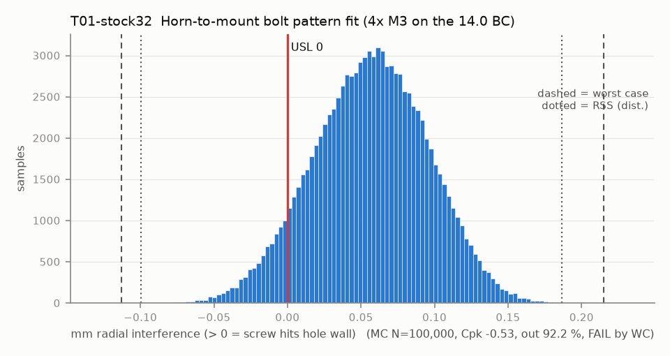

# T01-stock32 — Horn-to-mount bolt pattern fit (4x M3 on the 14.0 BC)

Variant of `T01` (rejected): stock CAD hole 3.2 (SO-101 gripper)

- Requirement: All 4 M3 screws pass the printed clearance holes and thread into the horn with no hole-wall contact, crediting no pilot float. Fixed-fastener case (screw threads into the horn): H = F + T1 + T2.
- Spec: USL 0.000 mm radial interference (> 0 = screw hits hole wall)
- Acceptance: WC
- Model: radial; source file `T01_bolt_pattern_fit.yaml`; seed 20260922

y = |e_hole + e_thread| + F/2 - H/2. Rev A prints the holes at CAD 3.6 (fix 1), which come out about 3.35. With the MMC hole H = 3.20 (3.6 - 0.25 - 0.15) and F = 2.98, the fixed-fastener formula leaves T1 = 0.17 for the printed hole position after T2 = 0.05 for the horn.

| Contributor | Kind | Nominal | Bias | Tol (−/+) | Sens. | Dist | σ | Var % | Tag | Source |
|---|---|---:|---:|---|---:|---|---:|---:|---|---|
| hole_d_printed | linear | 3.200 | -0.250 | -0.150 / +0.150 | -0.5000 | normal | 0.0500 | 10.1 | S | CAD 3.6 (params.json wrist_mount) + small-hole bias -0.25 [S] + scatter 0.15 [A] (basis.yaml) |
| screw_major_d | linear | 2.927 | 0.000 | -0.053 / +0.053 | 0.5000 | uniform | 0.0306 | 3.8 | S | ISO 965 6g (Brighton-Best) |
| hole_position | radial | 0.000 | 0.000 | R 0.100 | 1.0000 | disk | 0.0500 | 81.0 | A | position dia 0.2 to A|B|C, printed (basis fdm_pos_dia) |
| horn_thread_position | radial | 0.000 | 0.000 | R 0.025 | 1.0000 | disk | 0.0125 | 5.1 | A | molded horn pattern |

| Result | Value |
|---|---|
| Nominal | -0.137 |
| Mean-shifted centre | -0.012 |
| Worst case | -0.113 … 0.215 (fail) |
| RSS classic (t = 3σ) | -0.091 … 0.119 |
| RSS distribution-adjusted | -0.099 … 0.186 (fail) |
| MC mean / σ | 0.057 / 0.0390 |
| MC 0.135 % … 99.865 % | -0.059 … 0.166 |
| MC min … max | -0.097 … 0.211 |
| MC out of spec | 92.2 % |
| Cpk percentile / normal | -0.53 ± 0.01 / -0.48 ± 0.00 |
| Yield (MC) | 7.81 % |
| Dominant contributor | hole_position (81 %) |
| Pass/fail by the declared method (WC) | FAIL |
| **Verdict (pass / marginal / fail)** | **FAIL** |

