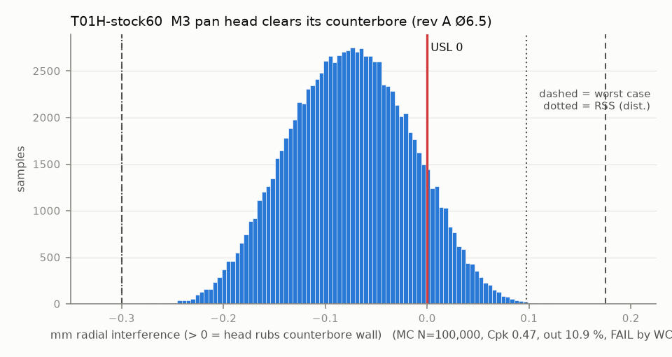

# T01H-stock60 — M3 pan head clears its counterbore (rev A Ø6.5)

Variant of `T01H` (rejected): stock counterbore 6.0

- Requirement: Screw head (located by the horn thread) seats without touching the counterbore wall.
- Spec: USL 0.000 mm radial interference (> 0 = head rubs counterbore wall)
- Acceptance: WC
- Model: radial; source file `T01H_screw_head_counterbore.yaml`; seed 20260922

| Contributor | Kind | Nominal | Bias | Tol (−/+) | Sens. | Dist | σ | Var % | Tag | Source |
|---|---|---:|---:|---|---:|---|---:|---:|---|---|
| cbore_d_printed | linear | 6.000 | -0.250 | -0.150 / +0.150 | -0.5000 | normal | 0.0500 | 6.9 | S | CAD 6.5 (params.json wrist_mount.counterbore_d) + small-hole bias [S] + scatter [A] |
| head_dk | linear | 5.450 | 0.000 | -0.150 / +0.150 | 0.5000 | uniform | 0.0866 | 20.7 | S | ISO 7045 M3 dk max 5.6 [S]; min 5.3 [A] (dk min not found) |
| cbore_position | radial | 0.000 | 0.000 | R 0.100 | 1.0000 | disk | 0.0500 | 55.2 | A | counterbore to A|B|C, printed |
| horn_thread_position | radial | 0.000 | 0.000 | R 0.025 | 1.0000 | disk | 0.0125 | 3.4 | A | molded horn pattern |
| head_on_shank | radial | 0.000 | 0.000 | R 0.050 | 1.0000 | disk | 0.0250 | 13.8 | A | head concentric to shank |

| Result | Value |
|---|---|
| Nominal | -0.275 |
| Mean-shifted centre | -0.150 |
| Worst case | -0.300 … 0.175 (fail) |
| RSS classic (t = 3σ) | -0.256 … 0.006 |
| RSS distribution-adjusted | -0.300 … 0.098 (fail) |
| MC mean / σ | -0.076 / 0.0595 |
| MC 0.135 % … 99.865 % | -0.235 … 0.085 |
| MC min … max | -0.282 … 0.134 |
| MC out of spec | 10.9 % |
| Cpk percentile / normal | 0.47 ± 0.00 / 0.42 ± 0.00 |
| Yield (MC) | 89.11 % |
| Dominant contributor | cbore_position (55 %) |
| Pass/fail by the declared method (WC) | FAIL |
| **Verdict (pass / marginal / fail)** | **FAIL** |

