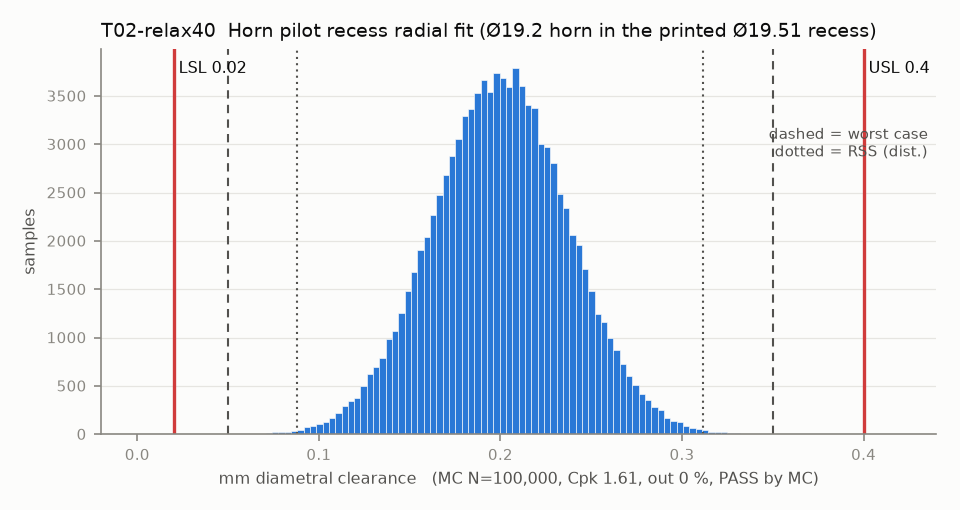

# T02-relax40 — Horn pilot recess radial fit (Ø19.2 horn in the printed Ø19.51 recess)

Variant of `T02` (option): recess CAD 19.56 and accept clearance up to 0.40 (checked by T04-relax40)

- Requirement: Recess slides onto the horn by hand (clearance >= 0.02) and float stays small enough to centre the gripper (<= 0.30).
- Spec: LSL 0.020, USL 0.400 mm diametral clearance
- Acceptance: MC (Cpk ≥ 1.33, percentile method)
- Model: linear; source file `T02_pilot_recess_fit.yaml`; seed 20260922

Rev A recess is CAD 19.51 with a 0.3 x 45 mouth chamfer, so first-layer squish stays in the chamfer. It prints about 19.35 (large-hole bias -0.16), only 0.15 over the horn, so the slide-on limit (0.02) binds first. The scatter of a 20 mm printed hole, not the CAD size, sets the verdict.

| Contributor | Kind | Nominal | Bias | Tol (−/+) | Sens. | Dist | σ | Var % | Tag | Source |
|---|---|---:|---:|---|---:|---|---:|---:|---|---|
| recess_d_printed | linear | 19.560 | -0.160 | -0.100 / +0.100 | 1.0000 | normal | 0.0333 | 80.0 | S | CAD 19.51 (params.json) + large-hole bias -0.16 [S low] + XY band 0.10 [S] |
| horn_od | linear | 19.200 | 0.000 | -0.050 / +0.050 | -1.0000 | normal | 0.0167 | 20.0 | A | so101.md row 2 nominal [D]; tol [A] |

| Result | Value |
|---|---|
| Nominal | 0.360 |
| Mean-shifted centre | 0.200 |
| Worst case | 0.050 … 0.350 (pass) |
| RSS classic (t = 3σ) | 0.088 … 0.312 |
| RSS distribution-adjusted | 0.088 … 0.312 (pass) |
| MC mean / σ | 0.200 / 0.0374 |
| MC 0.135 % … 99.865 % | 0.088 … 0.312 |
| MC min … max | 0.043 … 0.396 |
| MC out of spec | <30 ppm (0 of 100,000 samples; 95% upper bound) |
| Cpk percentile / normal | 1.61 ± 0.02 / 1.60 ± 0.00 |
| Yield (MC) | 100.000 % (<30 ppm (0 of 100,000 samples; 95% upper bound) out) |
| Dominant contributor | recess_d_printed (80 %) |
| Pass/fail by the declared method (MC) | PASS |
| **Verdict (pass / marginal / fail)** | **PASS** |

