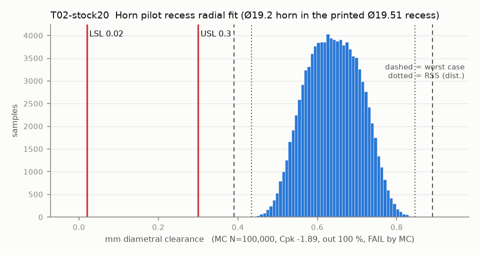

# T02-stock20 — Horn pilot recess radial fit (Ø19.2 horn in the printed Ø19.51 recess)

Variant of `T02` (rejected): stock Ø20.0 recess, no chamfer

- Requirement: Recess slides onto the horn by hand (clearance >= 0.02) and float stays small enough to centre the gripper (<= 0.30).
- Spec: LSL 0.020, USL 0.300 mm diametral clearance
- Acceptance: MC (Cpk ≥ 1.33, percentile method)
- Model: linear; source file `T02_pilot_recess_fit.yaml`; seed 20260922

Rev A recess is CAD 19.51 with a 0.3 x 45 mouth chamfer, so first-layer squish stays in the chamfer. It prints about 19.35 (large-hole bias -0.16), only 0.15 over the horn, so the slide-on limit (0.02) binds first. The scatter of a 20 mm printed hole, not the CAD size, sets the verdict.

| Contributor | Kind | Nominal | Bias | Tol (−/+) | Sens. | Dist | σ | Var % | Tag | Source |
|---|---|---:|---:|---|---:|---|---:|---:|---|---|
| recess_d_printed | linear | 20.000 | -0.160 | -0.100 / +0.100 | 1.0000 | normal | 0.0333 | 23.5 | S | CAD 19.51 (params.json) + large-hole bias -0.16 [S low] + XY band 0.10 [S] |
| horn_od | linear | 19.200 | 0.000 | -0.050 / +0.050 | -1.0000 | normal | 0.0167 | 5.9 | A | so101.md row 2 nominal [D]; tol [A] |
| recess_first_layer_residual | linear | 0.000 | 0.000 | -0.100 / +0.100 | 1.0000 | uniform | 0.0577 | 70.6 | A | no mouth chamfer: first layer flares |

| Result | Value |
|---|---|
| Nominal | 0.800 |
| Mean-shifted centre | 0.640 |
| Worst case | 0.390 … 0.890 (fail) |
| RSS classic (t = 3σ) | 0.490 … 0.790 |
| RSS distribution-adjusted | 0.434 … 0.846 (fail) |
| MC mean / σ | 0.640 / 0.0688 |
| MC 0.135 % … 99.865 % | 0.462 … 0.819 |
| MC min … max | 0.400 … 0.868 |
| MC out of spec | 100 % |
| Cpk percentile / normal | -1.89 ± 0.01 / -1.65 ± 0.00 |
| Yield (MC) | 0.00 % |
| Dominant contributor | recess_first_layer_residual (71 %) |
| Pass/fail by the declared method (MC) | FAIL |
| **Verdict (pass / marginal / fail)** | **FAIL** |

