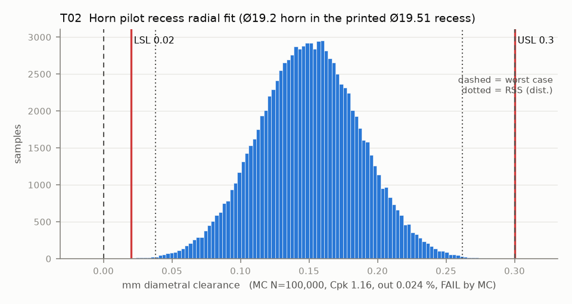

# T02 — Horn pilot recess radial fit (Ø19.2 horn in the printed Ø19.51 recess)

Baseline: CAD rev A as drawn (`cad/gripper/params.json`, `cad/gripper/README.md`).

- Requirement: Recess slides onto the horn by hand (clearance >= 0.02) and float stays small enough to centre the gripper (<= 0.30).
- Spec: LSL 0.020, USL 0.300 mm diametral clearance
- Acceptance: MC (Cpk ≥ 1.33, percentile method)
- Model: linear; source file `T02_pilot_recess_fit.yaml`; seed 20260922

Rev A recess is CAD 19.51 with a 0.3 x 45 mouth chamfer, so first-layer squish stays in the chamfer. It prints about 19.35 (large-hole bias -0.16), only 0.15 over the horn, so the slide-on limit (0.02) binds first. The scatter of a 20 mm printed hole, not the CAD size, sets the verdict.

| Contributor | Kind | Nominal | Bias | Tol (−/+) | Sens. | Dist | σ | Var % | Tag | Source |
|---|---|---:|---:|---|---:|---|---:|---:|---|---|
| recess_d_printed | linear | 19.510 | -0.160 | -0.100 / +0.100 | 1.0000 | normal | 0.0333 | 80.0 | S | CAD 19.51 (params.json) + large-hole bias -0.16 [S low] + XY band 0.10 [S] |
| horn_od | linear | 19.200 | 0.000 | -0.050 / +0.050 | -1.0000 | normal | 0.0167 | 20.0 | A | so101.md row 2 nominal [D]; tol [A] |

| Result | Value |
|---|---|
| Nominal | 0.310 |
| Mean-shifted centre | 0.150 |
| Worst case | 0.000 … 0.300 (fail) |
| RSS classic (t = 3σ) | 0.038 … 0.262 |
| RSS distribution-adjusted | 0.038 … 0.262 (pass) |
| MC mean / σ | 0.150 / 0.0374 |
| MC 0.135 % … 99.865 % | 0.038 … 0.262 |
| MC min … max | -0.007 … 0.346 |
| MC out of spec | 240 ppm |
| Cpk percentile / normal | 1.16 ± 0.02 / 1.16 ± 0.00 |
| Yield (MC) | 99.976 % (240 ppm out) |
| Dominant contributor | recess_d_printed (80 %) |
| Pass/fail by the declared method (MC) | FAIL |
| **Verdict (pass / marginal / fail)** | **MARGINAL** |

Cheapest fix: Open the recess to CAD 19.56 and accept up to 0.40 diametral clearance (T02-relax40). The radial float then stays inside the 0.30 concentricity budget (T04-relax40). Better still, print the coupon and size the recess from the measured hole. (proved by `T02-relax40`)

