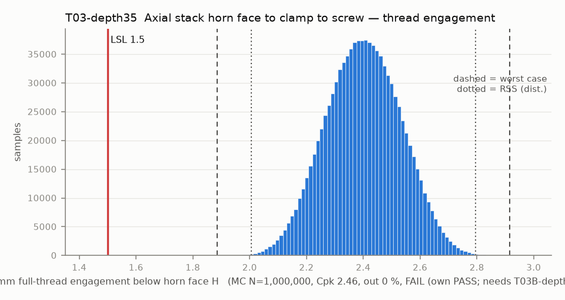

# T03-depth35 — Axial stack horn face to clamp to screw — thread engagement

Variant of `T03` (scenario): horn holes measured 3.5 deep (M15 outcome to confirm)

- Requirement: M3 engages >= 1.5 mm (3 pitches) of full horn thread. The screw reaches min(protrusion below H, hole depth), and its incomplete tip thread is inside the hole either way, so engagement = min(L - t - lift - runout, depth) - tip chamfer. Conditional on T03B: a screw that bottoms does not clamp.
- Spec: LSL 1.500 mm full-thread engagement below horn face H
- Acceptance: WC
- Model: expression; source file `T03_thread_engagement.yaml`; seed 21260925

Var % from Monte Carlo freeze-one (non-linear model); Sens. is a central difference at the mids and does not rank contributors. Worst case is taken over the corners only, so a minimum inside the box (the kink of abs()) can be missed.

| Contributor | Kind | Nominal | Bias | Tol (−/+) | Sens. | Dist | σ | Var % | Tag | Source |
|---|---|---:|---:|---|---:|---|---:|---:|---|---|
| screw_length | linear | 6.000 | 0.000 | -0.240 / +0.240 | 1.0000 | normal | 0.0800 | 36.9 | A | M3x6 [S LeRobot]; tol [A] |
| clamp_thickness | linear | 3.000 | 0.000 | -0.150 / +0.150 | -1.0000 | uniform | 0.0866 | 43.3 | S | 3.0 (params.json) [D]; Z band [S Gebre] |
| datum_A_flatness_lift | linear | 0.000 | 0.000 | 0.000 / +0.200 | -1.0000 | uniform | 0.0577 | 19.4 | A | flatness 0.2 on A: part rests on high points |
| horn_face_runout | linear | 0.000 | 0.000 | -0.025 / +0.025 | -1.0000 | normal | 0.0083 | 0.4 | A | horn face FIM 0.05 |
| horn_hole_depth | linear | 3.500 | 0.000 | -0.100 / +0.100 | 0.0000 | normal | 0.0333 | 0.0 | A | 2.5 CAD (so101.md row 4) [D]; tol [A] |
| screw_tip_chamfer | linear | 0.500 | 0.000 | -0.000 / +0.000 | -1.0000 | normal | 0.0000 | 0.0 | A | incomplete thread at the point |

| Result | Value |
|---|---|
| Nominal | 2.500 |
| Mean-shifted centre | 2.400 |
| Worst case | 1.885 … 2.915 (pass) |
| RSS classic (t = 3σ) | 2.099 … 2.701 |
| RSS distribution-adjusted | 2.005 … 2.795 (pass) |
| MC mean / σ | 2.400 / 0.1315 |
| MC 0.135 % … 99.865 % | 2.034 … 2.768 |
| MC min … max | 1.860 … 2.937 |
| MC out of spec | <3 ppm (0 of 1,000,000 samples; 95% upper bound) |
| Cpk percentile / normal | 2.46 ± 0.01 / 2.28 ± 0.00 |
| Yield (MC) | 100.000 % (<3 ppm (0 of 1,000,000 samples; 95% upper bound) out) |
| Dominant contributor | clamp_thickness (43 %) |
| Pass/fail by the declared method (WC) | FAIL (own PASS; needs T03B-depth35) |
| **Verdict (pass / marginal / fail)** | **MARGINAL (blocked by T03B-depth35; own check PASS)** |

Verdict is conditional on: T03B-depth35.

