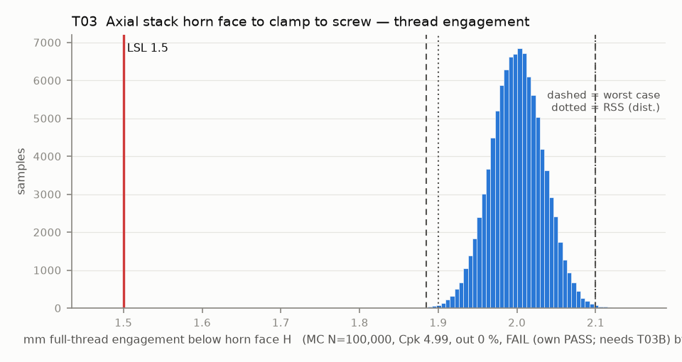

# T03 — Axial stack horn face to clamp to screw — thread engagement

Baseline: CAD rev A as drawn (`cad/gripper/params.json`, `cad/gripper/README.md`).

- Requirement: M3 engages >= 1.5 mm (3 pitches) of full horn thread. The screw reaches min(protrusion below H, hole depth), and its incomplete tip thread is inside the hole either way, so engagement = min(L - t - lift - runout, depth) - tip chamfer. Conditional on T03B: a screw that bottoms does not clamp.
- Spec: LSL 1.500 mm full-thread engagement below horn face H
- Acceptance: WC
- Model: expression; source file `T03_thread_engagement.yaml`; seed 20260922

Var % from Monte Carlo freeze-one (non-linear model); Sens. is a central difference at the mids and does not rank contributors. Worst case is taken over the corners only, so a minimum inside the box (the kink of abs()) can be missed.

| Contributor | Kind | Nominal | Bias | Tol (−/+) | Sens. | Dist | σ | Var % | Tag | Source |
|---|---|---:|---:|---|---:|---|---:|---:|---|---|
| screw_length | linear | 6.000 | 0.000 | -0.240 / +0.240 | 0.0000 | normal | 0.0800 | 0.0 | A | M3x6 [S LeRobot]; tol [A] |
| clamp_thickness | linear | 3.000 | 0.000 | -0.150 / +0.150 | 0.0000 | uniform | 0.0866 | 0.0 | S | 3.0 (params.json) [D]; Z band [S Gebre] |
| datum_A_flatness_lift | linear | 0.000 | 0.000 | 0.000 / +0.200 | 0.0000 | uniform | 0.0577 | 0.0 | A | flatness 0.2 on A: part rests on high points |
| horn_face_runout | linear | 0.000 | 0.000 | -0.025 / +0.025 | 0.0000 | normal | 0.0083 | 0.0 | A | horn face FIM 0.05 |
| horn_hole_depth | linear | 2.500 | 0.000 | -0.100 / +0.100 | 1.0000 | normal | 0.0333 | 100.0 | A | 2.5 CAD (so101.md row 4) [D]; tol [A] |
| screw_tip_chamfer | linear | 0.500 | 0.000 | -0.000 / +0.000 | -1.0000 | normal | 0.0000 | 0.0 | A | incomplete thread at the point |

| Result | Value |
|---|---|
| Nominal | 2.000 |
| Mean-shifted centre | 2.000 |
| Worst case | 1.885 … 2.100 (pass) |
| RSS classic (t = 3σ) | 1.900 … 2.100 |
| RSS distribution-adjusted | 1.900 … 2.100 † (pass); clipped to WC, unclipped 1.900 … 2.100 |
| MC mean / σ | 2.000 / 0.0334 |
| MC 0.135 % … 99.865 % | 1.900 … 2.101 |
| MC min … max | 1.856 … 2.136 |
| MC out of spec | <30 ppm (0 of 100,000 samples; 95% upper bound) |
| Cpk percentile / normal | 4.99 ± 0.04 / 5.00 ± 0.01 |
| Yield (MC) | 100.000 % (<30 ppm (0 of 100,000 samples; 95% upper bound) out) |
| Dominant contributor | horn_hole_depth (100 %) |
| Pass/fail by the declared method (WC) | FAIL (own PASS; needs T03B) |
| **Verdict (pass / marginal / fail)** | **FAIL (blocked by T03B; own check PASS)** |

Cheapest fix: Measure the real horn hole depth (DB M15) before buying screws. At 3.5 deep, M3x6 engages fully but is marginal on bottoming (T03-depth35), so run each screw in by hand and check the head seats before torquing. (proved by `T03-depth35`)

Verdict is conditional on: T03B.

