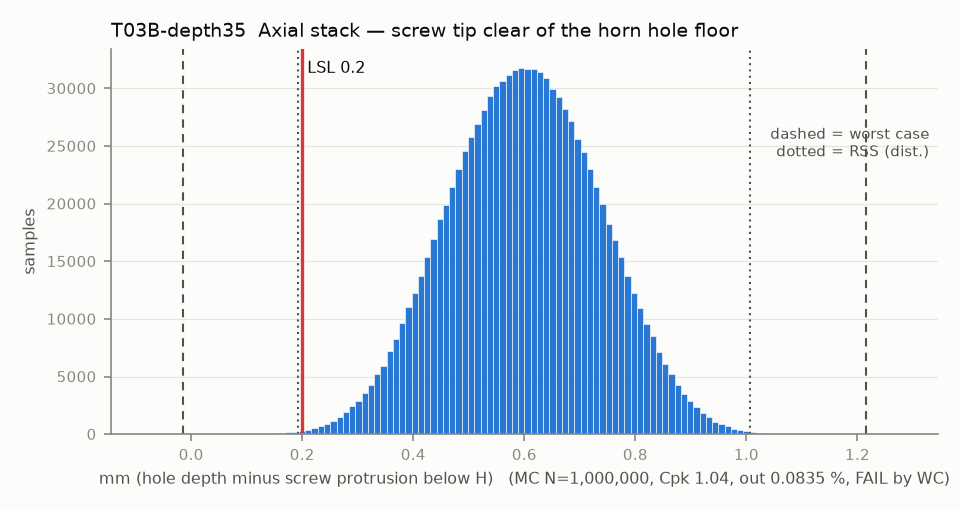

# T03B-depth35 — Axial stack — screw tip clear of the horn hole floor

Variant of `T03B` (scenario): horn holes measured 3.5 deep (M15 outcome to confirm)

- Requirement: Screw tip stops >= 0.2 mm above the blind-hole floor so the head, not the tip, takes the clamp load.
- Spec: LSL 0.200 mm (hole depth minus screw protrusion below H)
- Acceptance: WC
- Model: linear; source file `T03B_screw_bottoming.yaml`; seed 21260925

CAD horn holes are 2.5 deep but M3x6 through the 3.0 clamp protrudes 3.0, so the CAD says the screw bottoms. The stock gripper uses the same screw and clamp, so the real holes are probably deeper.

| Contributor | Kind | Nominal | Bias | Tol (−/+) | Sens. | Dist | σ | Var % | Tag | Source |
|---|---|---:|---:|---|---:|---|---:|---:|---|---|
| horn_hole_depth | linear | 3.500 | 0.000 | -0.100 / +0.100 | 1.0000 | normal | 0.0333 | 6.0 | A | 2.5 CAD (so101.md row 4) [D]; tol [A] |
| screw_length | linear | 6.000 | 0.000 | -0.240 / +0.240 | -1.0000 | normal | 0.0800 | 34.8 | A | M3x6 |
| clamp_thickness | linear | 3.000 | 0.000 | -0.150 / +0.150 | 1.0000 | uniform | 0.0866 | 40.7 | S | params.json 3.0; Z band [S Gebre] |
| datum_A_flatness_lift | linear | 0.000 | 0.000 | 0.000 / +0.200 | 1.0000 | uniform | 0.0577 | 18.1 | A | flatness 0.2 on A |
| horn_face_runout | linear | 0.000 | 0.000 | -0.025 / +0.025 | 1.0000 | normal | 0.0083 | 0.4 | A | horn face FIM 0.05; same term and sign as T03 |

| Result | Value |
|---|---|
| Nominal | 0.500 |
| Mean-shifted centre | 0.600 |
| Worst case | -0.015 … 1.215 (fail) |
| RSS classic (t = 3σ) | 0.283 … 0.917 |
| RSS distribution-adjusted | 0.193 … 1.007 (fail) |
| MC mean / σ | 0.600 / 0.1356 |
| MC 0.135 % … 99.865 % | 0.217 … 0.981 |
| MC min … max | -0.026 … 1.148 |
| MC out of spec | 835 ppm |
| Cpk percentile / normal | 1.04 ± 0.00 / 0.98 ± 0.00 |
| Yield (MC) | 99.916 % (835 ppm out) |
| Dominant contributor | clamp_thickness (41 %) |
| Pass/fail by the declared method (WC) | FAIL |
| **Verdict (pass / marginal / fail)** | **MARGINAL** |

