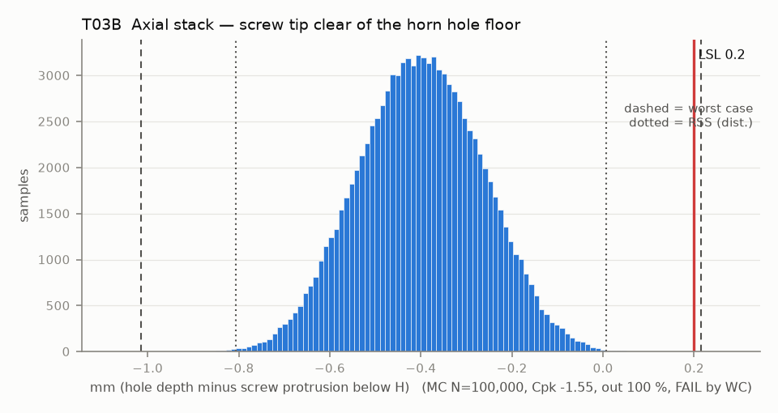

# T03B — Axial stack — screw tip clear of the horn hole floor

Baseline: CAD rev A as drawn (`cad/gripper/params.json`, `cad/gripper/README.md`).

- Requirement: Screw tip stops >= 0.2 mm above the blind-hole floor so the head, not the tip, takes the clamp load.
- Spec: LSL 0.200 mm (hole depth minus screw protrusion below H)
- Acceptance: WC
- Model: linear; source file `T03B_screw_bottoming.yaml`; seed 20260922

CAD horn holes are 2.5 deep but M3x6 through the 3.0 clamp protrudes 3.0, so the CAD says the screw bottoms. The stock gripper uses the same screw and clamp, so the real holes are probably deeper.

| Contributor | Kind | Nominal | Bias | Tol (−/+) | Sens. | Dist | σ | Var % | Tag | Source |
|---|---|---:|---:|---|---:|---|---:|---:|---|---|
| horn_hole_depth | linear | 2.500 | 0.000 | -0.100 / +0.100 | 1.0000 | normal | 0.0333 | 6.0 | A | 2.5 CAD (so101.md row 4) [D]; tol [A] |
| screw_length | linear | 6.000 | 0.000 | -0.240 / +0.240 | -1.0000 | normal | 0.0800 | 34.8 | A | M3x6 |
| clamp_thickness | linear | 3.000 | 0.000 | -0.150 / +0.150 | 1.0000 | uniform | 0.0866 | 40.7 | S | params.json 3.0; Z band [S Gebre] |
| datum_A_flatness_lift | linear | 0.000 | 0.000 | 0.000 / +0.200 | 1.0000 | uniform | 0.0577 | 18.1 | A | flatness 0.2 on A |
| horn_face_runout | linear | 0.000 | 0.000 | -0.025 / +0.025 | 1.0000 | normal | 0.0083 | 0.4 | A | horn face FIM 0.05; same term and sign as T03 |

| Result | Value |
|---|---|
| Nominal | -0.500 |
| Mean-shifted centre | -0.400 |
| Worst case | -1.015 … 0.215 (fail) |
| RSS classic (t = 3σ) | -0.717 … -0.083 |
| RSS distribution-adjusted | -0.807 … 0.007 (fail) |
| MC mean / σ | -0.400 / 0.1355 |
| MC 0.135 % … 99.865 % | -0.787 … -0.021 |
| MC min … max | -0.904 … 0.096 |
| MC out of spec | 100 % |
| Cpk percentile / normal | -1.55 ± 0.02 / -1.48 ± 0.00 |
| Yield (MC) | 0.00 % |
| Dominant contributor | clamp_thickness (41 %) |
| Pass/fail by the declared method (WC) | FAIL |
| **Verdict (pass / marginal / fail)** | **FAIL** |

Cheapest fix: Measure the horn hole depth (DB M15) before buying screws. At the CAD 2.5, M3x6 bottoms and M3x5 engages too little (T03-m3x5); at 3.5 deep M3x6 is marginal (T03B-depth35), so check each head seats by hand. (proved by `T03B-depth35`)

