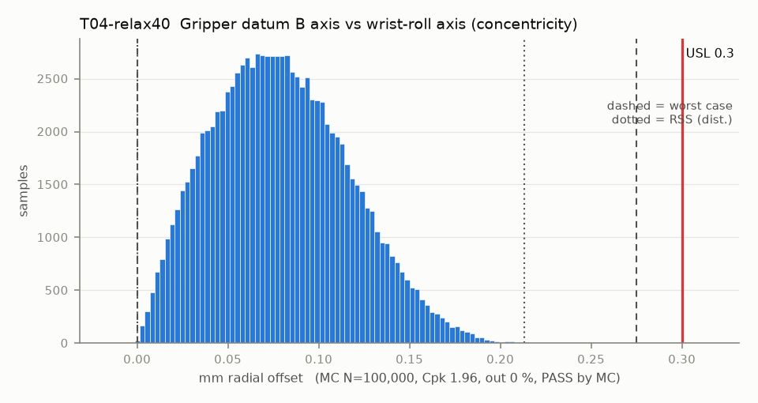

# T04-relax40 — Gripper datum B axis vs wrist-roll axis (concentricity)

Variant of `T04` (scenario): recess CAD 19.56, clearance up to 0.40 (T02-relax40)

- Requirement: Gripper axis (datum B) within 0.30 mm radial of the wrist-roll axis.
- Spec: USL 0.300 mm radial offset
- Acceptance: MC (Cpk ≥ 1.33, percentile method)
- Model: radial; source file `T04_concentricity.yaml`; seed 20260922

Screws clamp but do not locate; the part sits anywhere inside the pilot clearance (area-uniform disk). The disk radius is each T02 clearance sample / 2 (clipped at 0), so clearance scatter is carried and WC uses T02's WC.

| Contributor | Kind | Nominal | Bias | Tol (−/+) | Sens. | Dist | σ | Var % | Tag | Source |
|---|---|---:|---:|---|---:|---|---:|---:|---|---|
| pilot_float | radial | 0.000 | 0.000 | from T02-relax40 | 1.0000 | empirical | 0.0509 | 67.4 | D | T02 clearance samples / 2 |
| horn_od_eccentricity | radial | 0.000 | 0.000 | R 0.050 | 1.0000 | disk | 0.0250 | 16.3 | A | horn OD vs spline |
| servo5_radial_play | radial | 0.000 | 0.000 | R 0.050 | 1.0000 | disk | 0.0250 | 16.3 | A | unpublished |

| Result | Value |
|---|---|
| Nominal | 0.000 |
| Mean-shifted centre | 0.000 |
| Worst case | 0.000 … 0.275 (pass) |
| RSS classic (t = 3σ) | 0.000 … 0.189 |
| RSS distribution-adjusted | 0.000 … 0.213 (pass) |
| MC mean / σ | 0.079 / 0.0374 |
| MC 0.135 % … 99.865 % | 0.003 … 0.191 |
| MC min … max | 0.000 … 0.232 |
| MC out of spec | <30 ppm (0 of 100,000 samples; 95% upper bound) |
| Cpk percentile / normal | 1.96 ± 0.01 / 1.97 ± 0.00 |
| Yield (MC) | 100.000 % (<30 ppm (0 of 100,000 samples; 95% upper bound) out) |
| Dominant contributor | pilot_float (67 %) |
| Pass/fail by the declared method (MC) | PASS |
| **Verdict (pass / marginal / fail)** | **PASS** |

