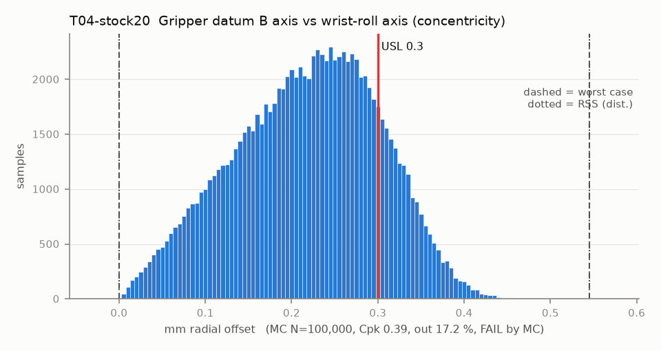

# T04-stock20 — Gripper datum B axis vs wrist-roll axis (concentricity)

Variant of `T04` (rejected): stock Ø20.0 recess (T02-stock20)

- Requirement: Gripper axis (datum B) within 0.30 mm radial of the wrist-roll axis.
- Spec: USL 0.300 mm radial offset
- Acceptance: MC (Cpk ≥ 1.33, percentile method)
- Model: radial; source file `T04_concentricity.yaml`; seed 20260922

Screws clamp but do not locate; the part sits anywhere inside the pilot clearance (area-uniform disk). The disk radius is each T02 clearance sample / 2 (clipped at 0), so clearance scatter is carried and WC uses T02's WC.

| Contributor | Kind | Nominal | Bias | Tol (−/+) | Sens. | Dist | σ | Var % | Tag | Source |
|---|---|---:|---:|---|---:|---|---:|---:|---|---|
| pilot_float | radial | 0.000 | 0.000 | from T02-stock20 | 1.0000 | empirical | 0.1609 | 95.4 | D | T02 clearance samples / 2 |
| horn_od_eccentricity | radial | 0.000 | 0.000 | R 0.050 | 1.0000 | disk | 0.0250 | 2.3 | A | horn OD vs spline |
| servo5_radial_play | radial | 0.000 | 0.000 | R 0.050 | 1.0000 | disk | 0.0250 | 2.3 | A | unpublished |

| Result | Value |
|---|---|
| Nominal | 0.000 |
| Mean-shifted centre | 0.000 |
| Worst case | 0.000 … 0.545 (fail) |
| RSS classic (t = 3σ) | 0.000 … 0.451 |
| RSS distribution-adjusted | 0.000 … 0.545 † (fail); clipped to WC, unclipped 0.000 … 0.566 |
| MC mean / σ | 0.217 / 0.0839 |
| MC 0.135 % … 99.865 % | 0.012 … 0.422 |
| MC min … max | 0.002 … 0.479 |
| MC out of spec | 17.2 % |
| Cpk percentile / normal | 0.39 ± 0.00 / 0.33 ± 0.00 |
| Yield (MC) | 82.80 % |
| Dominant contributor | pilot_float (95 %) |
| Pass/fail by the declared method (MC) | FAIL |
| **Verdict (pass / marginal / fail)** | **FAIL** |

