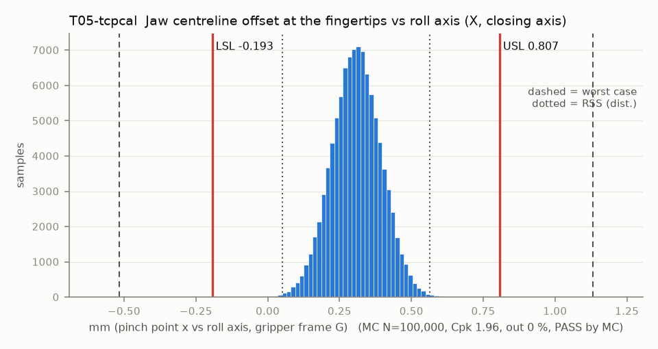

# T05-tcpcal — Jaw centreline offset at the fingertips vs roll axis (X, closing axis)

Variant of `T05` (option): measure the pinch point once and set the TCP (removes every fixed offset; leaves the T04 float)

- Requirement: Pinch point within +/-0.5 mm of its design position, without a per-unit TCP calibration. The systematic shift from finger B lagging by half the design backlash (0.25 * jt0 * L_tip / r) is known and calibrated into the TCP, so the spec is centred on it.
- Spec: LSL -0.193, USL 0.807 mm (pinch point x vs roll axis, gripper frame G)
- Acceptance: MC (Cpk ≥ 1.33, percentile method)
- Model: linear; source file `T05_jaw_centerline.yaml`; seed 20260922

Rev A chain, roll axis to pinch point: pilot float, horn eccentricity and servo-5 play (T04 terms, X component); spider insert holes to the recess (one print); the deck floats on 4 M3 screws in Ø3.6 holes (nothing locates it); deck holes to the pin A hole (one PETG housing print, about 30-45 mm apart); knuckle A sleeve on pin A. Pin B follows pin A by the centre distance a (T06, same shared names), so x_B = x_A + a and x_c = x_A + (a - a0)/2: pin A float nets +0.5 (it is +1 in x_A and -1 in a), the A-to-B hole spacing and pin B float enter at 0.5. Dog lash turns A and B by equal and opposite angles, so the centre does not move.

| Contributor | Kind | Nominal | Bias | Tol (−/+) | Sens. | Dist | σ | Var % | Tag | Source |
|---|---|---:|---:|---|---:|---|---:|---:|---|---|
| pilot_float | radial (X proj.) | 0.000 | 0.000 | from T02 | 1.0000 | empirical | 0.0386 | 20.3 | D | X component of the T04 pilot float (same samples) |
| horn_od_eccentricity | radial (X proj.) | 0.000 | 0.000 | -0.050 / +0.050 | 1.0000 | disk | 0.0250 | 8.5 | A | X component of the T04 term |
| servo5_radial_play | radial (X proj.) | 0.000 | 0.000 | -0.050 / +0.050 | 1.0000 | disk | 0.0250 | 8.5 | A | X component of the T04 term |
| pinA_float | linear | 0.000 | 0.000 | -0.007 / +0.007 | 0.5000 | uniform | 0.0040 | 0.1 | D | +1 in x_A, -1 in a (T06): net 0.5 |
| pin_float | linear | 0.000 | 0.000 | -0.007 / +0.007 | 0.5000 | uniform | 0.0040 | 0.1 | D | knuckle B sleeve, in a (T06): 0.5 |
| sleeveA_ecc | linear | 0.000 | 0.000 | -0.015 / +0.015 | 0.5000 | normal | 0.0050 | 0.1 | S | bush concentricity (T06): +1 in x_A, -1 in a |
| sleeveB_ecc | linear | 0.000 | 0.000 | -0.015 / +0.015 | 0.5000 | normal | 0.0050 | 0.1 | S | bush concentricity (T06): 0.5 |
| finger_A_root_float | radial (X proj.) | 0.000 | 0.000 | -0.050 / +0.050 | 0.5000 | disk | 0.0250 | 2.1 | A | pegs + M2 (rev A fix 10): X component of the X-Z float disk |
| finger_B_root_float | radial (X proj.) | 0.000 | 0.000 | -0.050 / +0.050 | 0.5000 | disk | 0.0250 | 2.1 | A | same, finger B |
| backlash_lag_B | linear | 0.250 | 0.000 | from T07 | 1.2281 | empirical | 0.0458 | 43.0 | D | centred CAD mesh: B lags by jt/(2r) rad while A drives it closed; the centre moves half |
| tcp_measure | linear | 0.000 | 0.000 | -0.100 / +0.100 | 1.0000 | normal | 0.0333 | 15.1 | A | pinch point measured with a pin gauge on the arm |

| Result | Value |
|---|---|
| Nominal | 0.307 |
| Mean-shifted centre | 0.307 |
| Worst case | -0.517 … 1.131 (fail) |
| RSS classic (t = 3σ) | 0.049 … 0.566 |
| RSS distribution-adjusted | 0.050 … 0.564 (pass) |
| MC mean / σ | 0.307 / 0.0853 |
| MC 0.135 % … 99.865 % | 0.053 … 0.563 |
| MC min … max | -0.035 … 0.668 |
| MC out of spec | <30 ppm (0 of 100,000 samples; 95% upper bound) |
| Cpk percentile / normal | 1.96 ± 0.02 / 1.95 ± 0.00 |
| Yield (MC) | 100.000 % (<30 ppm (0 of 100,000 samples; 95% upper bound) out) |
| Dominant contributor | backlash_lag_B (43 %) |
| Pass/fail by the declared method (MC) | PASS |
| **Verdict (pass / marginal / fail)** | **PASS** |

