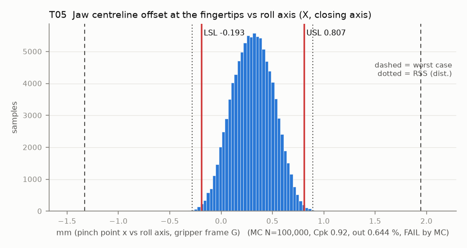

# T05 — Jaw centreline offset at the fingertips vs roll axis (X, closing axis)

Baseline: CAD rev A as drawn (`cad/gripper/params.json`, `cad/gripper/README.md`).

- Requirement: Pinch point within +/-0.5 mm of its design position, without a per-unit TCP calibration. The systematic shift from finger B lagging by half the design backlash (0.25 * jt0 * L_tip / r) is known and calibrated into the TCP, so the spec is centred on it.
- Spec: LSL -0.193, USL 0.807 mm (pinch point x vs roll axis, gripper frame G)
- Acceptance: MC (Cpk ≥ 1.33, percentile method)
- Model: linear; source file `T05_jaw_centerline.yaml`; seed 20260922

Rev A chain, roll axis to pinch point: pilot float, horn eccentricity and servo-5 play (T04 terms, X component); spider insert holes to the recess (one print); the deck floats on 4 M3 screws in Ø3.6 holes (nothing locates it); deck holes to the pin A hole (one PETG housing print, about 30-45 mm apart); knuckle A sleeve on pin A. Pin B follows pin A by the centre distance a (T06, same shared names), so x_B = x_A + a and x_c = x_A + (a - a0)/2: pin A float nets +0.5 (it is +1 in x_A and -1 in a), the A-to-B hole spacing and pin B float enter at 0.5. Dog lash turns A and B by equal and opposite angles, so the centre does not move.

| Contributor | Kind | Nominal | Bias | Tol (−/+) | Sens. | Dist | σ | Var % | Tag | Source |
|---|---|---:|---:|---|---:|---|---:|---:|---|---|
| pilot_float | radial (X proj.) | 0.000 | 0.000 | from T02 | 1.0000 | empirical | 0.0386 | 3.9 | D | X component of the T04 pilot float (same samples) |
| horn_od_eccentricity | radial (X proj.) | 0.000 | 0.000 | -0.050 / +0.050 | 1.0000 | disk | 0.0250 | 1.6 | A | X component of the T04 term |
| servo5_radial_play | radial (X proj.) | 0.000 | 0.000 | -0.050 / +0.050 | 1.0000 | disk | 0.0250 | 1.6 | A | X component of the T04 term |
| inserts_to_recess | linear | 0.000 | 0.000 | -0.100 / +0.100 | 1.0000 | normal | 0.0333 | 2.9 | S | spider insert bores to the recess, one print, < 30 mm (basis XY band) |
| deck_float | radial (X proj.) | 0.000 | 0.000 | -0.313 / +0.313 | 1.0000 | disk | 0.1565 | 63.8 | D | deck on 4 M3 in Ø3.6 holes: largest printed hole less the smallest screw, / 2 (basis deck_float) |
| pinA_to_deck_holes | linear | 0.000 | 0.000 | -0.200 / +0.200 | 1.0000 | normal | 0.0667 | 11.6 | A | pin A plate hole to the deck screw holes, 30-45 mm apart on one print (basis fdm_xy_tol) |
| pinA_float | linear | 0.000 | 0.000 | -0.007 / +0.007 | 0.5000 | uniform | 0.0040 | 0.0 | D | +1 in x_A, -1 in a (T06): net 0.5 |
| pinA_to_pinB_holes | linear | 0.000 | 0.000 | -0.100 / +0.100 | 0.5000 | normal | 0.0333 | 0.7 | S | in a (T06): 0.5 |
| pin_float | linear | 0.000 | 0.000 | -0.007 / +0.007 | 0.5000 | uniform | 0.0040 | 0.0 | D | knuckle B sleeve, in a (T06): 0.5 |
| sleeveA_ecc | linear | 0.000 | 0.000 | -0.015 / +0.015 | 0.5000 | normal | 0.0050 | 0.0 | S | bush concentricity (T06): +1 in x_A, -1 in a |
| sleeveB_ecc | linear | 0.000 | 0.000 | -0.015 / +0.015 | 0.5000 | normal | 0.0050 | 0.0 | S | bush concentricity (T06): 0.5 |
| xf_A | linear | 0.000 | 0.000 | -0.100 / +0.100 | 0.5000 | normal | 0.0333 | 0.7 | S | knuckle A root face to pivot (PA6-CF, XY band) |
| xf_B | linear | 0.000 | 0.000 | -0.100 / +0.100 | -0.5000 | normal | 0.0333 | 0.7 | S | knuckle B root face to pivot |
| pad_A_profile | linear | 0.000 | 0.000 | -0.150 / +0.150 | 0.5000 | normal | 0.0500 | 1.6 | A | TPU pad (no data, basis tpu_xy_tol) |
| pad_B_profile | linear | 0.000 | 0.000 | -0.150 / +0.150 | -0.5000 | normal | 0.0500 | 1.6 | A | TPU pad |
| finger_A_root_float | radial (X proj.) | 0.000 | 0.000 | -0.050 / +0.050 | 0.5000 | disk | 0.0250 | 0.4 | A | pegs + M2 (rev A fix 10): X component of the X-Z float disk |
| finger_B_root_float | radial (X proj.) | 0.000 | 0.000 | -0.050 / +0.050 | 0.5000 | disk | 0.0250 | 0.4 | A | same, finger B |
| backlash_lag_B | linear | 0.250 | 0.000 | from T07 | 1.2281 | empirical | 0.0458 | 8.2 | D | centred CAD mesh: B lags by jt/(2r) rad while A drives it closed; the centre moves half |

| Result | Value |
|---|---|
| Nominal | 0.307 |
| Mean-shifted centre | 0.307 |
| Worst case | -1.330 … 1.944 (fail) |
| RSS classic (t = 3σ) | -0.166 … 0.780 |
| RSS distribution-adjusted | -0.281 … 0.895 (fail) |
| MC mean / σ | 0.307 / 0.1991 |
| MC 0.135 % … 99.865 % | -0.231 … 0.852 |
| MC min … max | -0.410 … 0.989 |
| MC out of spec | 0.644 % |
| Cpk percentile / normal | 0.92 ± 0.01 / 0.84 ± 0.00 |
| Yield (MC) | 99.36 % |
| Dominant contributor | deck_float (64 %) |
| Pass/fail by the declared method (MC) | FAIL |
| **Verdict (pass / marginal / fail)** | **FAIL** |

Cheapest fix: Locate the deck on the spider with two bonded ISO 2338 h8 pins in reamed deck holes. That removes the deck screw float; T05-deckpegs includes translation clearance and rotation about the two-pin pattern. (proved by `T05-deckpegs`)

