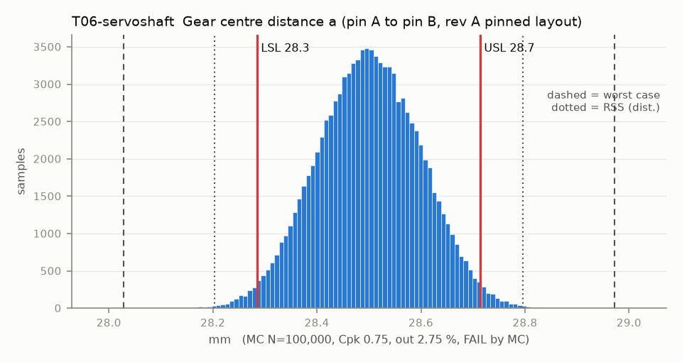

# T06-servoshaft — Gear centre distance a (pin A to pin B, rev A pinned layout)

Variant of `T06` (rejected): pre-rev-A layout: knuckle A on the servo shaft, pin B in the housing

- Requirement: a stays inside the band that keeps backlash between jt_min and jt_max for the design jt0 (T07).
- Spec: LSL 28.286, USL 28.714 mm
- Acceptance: MC (Cpk ≥ 1.33, percentile method)
- Model: linear; source file `T06_gear_center_distance.yaml`; seed 20260922

Both knuckles run in bronze sleeves on m6 pins pressed into the line-reamed plate holes (rev A, fix 9), so a is the printed A-to-B hole spacing (reaming sizes the hole but follows its printed position) plus the two sleeve clearances. The servo no longer sets a: it drives knuckle A through the dog coupling (T14B).

| Contributor | Kind | Nominal | Bias | Tol (−/+) | Sens. | Dist | σ | Var % | Tag | Source |
|---|---|---:|---:|---|---:|---|---:|---:|---|---|
| pin_float | linear | 0.000 | 0.000 | -0.007 / +0.007 | 1.0000 | uniform | 0.0040 | 0.2 | D | knuckle B sleeve on its pin (basis pin_clear) |
| sleeveB_ecc | linear | 0.000 | 0.000 | -0.015 / +0.015 | 1.0000 | normal | 0.0050 | 0.3 | S | same |
| pinB_pos_to_cradle | linear | 0.000 | 0.000 | -0.100 / +0.100 | 1.0000 | normal | 0.0333 | 11.4 | A | pin B bore to the cradle, same print |
| servo_float_in_cradle | linear | 0.000 | 0.000 | -0.100 / +0.100 | -1.0000 | uniform | 0.0577 | 34.1 | D | cradle clearance / 2 |
| shaft_in_case | linear | 0.000 | 0.000 | -0.200 / +0.200 | -1.0000 | normal | 0.0667 | 45.5 | A | unpublished |
| spline_play | linear | 0.000 | 0.000 | -0.050 / +0.050 | -1.0000 | uniform | 0.0289 | 8.5 | A |  |

| Result | Value |
|---|---|
| Nominal | 28.500 |
| Mean-shifted centre | 28.500 |
| Worst case | 28.028 … 28.972 (fail) |
| RSS classic (t = 3σ) | 28.249 … 28.751 |
| RSS distribution-adjusted | 28.204 … 28.796 (fail) |
| MC mean / σ | 28.500 / 0.0989 |
| MC 0.135 % … 99.865 % | 28.213 … 28.787 |
| MC min … max | 28.093 … 28.957 |
| MC out of spec | 2.75 % |
| Cpk percentile / normal | 0.75 ± 0.01 / 0.72 ± 0.00 |
| Yield (MC) | 97.25 % |
| Dominant contributor | shaft_in_case (46 %) |
| Pass/fail by the declared method (MC) | FAIL |
| **Verdict (pass / marginal / fail)** | **FAIL** |

