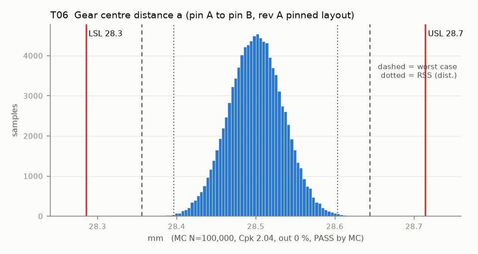

# T06 — Gear centre distance a (pin A to pin B, rev A pinned layout)

Baseline: CAD rev A as drawn (`cad/gripper/params.json`, `cad/gripper/README.md`).

- Requirement: a stays inside the band that keeps backlash between jt_min and jt_max for the design jt0 (T07).
- Spec: LSL 28.286, USL 28.714 mm
- Acceptance: MC (Cpk ≥ 1.33, percentile method)
- Model: linear; source file `T06_gear_center_distance.yaml`; seed 20260922

Both knuckles run in bronze sleeves on m6 pins pressed into the line-reamed plate holes (rev A, fix 9), so a is the printed A-to-B hole spacing (reaming sizes the hole but follows its printed position) plus the two sleeve clearances. The servo no longer sets a: it drives knuckle A through the dog coupling (T14B).

| Contributor | Kind | Nominal | Bias | Tol (−/+) | Sens. | Dist | σ | Var % | Tag | Source |
|---|---|---:|---:|---|---:|---|---:|---:|---|---|
| pinA_to_pinB_holes | linear | 0.000 | 0.000 | -0.100 / +0.100 | 1.0000 | normal | 0.0333 | 93.1 | S | pin A and pin B holes on one print, 28.5 apart (basis XY band); reaming does not move them |
| pin_float | linear | 0.000 | 0.000 | -0.007 / +0.007 | 1.0000 | uniform | 0.0040 | 1.4 | D | knuckle B sleeve on its pin (basis pin_clear) |
| pinA_float | linear | 0.000 | 0.000 | -0.007 / +0.007 | -1.0000 | uniform | 0.0040 | 1.4 | D | knuckle A sleeve on its pin |
| sleeveA_ecc | linear | 0.000 | 0.000 | -0.015 / +0.015 | -1.0000 | normal | 0.0050 | 2.1 | S | bush concentricity IT9 (0.030 at 3-6 mm) / 2, https://www.hpceurope.com/docFichesTechniques/OiliteBushings.pdf (retrieved 2026-10-11) |
| sleeveB_ecc | linear | 0.000 | 0.000 | -0.015 / +0.015 | 1.0000 | normal | 0.0050 | 2.1 | S | same |

| Result | Value |
|---|---|
| Nominal | 28.500 |
| Mean-shifted centre | 28.500 |
| Worst case | 28.356 … 28.644 (pass) |
| RSS classic (t = 3σ) | 28.397 … 28.603 |
| RSS distribution-adjusted | 28.396 … 28.604 (pass) |
| MC mean / σ | 28.500 / 0.0346 |
| MC 0.135 % … 99.865 % | 28.397 … 28.605 |
| MC min … max | 28.345 … 28.644 |
| MC out of spec | <30 ppm (0 of 100,000 samples; 95% upper bound) |
| Cpk percentile / normal | 2.04 ± 0.00 / 2.06 ± 0.00 |
| Yield (MC) | 100.000 % (<30 ppm (0 of 100,000 samples; 95% upper bound) out) |
| Dominant contributor | pinA_to_pinB_holes (93 %) |
| Pass/fail by the declared method (MC) | PASS |
| **Verdict (pass / marginal / fail)** | **PASS** |

