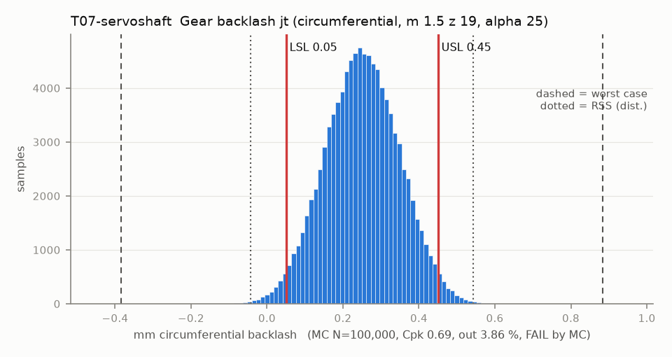

# T07-servoshaft — Gear backlash jt (circumferential, m 1.5 z 19, alpha 25)

Variant of `T07` (rejected): pre-rev-A layout (T06-servoshaft)

- Requirement: jt between 0.05 (no binding) and 0.45 (open-jaw repeatability), design jt0 = 0.25 by flank offset.
- Spec: LSL 0.050, USL 0.450 mm circumferential backlash
- Acceptance: MC (Cpk ≥ 1.33, percentile method)
- Model: linear; source file `T07_backlash.yaml`; seed 20260922

jt = jt0 + 2 tan(alpha) (a - a0) - ds_A - ds_B, plus pitch-circle runout of each gear (KHK Table 4.1 via W1).

| Contributor | Kind | Nominal | Bias | Tol (−/+) | Sens. | Dist | σ | Var % | Tag | Source |
|---|---|---:|---:|---|---:|---|---:|---:|---|---|
| centre_distance | linear | 28.500 | 0.000 | from T06-servoshaft | 0.9326 | empirical | 0.0989 | 89.1 | D | T06 |
| tooth_thickness_A | linear | 0.000 | 0.000 | -0.050 / +0.050 | -1.0000 | normal | 0.0167 | 2.9 | A | printed PA6-CF tooth |
| tooth_thickness_B | linear | 0.000 | 0.000 | -0.050 / +0.050 | -1.0000 | normal | 0.0167 | 2.9 | A | printed PA6-CF tooth |
| runout_A | linear | 0.000 | 0.000 | -0.050 / +0.050 | 0.9326 | normal | 0.0167 | 2.5 | A | pitch circle vs sleeve bore |
| runout_B | linear | 0.000 | 0.000 | -0.050 / +0.050 | 0.9326 | normal | 0.0167 | 2.5 | A | pitch circle vs sleeve bore |

| Result | Value |
|---|---|
| Nominal | 0.250 |
| Mean-shifted centre | 0.250 |
| Worst case | -0.383 … 0.883 (fail) |
| RSS classic (t = 3σ) | -0.003 … 0.503 |
| RSS distribution-adjusted | -0.043 … 0.543 (fail) |
| MC mean / σ | 0.250 / 0.0977 |
| MC 0.135 % … 99.865 % | -0.039 … 0.538 |
| MC min … max | -0.161 … 0.661 |
| MC out of spec | 3.86 % |
| Cpk percentile / normal | 0.69 ± 0.00 / 0.68 ± 0.00 |
| Yield (MC) | 96.14 % |
| Dominant contributor | centre_distance (89 %) |
| Pass/fail by the declared method (MC) | FAIL |
| **Verdict (pass / marginal / fail)** | **FAIL** |

