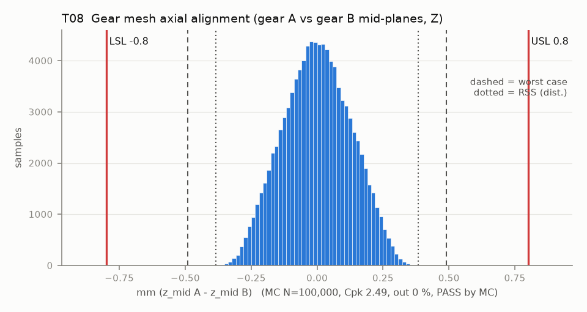

# T08 — Gear mesh axial alignment (gear A vs gear B mid-planes, Z)

Baseline: CAD rev A as drawn (`cad/gripper/params.json`, `cad/gripper/README.md`).

- Requirement: Face mid-planes within +/-0.8 mm (10 % of the 8 mm face width).
- Spec: LSL -0.800, USL 0.800 mm (z_mid A - z_mid B)
- Acceptance: MC (Cpk ≥ 1.33, percentile method)
- Model: linear; source file `T08_mesh_axial.yaml`; seed 20260922

Rev A: both knuckles sit on datum D (mid-plate front face) through one 0.85 shim each and float axially inside their own 0.3 end play (T15). z_mid = shim + hub/2 + float. The servo no longer sets gear A's height: the dog pins slide axially in their 3.5 deep slots.

| Contributor | Kind | Nominal | Bias | Tol (−/+) | Sens. | Dist | σ | Var % | Tag | Source |
|---|---|---:|---:|---|---:|---|---:|---:|---|---|
| shim_A | linear | 0.850 | 0.000 | -0.020 / +0.020 | 1.0000 | normal | 0.0067 | 0.3 | A | params.json knuckle.shim_t [D]; tol [A] |
| shim_B | linear | 0.850 | 0.000 | -0.020 / +0.020 | -1.0000 | normal | 0.0067 | 0.3 | A | same |
| hub_A_half | linear | 4.000 | 0.000 | -0.075 / +0.075 | 1.0000 | normal | 0.0250 | 3.8 | S | knuckle hub length 8 printed in Z (basis Z band), half of it |
| hub_B_half | linear | 4.000 | 0.000 | -0.075 / +0.075 | -1.0000 | normal | 0.0250 | 3.8 | S | same |
| float_A | linear | 0.000 | 0.000 | -0.150 / +0.150 | 1.0000 | uniform | 0.0866 | 45.9 | D | knuckle A end play 0.3 / 2 |
| float_B | linear | 0.000 | 0.000 | -0.150 / +0.150 | -1.0000 | uniform | 0.0866 | 45.9 | D | knuckle B end play 0.3 / 2 |

| Result | Value |
|---|---|
| Nominal | 0.000 |
| Mean-shifted centre | 0.000 |
| Worst case | -0.490 … 0.490 (pass) |
| RSS classic (t = 3σ) | -0.239 … 0.239 |
| RSS distribution-adjusted | -0.383 … 0.383 (pass) |
| MC mean / σ | -0.000 / 0.1275 |
| MC 0.135 % … 99.865 % | -0.321 … 0.321 |
| MC min … max | -0.385 … 0.407 |
| MC out of spec | <30 ppm (0 of 100,000 samples; 95% upper bound) |
| Cpk percentile / normal | 2.49 ± 0.01 / 2.09 ± 0.00 |
| Yield (MC) | 100.000 % (<30 ppm (0 of 100,000 samples; 95% upper bound) out) |
| Dominant contributor | float_A (46 %) |
| Pass/fail by the declared method (MC) | PASS |
| **Verdict (pass / marginal / fail)** | **PASS** |

