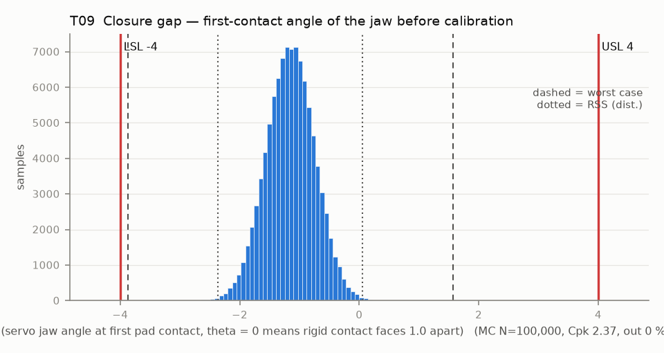

# T09 — Closure gap — first-contact angle of the jaw before calibration

Baseline: CAD rev A as drawn (`cad/gripper/params.json`, `cad/gripper/README.md`).

- Requirement: The uncalibrated first-contact angle falls inside the firmware calibration window (CAL_C0 -4 .. +4 deg), so CALIBRATE finds it instead of raising a SENSOR fault. T09T (close time, R19) and T09F / T09P / T09H (pad force, R15 and R14) build on this angle.
- Spec: LSL -4.000, USL 4.000 deg (servo jaw angle at first pad contact, theta = 0 means rigid contact faces 1.0 apart)
- Acceptance: MC (Cpk ≥ 1.33, percentile method)
- Model: linear; source file `T09_closure_gap.yaml`; seed 20260922

The rigid contact faces (PLA nail on A, FSR stack on B) are contact_gap apart at theta = 0. Each finger closes the gap at r_c per radian (r_c is the moment arm of the pad normal), so contact comes at theta_c = -gap / (2 r_c), converted to degrees (-0.441 deg per mm of gap). Angle terms enter directly: the horn trim set by eye at bench step 1, servo repeatability, the dog coupling lash (A lags the horn while closing, so the servo turns dog_lash further) and finger B's backlash lag (the servo turns half of it further).

| Contributor | Kind | Nominal | Bias | Tol (−/+) | Sens. | Dist | σ | Var % | Tag | Source |
|---|---|---:|---:|---|---:|---|---:|---:|---|---|
| centre_distance | linear | 28.500 | 0.000 | from T06 | -0.4407 | empirical | 0.0346 | 0.1 | D | T06: a larger centre distance widens the gap |
| contact_gap | linear | 1.000 | 0.000 | -0.000 / +0.000 | -0.4407 | normal | 0.0000 | 0.0 | D | params.json finger.contact_gap |
| xf_A | linear | 0.000 | 0.000 | -0.100 / +0.100 | 0.4407 | normal | 0.0333 | 0.1 | S | knuckle A root face to pivot (basis XY band) |
| xf_B | linear | 0.000 | 0.000 | -0.100 / +0.100 | 0.4407 | normal | 0.0333 | 0.1 | S | knuckle B root face to pivot |
| pad_A_profile | linear | 0.000 | 0.000 | -0.150 / +0.150 | 0.4407 | normal | 0.0500 | 0.3 | A | TPU pad face (no data) |
| pad_B_profile | linear | 0.000 | 0.000 | -0.150 / +0.150 | 0.4407 | normal | 0.0500 | 0.3 | A | TPU pad face |
| nail_thickness | linear | 0.000 | 0.000 | -0.150 / +0.150 | 0.4407 | normal | 0.0500 | 0.3 | S | PLA nail 1.0 printed flat (Z band) |
| backing_thickness | linear | 0.000 | 0.000 | -0.150 / +0.150 | 0.4407 | normal | 0.0500 | 0.3 | S | PLA FSR backing 1.5 printed flat (Z band) |
| fsr_thickness | linear | 0.000 | 0.000 | -0.050 / +0.050 | 0.4407 | normal | 0.0167 | 0.0 | A | FSR 402 stack 0.45 |
| finger_A_root_float | radial (X proj.) | 0.000 | 0.000 | -0.050 / +0.050 | 0.4407 | disk | 0.0250 | 0.1 | A | pegs + M2: X component of the T05 float disk |
| finger_B_root_float | radial (X proj.) | 0.000 | 0.000 | -0.050 / +0.050 | -0.4407 | disk | 0.0250 | 0.1 | A | same, finger B |
| horn_trim | linear | 0.000 | 0.000 | -1.000 / +1.000 | 1.0000 | normal | 0.3333 | 68.4 | A | SERVO_DEG_AT_JAW0 set by eye (basis servo_horn_trim_deg) |
| servo_angle_error | linear | 0.000 | 0.000 | -0.500 / +0.500 | 1.0000 | normal | 0.1667 | 17.1 | A | deadband + gear play |
| dog_lash_offset | linear | -0.462 | 0.000 | -0.409 / +0.409 | 1.0000 | normal | 0.1364 | 11.5 | D | dog clearance / (2 r_dog), taken up in the closing direction; tol from the printed slot width |
| backlash_lag_B | linear | 0.250 | 0.000 | from T07 | -1.0052 | empirical | 0.0458 | 1.3 | D | B lags A by jt/(2r) rad; contact needs half of it more servo travel |

| Result | Value |
|---|---|
| Nominal | -1.154 |
| Mean-shifted centre | -1.154 |
| Worst case | -3.875 … 1.566 (pass) |
| RSS classic (t = 3σ) | -2.363 … 0.054 |
| RSS distribution-adjusted | -2.364 … 0.055 (pass) |
| MC mean / σ | -1.154 / 0.4045 |
| MC 0.135 % … 99.865 % | -2.352 … 0.069 |
| MC min … max | -2.709 … 0.623 |
| MC out of spec | <30 ppm (0 of 100,000 samples; 95% upper bound) |
| Cpk percentile / normal | 2.37 ± 0.03 / 2.35 ± 0.01 |
| Yield (MC) | 100.000 % (<30 ppm (0 of 100,000 samples; 95% upper bound) out) |
| Dominant contributor | horn_trim (68 %) |
| Pass/fail by the declared method (MC) | PASS |
| **Verdict (pass / marginal / fail)** | **PASS** |

