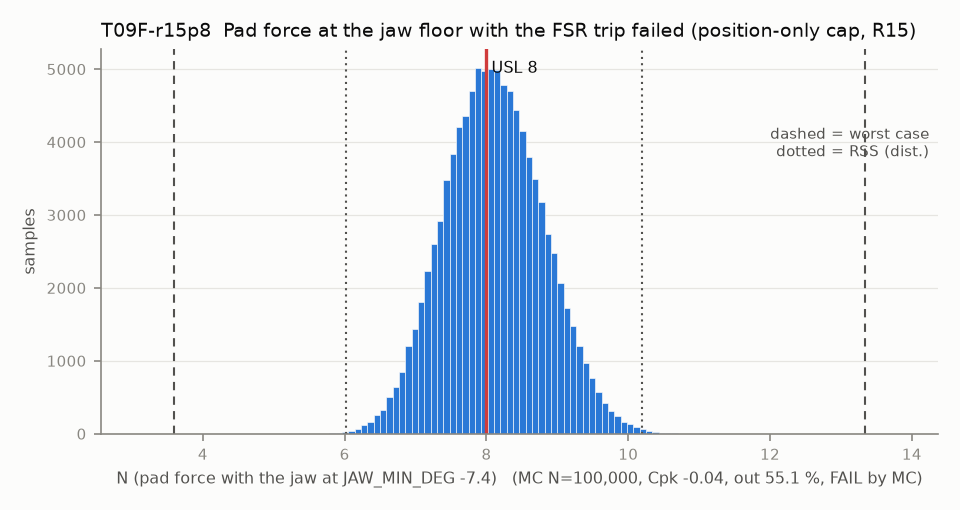

# T09F-r15p8 — Pad force at the jaw floor with the FSR trip failed (position-only cap, R15)

Variant of `T09F` (scenario): R15 ruled: cap 8 N

- Requirement: R15 ruled 8 N (Douglas 2026-10-12, DESIGN-BASIS R15): pad force <= 8 N even if the FSR trip fails.
- Spec: USL 8.000 N (pad force with the jaw at JAW_MIN_DEG -7.4)
- Acceptance: MC (Cpk ≥ 1.33, percentile method)
- Model: expression; source file `T09F_force_at_floor.yaml`; seed 20260922

F = k_pair * 2 r_c * (theta_c - theta), finger.md 6.2 linear model. theta_c is the T09 first-contact angle (same samples); the floor is absolute, so the uncalibrated spread of theta_c moves the force at the floor. Reading used: the servo position errors at contact and at the floor are independent (deadband and gear play settle afresh at each stop), so the floor error has its own sample key (shared: servo_angle_error_at_floor) and T09's contact error stays inside theta_c. With one common bias instead (contact error cancelled explicitly) the stack is still FAIL (third review, B1: Cpk 0.95 against 0.90 here); the shared T09 key used before cancelled the floor error sample for sample and made the stack read MARGINAL.

Var % from Monte Carlo freeze-one (non-linear model); Sens. is a central difference at the mids and does not rank contributors. Worst case is taken over the corners only, so a minimum inside the box (the kink of abs()) can be missed.

| Contributor | Kind | Nominal | Bias | Tol (−/+) | Sens. | Dist | σ | Var % | Tag | Source |
|---|---|---:|---:|---|---:|---|---:|---:|---|---|
| theta_c | linear | -1.154 | 0.000 | from T09 | 1.2978 | empirical | 0.4045 | 57.1 | D | T09 first-contact angle, deg |
| k_pair | linear | 0.572 | 0.000 | -0.049 / +0.049 | 14.1706 | uniform | 0.0283 | 33.2 | D | finger.md 6.2, E 56-67 MPa |
| jaw_floor | linear | -7.400 | 0.000 | -0.000 / +0.000 | -1.2978 | normal | 0.0000 | 0.0 | D | config.h JAW_MIN_DEG |
| servo_angle_error | linear | 0.000 | 0.000 | -0.500 / +0.500 | -1.2978 | normal | 0.1667 | 9.7 | A | position error at the floor (independent of the T09 contact error) |

| Result | Value |
|---|---|
| Nominal | 8.106 |
| Mean-shifted centre | 8.106 |
| Worst case | 3.589 … 13.338 (fail) |
| RSS classic (t = 3σ) | 6.271 … 9.940 |
| RSS distribution-adjusted | 6.021 … 10.191 (fail) |
| MC mean / σ | 8.106 / 0.6937 |
| MC 0.135 % … 99.865 % | 6.189 … 10.217 |
| MC min … max | 5.476 … 11.088 |
| MC out of spec | 55.1 % |
| Cpk percentile / normal | -0.04 ± 0.00 / -0.05 ± 0.00 |
| Yield (MC) | 44.91 % |
| Dominant contributor | theta_c (57 %) |
| Pass/fail by the declared method (MC) | FAIL |
| **Verdict (pass / marginal / fail)** | **FAIL** |

