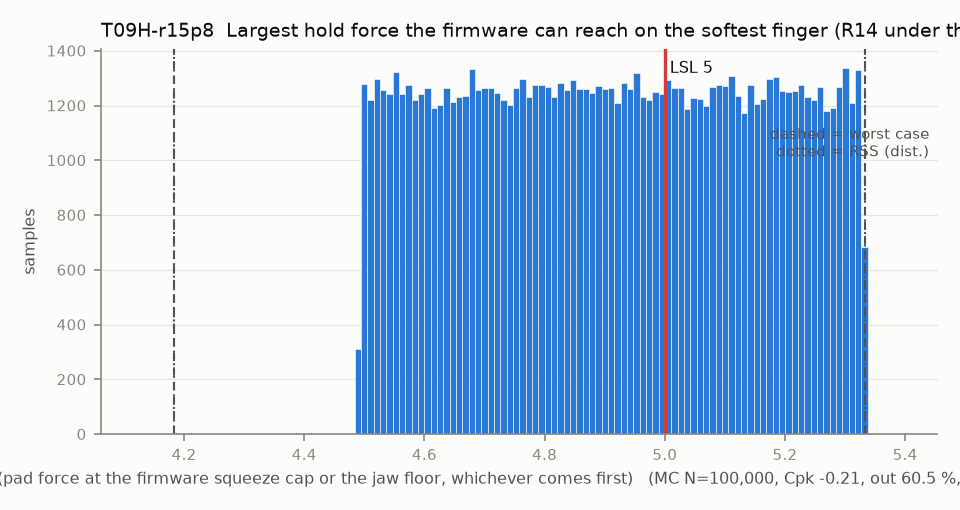

# T09H-r15p8 — Largest hold force the firmware can reach on the softest finger (R14 under the R15 cap)

Variant of `T09H` (scenario): squeeze cap sized for the ruled 8 N: 3.785 deg (basis u_max_8_deg, the firmware compiled with F_CAP_N 8)

- Requirement: The controller can reach the 5 N hold force (R14) on every finger within its squeeze cap. The squeeze cap stays sized for F_CAP_N 10 (9.5 N basis, config.h) under the ruled 8 N R15, which the floor and the trip hold (T09F, T09P); a cap sized for 8 N is T09H-r15p8.
- Spec: LSL 5.000 N (pad force at the firmware squeeze cap or the jaw floor, whichever comes first)
- Acceptance: MC (Cpk ≥ 1.33, percentile method)
- Model: expression; source file `T09H_hold_force_reach.yaml`; seed 20260922

The firmware limits the squeeze past the calibrated contact to u_max (4.867 deg for a 10 N cap) and never goes below the absolute floor. F = k_pair * 2 r_c * radians(min(u_max, theta_c - floor)).

Var % from Monte Carlo freeze-one (non-linear model); Sens. is a central difference at the mids and does not rank contributors. Worst case is taken over the corners only, so a minimum inside the box (the kink of abs()) can be missed.

| Contributor | Kind | Nominal | Bias | Tol (−/+) | Sens. | Dist | σ | Var % | Tag | Source |
|---|---|---:|---:|---|---:|---|---:|---:|---|---|
| theta_c | linear | -1.154 | 0.000 | from T09 | 0.0000 | empirical | 0.4045 | 0.0 | D | T09 first-contact angle, deg |
| k_pair | linear | 0.572 | 0.000 | -0.049 / +0.049 | 8.5879 | uniform | 0.0283 | 100.0 | D | finger.md 6.2 |
| u_max | linear | 3.785 | 0.000 | -0.000 / +0.000 | 1.2978 | normal | 0.0000 | 0.0 | D | firmware squeeze cap at F_CAP 10 N |
| jaw_floor | linear | -7.400 | 0.000 | -0.000 / +0.000 | 0.0000 | normal | 0.0000 | 0.0 | D | config.h JAW_MIN_DEG |

| Result | Value |
|---|---|
| Nominal | 4.912 |
| Mean-shifted centre | 4.912 |
| Worst case | 4.183 … 5.333 (fail) |
| RSS classic (t = 3σ) | 4.491 … 5.333 |
| RSS distribution-adjusted | 4.183 … 5.333 † (fail); clipped to WC, unclipped 4.183 … 5.641 |
| MC mean / σ | 4.912 / 0.2429 |
| MC 0.135 % … 99.865 % | 4.493 … 5.332 |
| MC min … max | 4.491 … 5.333 |
| MC out of spec | 60.5 % |
| Cpk percentile / normal | -0.21 ± 0.00 / -0.12 ± 0.00 |
| Yield (MC) | 39.50 % |
| Dominant contributor | k_pair (100 %) |
| Pass/fail by the declared method (MC) | FAIL |
| **Verdict (pass / marginal / fail)** | **FAIL** |

