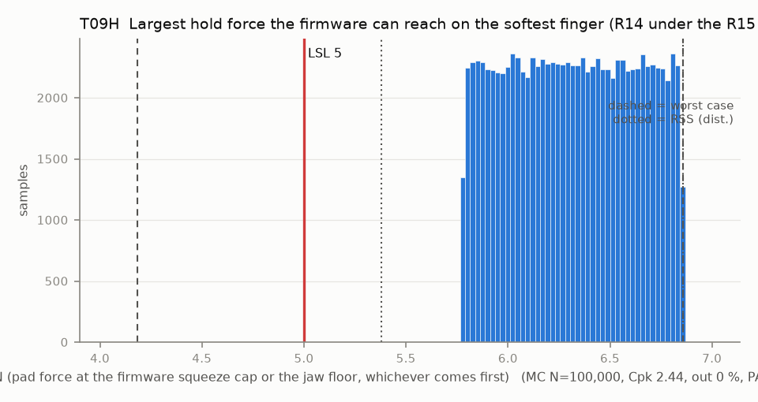

# T09H — Largest hold force the firmware can reach on the softest finger (R14 under the R15 cap)

Baseline: CAD rev A as drawn (`cad/gripper/params.json`, `cad/gripper/README.md`).

- Requirement: The controller can reach the 5 N hold force (R14) on every finger within its squeeze cap. The squeeze cap stays sized for F_CAP_N 10 (9.5 N basis, config.h) under the ruled 8 N R15, which the floor and the trip hold (T09F, T09P); a cap sized for 8 N is T09H-r15p8.
- Spec: LSL 5.000 N (pad force at the firmware squeeze cap or the jaw floor, whichever comes first)
- Acceptance: MC (Cpk ≥ 1.33, percentile method)
- Model: expression; source file `T09H_hold_force_reach.yaml`; seed 20260922

The firmware limits the squeeze past the calibrated contact to u_max (4.867 deg for a 10 N cap) and never goes below the absolute floor. F = k_pair * 2 r_c * radians(min(u_max, theta_c - floor)).

Var % from Monte Carlo freeze-one (non-linear model); Sens. is a central difference at the mids and does not rank contributors. Worst case is taken over the corners only, so a minimum inside the box (the kink of abs()) can be missed.

| Contributor | Kind | Nominal | Bias | Tol (−/+) | Sens. | Dist | σ | Var % | Tag | Source |
|---|---|---:|---:|---|---:|---|---:|---:|---|---|
| theta_c | linear | -1.154 | 0.000 | from T09 | 0.0000 | empirical | 0.4045 | 0.0 | D | T09 first-contact angle, deg |
| k_pair | linear | 0.572 | 0.000 | -0.049 / +0.049 | 11.0429 | uniform | 0.0283 | 100.0 | D | finger.md 6.2 |
| u_max | linear | 4.867 | 0.000 | -0.000 / +0.000 | 1.2978 | normal | 0.0000 | 0.0 | D | firmware squeeze cap at F_CAP 10 N |
| jaw_floor | linear | -7.400 | 0.000 | -0.000 / +0.000 | 0.0000 | normal | 0.0000 | 0.0 | D | config.h JAW_MIN_DEG |

| Result | Value |
|---|---|
| Nominal | 6.317 |
| Mean-shifted centre | 6.317 |
| Worst case | 4.183 … 6.858 (fail) |
| RSS classic (t = 3σ) | 5.775 … 6.858 |
| RSS distribution-adjusted | 5.379 … 6.858 † (pass); clipped to WC, unclipped 5.379 … 7.254 |
| MC mean / σ | 6.316 / 0.3124 |
| MC 0.135 % … 99.865 % | 5.777 … 6.856 |
| MC min … max | 5.680 … 6.858 |
| MC out of spec | <30 ppm (0 of 100,000 samples; 95% upper bound) |
| Cpk percentile / normal | 2.44 ± 0.01 / 1.40 ± 0.00 |
| Yield (MC) | 100.000 % (<30 ppm (0 of 100,000 samples; 95% upper bound) out) |
| Dominant contributor | k_pair (100 %) |
| Pass/fail by the declared method (MC) | PASS |
| **Verdict (pass / marginal / fail)** | **PASS** |

Cheapest fix: Needed only once the dog slots open to 3.4 (rev B row 1): the 1.5 deg of dog lash moves the first contact toward the jaw floor, and the absolute floor then cuts the squeeze short (T09H falls to Cpk 0.99 in the combined rev B run). The floor relative to the calibrated contact angle (the T09F firmware request, APPLIED in config.h JAW_FLOOR_BELOW_C0_DEG 4.9 for the ruled 8 N; 6.2 in round 2): T09H-relfloor8. The 4.9 deg floor sits just past the 4.867 deg squeeze cap, so it is MARGINAL exactly as with 6.2 (T09H-relfloor); the softest pair at the cap is the limit, not the floor. (proved by `T09H-relfloor8`)

