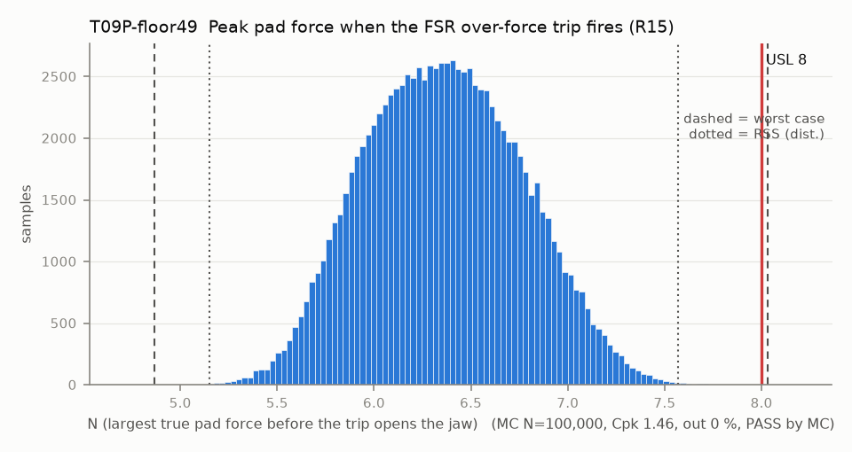

# T09P-floor49 — Peak pad force when the FSR over-force trip fires (R15)

Variant of `T09P` (option): firmware: trip 7.75 N / 20 ms, peak bounded by the jaw floor theta_c0 - 4.9 deg (JAW_FLOOR_BELOW_C0_DEG)

- Requirement: R15 ruled 8 N (Douglas 2026-10-12, DESIGN-BASIS R15): pad force <= 8 N.
- Spec: USL 8.000 N (largest true pad force before the trip opens the jaw)
- Acceptance: MC (Cpk ≥ 1.33, percentile method)
- Model: expression; source file `T09P_force_at_trip.yaml`; seed 20260922

The trip fires when the FSR reads F_TRIP_N (7.75 N) for 20 ms. The true force is the reading divided by (1 + FSR error), and the jaw keeps squeezing at up to 60 deg/s through the 20 ms hold plus the 9.5 ms filter lag, adding up to k_pair * 2 r_c * radians(60 * 0.0295) = 2.5 N on the stiff finger. The base stack ignores the jaw floor.

Var % from Monte Carlo freeze-one (non-linear model); Sens. is a central difference at the mids and does not rank contributors. Worst case is taken over the corners only, so a minimum inside the box (the kink of abs()) can be missed.

| Contributor | Kind | Nominal | Bias | Tol (−/+) | Sens. | Dist | σ | Var % | Tag | Source |
|---|---|---:|---:|---|---:|---|---:|---:|---|---|
| F_trip | linear | 7.750 | 0.000 | -0.000 / +0.000 | 0.0000 | normal | 0.0000 | 0.0 | D | config.h F_TRIP_N |
| fsr_error | linear | 0.000 | 0.000 | -0.100 / +0.100 | 0.0000 | normal | 0.0333 | 0.0 | A | FSR error after span calibration |
| k_pair | linear | 0.572 | 0.000 | -0.049 / +0.049 | 11.1177 | uniform | 0.0283 | 60.6 | D | finger.md 6.2 |
| squeeze_deg | linear | 0.885 | 0.000 | -0.885 / +0.885 | 0.0000 | uniform | 0.5110 | 0.0 | D | 60 deg/s for 20 ms + 9.5 ms (config.h) |
| cal_repeat | linear | 0.000 | 0.000 | -0.300 / +0.300 | 1.2978 | normal | 0.1000 | 10.5 | A | calibrated contact repeatability (same term as T09F-relfloor8) |
| servo_angle_error | linear | 0.000 | 0.000 | -0.500 / +0.500 | -1.2978 | normal | 0.1667 | 28.9 | A | position error at the floor (same sample as T09F) |

| Result | Value |
|---|---|
| Nominal | 6.359 |
| Mean-shifted centre | 6.359 |
| Worst case | 4.865 … 8.031 (fail) |
| RSS classic (t = 3σ) | 5.427 … 7.292 |
| RSS distribution-adjusted | 5.150 … 7.569 (pass) |
| MC mean / σ | 6.360 / 0.4035 |
| MC 0.135 % … 99.865 % | 5.307 … 7.480 |
| MC min … max | 4.971 … 7.904 |
| MC out of spec | <30 ppm (0 of 100,000 samples; 95% upper bound) |
| Cpk percentile / normal | 1.46 ± 0.00 / 1.35 ± 0.00 |
| Yield (MC) | 100.000 % (<30 ppm (0 of 100,000 samples; 95% upper bound) out) |
| Dominant contributor | k_pair (61 %) |
| Pass/fail by the declared method (MC) | PASS |
| **Verdict (pass / marginal / fail)** | **PASS** |

