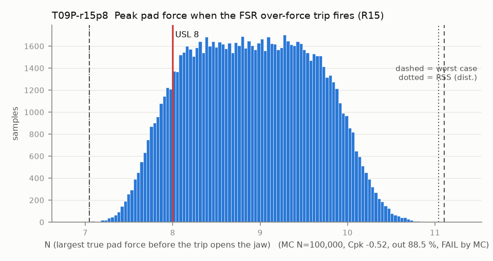

# T09P-r15p8 — Peak pad force when the FSR over-force trip fires (R15)

Variant of `T09P` (scenario): R15 ruled: cap 8 N

- Requirement: R15 ruled 8 N (Douglas 2026-10-12, DESIGN-BASIS R15): pad force <= 8 N.
- Spec: USL 8.000 N (largest true pad force before the trip opens the jaw)
- Acceptance: MC (Cpk ≥ 1.33, percentile method)
- Model: expression; source file `T09P_force_at_trip.yaml`; seed 20260922

The trip fires when the FSR reads F_TRIP_N (7.75 N) for 20 ms. The true force is the reading divided by (1 + FSR error), and the jaw keeps squeezing at up to 60 deg/s through the 20 ms hold plus the 9.5 ms filter lag, adding up to k_pair * 2 r_c * radians(60 * 0.0295) = 2.5 N on the stiff finger. The base stack ignores the jaw floor.

Var % from Monte Carlo freeze-one (non-linear model); Sens. is a central difference at the mids and does not rank contributors. Worst case is taken over the corners only, so a minimum inside the box (the kink of abs()) can be missed.

| Contributor | Kind | Nominal | Bias | Tol (−/+) | Sens. | Dist | σ | Var % | Tag | Source |
|---|---|---:|---:|---|---:|---|---:|---:|---|---|
| F_trip | linear | 7.750 | 0.000 | -0.000 / +0.000 | 1.0000 | normal | 0.0000 | 0.0 | D | config.h F_TRIP_N |
| fsr_error | linear | 0.000 | 0.000 | -0.100 / +0.100 | -7.7500 | normal | 0.0333 | 13.0 | A | FSR error after span calibration |
| k_pair | linear | 0.572 | 0.000 | -0.049 / +0.049 | 2.0080 | uniform | 0.0283 | 0.8 | D | finger.md 6.2 |
| squeeze_deg | linear | 0.885 | 0.000 | -0.885 / +0.885 | 1.2978 | uniform | 0.5110 | 86.2 | D | 60 deg/s for 20 ms + 9.5 ms (config.h) |

| Result | Value |
|---|---|
| Nominal | 8.899 |
| Mean-shifted centre | 8.899 |
| Worst case | 7.045 … 11.105 (fail) |
| RSS classic (t = 3σ) | 7.509 … 10.288 |
| RSS distribution-adjusted | 7.045 … 11.040 † (fail); clipped to WC, unclipped 6.757 … 11.040 |
| MC mean / σ | 8.908 / 0.7146 |
| MC 0.135 % … 99.865 % | 7.308 … 10.636 |
| MC min … max | 6.909 … 11.201 |
| MC out of spec | 88.5 % |
| Cpk percentile / normal | -0.52 ± 0.00 / -0.42 ± 0.00 |
| Yield (MC) | 11.53 % |
| Dominant contributor | squeeze_deg (86 %) |
| Pass/fail by the declared method (MC) | FAIL |
| **Verdict (pass / marginal / fail)** | **FAIL** |

