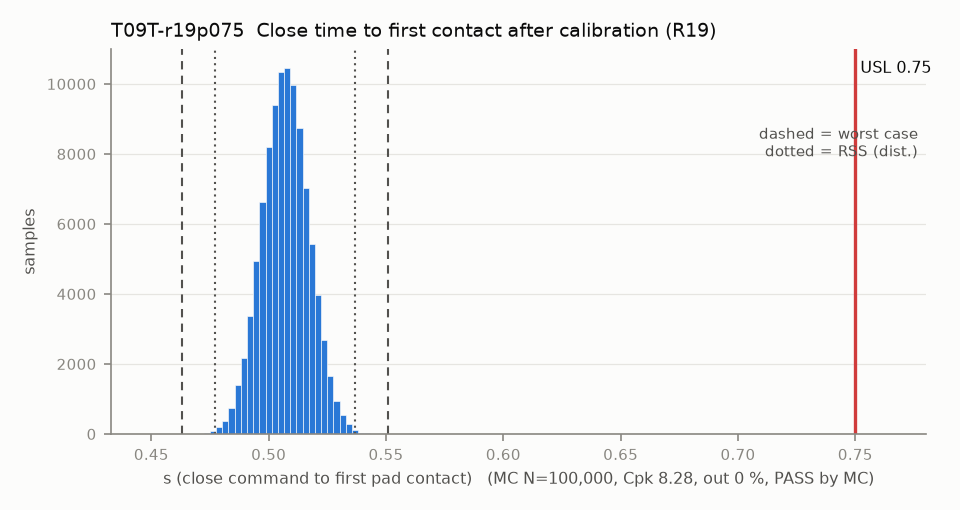

# T09T-r19p075 — Close time to first contact after calibration (R19)

Variant of `T09T` (scenario): R19 proposed: close in <= 0.75 s

- Requirement: R19 as written: full close in <= 0.5 s. The proposed 0.75 s is checked by T09T-r19p075 (requirement still open).
- Spec: USL 0.750 s (close command to first pad contact)
- Acceptance: MC (Cpk ≥ 1.33, percentile method)
- Model: linear; source file `T09T_close_time.yaml`; seed 20260922

The firmware simulation reaches contact in 503-511 ms with the calibrated contact angle (fw_sim.json). Any contact later than the calibrated angle adds (delta theta) / 20 deg/s, because the last part is at the near-contact speed. After calibration only the calibration repeatability and the servo repeatability remain.

| Contributor | Kind | Nominal | Bias | Tol (−/+) | Sens. | Dist | σ | Var % | Tag | Source |
|---|---|---:|---:|---|---:|---|---:|---:|---|---|
| t_contact_sim | linear | 0.507 | 0.000 | -0.004 / +0.004 | 1.0000 | uniform | 0.0023 | 5.3 | D | firmware_sim fw_sim.json, k 0.88-1.63 |
| cal_repeat | linear | 0.000 | 0.000 | -0.300 / +0.300 | 0.0500 | normal | 0.1000 | 25.1 | A | deg -> s at 20 deg/s |
| servo_angle_error | linear | 0.000 | 0.000 | -0.500 / +0.500 | 0.0500 | normal | 0.1667 | 69.6 | A | deg -> s at 20 deg/s |

| Result | Value |
|---|---|
| Nominal | 0.507 |
| Mean-shifted centre | 0.507 |
| Worst case | 0.463 … 0.551 (pass) |
| RSS classic (t = 3σ) | 0.478 … 0.536 |
| RSS distribution-adjusted | 0.477 … 0.537 (pass) |
| MC mean / σ | 0.507 / 0.0100 |
| MC 0.135 % … 99.865 % | 0.477 … 0.536 |
| MC min … max | 0.465 … 0.548 |
| MC out of spec | <30 ppm (0 of 100,000 samples; 95% upper bound) |
| Cpk percentile / normal | 8.28 ± 0.10 / 8.12 ± 0.02 |
| Yield (MC) | 100.000 % (<30 ppm (0 of 100,000 samples; 95% upper bound) out) |
| Dominant contributor | servo_angle_error (70 %) |
| Pass/fail by the declared method (MC) | PASS |
| **Verdict (pass / marginal / fail)** | **PASS** |

