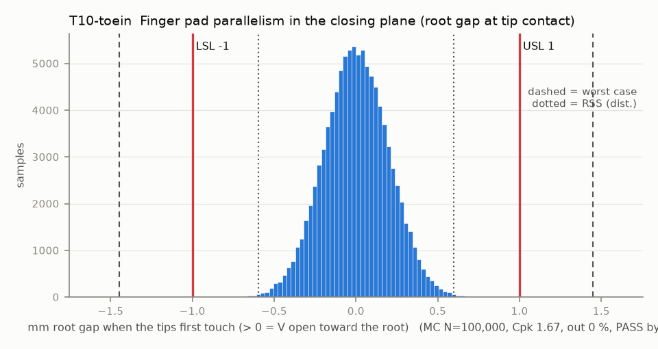

# T10-toein — Finger pad parallelism in the closing plane (root gap at tip contact)

Variant of `T10` (option): contact faces toed in 0.44 deg: parallel at first contact

- Requirement: Root gap at tip contact within +/-1.0 mm over the 45 mm pad (pad_len = L_tip - L_root).
- Spec: LSL -1.000, USL 1.000 mm root gap when the tips first touch (> 0 = V open toward the root)
- Acceptance: MC (Cpk ≥ 1.33, percentile method)
- Model: linear; source file `T10_pad_parallelism.yaml`; seed 20260922

Rotation errors (servo angle, backlash, dog lash) cancel at tip contact; only translation errors g scale by (1 - L_root/L_tip), plus pad face tilt and root-block angle. The finger is located by 2 pegs + 1 M2 (rev A), so its float is a small X translation.

| Contributor | Kind | Nominal | Bias | Tol (−/+) | Sens. | Dist | σ | Var % | Tag | Source |
|---|---|---:|---:|---|---:|---|---:|---:|---|---|
| closed_gap_design | linear | 0.000 | 0.000 | -0.000 / +0.000 | 0.6429 | normal | 0.0000 | 0.0 | D | params.json finger.contact_gap |
| centre_distance | linear | 28.500 | 0.000 | from T06 | 0.6429 | empirical | 0.0346 | 1.3 | D | T06 |
| xf_A | linear | 0.000 | 0.000 | -0.100 / +0.100 | -0.6429 | normal | 0.0333 | 1.2 | S | knuckle root face (XY band) |
| xf_B | linear | 0.000 | 0.000 | -0.100 / +0.100 | -0.6429 | normal | 0.0333 | 1.2 | S |  |
| pad_A_tilt | linear | 0.000 | 0.000 | -0.300 / +0.300 | 1.0000 | normal | 0.1000 | 25.3 | A | TPU profile zone used as tilt over the pad |
| pad_B_tilt | linear | 0.000 | 0.000 | -0.300 / +0.300 | 1.0000 | normal | 0.1000 | 25.3 | A |  |
| finger_A_root_float | radial (X proj.) | 0.000 | 0.000 | -0.050 / +0.050 | -0.6429 | disk | 0.0250 | 0.7 | A | pegs + M2: X component of the float disk |
| finger_B_root_float | radial (X proj.) | 0.000 | 0.000 | -0.050 / +0.050 | 0.6429 | disk | 0.0250 | 0.7 | A | same |
| root_block_A_angle | linear | 0.000 | 0.000 | -0.281 / +0.281 | 1.0000 | normal | 0.0938 | 22.2 | S | root face angle over the 16 mm base, projected to the pad |
| root_block_B_angle | linear | 0.000 | 0.000 | -0.281 / +0.281 | 1.0000 | normal | 0.0938 | 22.2 | S |  |

| Result | Value |
|---|---|
| Nominal | 0.000 |
| Mean-shifted centre | 0.000 |
| Worst case | -1.448 … 1.448 (fail) |
| RSS classic (t = 3σ) | -0.594 … 0.594 |
| RSS distribution-adjusted | -0.596 … 0.596 (pass) |
| MC mean / σ | 0.000 / 0.1987 |
| MC 0.135 % … 99.865 % | -0.596 … 0.597 |
| MC min … max | -0.816 … 0.891 |
| MC out of spec | <30 ppm (0 of 100,000 samples; 95% upper bound) |
| Cpk percentile / normal | 1.67 ± 0.01 / 1.68 ± 0.00 |
| Yield (MC) | 100.000 % (<30 ppm (0 of 100,000 samples; 95% upper bound) out) |
| Dominant contributor | pad_A_tilt (25 %) |
| Pass/fail by the declared method (MC) | PASS |
| **Verdict (pass / marginal / fail)** | **PASS** |

