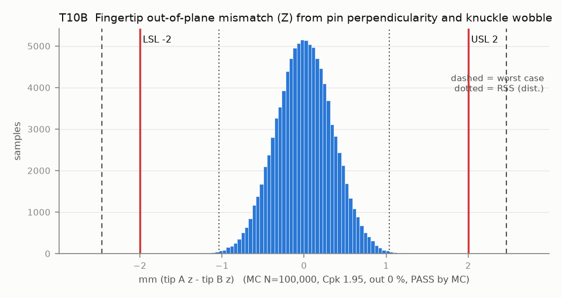

# T10B — Fingertip out-of-plane mismatch (Z) from pin perpendicularity and knuckle wobble

Baseline: CAD rev A as drawn (`cad/gripper/params.json`, `cad/gripper/README.md`).

- Requirement: Tips within +/-2.0 mm in Z (pads keep >= 90 % of the 20 mm depth overlapping).
- Spec: LSL -2.000, USL 2.000 mm (tip A z - tip B z)
- Acceptance: MC (Cpk ≥ 1.33, percentile method)
- Model: linear; source file `T10B_pad_out_of_plane.yaml`; seed 20260922

Frame G, Z = pivot-axis direction, normal to datum D. Rev A: each knuckle runs in a bronze sleeve on its own pressed pin, so the terms are the gear mid-plane offset (T08), each pin's perpendicularity to D, each knuckle's wobble in its sleeve, and each finger's seat on its root block.

| Contributor | Kind | Nominal | Bias | Tol (−/+) | Sens. | Dist | σ | Var % | Tag | Source |
|---|---|---:|---:|---|---:|---|---:|---:|---|---|
| mesh_axial_offset | linear | 0.000 | 0.000 | from T08 | 1.0000 | empirical | 0.1275 | 13.6 | D | T08 |
| pinA_perpendicularity | linear | 0.000 | 0.000 | -0.560 / +0.560 | 1.0000 | normal | 0.1867 | 29.1 | A | perp dia 0.1 to D over 12.5 mm |
| pinB_perpendicularity | linear | 0.000 | 0.000 | -0.560 / +0.560 | -1.0000 | normal | 0.1867 | 29.1 | A | same |
| knuckleA_wobble_on_pin | linear | 0.000 | 0.000 | -0.127 / +0.127 | 1.0000 | uniform | 0.0735 | 4.5 | D | sleeve clearance over sleeve length |
| knuckleB_wobble_on_pin | linear | 0.000 | 0.000 | -0.127 / +0.127 | -1.0000 | uniform | 0.0735 | 4.5 | D | same |
| finger_A_root_float | radial (2nd-axis proj.) | 0.000 | 0.000 | -0.050 / +0.050 | 1.0000 | disk | 0.0250 | 0.5 | A | Z component of the T05/T09/T10 float disk |
| finger_B_root_float | radial (2nd-axis proj.) | 0.000 | 0.000 | -0.050 / +0.050 | -1.0000 | disk | 0.0250 | 0.5 | A | same |
| finger_A_root_twist | linear | 0.000 | 0.000 | -0.100 / +0.100 | 1.0000 | uniform | 0.0577 | 2.8 | A | twist about Y moves the pad face 8 mm off the pegs in Z |
| finger_B_root_twist | linear | 0.000 | 0.000 | -0.100 / +0.100 | -1.0000 | uniform | 0.0577 | 2.8 | A | same |
| finger_A_z_on_root | linear | 0.000 | 0.000 | -0.150 / +0.150 | 1.0000 | uniform | 0.0866 | 6.3 | S | Z band |
| finger_B_z_on_root | linear | 0.000 | 0.000 | -0.150 / +0.150 | -1.0000 | uniform | 0.0866 | 6.3 | S | Z band |

| Result | Value |
|---|---|
| Nominal | 0.000 |
| Mean-shifted centre | 0.000 |
| Worst case | -2.465 … 2.465 (fail) |
| RSS classic (t = 3σ) | -0.887 … 0.887 |
| RSS distribution-adjusted | -1.038 … 1.038 (pass) |
| MC mean / σ | 0.002 / 0.3456 |
| MC 0.135 % … 99.865 % | -1.024 … 1.022 |
| MC min … max | -1.544 … 1.643 |
| MC out of spec | <30 ppm (0 of 100,000 samples; 95% upper bound) |
| Cpk percentile / normal | 1.95 ± 0.01 / 1.93 ± 0.00 |
| Yield (MC) | 100.000 % (<30 ppm (0 of 100,000 samples; 95% upper bound) out) |
| Dominant contributor | pinA_perpendicularity (29 %) |
| Pass/fail by the declared method (MC) | PASS |
| **Verdict (pass / marginal / fail)** | **PASS** |

