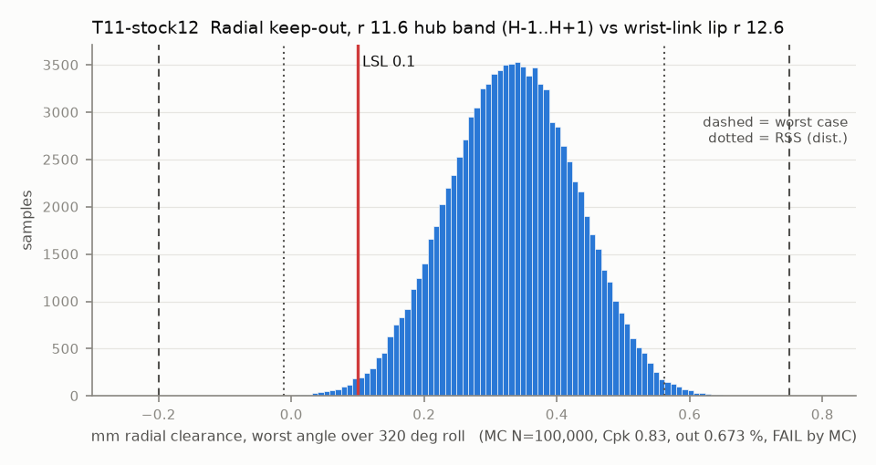

# T11-stock12 — Radial keep-out, r 11.6 hub band (H-1..H+1) vs wrist-link lip r 12.6

Variant of `T11` (rejected): pre-rev-A hub r 12.0

- Requirement: Rolling hub clears the stationary lip by >= 0.1 mm at every roll angle.
- Spec: LSL 0.100 mm radial clearance, worst angle over 320 deg roll
- Acceptance: MC (Cpk ≥ 1.33, percentile method)
- Model: linear; source file `T11_keepout_radial.yaml`; seed 20260922

Roll sweeps every angle, so hub offset (T04) and lip eccentricity add as magnitudes. This band starts on the bed, so it carries first-layer flare.

| Contributor | Kind | Nominal | Bias | Tol (−/+) | Sens. | Dist | σ | Var % | Tag | Source |
|---|---|---:|---:|---|---:|---|---:|---:|---|---|
| lip_radius | linear | 12.600 | 0.000 | -0.200 / +0.200 | 1.0000 | normal | 0.0667 | 48.7 | D | so101.md keep-out table [D]; tol [A] |
| hub_radius | linear | 12.000 | 0.100 | -0.050 / +0.050 | -1.0000 | normal | 0.0167 | 3.0 | S | params.json hub_r_low 11.6; first-layer flare [A]; XY band / 2 on a radius [S] |
| hub_offset | linear | 0.000 | 0.000 | from T04 | -1.0000 | empirical | 0.0327 | 11.7 | D | T04 radial |
| lip_eccentricity | linear | 0.000 | 0.000 | 0.000 / +0.200 | -1.0000 | uniform | 0.0577 | 36.5 | A |  |

| Result | Value |
|---|---|
| Nominal | 0.600 |
| Mean-shifted centre | 0.275 |
| Worst case | -0.200 … 0.750 (fail) |
| RSS classic (t = 3σ) | 0.031 … 0.519 |
| RSS distribution-adjusted | -0.012 … 0.562 (fail) |
| MC mean / σ | 0.333 / 0.0955 |
| MC 0.135 % … 99.865 % | 0.053 … 0.606 |
| MC min … max | -0.099 … 0.697 |
| MC out of spec | 0.673 % |
| Cpk percentile / normal | 0.83 ± 0.00 / 0.81 ± 0.00 |
| Yield (MC) | 99.33 % |
| Dominant contributor | lip_radius (49 %) |
| Pass/fail by the declared method (MC) | FAIL |
| **Verdict (pass / marginal / fail)** | **FAIL** |

