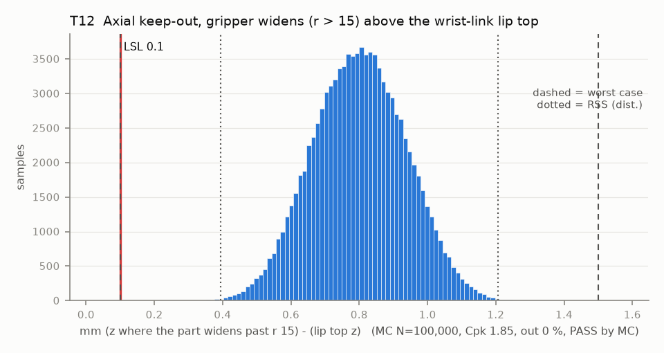

# T12 — Axial keep-out, gripper widens (r > 15) above the wrist-link lip top

Baseline: CAD rev A as drawn (`cad/gripper/params.json`, `cad/gripper/README.md`).

- Requirement: Any part wider than r 15 starts >= 0.1 mm above the lip top (z +5.3).
- Spec: LSL 0.100 mm (z where the part widens past r 15) - (lip top z)
- Acceptance: MC (Cpk ≥ 1.33, percentile method)
- Model: linear; source file `T12_keepout_axial.yaml`; seed 20260922

| Contributor | Kind | Nominal | Bias | Tol (−/+) | Sens. | Dist | σ | Var % | Tag | Source |
|---|---|---:|---:|---|---:|---|---:|---:|---|---|
| widen_height_above_H | linear | 5.000 | 0.000 | -0.150 / +0.150 | 1.0000 | uniform | 0.0866 | 40.9 | D | params.json band_to_H 5.0 [D]; Z band [S] |
| datum_A_flatness_lift | linear | 0.000 | 0.000 | 0.000 / +0.200 | 1.0000 | uniform | 0.0577 | 18.2 | A | raises the part |
| lip_top_above_H | linear | 4.300 | 0.000 | -0.100 / +0.100 | -1.0000 | normal | 0.0333 | 6.1 | D | so101.md |
| horn_height | linear | 0.000 | 0.000 | -0.100 / +0.100 | 1.0000 | normal | 0.0333 | 6.1 | A |  |
| servo5_seat | linear | 0.000 | 0.000 | -0.200 / +0.200 | -1.0000 | normal | 0.0667 | 24.2 | A |  |
| servo5_axial_play | linear | 0.000 | 0.000 | -0.050 / +0.050 | 1.0000 | uniform | 0.0289 | 4.5 | A |  |

| Result | Value |
|---|---|
| Nominal | 0.700 |
| Mean-shifted centre | 0.800 |
| Worst case | 0.100 … 1.500 (pass) |
| RSS classic (t = 3σ) | 0.492 … 1.108 |
| RSS distribution-adjusted | 0.394 … 1.206 (pass) |
| MC mean / σ | 0.800 / 0.1354 |
| MC 0.135 % … 99.865 % | 0.421 … 1.179 |
| MC min … max | 0.234 … 1.343 |
| MC out of spec | <30 ppm (0 of 100,000 samples; 95% upper bound) |
| Cpk percentile / normal | 1.85 ± 0.01 / 1.72 ± 0.00 |
| Yield (MC) | 100.000 % (<30 ppm (0 of 100,000 samples; 95% upper bound) out) |
| Dominant contributor | widen_height_above_H (41 %) |
| Pass/fail by the declared method (MC) | PASS |
| **Verdict (pass / marginal / fail)** | **PASS** |

