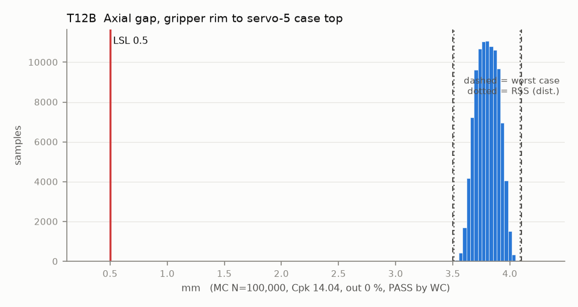

# T12B — Axial gap, gripper rim to servo-5 case top

Baseline: CAD rev A as drawn (`cad/gripper/params.json`, `cad/gripper/README.md`).

- Requirement: Rim clears the servo-5 case by >= 0.5 mm.
- Spec: LSL 0.500 mm
- Acceptance: WC
- Model: linear; source file `T12B_rim_to_case.yaml`; seed 20260922

| Contributor | Kind | Nominal | Bias | Tol (−/+) | Sens. | Dist | σ | Var % | Tag | Source |
|---|---|---:|---:|---|---:|---|---:|---:|---|---|
| horn_above_case | linear | 4.800 | 0.000 | -0.100 / +0.100 | 1.0000 | normal | 0.0333 | 11.8 | D | so101.md row 3 |
| rim_below_H | linear | 1.000 | 0.000 | -0.150 / +0.150 | -1.0000 | uniform | 0.0866 | 79.4 | D | params.json rim_below_H 1.0 [D]; Z band [S] |
| servo5_axial_play | linear | 0.000 | 0.000 | -0.050 / +0.050 | 1.0000 | uniform | 0.0289 | 8.8 | A |  |

| Result | Value |
|---|---|
| Nominal | 3.800 |
| Mean-shifted centre | 3.800 |
| Worst case | 3.500 … 4.100 (pass) |
| RSS classic (t = 3σ) | 3.613 … 3.987 |
| RSS distribution-adjusted | 3.508 … 4.092 (pass) |
| MC mean / σ | 3.800 / 0.0971 |
| MC 0.135 % … 99.865 % | 3.565 … 4.032 |
| MC min … max | 3.504 … 4.111 |
| MC out of spec | <30 ppm (0 of 100,000 samples; 95% upper bound) |
| Cpk percentile / normal | 14.04 ± 0.04 / 11.33 ± 0.02 |
| Yield (MC) | 100.000 % (<30 ppm (0 of 100,000 samples; 95% upper bound) out) |
| Dominant contributor | rim_below_H (79 %) |
| Pass/fail by the declared method (WC) | PASS |
| **Verdict (pass / marginal / fail)** | **PASS** |

