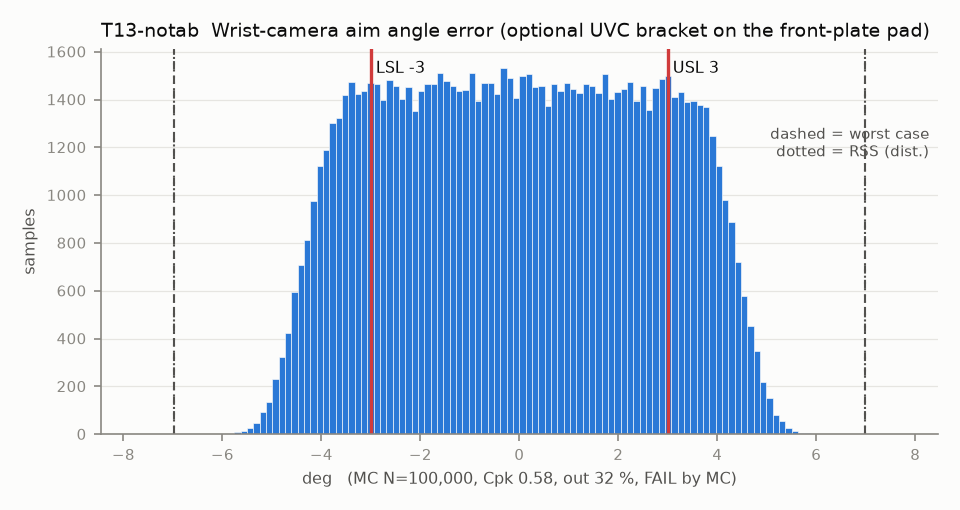

# T13-notab — Wrist-camera aim angle error (optional UVC bracket on the front-plate pad)

Variant of `T13` (rejected): no locating tab: rotation set by 2 screws in Ø3.6 holes

- Requirement: Optical axis within +/-3 deg of nominal so the fingertips stay in view without re-aiming (extrinsics are calibrated anyway).
- Spec: LSL -3.000, USL 3.000 deg
- Acceptance: MC (Cpk ≥ 1.33, percentile method)
- Model: linear; source file `T13_camera_aim.yaml`; seed 20260922

Rev A pad: 2 heat-set inserts 8.1 apart plus a 3 x 2 x 1.5 locating tab slot (fix 11). The primary camera is fixed off-arm (camera.md 0), so this stack only matters if the wrist UVC option is built. The tab, not the screws, sets the bracket rotation.

| Contributor | Kind | Nominal | Bias | Tol (−/+) | Sens. | Dist | σ | Var % | Tag | Source |
|---|---|---:|---:|---|---:|---|---:|---:|---|---|
| housing_boss_perpendicularity | linear | 0.000 | 0.000 | -0.573 / +0.573 | 1.0000 | normal | 0.1910 | 0.5 | A | perp 0.2 over 20 to A |
| bracket_face_perpendicularity | linear | 0.000 | 0.000 | -0.573 / +0.573 | 1.0000 | normal | 0.1910 | 0.5 | A |  |
| board_float | linear | 0.000 | 0.000 | -0.409 / +0.409 | 1.0000 | uniform | 0.2363 | 0.8 | A | 4x M2 |
| lens_tilt | linear | 0.000 | 0.000 | -1.000 / +1.000 | 1.0000 | normal | 0.3333 | 1.6 | A |  |
| bracket_rotation_float | linear | 0.000 | 0.000 | -4.428 / +4.428 | 1.0000 | uniform | 2.5565 | 96.5 | D | bracket float on 2 screws 8.1 apart (inserts in the pad: one part floats) |

| Result | Value |
|---|---|
| Nominal | 0.000 |
| Mean-shifted centre | 0.000 |
| Worst case | -6.983 … 6.983 (fail) |
| RSS classic (t = 3σ) | -4.629 … 4.629 |
| RSS distribution-adjusted | -6.983 … 6.983 † (fail); clipped to WC, unclipped -7.809 … 7.809 |
| MC mean / σ | 0.008 / 2.5946 |
| MC 0.135 % … 99.865 % | -5.173 … 5.208 |
| MC min … max | -6.049 … 6.148 |
| MC out of spec | 32 % |
| Cpk percentile / normal | 0.58 ± 0.00 / 0.38 ± 0.00 |
| Yield (MC) | 68.01 % |
| Dominant contributor | bracket_rotation_float (96 %) |
| Pass/fail by the declared method (MC) | FAIL |
| **Verdict (pass / marginal / fail)** | **FAIL** |

