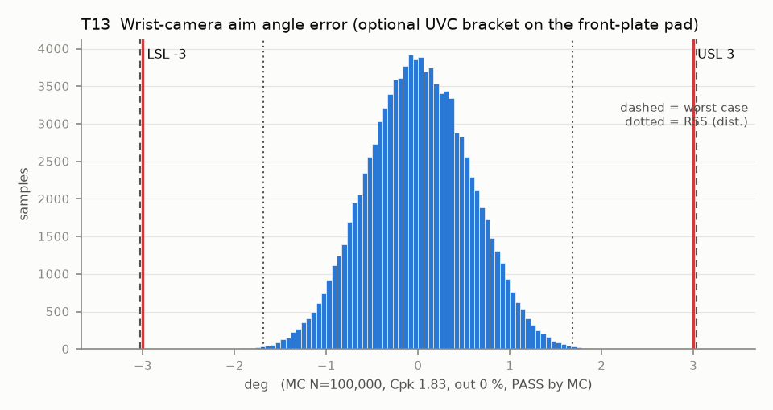

# T13 — Wrist-camera aim angle error (optional UVC bracket on the front-plate pad)

Baseline: CAD rev A as drawn (`cad/gripper/params.json`, `cad/gripper/README.md`).

- Requirement: Optical axis within +/-3 deg of nominal so the fingertips stay in view without re-aiming (extrinsics are calibrated anyway).
- Spec: LSL -3.000, USL 3.000 deg
- Acceptance: MC (Cpk ≥ 1.33, percentile method)
- Model: linear; source file `T13_camera_aim.yaml`; seed 20260922

Rev A pad: 2 heat-set inserts 8.1 apart plus a 3 x 2 x 1.5 locating tab slot (fix 11). The primary camera is fixed off-arm (camera.md 0), so this stack only matters if the wrist UVC option is built. The tab, not the screws, sets the bracket rotation.

| Contributor | Kind | Nominal | Bias | Tol (−/+) | Sens. | Dist | σ | Var % | Tag | Source |
|---|---|---:|---:|---|---:|---|---:|---:|---|---|
| bracket_tab_float | linear | 0.000 | 0.000 | -0.477 / +0.477 | 1.0000 | uniform | 0.2757 | 24.1 | A | tab in its slot |
| housing_boss_perpendicularity | linear | 0.000 | 0.000 | -0.573 / +0.573 | 1.0000 | normal | 0.1910 | 11.5 | A | perp 0.2 over 20 to A |
| bracket_face_perpendicularity | linear | 0.000 | 0.000 | -0.573 / +0.573 | 1.0000 | normal | 0.1910 | 11.5 | A |  |
| board_float | linear | 0.000 | 0.000 | -0.409 / +0.409 | 1.0000 | uniform | 0.2363 | 17.7 | A | 4x M2 |
| lens_tilt | linear | 0.000 | 0.000 | -1.000 / +1.000 | 1.0000 | normal | 0.3333 | 35.2 | A |  |

| Result | Value |
|---|---|
| Nominal | 0.000 |
| Mean-shifted centre | 0.000 |
| Worst case | -3.033 … 3.033 (fail) |
| RSS classic (t = 3σ) | -1.432 … 1.432 |
| RSS distribution-adjusted | -1.686 … 1.686 (pass) |
| MC mean / σ | 0.001 / 0.5631 |
| MC 0.135 % … 99.865 % | -1.637 … 1.624 |
| MC min … max | -2.338 … 2.144 |
| MC out of spec | <30 ppm (0 of 100,000 samples; 95% upper bound) |
| Cpk percentile / normal | 1.83 ± 0.01 / 1.77 ± 0.00 |
| Yield (MC) | 100.000 % (<30 ppm (0 of 100,000 samples; 95% upper bound) out) |
| Dominant contributor | lens_tilt (35 %) |
| Pass/fail by the declared method (MC) | PASS |
| **Verdict (pass / marginal / fail)** | **PASS** |

