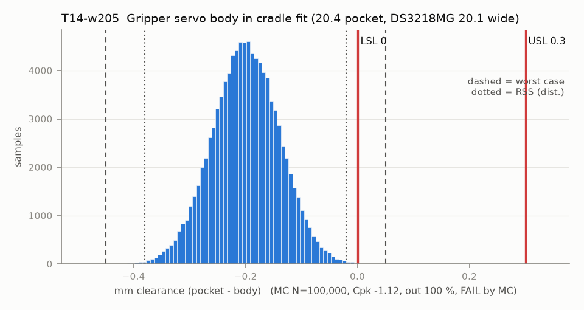

# T14-w205 — Gripper servo body in cradle fit (20.4 pocket, DS3218MG 20.1 wide)

Variant of `T14` (scenario): servo body 20.5 (actuators.csv A17) in the rev A 20.4 pocket: it does not fit

- Requirement: Servo drops in (>= 0) and floats <= 0.30 (in rev A the float feeds the dog coupling, T14B).
- Spec: LSL 0.000, USL 0.300 mm clearance (pocket - body)
- Acceptance: MC (Cpk ≥ 1.33, percentile method)
- Model: linear; source file `T14_servo_cradle.yaml`; seed 20260922

| Contributor | Kind | Nominal | Bias | Tol (−/+) | Sens. | Dist | σ | Var % | Tag | Source |
|---|---|---:|---:|---|---:|---|---:|---:|---|---|
| pocket_width | linear | 20.400 | -0.100 | -0.150 / +0.150 | 1.0000 | normal | 0.0500 | 69.2 | A | README pocket 20.4 [D]; pocket bias and scatter [A] |
| servo_body_width | linear | 20.500 | 0.000 | -0.100 / +0.100 | -1.0000 | normal | 0.0333 | 30.8 | S | DS3218MG 20.1 [S servodatabase]; tol [A] |
| hot_seat_creep | linear | 0.000 | 0.000 | -0.000 / +0.000 | 1.0000 | uniform | 0.0000 | 0.0 | A | hot scenario only (0 when cold): PETG seat relaxes, servo shifts in its pocket |

| Result | Value |
|---|---|
| Nominal | -0.100 |
| Mean-shifted centre | -0.200 |
| Worst case | -0.450 … 0.050 (fail) |
| RSS classic (t = 3σ) | -0.380 … -0.020 |
| RSS distribution-adjusted | -0.380 … -0.020 (fail) |
| MC mean / σ | -0.200 / 0.0602 |
| MC 0.135 % … 99.865 % | -0.379 … -0.020 |
| MC min … max | -0.447 … 0.053 |
| MC out of spec | 100 % |
| Cpk percentile / normal | -1.12 ± 0.01 / -1.11 ± 0.00 |
| Yield (MC) | 0.03 % |
| Dominant contributor | pocket_width (69 %) |
| Pass/fail by the declared method (MC) | FAIL |
| **Verdict (pass / marginal / fail)** | **FAIL** |

