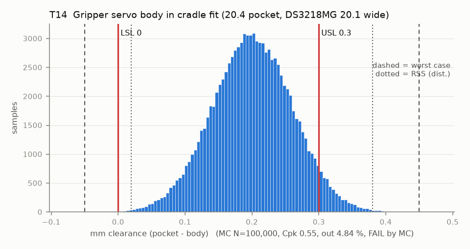

# T14 — Gripper servo body in cradle fit (20.4 pocket, DS3218MG 20.1 wide)

Baseline: CAD rev A as drawn (`cad/gripper/params.json`, `cad/gripper/README.md`).

- Requirement: Servo drops in (>= 0) and floats <= 0.30 (in rev A the float feeds the dog coupling, T14B).
- Spec: LSL 0.000, USL 0.300 mm clearance (pocket - body)
- Acceptance: MC (Cpk ≥ 1.33, percentile method)
- Model: linear; source file `T14_servo_cradle.yaml`; seed 20260922

| Contributor | Kind | Nominal | Bias | Tol (−/+) | Sens. | Dist | σ | Var % | Tag | Source |
|---|---|---:|---:|---|---:|---|---:|---:|---|---|
| pocket_width | linear | 20.400 | -0.100 | -0.150 / +0.150 | 1.0000 | normal | 0.0500 | 69.2 | A | README pocket 20.4 [D]; pocket bias and scatter [A] |
| servo_body_width | linear | 20.100 | 0.000 | -0.100 / +0.100 | -1.0000 | normal | 0.0333 | 30.8 | S | DS3218MG 20.1 [S servodatabase]; tol [A] |
| hot_seat_creep | linear | 0.000 | 0.000 | -0.000 / +0.000 | 1.0000 | uniform | 0.0000 | 0.0 | A | hot scenario only (0 when cold): PETG seat relaxes, servo shifts in its pocket |

| Result | Value |
|---|---|
| Nominal | 0.300 |
| Mean-shifted centre | 0.200 |
| Worst case | -0.050 … 0.450 (fail) |
| RSS classic (t = 3σ) | 0.020 … 0.380 |
| RSS distribution-adjusted | 0.020 … 0.380 (fail) |
| MC mean / σ | 0.200 / 0.0602 |
| MC 0.135 % … 99.865 % | 0.021 … 0.380 |
| MC min … max | -0.047 … 0.453 |
| MC out of spec | 4.84 % |
| Cpk percentile / normal | 0.55 ± 0.00 / 0.55 ± 0.00 |
| Yield (MC) | 95.16 % |
| Dominant contributor | pocket_width (69 %) |
| Pass/fail by the declared method (MC) | FAIL |
| **Verdict (pass / marginal / fail)** | **FAIL** |

Cheapest fix: Locate the servo by its output boss (the T14B fix) so the cradle no longer has to locate it, then open the pocket to CAD 20.5 so it always drops in (T14-boss205). The listed DS3218MG width is 20.1, not the CAD 20.0. (proved by `T14-boss205`)

