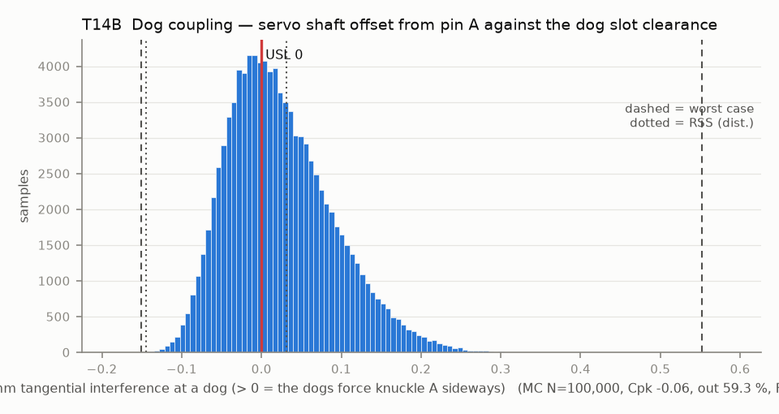

# T14B — Dog coupling — servo shaft offset from pin A against the dog slot clearance

Baseline: CAD rev A as drawn (`cad/gripper/params.json`, `cad/gripper/README.md`).

- Requirement: The servo shaft axis and pin A are two separate axes. The two M3 dogs on the horn sit in radial slots in knuckle A, so the slots absorb any offset along the slot, but an offset across the slot must fit inside the tangential half-clearance, or the coupling side-loads the servo bearing and pin A.
- Spec: USL 0.000 mm tangential interference at a dog (> 0 = the dogs force knuckle A sideways)
- Acceptance: WC
- Model: expression; source file `T14B_dog_coupling.yaml`; seed 20260922

Once the boss locates the servo (boss, boss34), the servo case width does not enter this stack at all; only the cradle-located layouts use servo_body_w. Offset across the slot = shaft in case + servo float in the cradle + cradle to pin A hole + spline play + dog screw position + knuckle A float on its pin. For boss variants, wall lean moves the web bore by boss_web_to_pinA * pin_perp_zone / pin_span = 6.30 * 0.10 / 15 = 0.042 mm. Servo-axis direction is set by the ear seats and cradle floor, not the 1.6 mm bore engagement; ear-seat flatness moves the dog plane by boss_to_dog_lever * mount_flatness / servo_ear_span = 3.05 * 0.20 / 54.5 = 0.011 mm. Both levers are CAD derived. Half-clearance = (printed slot width - screw major) / 2. Rev A has 0.06 nominal half-clearance against an offset that can reach 0.5.

Var % from Monte Carlo freeze-one (non-linear model); Sens. is a central difference at the mids and does not rank contributors. Worst case is taken over the corners only, so a minimum inside the box (the kink of abs()) can be missed.

| Contributor | Kind | Nominal | Bias | Tol (−/+) | Sens. | Dist | σ | Var % | Tag | Source |
|---|---|---:|---:|---|---:|---|---:|---:|---|---|
| shaft_in_case | linear | 0.000 | 0.000 | -0.200 / +0.200 | 0.0000 | normal | 0.0667 | 37.9 | A | unpublished |
| servo_float | linear | 0.000 | 0.000 | -0.100 / +0.100 | 0.0000 | uniform | 0.0577 | 25.0 | D | T14 nominal clearance / 2 |
| cradle_to_pinA | linear | 0.000 | 0.000 | -0.100 / +0.100 | 0.0000 | normal | 0.0333 | 8.9 | S | one mid-plate print, < 30 mm |
| spline_play | linear | 0.000 | 0.000 | -0.050 / +0.050 | 0.0000 | uniform | 0.0289 | 6.9 | A |  |
| dog_pos | linear | 0.000 | 0.000 | -0.050 / +0.050 | 0.0000 | normal | 0.0167 | 2.3 | A | dog screw holes in the horn |
| pinA_float | linear | 0.000 | 0.000 | -0.007 / +0.007 | 0.0000 | uniform | 0.0040 | 0.1 | D | knuckle A sleeve on pin A |
| slot_w | linear | 3.140 | -0.100 | -0.150 / +0.150 | -0.5000 | normal | 0.0500 | 13.8 | A | params.json dog_slot_w 3.14 [D]; slot bias and scatter [A] |
| dog_d | linear | 2.927 | 0.000 | -0.053 / +0.053 | 0.5000 | uniform | 0.0306 | 5.1 | S | M3 6g major |
| hot_servo_shift | linear | 0.000 | 0.000 | -0.000 / +0.000 | 0.0000 | uniform | 0.0000 | 0.0 | A | hot scenario only (0 when cold): PETG seat relaxes, servo shifts |
| hot_shaft_shift | linear | 0.000 | 0.000 | -0.000 / +0.000 | 0.0000 | normal | 0.0000 | 0.0 | A | hot scenario only (0 when cold): shaft position term widens |

| Result | Value |
|---|---|
| Nominal | -0.107 |
| Mean-shifted centre | -0.056 |
| Worst case | -0.151 … 0.552 (fail) |
| RSS classic (t = 3σ) | -0.136 … 0.023 — not valid: non-linear model, use Monte Carlo |
| RSS distribution-adjusted | -0.144 … 0.031 (fail) — not valid: non-linear model, use Monte Carlo |
| MC mean / σ | 0.024 / 0.0664 |
| MC 0.135 % … 99.865 % | -0.119 … 0.265 |
| MC min … max | -0.165 … 0.387 |
| MC out of spec | 59.3 % |
| Cpk percentile / normal | -0.06 ± 0.00 / -0.12 ± 0.00 |
| Yield (MC) | 40.68 % |
| Dominant contributor | shaft_in_case (38 %) |
| Pass/fail by the declared method (WC) | FAIL |
| **Verdict (pass / marginal / fail)** | **FAIL** |

Cheapest fix: Locate the servo by its Ø9 output boss in a reamed bore in the 1.6 mm housing web at the case top (the boss is concentric with the shaft) and open the dog slots to 3.4 (lash about +/-1.5 deg [A: arithmetic here, (3.4 - 0.1 - 2.927) / (2 x 7 mm) rad]). With the web terms T14B-boss34 fails at Cpk 0.98. A 3.42 mm slot adds 0.010 mm half-clearance and restores about Cpk 1.05, but costs the closure window; the robust fix is a zero-lash coupling that takes offset, such as an Oldham disc. (proved by `T14B-boss34`)

