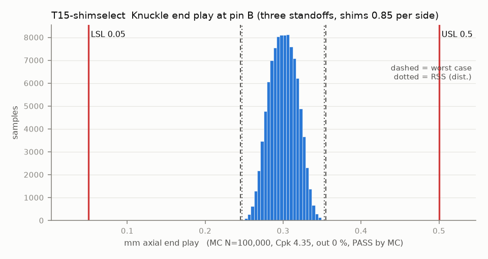

# T15-shimselect — Knuckle end play at pin B (three standoffs, shims 0.85 per side)

Variant of `T15` (option): shims picked at assembly from a 0.05-step set

- Requirement: Knuckle B turns freely (>= 0.05) with <= 0.5 axial float.
- Spec: LSL 0.050, USL 0.500 mm axial end play
- Acceptance: MC (Cpk ≥ 1.33, percentile method)
- Model: linear; source file `T15_standoff_endplay.yaml`; seed 20260922

The front plate sits on three standoff tops at (-24.5, 13), (24.5, 13) and (0, 15.5). Both pins are at y 0, outside that triangle, so the plate plane is extrapolated: a top-height error moves the gap at pin B by 3.39 (near standoff), 2.81 (far standoff) and -5.2 (centre standoff) times itself. The three tops share one print height (common term); only their differences tilt the plate.

| Contributor | Kind | Nominal | Bias | Tol (−/+) | Sens. | Dist | σ | Var % | Tag | Source |
|---|---|---:|---:|---|---:|---|---:|---:|---|---|
| hot_endplay | linear | 0.000 | 0.000 | -0.000 / +0.000 | 1.0000 | uniform | 0.0000 | 0.0 | A | hot scenario only (0 when cold): warm PETG plates against PA6-CF knuckles, stand-in amount |
| endplay_set | linear | 0.300 | 0.000 | -0.025 / +0.025 | 1.0000 | uniform | 0.0144 | 67.6 | A | half a 0.05 shim step |
| feeler_error | linear | 0.000 | 0.000 | -0.030 / +0.030 | 1.0000 | normal | 0.0100 | 32.4 | A | feeler gauge reading |

| Result | Value |
|---|---|
| Nominal | 0.300 |
| Mean-shifted centre | 0.300 |
| Worst case | 0.245 … 0.355 (pass) |
| RSS classic (t = 3σ) | 0.261 … 0.339 |
| RSS distribution-adjusted | 0.247 … 0.353 (pass) |
| MC mean / σ | 0.300 / 0.0175 |
| MC 0.135 % … 99.865 % | 0.255 … 0.346 |
| MC min … max | 0.242 … 0.363 |
| MC out of spec | <30 ppm (0 of 100,000 samples; 95% upper bound) |
| Cpk percentile / normal | 4.35 ± 0.05 / 3.80 ± 0.01 |
| Yield (MC) | 100.000 % (<30 ppm (0 of 100,000 samples; 95% upper bound) out) |
| Dominant contributor | endplay_set (68 %) |
| Pass/fail by the declared method (MC) | PASS |
| **Verdict (pass / marginal / fail)** | **PASS** |

