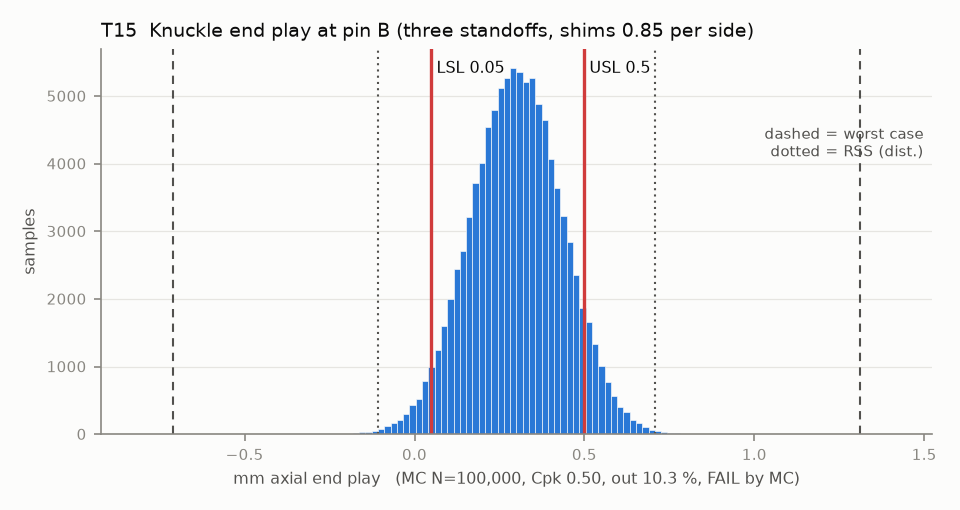

# T15 — Knuckle end play at pin B (three standoffs, shims 0.85 per side)

Baseline: CAD rev A as drawn (`cad/gripper/params.json`, `cad/gripper/README.md`).

- Requirement: Knuckle B turns freely (>= 0.05) with <= 0.5 axial float.
- Spec: LSL 0.050, USL 0.500 mm axial end play
- Acceptance: MC (Cpk ≥ 1.33, percentile method)
- Model: linear; source file `T15_standoff_endplay.yaml`; seed 20260922

The front plate sits on three standoff tops at (-24.5, 13), (24.5, 13) and (0, 15.5). Both pins are at y 0, outside that triangle, so the plate plane is extrapolated: a top-height error moves the gap at pin B by 3.39 (near standoff), 2.81 (far standoff) and -5.2 (centre standoff) times itself. The three tops share one print height (common term); only their differences tilt the plate.

| Contributor | Kind | Nominal | Bias | Tol (−/+) | Sens. | Dist | σ | Var % | Tag | Source |
|---|---|---:|---:|---|---:|---|---:|---:|---|---|
| standoff_common | linear | 0.000 | 0.000 | -0.150 / +0.150 | 1.0000 | normal | 0.0500 | 13.5 | S | all three tops, one print height (Z band) |
| standoff_near | linear | 0.000 | 0.000 | -0.050 / +0.050 | 3.3910 | normal | 0.0167 | 17.2 | A | top-height difference on one layer (basis plate_flat) |
| standoff_far | linear | 0.000 | 0.000 | -0.050 / +0.050 | 2.8090 | normal | 0.0167 | 11.8 | A |  |
| standoff_top | linear | 0.000 | 0.000 | -0.050 / +0.050 | -5.2000 | normal | 0.0167 | 40.5 | A |  |
| mid_plate_flatness | linear | 0.000 | 0.000 | -0.050 / +0.050 | 1.0000 | normal | 0.0167 | 1.5 | A | at the pin boss |
| front_plate_flatness | linear | 0.000 | 0.000 | -0.050 / +0.050 | 1.0000 | normal | 0.0167 | 1.5 | A | at the pin boss |
| knuckle_B_hub | linear | 8.000 | 0.000 | -0.150 / +0.150 | -1.0000 | normal | 0.0500 | 13.5 | S | hub 8 printed in Z (Z band) |
| shim_B_back | linear | 0.850 | 0.000 | -0.020 / +0.020 | -1.0000 | normal | 0.0067 | 0.2 | A | params.json shim_t |
| shim_B_front | linear | 0.850 | 0.000 | -0.020 / +0.020 | -1.0000 | normal | 0.0067 | 0.2 | A | params.json shim_t |
| hot_endplay | linear | 0.000 | 0.000 | -0.000 / +0.000 | 1.0000 | uniform | 0.0000 | 0.0 | A | hot scenario only (0 when cold): warm PETG plates against PA6-CF knuckles, stand-in amount |

| Result | Value |
|---|---|
| Nominal | 0.300 |
| Mean-shifted centre | 0.300 |
| Worst case | -0.710 … 1.310 (fail) |
| RSS classic (t = 3σ) | -0.109 … 0.709 |
| RSS distribution-adjusted | -0.109 … 0.709 (fail) |
| MC mean / σ | 0.300 / 0.1357 |
| MC 0.135 % … 99.865 % | -0.113 … 0.702 |
| MC min … max | -0.257 … 0.894 |
| MC out of spec | 10.3 % |
| Cpk percentile / normal | 0.50 ± 0.01 / 0.49 ± 0.00 |
| Yield (MC) | 89.67 % |
| Dominant contributor | standoff_top (41 %) |
| Pass/fail by the declared method (MC) | FAIL |
| **Verdict (pass / marginal / fail)** | **FAIL** |

Cheapest fix: Pick the shims at assembly: measure the gap at each pin with feeler gauges and stack shims from a 0.05-step set so the end play lands at 0.3 +/- 0.05 (T15-shimselect). No CAD change; buy a shim assortment. (proved by `T15-shimselect`)

