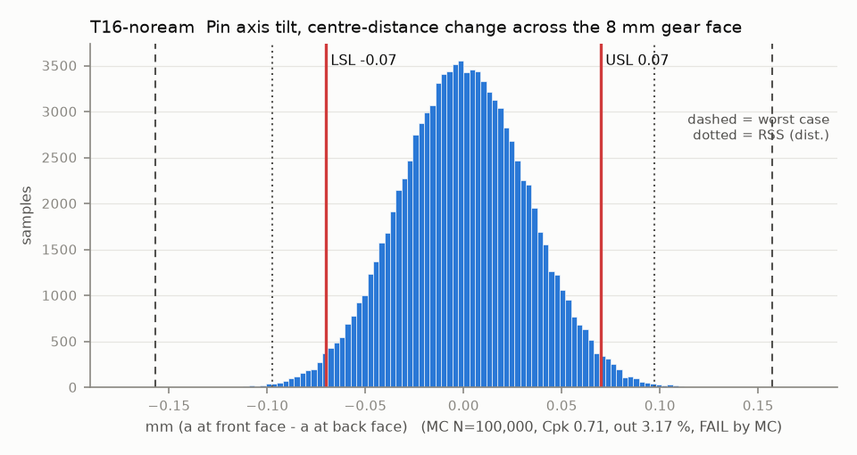

# T16-noream — Pin axis tilt, centre-distance change across the 8 mm gear face

Variant of `T16` (scenario): line reaming skipped: plate holes as printed, front plate located by the pins

- Requirement: Centre distance varies <= 0.07 mm across the face (axes A and B parallel in the plane of centres).
- Spec: LSL -0.070, USL 0.070 mm (a at front face - a at back face)
- Acceptance: MC (Cpk ≥ 1.33, percentile method)
- Model: linear; source file `T16_pin_tilt.yaml`; seed 20260922

Rev A: pins A and B are pressed through the mid and front plates, whose holes are line-reamed together. A pin tilts by (front hole offset - mid hole offset) / pin span; each knuckle can also cock in its sleeve by clearance / sleeve length. Every term is the change of a across face_b.

| Contributor | Kind | Nominal | Bias | Tol (−/+) | Sens. | Dist | σ | Var % | Tag | Source |
|---|---|---:|---:|---|---:|---|---:|---:|---|---|
| pinA_coax | linear | 0.000 | 0.000 | -0.100 / +0.100 | -0.6400 | normal | 0.0333 | 43.3 | A | line-reamed plate holes |
| pinB_coax | linear | 0.000 | 0.000 | -0.100 / +0.100 | 0.6400 | normal | 0.0333 | 43.3 | A | line-reamed plate holes |
| knuckleA_tilt_on_pin | linear | 0.000 | 0.000 | -0.015 / +0.015 | -1.0000 | uniform | 0.0084 | 6.7 | D | sleeve clearance over the sleeve length |
| knuckleB_tilt_on_pin | linear | 0.000 | 0.000 | -0.015 / +0.015 | 1.0000 | uniform | 0.0084 | 6.7 | D | same |

| Result | Value |
|---|---|
| Nominal | 0.000 |
| Mean-shifted centre | 0.000 |
| Worst case | -0.157 … 0.157 (fail) |
| RSS classic (t = 3σ) | -0.093 … 0.093 |
| RSS distribution-adjusted | -0.097 … 0.097 (fail) |
| MC mean / σ | 0.000 / 0.0326 |
| MC 0.135 % … 99.865 % | -0.097 … 0.098 |
| MC min … max | -0.131 … 0.150 |
| MC out of spec | 3.17 % |
| Cpk percentile / normal | 0.71 ± 0.01 / 0.72 ± 0.00 |
| Yield (MC) | 96.83 % |
| Dominant contributor | pinA_coax (43 %) |
| Pass/fail by the declared method (MC) | FAIL |
| **Verdict (pass / marginal / fail)** | **FAIL** |

