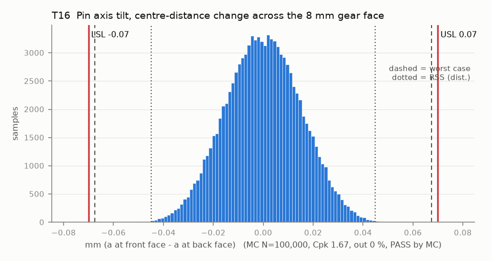

# T16 — Pin axis tilt, centre-distance change across the 8 mm gear face

Baseline: CAD rev A as drawn (`cad/gripper/params.json`, `cad/gripper/README.md`).

- Requirement: Centre distance varies <= 0.07 mm across the face (axes A and B parallel in the plane of centres).
- Spec: LSL -0.070, USL 0.070 mm (a at front face - a at back face)
- Acceptance: MC (Cpk ≥ 1.33, percentile method)
- Model: linear; source file `T16_pin_tilt.yaml`; seed 20260922

Rev A: pins A and B are pressed through the mid and front plates, whose holes are line-reamed together. A pin tilts by (front hole offset - mid hole offset) / pin span; each knuckle can also cock in its sleeve by clearance / sleeve length. Every term is the change of a across face_b.

| Contributor | Kind | Nominal | Bias | Tol (−/+) | Sens. | Dist | σ | Var % | Tag | Source |
|---|---|---:|---:|---|---:|---|---:|---:|---|---|
| pinA_coax | linear | 0.000 | 0.000 | -0.030 / +0.030 | -0.6400 | normal | 0.0100 | 18.4 | A | line-reamed plate holes |
| pinB_coax | linear | 0.000 | 0.000 | -0.030 / +0.030 | 0.6400 | normal | 0.0100 | 18.4 | A | line-reamed plate holes |
| knuckleA_tilt_on_pin | linear | 0.000 | 0.000 | -0.015 / +0.015 | -1.0000 | uniform | 0.0084 | 31.6 | D | sleeve clearance over the sleeve length |
| knuckleB_tilt_on_pin | linear | 0.000 | 0.000 | -0.015 / +0.015 | 1.0000 | uniform | 0.0084 | 31.6 | D | same |

| Result | Value |
|---|---|
| Nominal | 0.000 |
| Mean-shifted centre | 0.000 |
| Worst case | -0.067 … 0.067 (pass) |
| RSS classic (t = 3σ) | -0.034 … 0.034 |
| RSS distribution-adjusted | -0.045 … 0.045 (pass) |
| MC mean / σ | -0.000 / 0.0150 |
| MC 0.135 % … 99.865 % | -0.042 … 0.042 |
| MC min … max | -0.057 … 0.059 |
| MC out of spec | <30 ppm (0 of 100,000 samples; 95% upper bound) |
| Cpk percentile / normal | 1.67 ± 0.01 / 1.56 ± 0.00 |
| Yield (MC) | 100.000 % (<30 ppm (0 of 100,000 samples; 95% upper bound) out) |
| Dominant contributor | knuckleA_tilt_on_pin (32 %) |
| Pass/fail by the declared method (MC) | PASS |
| **Verdict (pass / marginal / fail)** | **PASS** |

