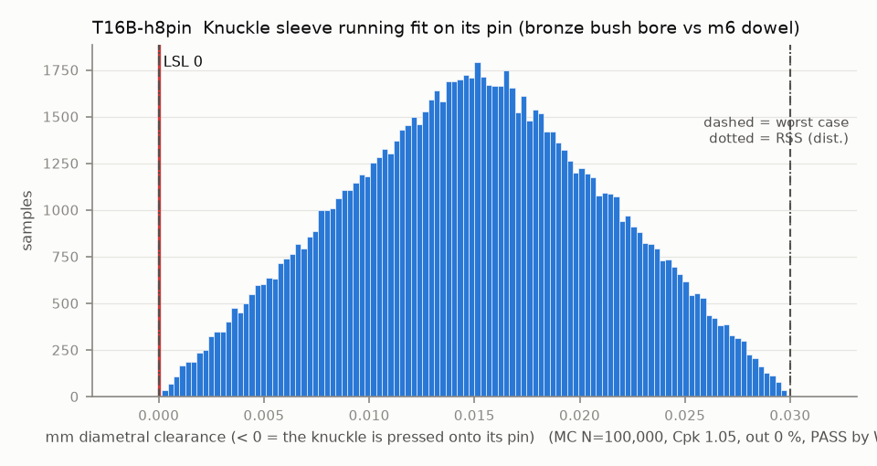

# T16B-h8pin — Knuckle sleeve running fit on its pin (bronze bush bore vs m6 dowel)

Variant of `T16B` (option): ISO 2338 h8 pin 2.986-3.000 as the knuckle shaft

- Requirement: Each knuckle turns on its pin, so the sleeve bore is never smaller than the pin.
- Spec: LSL 0.000 mm diametral clearance (< 0 = the knuckle is pressed onto its pin)
- Acceptance: WC
- Model: linear; source file `T16B_sleeve_running_fit.yaml`; seed 20260922

A sintered bronze bush comes F7 (3.006-3.016) and closes to H7 (3.000-3.010) when pressed into a rigid H7 housing; a printed PA6-CF knuckle closes it somewhere in between, so the bore is taken as uniform over 3.000-3.016. The m6 dowel is 3.002-3.008. The lower limit stays 0.000 (line-to-line is accepted: oil-impregnated bush, H7/h6-type sliding fit [A], worst case only, and the assembly check turns every pair by hand). The rev B pins are graded to the pressed bore so each pair is 0.000-0.020 (case revb: pin_clear 0.020), which T16 needs.

| Contributor | Kind | Nominal | Bias | Tol (−/+) | Sens. | Dist | σ | Var % | Tag | Source |
|---|---|---:|---:|---|---:|---|---:|---:|---|---|
| sleeve_bore | linear | 3.008 | 0.000 | -0.008 / +0.008 | 1.0000 | uniform | 0.0046 | 56.6 | S | HPC Oilite catalogue pp. 40-43 |
| pin_d | linear | 2.993 | 0.000 | -0.007 / +0.007 | -1.0000 | uniform | 0.0040 | 43.4 | A | h8 limits from the ISO 286 grade table, not found on a public catalogue page (basis.yaml pin_h8_min/max); confirm on the supplier sheet |

| Result | Value |
|---|---|
| Nominal | 0.015 |
| Mean-shifted centre | 0.015 |
| Worst case | -0.000 … 0.030 (pass) |
| RSS classic (t = 3σ) | 0.004 … 0.026 |
| RSS distribution-adjusted | -0.000 … 0.030 † (pass); clipped to WC, unclipped -0.003 … 0.033 |
| MC mean / σ | 0.015 / 0.0061 |
| MC 0.135 % … 99.865 % | 0.001 … 0.029 |
| MC min … max | 0.000 … 0.030 |
| MC out of spec | <30 ppm (0 of 100,000 samples; 95% upper bound) |
| Cpk percentile / normal | 1.05 ± 0.00 / 0.81 ± 0.00 |
| Yield (MC) | 100.000 % (<30 ppm (0 of 100,000 samples; 95% upper bound) out) |
| Dominant contributor | sleeve_bore (57 %) |
| Pass/fail by the declared method (WC) | PASS |
| **Verdict (pass / marginal / fail)** | **PASS** |

