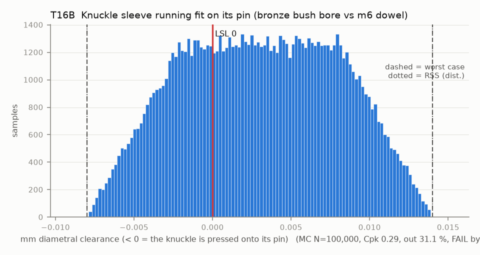

# T16B — Knuckle sleeve running fit on its pin (bronze bush bore vs m6 dowel)

Baseline: CAD rev A as drawn (`cad/gripper/params.json`, `cad/gripper/README.md`).

- Requirement: Each knuckle turns on its pin, so the sleeve bore is never smaller than the pin.
- Spec: LSL 0.000 mm diametral clearance (< 0 = the knuckle is pressed onto its pin)
- Acceptance: WC
- Model: linear; source file `T16B_sleeve_running_fit.yaml`; seed 20260922

A sintered bronze bush comes F7 (3.006-3.016) and closes to H7 (3.000-3.010) when pressed into a rigid H7 housing; a printed PA6-CF knuckle closes it somewhere in between, so the bore is taken as uniform over 3.000-3.016. The m6 dowel is 3.002-3.008. The lower limit stays 0.000 (line-to-line is accepted: oil-impregnated bush, H7/h6-type sliding fit [A], worst case only, and the assembly check turns every pair by hand). The rev B pins are graded to the pressed bore so each pair is 0.000-0.020 (case revb: pin_clear 0.020), which T16 needs.

| Contributor | Kind | Nominal | Bias | Tol (−/+) | Sens. | Dist | σ | Var % | Tag | Source |
|---|---|---:|---:|---|---:|---|---:|---:|---|---|
| sleeve_bore | linear | 3.008 | 0.000 | -0.008 / +0.008 | 1.0000 | uniform | 0.0046 | 87.7 | S | HPC Oilite catalogue pp. 40-43 |
| pin_d | linear | 3.005 | 0.000 | -0.003 / +0.003 | -1.0000 | uniform | 0.0017 | 12.3 | S | ISO 8734 m6 (McMaster) |

| Result | Value |
|---|---|
| Nominal | 0.003 |
| Mean-shifted centre | 0.003 |
| Worst case | -0.008 … 0.014 (fail) |
| RSS classic (t = 3σ) | -0.006 … 0.012 |
| RSS distribution-adjusted | -0.008 … 0.014 † (fail); clipped to WC, unclipped -0.012 … 0.018 |
| MC mean / σ | 0.003 / 0.0049 |
| MC 0.135 % … 99.865 % | -0.007 … 0.014 |
| MC min … max | -0.008 … 0.014 |
| MC out of spec | 31.1 % |
| Cpk percentile / normal | 0.29 ± 0.00 / 0.20 ± 0.00 |
| Yield (MC) | 68.93 % |
| Dominant contributor | sleeve_bore (88 %) |
| Pass/fail by the declared method (WC) | FAIL |
| **Verdict (pass / marginal / fail)** | **FAIL** |

Cheapest fix: Use an h8 pin (ISO 2338, 2.986-3.000) instead of the m6 dowel (T16B-h8pin). The bush maker recommends a running shaft of f7 or h7, and m6 is a press-fit size. Buy 3 x 6 bushes (no 3 x 5 bush was found in the catalogue searched [A]; confirm with the supplier) and open the knuckle bore to 6. The worst case of the fix is exactly 0.000 clearance (3.000 pin in a 3.000 bore), so check a few pins and pressed bores. (proved by `T16B-h8pin`)

