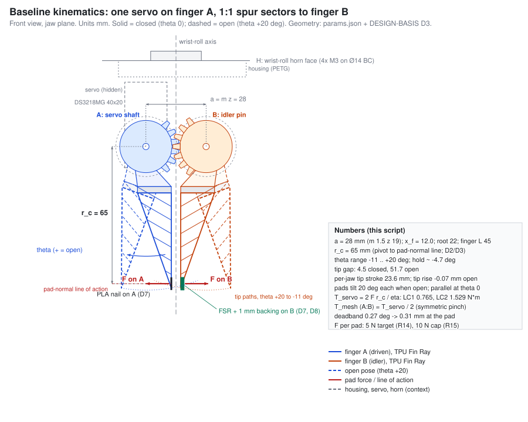
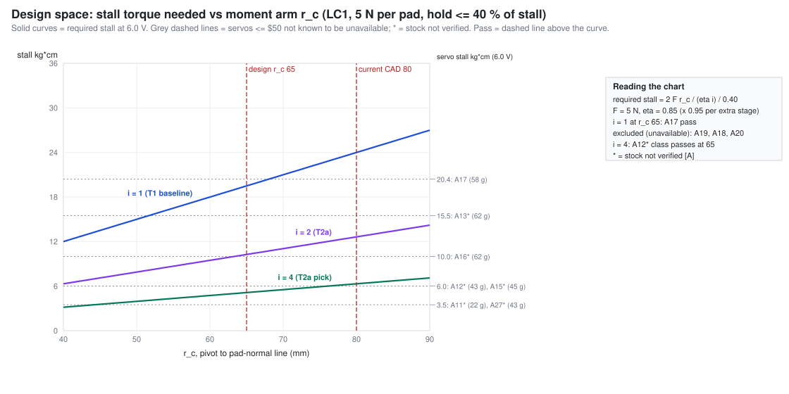

# Cloth-feed gripper: concept description

Concepts to iterate, the design space of each subsystem, the calculations each concept needs, and a scored comparison. Dated 2026-09-22. `DESIGN-BASIS.md` owns requirements (R), load cases (LC), decisions (D) and measurements (M); this file cites those IDs and does not restate their values unless a comparison needs them.

- **Numbers:** screening numbers come from `analysis/gripper/concept_figures.py` (stdlib only). Inputs: `cad/gripper/params.json`, `docs/gripper/design_basis_out.json`, `docs/gripper/research/actuators.csv`, and the script's `ASSUMED` table. Output: `docs/gripper/figures/concept_numbers.json`, the run log `docs/gripper/figures/concept_figures_stdout.txt`, and the SVGs in section 9. Re-run with `uv run python analysis/gripper/concept_figures.py` (under 1 s).
- **Tags:** **[S]** sourced (research note or URL), **[D]** derived (script named, or equation shown), **[A]** assumed and reversible. `[D cf]` means derived by `concept_figures.py`; `[D DB]` means derived by `docs/gripper/design_basis.py` and stated in `DESIGN-BASIS.md`.
- **Level:** first-order statics, kinematics and the W2a close-time model, good enough to rank concepts. The owning scripts in the calculation register (section 8) replace these numbers.

**R19 ruling (2026-10-12):** full close within 0.75 s. C0 remains the selected build baseline by ruling. The actuator and Pugh screens below retain the selection basis 0.5 s (R19 at selection; superseded 2026-10-12); their computed ranks are evidence, not a new selection. `concept_numbers.json` reports the current 0.75 s check separately.

**Current generated timing (unchanged model):** C0 0.284 s; C1 0.403 s; C2 0.535 s; C2p 0.535 s; C3 0.624 s; C3b 0.409 s. All six meet the ruled 0.75 s timing limit; the retained 0.5 s selection screen (superseded 2026-10-12) still ranks C3b, C1, C0. C0 stays selected by ruling. Earlier rounded screening examples below are historical comparisons, not new selections.

## 0. Headline

1. **The baseline (C0) closes, but only just.** DS3218MG hold margin is +4.6 % at LC1 on the design-basis torque and 6.0 V [D cf], and +1.0 % on W2a's 0.792 N·m hold torque [D `payload_torque.py`]. The arm mass-moment is 92.7 % of the C001 7.4 V budget [D DB]. **Only A17 DS3218MG passes on a 1:1 drive with verified stock** [S `actuators.csv` stock_checked; D cf]; DS3225 (A18) is recorded unavailable.
2. **The selection basis 0.5 s (R19 at selection; superseded 2026-10-12), with last 3° at ≤ 20 °/s, remains the pass/fail screen ahead of the matrix**, using the `payload_torque.py` close model for every concept [D cf]. It removes three concepts: **C3** 1-start worm 0.59 s, **C2** ball-rail rack 0.53 s, **C2p** printed-slide rack 0.53 s. C0 0.28 s, C1 0.39 s and **C3b** 2-start worm 0.39 s pass.
3. **Among the passers, C3b (2-start worm on the Pololu M01) and C1 (4:1 pinion stage on the FS5106B-FB) trade first place.** On the base weights C3b leads (+45 vs +30). C1 leads when K1 is dropped (the GSI accepts the servo), when K2 is scored like-for-like, and it ties with the K2/K3 thresholds at ×0.75 [D cf]. C3b runs its gearbox at 92 % of the 2.0 kg·cm limit at LC1. It self-locks only for μ 0.20–0.29 and exceeds the limit at μ 0.30 [D cf].
4. **The high-load parts of C1 and C3 need PA6-CF.** C1's z12 m1 pinion carries 33.5 N at LC1 (22.8 MPa) and 98.1 N at LC3 (66.7 MPa); PETG fails every case, and z12 needs profile shift x ≥ 0.29 [D cf]. The C3 worm wheel carries the full knuckle torque: 76.5 N of worm thrust at LC1 and 109 N at the gearbox limit, so the worm needs its own thrust bearing (Pololu 5193 publishes no axial rating). A z20 m1 wheel needs b ≥ 6.3 mm in PA6-CF; b 8 is used [D cf].
5. **Rack jaws (C2) do not jam.** The drive force F (1 + 2μh/l) stays finite. Above μ = 0.22 (rack B, h 67 mm) the slide friction exceeds F, so the pad force cannot back-drive the slide. The printed slide at μ 0.30 still holds on A12 (margin +3.7 %) [D cf]. Both rack variants fail the selection basis (superseded 2026-10-12) by 0.03 s.
6. **Recommendation.** Keep C0 as the build-now baseline. Iterate to C1 first, because its lead holds when the judgment calls move and it keeps a PWM servo (D1). Bench-prototype the C3b worm, which must prove the μ window. Park C3 unless the historical screen is relaxed to 0.6 s (superseded 2026-10-12; current R19 is 0.75 s). Park C2, C2p, T4 and T6.

## 1. Problem statement

An SO-101 follower arm needs a custom end effector that picks one flat ply of woven cotton off a table and carries it to a domestic sewing machine. The end effector presents the cloth edge under the presser foot, holds light tension while the feed dogs pull, and releases before the foot. It must be driven by one PWM actuator costing ≤ $50, be hand-sized and as light as possible, use compliant (Fin Ray) fingers and a strong gear profile, and satisfy the ME102B course rules (R1–R6). Computer vision comes later; only camera placement is decided now (D9, R23).

## 2. Use scenario

Phases and durations are from DESIGN-BASIS section 7 [A]; the firmware states are from section 8.

| Step | What happens | Firmware state | Time | Gripper demand | Requirements |
|---|---|---|---|---|---|
| 0 | Boot, home to the open limit, close empty until the FSR reads 0.5 N, store θ_c0 | BOOT → HOME → CALIBRATE → IDLE | once | Repeatable closed reference | R21, R4 |
| 1 | Arm moves over the cloth edge (overhead camera, later) | APPROACH | 4.0 s incl. step 2 | Jaw open, +20° | R18, R24 |
| 2 | Lower until the nail finger A touches the table (FSR or current spike) | TOUCHDOWN | (in step 1) | Nail slides under one ply | D7, R20 |
| 3 | Close. Fast to the pre-grasp angle, then ≤ 20 °/s for the last 3°, then step toward θ_hold until the FSR reads ≥ 5 N | CLOSE | 0.75 s (ruled R19) | 5 N per pad, never below θ_min | R14, R15, R19 |
| 4 | Lift and move to the needle, then present the edge ≥ 20 mm before the presser foot | HOLD | 5.0 s | No slip under 0.5 g dynamic loading | LC5, R10 |
| 5 | Machine feeds 200 mm at 10 mm/s while the gripper holds 2 N of tension | FEED | 20.0 s | Hold ≥ 5 N; re-step if < 4.5 N; SLIP if < 3 N | LC1, LC4, R26 |
| 6 | Open | RELEASE | 0.5 s | Clear the cloth without dragging it | R18 |
| 7 | Return | RETRACT → IDLE | 5.0 s | — | — |

Cycle: 35 s, 72.9 % of it gripping [D DB].

## 3. Requirements the concepts are scored against

The full table, with values and proofs, is DESIGN-BASIS section 1. This column shows which design space each requirement constrains.

| ID | Requirement (short) | Constrains | Criterion (section 7) |
|---|---|---|---|
| R1 | ≥ 1 moving transmission DOF | Transmission | K1 |
| R2 | ≥ 1 DC motor | Actuator | K1 |
| R3 | ≥ 1 analog input | Sensing | K5 |
| R4 | ≥ 1 digital button | Sensing | — (all concepts) |
| R5, R6 | MCU, state machine, event-driven code | Firmware | K8 |
| R7, R8 | PWM actuator, ≤ $50 | Actuator | K2 |
| R9 | Compact: wrist keep-out bands | Transmission, wrist mount | K6 |
| R10 | Light: mass-moment ≤ 43,720 g·mm | All | K3 |
| R11 | Public, cited sources only | Every design space (datasheets, allowables) | — (all concepts; sources section) |
| R12 | Tip stiffness 0.88–1.63 N/mm per finger | Finger | K5 |
| R13, R25 | Gear strength LC1–LC3; 1e5-cycle life | Transmission, material | K7 |
| R14, R15, R16 | 5 N hold; 10 N cap; hold ≤ 40 % of stall | Actuator × transmission | K2 |
| R17, R18 | r_c ≤ 65 mm; θ ∈ [−11°, +20°] | Transmission, finger | K2, K4 |
| R19 | ≤ 0.75 s close; last 3° at ≤ 20 °/s (ruled 2026-10-12) | Kept actuator × transmission | Current requirement check; the matrix retains the superseded 0.5 s selection basis |
| R20, R21 | Stall back-off ≤ 200 ms; calibration | Sensing, firmware | K5 |
| R22 | Wrist interface (horn, Ø14 bolt circle, pilot) | Wrist mount | K6, K8 |
| R23 | Camera provision | Camera | — |
| R24 | Work cell: shoulder_lift axis within ±50 mm of the tension line; reach ≤ 300 mm | Arm placement (not the gripper); sets the full-extension R10 check as the worst case | — (all concepts) |
| R26, R27 | ≤ 60 °C case; 6 V ≥ 3 A rail | Actuator | K9 |
| Scenario | Single-ply pickup from the table | Finger, transmission | K4 |

## 4. Design spaces

### 4.1 Transmission (jaw DOF)

Each alternative carries the same loads (F = 5 N / 10 N per pad, r_c = 65 mm, DESIGN-BASIS LC1/LC2) and the same per-jaw tip stroke as the baseline, 24.6 mm [D cf], so the torques compare directly. "Lightest actuator" is the lightest servo in `design_basis_out.json` that is not recorded unavailable in `actuators.csv`, whose 40 % hold covers the LC1 torque and whose travel covers the servo sweep [D cf]. **Stock** is read from the `stock_checked` column of `actuators.csv`: "in stock" there is [S]; a blank or "listed" entry is **unverified [A]**, marked \*. Mass-moment is about shoulder_lift at full extension, using the design-basis mass items, the new actuator and the listed hardware changes (hardware masses [A], see `concept_numbers.json` → `inputs.hardware_deltas_A`).

**Close time (R19)** uses the `analysis/gripper/payload_torque.py` `close_time()` model for every row [D cf]:

t = k_trap · (θ_open − θ_c − 3°)/ω₀ + 3°/min(20 °/s, ω₀) + θ_over / min(ω₀ (1 − T/(2 T_stall)), 60 °/s)

Here ω₀ is the no-load jaw speed, k_trap = 1.3 [A], θ_c = −0.31° [D], and θ_over = F/(k_tip r_c) = 4.41° [D]. The parallel jaws use jaw-equivalent degrees (same pad travel per degree).

| ID | Alternative | How it works | Actuator torque at LC1 | Lightest actuator (stock) | Mass-moment (% of budget) | Close, selection basis ≤ 0.5 s (superseded 2026-10-12) | Kinematics | Main risk | Status |
|---|---|---|---|---|---|---|---|---|---|
| T1 | **1:1 spur sector (baseline)** | Servo spline drives knuckle A; sector A meshes sector B at a = m z | 0.765 N·m [D DB] | A17 DS3218MG, margin +4.6 %, in stock [S] | 40,507 g·mm (92.7 %) [D DB] | 0.28 s, pass [D cf] | Pads tilt 20° each when open; tip rises 0.29 mm [D cf] | Thin torque margin; LC3 puts full stall across the mesh | Baseline |
| T2a | **Unequal-ratio sector, reduction**: pinion z12 → sector A z48 (i = 4), then A:B 1:1 | The extra stage divides the servo torque by i·η_stage (η_stage 0.95 [A]) | 0.201 N·m [D cf] | A12 FS5106B-FB\*, 43 g, feedback wire, margin +17 % [D cf; stock A] | 36,792 (84.2 %) [D cf] | 0.39 s, pass [D cf] | As T1; jaw step 0.068° [A: A12 deadband not published, DS3218MG 3 µs borrowed]; servo sweep 124° [D cf] | The pinion tooth force does not fall with i: 33.5 N at LC1 (22.8 MPa), 98.1 N at LC3 (66.7 MPa). It fails PETG (20.4 / 51), passes PA6-CF, and z12 needs x ≥ 0.29. A12 stall × i puts 2.24 N·m on the A:B mesh at LC3 (vs 2.00) [D cf] | **Carry (C1)** |
| T2b | **Unequal-ratio sector, asymmetric**: z_A:z_B = k with the servo on A; B turns k times A | T = F r_c (1 + k)/η | k = 0.5: 0.574 N·m; k = 2: 1.147 N·m [D cf] | k = 0.5: A17. k = 2: none [D cf] | 40,857 (93.5 %) at k = 0.5 [D cf] | as T1 | k = 2 keeps nail finger A within 13.3° of closed while B sweeps 26.7° [D cf] | k > 1 is only possible with a reduction stage ahead of it | Variant of T2a |
| T3 | **Rack-and-pinion parallel jaw**: pinion z19 (r 9.5) between two racks; one carriage per rack | T = Σ_j (F + 2 μ F h_j/l) r_p/η_mesh; h_A 48, h_B 67 mm from the drawn layout, l 30 [D cf; A layout] | Printed slide μ 0.30: 0.227 N·m. Ball rail μ 0.01: 0.110 N·m [D cf] | A12\* on both (printed margin +3.7 %, rail +115 %). FT1117M-FB has the torque but only 120° of travel against a 148° sweep [D cf] | Ball rail 43,403 (99.3 %); printed slide 36,461 (83.4 %) [A mass; D cf] | 0.53 s, **fail** on both; no listed servo passes at this pinion size [D cf] | Pads parallel; tip height constant; 0.045 mm per deadband step [D cf] | Friction exceeds F above μ = 0.22 (rack B) / 0.31 (rack A), so the slide cannot be back-driven; it does not jam in the drive direction [D cf]; stick-slip; no CAD yet | Park (R19); C2 / C2p kept in the matrix |
| T4 | **4-bar parallelogram**, sides synced by a 1:1 pair on the driven links | T = 2 F l cos ψ/η, l = 40 [A], η 0.80 [A] | 0.500 N·m [D cf] | A17 [D cf] | 41,045 (93.9 %) [D cf] | 0.33 s, pass [D cf] | Pads parallel; opens at ψ 38°; tip rises 8.5 mm; fingers hang 18 mm lower [D cf] | Tip rises while closing (bad for table pickup); 8 pins of wobble | Park |
| T5 | **Worm, self-locking, 1-start**: Pololu HPCB 150:1 (M01) drives a worm (d 10, λ 5.71°) into a z20 wheel sector on A; A:B 1:1 | η_w = tan λ / tan(λ + φ); locks if λ < φ = atan μ; motor T = T_wheel/(N η_w), N = z/starts | 1.40 kg·cm at the gearbox output, 70 % of its 2.0 limit [D cf] | M01\*, 11 g, $32.45 [S price; stock A: "listed"] | 28,287 (64.7 %) incl. +3 g thrust bearings [D cf; A mass] | **0.59 s, fail** (0.34 free + 0.15 last 3° + 0.10 overtravel at 43 °/s) [D cf]; W2a gets 0.57 s for M01 + 20:1 | As T1; 66 °/s no-load; 100 counts per jaw degree [D cf] | Wheel carries the full T_servo: worm thrust 76.5 N at LC1, 109 N at the gearbox limit; z20 m1 b6 Lewis 39.6 MPa > PA6-CF 38, so b ≥ 6.3 (b 8: 29.7 MPa); printed worm wear at η 0.28; unlocks at μ ≤ 0.10 [D cf] | Park unless the historical screen is relaxed to 0.6 s (superseded 2026-10-12; current R19 is 0.75 s) (C3) |
| T5b | **Worm, 2-start** (same d, module and wheel): λ 11.31°, N = 10 | As T5 | 1.85 kg·cm, **92 % of the gearbox limit** [D cf] | M01\* | 28,287 (64.7 %) [D cf] | 0.39 s, pass [D cf] | 132 °/s no-load; 50 counts per jaw degree [D cf] | Self-locks only if μ > tan λ = 0.20; at μ 0.30 the LC1 motor torque is 2.07 kg·cm, over the limit; pad force at the limit only 5.4 N; thrust 83 N at the limit [D cf] | **Carry (C3b)**, bench first |
| T6 | **Cable / tendon**: servo pulley r_p 10 → floating (whiffletree) pulley → finger levers r_t 12; torsion return springs [A] | Tension = F r_c/r_t + F_spring; T = 2 · tension · r_p/η | 0.708 N·m, 30.1 N per tendon [D cf] | A17 [D cf] | 41,863 (95.8 %) [D cf] | 0.29 s, pass [D cf] | Equal pad forces (adaptive); no sync gears | Tendon creep shifts θ_c0 | Park |
| T6p | Tendon with the servo moved behind the wrist, Bowden sheath (η 0.60 [A]) | As T6 | 1.003 N·m [D cf] | None passes [D cf] | 36,209 (82.8 %), booked with the A17 mass [D cf] | — | As T6 | Winds up across the 320° roll; Bowden loss | Park |

What decides between them:

- **Torque vs moment arm.** The design-space chart (`concept_design_space_rc.svg`) shows the stall each ratio needs as r_c varies. On a 1:1 drive at r_c 65 only A17 passes among parts not recorded unavailable (A18, A19, A20 are) [D cf]. At i = 4 the feedback servos A12\* and A13\* pass too [D cf].
- **Speed vs reduction.** Every added reduction trades R19 time for torque. A 4:1 stage on a standard servo leaves 0.11 s of margin. A 1-start worm on M01 does not fit in 0.5 s; a 2-start does, at 92 % of the gearbox limit. (0.5 s comparison superseded 2026-10-12)
- **Pad kinematics.** A rotating finger (T1, T2, T5, T6) keeps the tip nearly level: it rises 0.29 mm over the stroke [D cf], but the pad tilts by θ. The pads are parallel only at θ = 0, which is where a 0.3 mm ply is gripped, so tilt matters only for thick stacks. The parallel jaws (T3, T4) keep the pads flat; T4 lifts the tip 8.5 mm while doing it [D cf].
- **Where the finger moment goes.** In T1, T2, T5 and T6 it becomes actuator torque, which scales with r_c. In T3 it becomes a carriage couple, which becomes friction. In T4 it becomes link axial force, so finger length is free.

### 4.2 Finger

| ID | Alternative | Why | Stiffness / strength basis | Pickup | Status |
|---|---|---|---|---|---|
| F1 | **Fin Ray rib variants**: rib count 3–8, rib angle 0–45° (the published reference uses 45° [S `tools.md`]), rib 0.6–1.2 mm, wall 0.8–1.6 mm, TPU 95A printed flat | Conforms, and the published stability work is on fabric blocks [S `cloth_and_camera.md` 2.4] | Must land at 0.88–1.63 N/mm tip stiffness (R12). The L 45 hand calc of the CAD rib set gives 3.18 N/mm (E 67 X-Y) and 2.65 N/mm (E 56 Z), too stiff [D `finger_beam.py`]. The FEA pick at L 45, E 67 (3 ribs at 0°, wall 0.8, rib 0.6) gives 1.56 N/mm, inside the window [D `finger_fea.py`, `fea_summary.json`] | Tip stays stiff so the pinch happens at the tip [A] | **Baseline** |
| F2 | Diamond / gyroid lattice (TPU infill in a solid skin) | Tunable stiffness through infill density; softer infill raised printed-TPU μ [S `cloth_and_camera.md` 2.3] | No closed form; FEA of a homogenised lattice, or a coupon bend test | Same as F1 | Alternative |
| F3 | Solid soft pad: TPU 95A wedge, or a Shore 20–30A silicone skin on a rigid finger | Simplest part; the silicone raises μ [A] | Beam hand calc; no lattice uncertainty. Compliance lives only in the pad | Contact patch grows with force | Alternative |
| F4 | **Rigid nail tip** for single-ply pickup: a 1.0 mm PLA insert on finger A's tip (0.8–1.2 mm range) | Slides under one ply lying flat [S `cloth_and_camera.md` 2.2] | Cantilever of the nail under the table-contact load; the load goes to the servo shaft (D7) | Primary pickup aid | **Baseline, on A** |
| F5 | **Asymmetric FSR finger**: finger B carries the FSR 402 behind a 1.0 mm backing and a 6 mm puck | Force feedback without FSR saturation (D8) | Backing-plate bending; FSR force curve behind the puck (M11) | Senses touchdown and grip | **Baseline, on B** |

F4 and F5 pair with any of F1–F3: the matched set is nail on A, FSR on B, compliance on both.

### 4.3 Actuator class

"Passes" = not recorded unavailable, 40 % hold covers LC1 at 6.0 V, travel covers the sweep [D cf, `transmissions.*.classes`]. \* = stock not verified in `actuators.csv` [A]. Class limits by mass: micro ≤ 16 g, mini ≤ 30 g, standard above [A].

| ID | Class | Examples [S `actuators.csv`] | Passes on T1 (1:1) | Passes on T2a (i = 4) | Passes on T3 (ball rail) | Notes |
|---|---|---|---|---|---|---|
| A1 | Standard PWM servo | DS3218MG 58 g $12.99; DS3225 67 g $18.99; MG996R 62 g | A17 only (A18, A19, A20 recorded unavailable) | A17, A13\*, A12\*, A15\* | + A27\* | DS3218MG stall current 2.2 A sets R27 [S]. A17 is the only servo with verified stock [S `actuators.csv`] |
| A2 | Mini PWM servo | FT1117M-FB 22 g, 3.5 kg·cm | none | none | none (torque yes, travel 120° < 148°) | Passes T3 if the opening shrinks to ≤ 20 mm per jaw [D: 9.5 mm × 120°] |
| A3 | Micro PWM servo | SG90, MG90S, HS-5065MG (≤ 2.5 kg·cm) | none | none | none | Only with i ≥ 10 or parallel jaws with a small opening |
| A4 | Feedback servo (analog pot wire) | FS5106B-FB 43 g $25.64; FS5115M-FB 62 g $35.77 | none (FS5115M-FB max r_c 51.7 mm [D DB]) | A13\*, A12\* | A13\*, A12\* | The pot is a second analog input (R3) and closed-jaw sensing. Stock unverified for both: A12's `stock_checked` is blank and Pololu 3442 shows "backorders allowed"; A13 is "inventory not shown" [A]. Deadband not published [A] |
| A5 | PWM DC gearmotor + H-bridge (DRV8833) + encoder | Pololu HPCB 150:1 (M01) 11 g $32.45; 380:1 (M02) | Needs more reduction: **M01 (2.0 kg·cm limit) ≥ 3.9:1; M02 (2.5 kg·cm) ≥ 3.12:1**, LC1 against the instantaneous gearbox limit [D cf] | — | — | Stock "listed" only [A]. Only a worm (T5/T5b) or a spur stage above those ratios makes it work; meets R2 without a ruling. Speed is the binding limit: W2a's M01 + 20:1 closes in 0.57 s and M02 + 8:1 in 0.58 s [D `payload_torque.py`] |

### 4.4 Materials and process

Allowables are DESIGN-BASIS section 4. "Use" gives where each material is a candidate.

| ID | Material / process | ρ g/cm³ [S] | LC1 / LC2 / LC3 allowable MPa [D DB] | Use | Notes |
|---|---|---|---|---|---|
| M1 | PLA, FDM | 1.24 | 15.0 / 23.3 / 35.0 | Nail insert (F4), FSR backing, coupons | HDT 57 °C; the m1 z24 gear fails all three cases [D DB] |
| M2 | **PETG**, FDM | 1.25 | 20.4 / 34.0 / 51.0 | **Housing, knuckles**; T3 rack pinion (12.6 MPa at LC1 [D cf]); C1 z48 sector (42.6 MPa at LC3 [D cf]) | Fatigue basis assumed from the PLA ratio [A]. Not for the sync pair: `gears.md` finds m1.5 z20 b6 fails LC3, shock, wear and Miner [D `gears.py`] |
| M3 | **TPU 95A**, FDM, printed flat | 1.22 | Strain ≤ 10 % [A]; flexural 4.1 MPa at 9.4 % [S] | **Fingers** | Z break strength 6.4 MPa [S], so keep the rib-bending plane in X-Y |
| M4 | **PA6-CF**, FDM, dried and annealed | 1.09 | 38.0 / 68.0 / 102 | Sync pair (gear lane primary m1.25 z19 α25 b10 [D `gears.py`]); C1 z12 pinion; C3 z20 m1 worm wheel at b 8 | Needs a hardened nozzle |
| M5 | POM-H, machined | 1.42 [A] | 21.3 / 46.0 / 69.0 | Gears, worm, slides (low μ) | CNC lead time; low friction suits T3 and T5 |
| M6 | Al 6061-T6, machined | 2.70 | 64.7 / 184 / 276 | Pinion, worm, shafts | Mass: a solid 100° m1 z24 sector is 2.04 g vs 0.94 g in PETG [D `gears.md` 6] |

Process rule (D10): print first. Switch to CNC only if a printed pair fails the step-load bench test (M17).

### 4.5 Wrist mount

| ID | Alternative | Interface | Pros | Cons | Status |
|---|---|---|---|---|---|
| W1 | **Horn-mounted flange** (as the stock gripper) | 4× M3×6 into the wrist-roll horn on a Ø14.0 bolt circle; pilot recess about Ø19.45; Ø24 hub for 4.5 mm above H (R9, R22) [D `so101.md`] | No arm changes; keeps the 320° roll; tolerance stacks T01–T04 and T11 already exist | Every load goes through servo 5's output bearing [S `so101.md`]; stack T02 (pilot fit) needs a tuned recess | **Baseline** |
| W2 | Replacement wrist-roll link: a new printed `Wrist_Roll_Pitch` link that carries the gripper housing and gives it a second bearing | Rebuilds the link around servo 5 | Takes bending off the servo-5 bearing; can put the gripper servo nearer the wrist-flex axis | Rebuilds a stock arm part; more CAD and assembly risk; the roll keep-out must be redone | Alternative (only if the servo-5 bearing fails) |
| W3 | Fixed wrist (no roll): bolt to the wrist-flex link, drop wrist roll | New adapter at the wrist-flex link | Removes the roll keep-out; cables do not cross a rolling joint | Loses roll, which may be needed to align the cloth edge with the needle line [A] | Reject for now |

### 4.6 Sensing

| ID | Sensor | Measures | Input | Concepts | Status |
|---|---|---|---|---|---|
| S1 | **FSR 402 on finger B** behind a backing plate and puck | Pad force 0.3–10 N [S Adafruit] | ADC1 GPIO 34 (R3) | All | **Baseline** |
| S2 | Servo feedback pot (4th wire) | Jaw angle, stall (commanded vs actual) | ADC1 GPIO 32 | C1 (A12 has it); any A4 servo | Adds a second analog input |
| S3 | **INA219 servo-rail current** | Stall (R20), hold current, heat proxy (R26) | I²C 21/22 | All servo concepts | **Baseline** |
| S4 | Quadrature encoder on the gearmotor | Jaw angle, 100 (1-start) / 50 (2-start) counts per jaw degree [D cf] | 2 GPIO with interrupts | C3, C3b | Required for C3 / C3b |
| S5 | **Jaw-open limit switch + START button** | Homing (R21); start/stop (R4) | GPIO 26 / 25 | All | **Baseline** |

C3 / C3b caveat: a self-locking worm holds the grip mechanically, so motor current says nothing about pad force during the hold. The FSR becomes the only force signal [D, from the self-locking condition].

### 4.7 Camera mount (placement only; CV later)

| ID | Placement | Pros | Cons | Status |
|---|---|---|---|---|
| V1 | **Fixed off-arm camera**. D9 says overhead; `camera.md` refines it to a raised oblique view: Pi Camera 3 at 250 mm above the bed, offset toward the tower, 5.6 px/mm on the critical edge [D `camera.py`] | Static; one homography to the bed plane | Straight overhead sees 0 % of the critical edge, because the machine head hides it [D `camera.py`] | **Primary** (D9, as refined) |
| V2 | Wrist pad on the housing: 2× M3 hex-nut points (upstream Hex-Nut adapter pattern) | Close view of the pick edge, 0.070 mm/px at 100 mm [D `cloth_and_camera.md` 3.2] | Adds 10 g at the wrist: 100.5 % of the budget on C0 [D `camera.py`], but fits on C1 and C3b; occluded at the needle | **Reserved** (R23) |
| V3 | 32 × 32 UVC module integrated into the housing (4× M2) | Neater cable; fixed extrinsics | Housing grows; needs roll cable management | Alternative |
| V4 | Forearm / elbow mount | Less wrist mass | Pose changes with every joint | Reject |
| V5 | Fixed side / oblique camera at the presser foot | Sees ply count and the gap under the foot | Narrow view; glare | Optional second |

### 4.8 Continuous design variables

| Variable | Range explored | Binding constraint | Owning calculation (section 8) |
|---|---|---|---|
| Moment arm r_c | 45–80 mm | R16 servo hold (at i = 1, ≤ 68 mm on DS3218MG) [D DB] | #3, #4 |
| Finger length L | 30–60 mm (45 design) | r_c = root + L − 5; R12 stiffness ∝ 1/L³ | #6, #7 |
| Reduction i (T2a) | 1–5.8 (servo travel 180° / 31° jaw range) | Close time R19 (0.39 s at i = 4, 0.45 s at 5.5 on A12 [D cf]); LC3 on the A:B mesh grows with i × stall; pinion tooth force does not fall with i | #3, #9, #15 |
| Worm starts, lead λ, μ (T5, T5b) | 1–2 starts (λ 5.7° / 11.3°), μ 0.10–0.30 | R19 needs 2 starts on M01; self-locking needs λ < atan μ; LC1 must stay under the 2.0 kg·cm gearbox limit | #14 |
| Rib angle / count / wall | 0–45° / 3–8 / 0.8–1.6 mm | R12 window 0.88–1.63 N/mm | #7 |
| Gear m, z, b | m 1–1.5, z 18–24, b 6–8 mm | LC3 static and LC1 fatigue (DESIGN-BASIS 2 table) | #9–#13 |
| Opening per jaw | 10–25 mm (24.6 now [D cf]) | Pick-pose error vs mini-servo travel (T3) | #5 |
| Servo supply | 5.0–6.8 V | Stall scales with V; R27 rail current | #18 |
| Pad force setpoint | 3.3–6.7 N (μ 0.6–0.3) [D DB] | R14 slip vs R15 cap | #1 |

## 5. Morphological chart

Rows are sub-functions, columns are the options. Letters mark which option each concept takes: **0** = C0, **1** = C1, **2** = C2, **2p** = C2p, **3** = C3, **3b** = C3b. Gear rows give the geometry the screen actually uses.

| Sub-function | Option 1 | Option 2 | Option 3 | Option 4 | Option 5 | Option 6 |
|---|---|---|---|---|---|---|
| Actuate | Standard servo **0** | Feedback servo **1 2 2p** | Mini servo | Micro servo | Gearmotor + H-bridge **3 3b** | — |
| Transmit | 1:1 spur sector **0** | Pinion + sector, i = 4 **1** | Rack + pinion **2 2p** | 4-bar parallelogram | Worm + wheel, 1-start **3** / 2-start **3b** | Tendon + whiffletree |
| Guide the jaws | Pivot pins **0 1 3 3b** | Ball rail **2** | Printed dovetail slide **2p** | — | — | — |
| Synchronise fingers | A:B 1:1 sector **0 1 3 3b** | Twin racks on one pinion **2 2p** | Unequal A:B (k ≠ 1) | Whiffletree (no sync) | — | — |
| Comply | Fin Ray TPU **all** | Lattice infill | Solid soft pad | — | — | — |
| Pick one ply | PLA nail on A **all** | Pins / microneedles | Vacuum | — | — | — |
| Sense force | FSR on B **all** | Motor current only | Servo pot error | — | — | — |
| Sense position | Servo internal **0** | Servo pot to ADC **1 2 2p** | Encoder **3 3b** | Limit switch, all | — | — |
| Mount to arm | Horn flange **all** | Replacement wrist link | Fixed wrist | — | — | — |
| Housing material | PETG FDM **all** | PLA FDM | PA-CF FDM | — | — | — |
| Sync-pair gears | PA6-CF: screened here at params m1 z24 b6, built at m1.25 z19 b10 per `gears.md` **0 1 3 3b** | PETG (not recommended, `gears.md`) | POM machined | Al machined | — | — |
| Drive gear | Servo spline, no gear **0** | PA6-CF m1 z12 pinion, x ≥ 0.29 **1** | PETG m1 z19 rack pinion **2 2p** | PA6-CF m1 z20 worm wheel, b 8, plus worm thrust bearings **3 3b** | — | — |
| See the cloth | Fixed off-arm camera (`camera.md` oblique view) **all** | Wrist hex-nut pad (reserved, all) | Housing UVC | Side / oblique | — | — |

## 6. Concept combinations

| Concept | Actuator (stock) | Transmission | Fingers | Sensing | Mass / mass-moment [D cf] | Close (R19) [D cf] | Why it is on the list |
|---|---|---|---|---|---|---|---|
| **C0 Baseline** | A17 DS3218MG, 6.0 V (in stock [S]) | T1: 1:1 spur sectors | F1 + F4 nail on A + F5 FSR on B | S1, S3, S5 | 115.8 g / 40,507 g·mm (92.7 %) | 0.28 s, pass | In CAD; every lane already works on it |
| **C1 Geared-down servo** | A12 FS5106B-FB (feedback), 6.0 V (unverified [A]) | T2a: PA6-CF pinion z12 → sector A z48 (i = 4) → A:B 1:1 | As C0 | S1, **S2**, S3, S5 | 104.8 g / 36,792 g·mm (84.2 %) | 0.39 s, pass | Lighter, +17 % hold margin, finer jaw step, a real reduction for R1 |
| **C2 Parallel rack jaw, ball rail** | A12 (unverified [A]) | T3: pinion z19 + twin racks on an MGN7-class ball rail | Fin Ray on carriages + nail + FSR | S1, S2, S3, S5 | 123.8 g / 43,403 g·mm (99.3 %) | 0.53 s, **fail** | Parallel pads and a level tip for table pickup |
| **C2p Parallel rack jaw, printed slide** | A12 (unverified [A]) | T3 on a printed dovetail slide, μ 0.30 [A]; no 25 g rail | As C2 | As C2 | 103.8 g / 36,461 g·mm (83.4 %) | 0.53 s, **fail** | Same kinematics without the rail mass |
| **C3 Self-locking worm, 1-start** | M01 Pololu HPCB 150:1 + DRV8833 off the arm ("listed" [A]) | T5: 1-start worm → PA6-CF z20 wheel on A → A:B 1:1 | As C0 | S1, **S4**, S5 (S3 on the motor rail) | 79.8 g / 28,287 g·mm (64.7 %) | 0.59 s, **fail** | No hold current, lightest, meets R2 without a GSI ruling |
| **C3b Worm, 2-start** | M01 (as C3) | T5b: 2-start worm, same wheel | As C0 | As C3 | 79.8 g / 28,287 g·mm (64.7 %) | 0.39 s, pass | The R19 fix for C3, at 92 % of the gearbox limit and with marginal self-locking |

Parked, with reasons: **T2b** (asymmetric) needs a reduction ahead of it, since k = 2 fails every servo [D cf]. **T4** lifts the tip 8.5 mm while closing and hangs the fingers 18 mm lower [D cf]. **T6 and T6p** give no torque gain on the gripper; the proximal version has no servo that passes, and the tendon crosses a 320° roll [D cf].

## 7. Screen and decision matrix (Pugh, datum C0)

**Step 1: R19 screen (pass/fail)** [D cf, `pugh.R19_screen`]. The close runs from θ_open to θ_hold, using the section 4.1 model.

| Concept | Free travel | Last 3° at ≤ 20 °/s | Overtravel (loaded speed) | Total | Selection basis ≤ 0.5 s (superseded 2026-10-12) |
|---|---|---|---|---|---|
| C0 | 0.060 s | 0.150 s | 0.073 s | 0.284 s | Pass |
| C1 | 0.180 s | 0.150 s | 0.073 s | 0.403 s | Pass |
| C2 | 0.312 s | 0.150 s | 0.073 s | 0.535 s | **Fail** |
| C2p | 0.312 s | 0.150 s | 0.073 s | 0.535 s | **Fail** |
| C3 | 0.371 s | 0.150 s | 0.103 s | 0.624 s | **Fail** |
| C3b | 0.185 s | 0.150 s | 0.073 s | 0.409 s | Pass |

C3 passes only if the historical screen is relaxed to 0.6 s (superseded 2026-10-12; current R19 is 0.75 s). W2a reaches the same verdict (M01 + 20:1, 0.57 s). C2 and C2p need a faster servo or a larger pinion, and no listed servo passes at the current pinion size, so both are parked. All six are still scored below, so the effect of the screen stays visible.

**Step 2: Pugh matrix.** Scores run from −2 to +2 against C0. K2 and K3 are scored by rule from the computed numbers. The rule [A]: K2 from the change in force margin, ±1 at 0.10 and ±2 at 0.30; K3 from the change in mass-moment, ±1 at 1,500 g·mm and ±2 at 4,000 g·mm. The other criteria are judged [A], with the reason recorded in `concept_numbers.json` → `pugh.scores`.

**K2 basis.** For a servo, the margin compares 40 % of stall at 6.0 V (the R16 continuous hold rule) with the LC1 torque. For a worm, the grip is held mechanically, so the margin compares LC1 at the gearbox output with the instantaneous 2.0 kg·cm limit. These two bases are not like-for-like. The sensitivity cases below score every concept on one basis.

**Weights and why [A]:**
- **15 each: K1–K4.** Each can make the demo fail outright: a grading rule, the cloth slipping, the arm unable to hold the pose, or the wrong ply count.
- **10 each: K5, K6, K8.** These degrade performance or schedule but can be recovered.
- **5 each: K7, K9.** Every concept can be sized to pass; these differ only in margin.

| Criterion (requirements) | W | C1 | C2 | C2p | C3 | C3b | Basis for the score |
|---|---|---|---|---|---|---|---|
| K1 Course compliance (R1, R2, M20) | 15 | +1 | +1 | +1 | +2 | +2 | C1 and C2 have a real reduction or conversion stage; only the worms also remove the servo-as-DC-motor question |
| K2 Grip-force margin (R8, R14, R16) | 15 | +1 | +2 | 0 | +2 | 0 | Margins: C0 +0.05, C1 +0.17, C2 +1.15, C2p +0.04, C3 +0.43, C3b +0.08 (worms against the gearbox limit) [D cf] |
| K3 Mass-moment (R10) | 15 | +1 | −1 | +2 | +2 | +2 | 36,792 / 43,403 / 36,461 / 28,287 / 28,287 vs 40,507 g·mm [D cf] |
| K4 Single-ply pickup (scenario, D7) | 15 | 0 | +1 | +1 | 0 | 0 | Only the rack jaws keep the pads parallel and the tip level |
| K5 Force control and resolution (R12, R15, R20, R21) | 10 | +1 | 0 | −1 | +1 | +1 | C1: 0.068° steps [A] plus a pot. C2: stick-slip. C2p: friction of 0.96–1.34 F hides the force. Worms: encoder, but force is visible only through the FSR |
| K6 Compactness (R9) | 10 | −1 | −1 | −1 | 0 | 0 | Offset pinion; rail longer than the opening; long motor + worm axis |
| K7 Transmission strength and life (R13, R25) | 5 | −1 | 0 | −1 | −2 | −2 | C1: the pinion fails PETG at LC1 and LC3 and needs PA6-CF plus profile shift. C2p: the slide wears under friction up to 1.34 F. Worms: 76.5 N of thrust at LC1 (109 / 83 N at the limit) needs its own bearings, the wheel needs b 8 in PA6-CF, and the printed worm is wear-limited [D cf] |
| K8 Build and integration risk | 10 | −1 | −2 | −1 | −2 | −2 | One more mesh; rail and new stacks; printed carriages to tune; worm, thrust bearings, bracket, H-bridge, encoder ISR, 6 wires across the roll |
| K9 Hold power and heat (R26, R27) | 5 | 0 | 0 | 0 | +2 | +1 | Self-locking needs zero hold current; the 2-start locks only while μ > 0.20 |
| **Weighted total (C0 = 0)** [D cf] | 100 | **+30** | +15 | +25 | +80 | **+45** | |
| **R19 screen** | | pass | fail | fail | fail | pass | |

**Rank of the selection-basis passers (superseded 2026-10-12): C3b (+45) > C1 (+30) > C0.** Without the screen, C3 would rank first (+80).

**Sensitivity** [D cf, `pugh.sensitivity`]. The cases vary the weights, score K2 on like-for-like bases, and move the K2/K3 thresholds by ±25 %. First place is **not** stable:

| Case | C1 | C2 | C2p | C3 | C3b | Rank of the selection-basis passers (superseded 2026-10-12) |
|---|---|---|---|---|---|---|
| Base weights | 30 | 15 | 25 | 80 | 45 | C3b > C1 > C0 |
| Equal weights | 11.1 | 0 | 0 | 55.6 | 22.2 | C3b > C1 > C0 |
| K1 = 0 (the GSI accepts the servo and the 1:1 pair) | 15 | 0 | 10 | 50 | 15 | C1 = C3b > C0 (tie) |
| K3 doubled | 45 | 0 | 55 | 110 | 75 | C3b > C1 > C0 |
| K8 doubled | 20 | **−5** (below C0) | 15 | 60 | 25 | C3b > C1 > C0 |
| K2 like-for-like: 40 % of stall for every actuator (C3 −0.43, C3b −0.57) | 30 | 15 | 25 | 20 | 15 | **C1 > C3b** > C0 |
| K2 like-for-like: instantaneous stall or gearbox limit for every actuator | 45 | 15 | 25 | 20 | 15 | **C1 > C3b** > C0 |
| K2/K3 thresholds × 0.75 (C1's K3 delta of 3,715 g·mm becomes +2) | 45 | 15 | 25 | 80 | 45 | C1 = C3b > C0 (tie) |
| K2/K3 thresholds × 1.25 (C1 K2 → 0; C2p K3 → +1) | 15 | 15 | 10 | 80 | 45 | C3b > C1 > C0 |

How to read this table: C3b's lead depends on K1 (the GSI question) and on scoring its K2 against the gearbox limit. Remove either, and C1 ties or leads. C2 falls below C0 when K8 is doubled. The judged scores K4–K9 were not perturbed one at a time; their reasons are in `concept_numbers.json`.

**Recommendation** (reversible [A]):

1. Keep **C0** as the build-now reference, because CAD, tolerancing, FEA, gears, dyno and firmware are all on it.
2. Make **C1** the first iteration. It only adds a PA6-CF pinion and moves the servo. It passes R19 with 0.11 s to spare, its lead survives the like-for-like K2 cases, and it keeps D1 (PWM servo primary). First confirm A12 stock and measure its deadband, because the 0.068° step is [A].
3. Run a **C3b bench prototype** in parallel: one printed 2-start worm with a PA6-CF b 8 wheel on an M01 motor, with thrust bearings. Measure:
   - μ;
   - the no-back-drive torque (the worm must lock, which needs μ > 0.20);
   - the peak output torque against the 2.0 kg·cm limit (it is over the limit at μ 0.30);
   - the wear after 1e4 grips.
4. Promote C3b only if the bench passes **and** the GSI rules that the servo does not count as the DC motor (M20). That reopens D1 (section 11). C3 (1-start) needs a 0.6 s historical screen (superseded 2026-10-12; current R19 is 0.75 s).
5. Drop **C2 / C2p** unless table pickup (K4) fails on the rotating fingers and R19 is relaxed.

## 8. Calculation register

Status terms:
- **Done:** a committed script ran and saved its outputs.
- **Done (C0):** done for the baseline only; the other concepts still need it.
- **Screen:** first-order numbers in `concept_figures.py` only.
- **Planned:** no script exists yet.

C-columns: ● needed, ○ needed only if that concept is carried. C2 covers C2p, and C3 covers C3b. Owners and statuses were checked against the scripts and results present on 2026-09-22.

| # | Calculation | C0 | C1 | C2 | C3 | Inputs | Method / equation | Owning script | Status |
|---|---|---|---|---|---|---|---|---|---|
| 1 | Grip-force budget | ● | ● | ● | ● | Tension, μ, SF, cap | N = SF·T/(2μ); μ sweep 0.3–0.6 | `docs/gripper/design_basis.py` (not under `analysis/gripper/`) | Done |
| 2 | Payload / arm mass-moment | ● | ● | ● | ● | Mass items, COM, MuJoCo arm | `qfrc_bias` at full extension plus a feed-pose sweep; Σ m (L + d) | `analysis/gripper/payload_torque.py` (W2a, results in `results/payload_torque.json`); per-concept screen in `concept_figures.py` | Done (C0: 107 g allowance, 9.7 g margin); screen (C1–C3) |
| 3 | Torque back-calculation per transmission | ● | ● | ● | ● | F, r_c, η, i, geometry, tension moment | T = 2 F r_c/(η i); rack T = Σ (F + 2μFh_j/l) r_p/η; worm T = T_wheel/(N η_w), N = z/starts | `payload_torque.py` (C0: 0.792 N·m incl. tension); `concept_figures.py` (C1–C3, on 0.765 N·m) | Done (C0); screen (C1–C3) |
| 4 | Actuator selection and trade study | ● | ● | ● | ● | `actuators.csv`, hold rule, travel, speed, stock | Hold ≥ T at 40 % of stall; travel ≥ sweep; R19 close model; then cost, mass, current; Monte Carlo on weights | `payload_torque.py`, written up in `docs/gripper/analysis/torque_and_actuator.md` (servo + DC branch); per-concept screen with R19 in `concept_figures.py` | Done (C0 and DC branch); screen (C1–C3) |
| 5 | Jaw kinematics | ● | ● | ● | ● | Pivots, x_f, L, θ range | Rotation R(−θ) of the tip / contact points; stroke, tilt, tip rise; opening vs pick-pose error | `concept_figures.py`; `analysis/gripper/finger_fea.py` (jaw motion, `results/finger_motion.json`) | Done; opening-vs-pose-error check planned |
| 6 | Finger cantilever hand calc (EB + Timoshenko, Fin Ray truss) | ● | ● | ● | ● | TPU E, geometry, LC1/LC2 at the tip pad | Tapered wedge plus a two-flank truss; stiffness and strain ≤ 10 % | `analysis/gripper/finger_beam.py` | Done at the design point: L 45, E 67 / 56 MPa; Fin Ray tip k 3.18 / 2.65 N/mm, above R12 for the CAD rib set [D] |
| 7 | Fin Ray FEA and design sweep | ● | ● | ● | ● | Mesh from `params.json`, TPU TDS | 2D plane stress, P2, gmsh + scikit-fem; linear + St Venant–Kirchhoff; sweep rib angle, count, wall to hit R12 | `analysis/gripper/finger_fea.py` | Done: `results/fea_sweep.json`, `fea_summary.json`. `finger.md` reports the 126-run sweep. The current `fea_sweep.json` holds the L 45, E 67 sweep, whose recommended set (3 ribs at 0°, wall 0.8, rib 0.6) gives k_tip 1.56 N/mm. The finger lane flags that a D7 nail variant fails a check |
| 8 | Knuckle, housing, nail and FSR-backing stress | ● | ● | ● | ● | LC2, LC3, LC5, PETG allowables | Beam hand calc, then 3D FEA of the housing at the horn bolts | `finger_beam.py` (knuckle arm, nail, FSR backing at L 45); `analysis/gripper/housing_fea.py` | Hand calc done; housing FEA planned |
| 9 | Gear bending | ● | ● | ○ | ● | m, z, b, LC1–LC3 mesh torques | Lewis σ = F_t/(b m Y) screen; ISO 6336-3-style Y_F·Y_S with knockdowns | `analysis/gripper/gears.py` (sync pair, `results/gears.json`); Lewis screen of the C1 pinion and C3 wheel in `concept_figures.py` | Done (C0 sync pair); screen (C1 pinion, C3 wheel) |
| 10 | Gear contact | ● | ● | ○ | ● | E, ν, geometry, misalignment | σ_H = Z_E Z_H Z_ε √(F_t/(b d₁)·(u+1)/u · K) | `gears.py` | Done (C0); C1 pinion and C3 worm flank planned |
| 11 | Gear fatigue | ● | ● | ○ | ● | Load spectrum (section 2), S-N | Miner D = Σ nᵢ/Nᵢ over the duty cycle and shock events | `gears.py`; `analysis/gripper/dyno.py` (events, `docs/gripper/analysis/dyno.md`) | Done (C0) |
| 12 | Gear wear | ● | ● | ○ | ● | k_w, μ, sliding per stroke | Archard Δh = k_w · p · s, per load segment | `gears.py` | Done (C0: 0.055 mm vs 0.125 limit, PA6-CF); worm wear planned (#14) |
| 13 | Gear deformation | ● | ● | ○ | ● | E, F_t, b | λ = 7.5 (F_t/b)(1/E₁ + 1/E₂) ≤ 0.07 m | named in `DESIGN-BASIS.md` section 2 (rated "trivial"); not confirmed in `gears.md` | Planned (check) |
| 14 | Worm self-locking, efficiency, thrust, wheel bending, wear | — | — | — | ● | λ, starts, μ sweep, wheel z and b, gearbox limit | Locks if λ < atan μ; η_w = tan λ/tan(λ+φ); thrust F_a = T_wheel/r_wheel (76.5 N at LC1, 109 N at the limit); wheel Lewis at b 6 / 8; bearing load; worm-flank wear per grip | `concept_figures.py` (screen); `analysis/gripper/worm_rating.py` (detail) | Screen done (T5, T5b); detail and bench planned |
| 15 | Pinion-stage sizing (T2a) | — | ● | — | — | i, pinion z, x, centre distance | Lewis on the pinion at F_t = T_servo/r_p (33.5 / 67.1 / 98.1 N at LC1–LC3); undercut x ≥ (17 − z)/17; extra centre-distance stack | `concept_figures.py` (screen); `gears.py` extension + `tolstack` (new stack) | Screen done; rating and stack planned |
| 16 | Slide / carriage friction and back-drive (T3) | — | — | ● | — | h_j (48 / 67 mm), l, μ, rail load rating | Friction = 2μ F h/l; friction > F (no back-drive) if μ > l/(2h); rail moment rating; larger-pinion R19 fix | `concept_figures.py` (screen); `analysis/gripper/slide_check.py` | Screen done; detail planned |
| 17 | Virtual dyno (duty-cycle life) | ● | ● | ○ | ● | Phases (DESIGN-BASIS 7), torque-time curve, K_A, `config.h` | Time-stepped motor + mesh + cloth model; stress, Miner, heat | `analysis/gripper/dyno.py` | Done (C0) |
| 18 | Servo / motor power, current, heat | ● | ● | ● | ● | Stall current, hold fraction, duty | Two-node thermal model; rail ≥ 1.3 × stall current; INA219 range | `dyno.py` (C0: R26 fails in 10 of 12 cases [D]) | Done (C0); C1 / C3 planned |
| 19 | Impact at contact | ● | ● | ● | ● | Close speed, finger k, effective inertia | F_peak ≈ F_static + v·√(k m_eff); sets the last-3° speed (R19) and K_A | `dyno.py` shock cases; `gears.py` shock | Done (C0) |
| 20 | Tolerance stacks | ● | ● | ● | ● | Dimensions and tolerances (T01–T16 YAML) | Worst case, RSS, Monte Carlo (1e5 samples) | `analysis/gripper/tolstack/tolstack.py` | Done for C0 interfaces; C1 / C2 / C3 stacks planned |
| 21 | Wrist-interface fit and keep-out | ● | ● | ● | ● | Horn CAD, keep-out bands | Stacks T01–T04, T11; hub radius by z band | `tolstack.py`; `cad/so101/measure_interface.py` | Done (fixes identified) |
| 22 | Finger stiffness window | ● | ● | ● | ● | F_cap, θ_over, deadband | k_min = F_cap/(r_c Δθ); k_max = ΔF/(r_c · deadband) | `design_basis.py` | Done |
| 23 | Slip / pull-test prediction | ● | ● | ● | ● | μ (M2), N | Hold = 2 μ N vs tension × SF | `design_basis.py`; reduce M2 data in `analysis/gripper/friction_test.py` | Done / planned |
| 24 | Camera FOV, resolution, occlusion | ● | ● | ● | ● | Sensor FOV, pose, arm meshes | Ray-cast visibility of the critical edge; px/mm; mount numbers | `analysis/gripper/camera.py` (`docs/gripper/analysis/camera.md`) | Done |
| 25 | Firmware timing | ● | ● | ● | ● | Loop periods, ADC rate, speeds, R19/R20 | Scheduler budget; stall detected ≤ 200 ms; step size vs deadband; FSR filter latency | `analysis/gripper/firmware_timing.py`; `firmware/gripper/test/sim_force.py` (named in `config.h`, not present) | Planned (`dyno.py` models the close and the stall trip) |
| 26 | 4-bar link and pin loads (T4) | — | — | — | — | l, ψ, F h | Link axial force = F h/d; pin bearing stress | none (parked) | Not needed |
| 27 | Tendon tension, creep, spring (T6) | — | — | — | — | r_t, r_p, spring | Tension = F r_c/r_t + F_s; creep strain → Δθ_c0 | none (parked) | Not needed |
| 28 | R19 screen, decision matrix and sensitivity | ● | ● | ● | ● | Close model, scores, weights, thresholds | `payload_torque.py` close model; Σ w·s; weight, K2-basis and threshold cases | `concept_figures.py` | Done |

## 9. Figures (generated; do not hand-edit)

| File | Shows |
|---|---|
| `figures/concept_baseline_kinematics.svg` | C0 front view: pivots A/B, a = 24, r_c = 65, closed and open (θ +20°) poses, tip paths +20 to −11°, pad-normal line of action, nail and FSR, horn face H |
| `figures/concept_T1_spur_1to1.svg` | T1 sector pair, rotation senses, torque numbers |
| `figures/concept_T2_unequal_ratio.svg` | T2a reduction pinion into sector A (i = 4); T2b asymmetric pair (k = 2) |
| `figures/concept_T3_rack_pinion.svg` | T3 twin racks, carriages on a rail or printed slide, carriage couple from F h; h_A / h_B drawn to the values used |
| `figures/concept_T4_fourbar.svg` | T4 parallelogram, closed and open, sync pair |
| `figures/concept_T5_worm.svg` | T5 gearmotor, worm on its own bearings, wheel sector on A, A:B sync; 1-start and 2-start numbers, R19 close, thrust, wheel Lewis |
| `figures/concept_T6_tendon.svg` | T6 servo pulley, whiffletree, levers, return springs |
| `figures/concept_design_space_rc.svg` | Required stall vs r_c for i = 1, 2, 4 (solid curves), with servo stall levels as grey dashed lines (\* = stock unverified) |

## 10. Assumptions added by this lane

All are [A] and reversible. Values live in `concept_figures.py` → `ASSUMED` and `HW`.

- **Efficiencies:** one extra printed spur stage 0.95; rack mesh 0.90; 4-bar 0.80; tendon over sheaves 0.85; Bowden 0.60.
- **Worm:** d = 10 mm, axial module 1, μ = 0.25 (sweep 0.10–0.30), wheel z20; 1-start (C3) and 2-start (C3b); wheel face b 6 screened, b 8 proposed.
- **Rack jaw:** carriage 30 mm; rack thickness 3 mm, clearance 2 mm and strut foot at −11 mm (these set h_A 48 / h_B 67 mm); μ = 0.30 printed slide, 0.01 ball rail; 150° of usable servo travel.
- **Geometry:** 4-bar link 40 mm; tendon lever 12 mm, pulley 10 mm, spring 3 N per finger.
- **Hardware masses:**
  - pinion stage +4 g;
  - rail and carriages +25 g, or printed dovetail and carriages +5 g;
  - racks +4 g;
  - worm set +3 g, bracket +3 g, worm thrust bearings and washer +3 g, limit switch +2 g;
  - knuckle arms −6 g where replaced.
  - Actuator COM is 29 mm (servo) or 25 mm (gearmotor) past H; the proximal servo sits at −80 mm.
- **Close model:** k_trap 1.3, last 3° at ≤ 20 °/s, overtravel ceiling 60 °/s (all as in `payload_torque.py`).
- **Stock:** a blank or "listed" `stock_checked` is treated as available but unverified.
- **Deadband:** where a servo's deadband is not published (A12), the DS3218MG 3 µs figure is borrowed.
- **Opening basis:** every alternative matches the baseline's 24.6 mm per-jaw tip stroke.
- **Scoring:** servo class limits 16 g / 30 g; T2a margin target 15 %; the Pugh thresholds and judged scores of section 7.

## 11. Conflicts and open items

1. **The decision matrix and D1.** D1 makes the PWM servo primary and the DC gearmotor a fallback. On the base weights the 2-start worm + gearmotor (C3b) ranks first among the selection-basis passers (superseded 2026-10-12), but its lead disappears when K1 is dropped or K2 is scored like-for-like (section 7). This file does not change D1. Reopen it after the GSI answer (M20) and the C3b bench test.
2. **W2a (`payload_torque.py`, `torque_and_actuator.md`) differs from the inputs this screen uses:**
   - **Hold torque:** 0.792 N·m including the tension moment on the pads, vs 0.765 N·m here (DESIGN-BASIS). The C0 margin at 6.0 V falls from +4.6 % to +1.0 %.
   - **Rail:** W2a moves the servo rail to 6.8 V (A17 margin +6.5 %); this screen and DESIGN-BASIS R16/R27 use 6.0 V.
   - **DC branch:** W2a rejects worm gearmotors and M01 + 20:1 on speed (0.57 s), and picks M02 380:1 + 8:1 at 0.58 s, which needs a 0.6 s historical screen (superseded 2026-10-12; current R19 is 0.75 s). This screen agrees for the 1-start worm (C3, 0.59 s). It finds a 2-start worm on M01 at 0.39 s, but only at 92 % of the gearbox limit, which W2a's 25 %-of-stall rule for gearmotors would reject.
   - Re-running this screen on 0.792 N·m and 6.8 V is open; the owner of `params.json` / DESIGN-BASIS decides the inputs.
3. **The close-time models disagree.** `dyno.py` (time-domain, `config.h` 4° slow zone) gives C0 0.64 s, which passes the ruled 0.75 s R19 but failed the selection basis (superseded 2026-10-12). The `payload_torque.py` model used here gives 0.28 s. The screen ranks concepts on one model; the absolute pass for C0 is disputed until the firmware slow zone matches R19's 3° and M-series timing video exists.
4. **Stock data bug, for the `docs/gripper/design_basis.py` owner.** `design_basis_out.json` gives A18 (DS3225) a blank `stock_note`, while `actuators.csv` `stock_checked` says "unavailable (MakerFocus, 2026-09-22)". This script now reads the csv; `concept_numbers.json` → `db_stock_note_bug` lists the IDs. Not edited here.
5. **`firmware/gripper/config.h` (another lane) does not match DESIGN-BASIS.**
   - It uses the FS5115M-FB servo. That servo fails the hold rule at r_c 65 (maximum r_c 51.7 mm [D DB]).
   - Its pins are button 27 and feedback 35. DESIGN-BASIS section 8 has 25 and 32.
   - Its `JAW_MIN_DEG` is −30°. R18 is −11°.
   - Not edited here.
6. **"Unequal-ratio sector" was read two ways**, and both are covered: T2a (a reduction stage) and T2b (an asymmetric A:B pair).
7. **The T3 mini-servo route is open.** FT1117M-FB (22 g) has the torque for a ball-rail rack jaw, but its 120° travel limits each jaw to about 20 mm of stroke [D: 9.5 mm × 2.09 rad]. Whether 20 mm is enough depends on the pick-pose error (calculation #5).
8. **The figures use `params.json` gear m1 z24 (a = 24).** The gear lane picks PA6-CF m1.25 z19 (a = 23.75) or m1.5 z20 (a = 30). Re-run the script after `params.json` changes; the torque screen does not depend on a.
9. **The C2, C2p and C3 hardware masses are assumed.** Weigh real parts before any of them is promoted.
10. **Stock is verified only for A17.** A12 (C1, C2) and M01 (C3) are unverified; check before buying.

## Sources

- DESIGN-BASIS and research notes: `docs/gripper/DESIGN-BASIS.md`, `docs/gripper/research/actuators.csv` / `.md`, `gears.md`, `cloth_and_camera.md`, `so101.md`, `tolerancing.md`, `tools.md`. Every [S] above traces to a URL in one of them.
- Pololu micro metal gearmotors (gearbox limits 2.0 / 2.5 kg·cm): https://www.pololu.com/category/60/micro-metal-gearmotors
- Pololu HPCB 150:1 with encoder (M01: 11 g, 220 rpm, 1807 counts per output revolution; no output-shaft axial load rating published): https://www.pololu.com/product/5193/specs
- FEETECH FS5106B-FB (A12: 6.0 kg·cm, 43 g, 180°; page shows "backorders allowed"): https://www.pololu.com/product/3442
- FEETECH FT1117M-FB (A11: 3.5 kg·cm, 22 g, 120°): https://www.pololu.com/product/3440
- DSServo DS3218MG (A17): https://speedyfpv.com/products/ds3218mg-digital-servo-high-speed-high-torque-metal-gear-waterproof-20kg-torque-180-degrees-w-accessories
- Adafruit FSR 402 (0.3–10 N): https://www.adafruit.com/product/166
