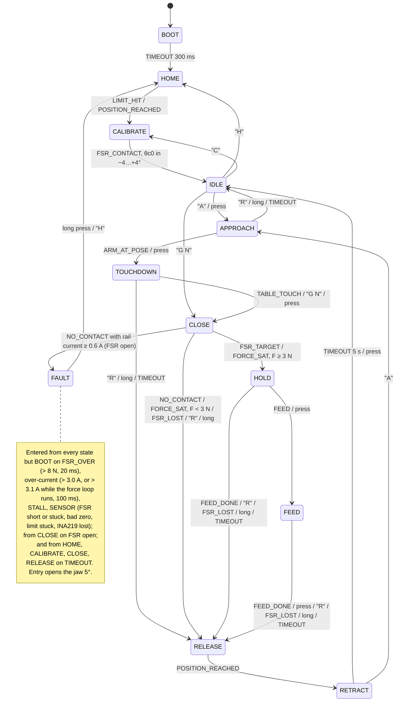
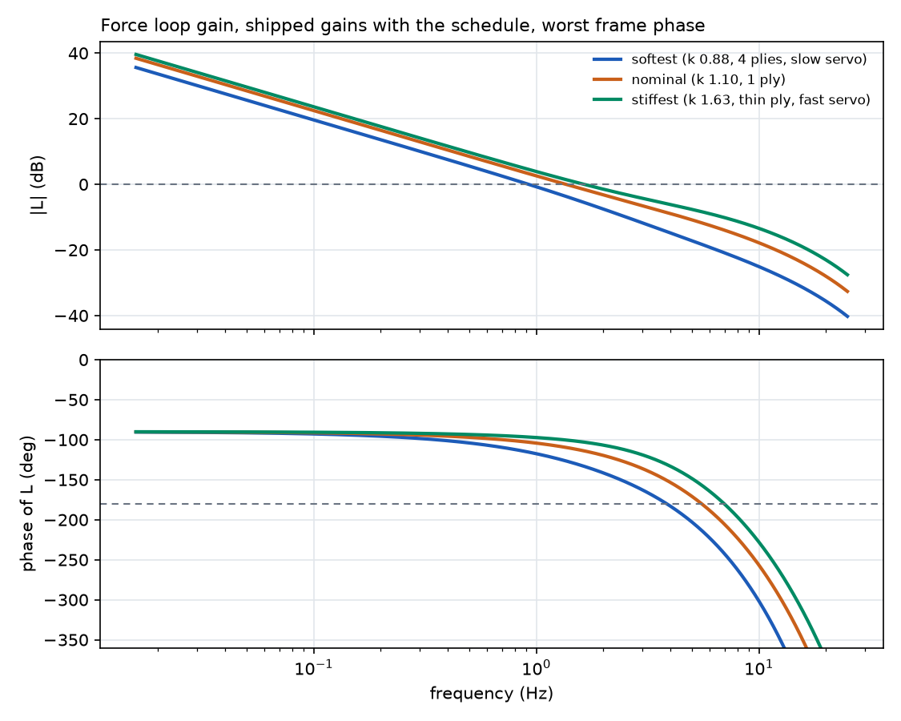
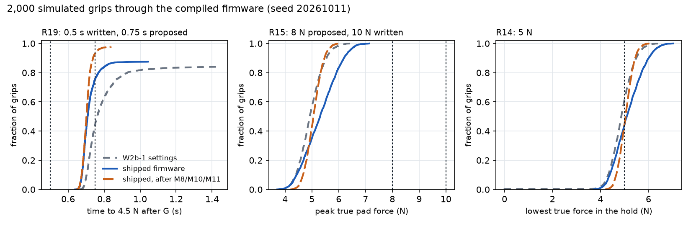

# Firmware and controls

Gripper firmware and controls lane, 2026-10-11: W2b-1 (2026-10-09), the first controls pass, and its review follow-up (same day). The firmware drives the DS3230 MG PWM servo from an ESP32. A state machine sequences the grip, and a force loop on the finger-B FSR (force-sensing resistor) holds the cloth. `DESIGN-BASIS.md` (DB) wins where this note disagrees.

**Re-run every number in this note** from the repository root (about 7 min on 4 cores): `python analysis/gripper/controls/run_all.py`, then `git status --short`: only the PNG figures change (matplotlib output is not byte-stable across versions). Tags: [S] sourced (URL or repository file named), [D] derived by the committed script named, [A] assumed, with the reason.

**Round 2 (firmware requests from the tolerance study, section 6.4).** Trip 7 N / 10 ms: declined (false trips in normal holds; early-contact peaks unchanged). Slow zone 3°: declined (jaw at up to 41 °/s at contact; an early contact passes 10 N). Jaw floor θ_c0 − 6.2°: applied (no simulated grip changes). The 8 N cap is run beside 10 N in section 6.4. **2026-10-16 (T09):** floor moved to θ_c0 − 4.9° for the ruled 8 N; tolerance stacks T09F and T09P pass, T09H unchanged, no new false trip (section 6.4).

**Section numbers.** Other documents cite this note's earlier numbering: "5.1" and "5.4" and "5.5" (simulation results, W2b-1) are now section 6 and 4.4; "7 O<n>" (open items) is now section 8 O<n>, same item numbers; "4.2 item 7" (squeeze cap) is now 4.1 item 8.

## 0. Answer

**Verdict.** Slip is now reported in every hold, and a stall trips over-current in every state, both shown in the host test and through the simulation for Fit A and Fit B servos. In normal grips the pad force never passes 7.18 N; **it can pass 8 N only when the jaw meets something early** (a fold, a seam stack or an object ≥ 8° above the calibrated contact angle, on a stiff finger with a stiff servo: up to 9.62 N on the linear bound, with FSR_OVER → FAULT already fired), and it never passes 10 N in any case simulated. R14 (hold ≥ 5 N) is met in 45.1 % of grips and R19 at 0.75 s in 49.3 %; firmware cannot close that gap alone, because the finger stiffness, servo droop and FSR span are unmeasured (M8, M10, M11).

Probabilities over 2,000 grips (1,000 for the extra columns). Each grip is a fresh draw of every plant constant across its range (section 3), run through the compiled firmware. Seed 20261011. 95 % Wilson intervals in brackets, from `results/montecarlo*_stdout.txt`. R14 assumes the FSR was calibrated with `CALF` to within 10 % (`span_mount` 0.9 to 1.1); the "CALF skipped" column draws 0.5 to 1.5.

| Requirement, reading | Shipped, design-stage uncertainty | G 6 | G 7 | CALF skipped | Early contact 0–10° drawn |
|---|---|---|---|---|---|
| **R14** true pad force ≥ 5.0 N through the hold (FSR creep to 25.5 s included) | **56.0 %** (53.8–58.1) | 62.9 % | 62.9 % | 44.1 % | 61.5 % |
| **R15 as written**, peak ≤ 10 N | **100 %**; max 7.18 N | 100 %; max 7.18 N | 100 %; max 7.18 N | 100 %; max 7.18 N | 100 %; max 7.79 N |
| **R15 as ruled**, peak ≤ 8 N | **100 %** | 100 % | 100 % | 100 % | 100 % |
| Finger folds (peak ≥ 98 % of the FEA fold load) | 0 % | 0 % | 0 % | 0 % | 0 % |
| **R19 as written**, 4.5 N within 0.5 s | **0 %**; median 0.703 s | | | | |
| R19 as written, read as *first contact* within 0.5 s | 0 % | | | | |
| **R19 as ruled**, 5 N within 0.75 s | **50.8 %** (48.6–53.0) | | | | |
| R19 as ruled, read as 4.5 N within 0.75 s | 75.7 % | | | | |
| Grip completes (ends in HOLD) | 100 % | 99.6 % | 99.6 % | 89.5 % | 100 % |

**If the bench confirms the nominals.** These columns narrow ranges around *assumed* bench results; they are not measurements. "Confirms": M10 measures k 1.1 N/mm (±5 %) and `FINGER_K_MAX_N_PER_MM` is set to 1.1 × that (1.21); CALF leaves ±3 %; τ 35–45 ms; dead time 8–12 ms. "Does not confirm": M10 measures k 1.4 N/mm instead (±5 %), `FINGER_K_MAX` set by the same rule (1.54).

| Requirement | Shipped | Bench confirms the nominals | Bench measures k 1.4 N/mm | W2b-1 settings |
|---|---|---|---|---|
| R14 | 56.0 % | 83.7 % | 85.7 % | 39.5 % |
| R15 ≤ 8 N, max | 100 %, 7.18 N | 100 %, 6.80 N | 100 %, 6.80 N | 100 %, 6.51 N |
| R19 5 N ≤ 0.75 s | 50.8 % | 99.6 % | 97.0 % | 11.1 % |
| R19 4.5 N ≤ 0.5 s | 0 % | 0 % | 0 % | 0 % |
| Grip completes | 100 % | 100 % | 100 % | 99.6 % |

**When pad force passes 8 N and 10 N** (R15; section 4.4 has the sweep):
- **Normal grips, G 5 to G 7, CALF done or skipped:** never above 8 N (max 7.18 N over the columns above). The regulated target clamps at 6.5 N (`F_SET_MAX_N`, was 7 N), so `G 6` and `G 7` both regulate to 6.5 N measured.
- **Early contact** (a fold, seam stack or object): the jaw is still moving when it touches, and the loop's 79 ms of delay (section 5) carries it on. Pre-ruling settings (120 °/s to the slow zone, trip 8 N): 99.9 % of honest-plant grips ≤ 8 N, linear stiff bound 7.57 / 8.20 / 9.62 N at 6 / 8 / 10°. With the mid zone of section 4.4 the honest-plant max is 7.58 N and the bound 7.39 / 7.88 / 6.75 N. The FEA fold load is 8.41–8.88 N (finger.md).
- **What holds 8 N for early contact up to 10° (applied 2026-10-16):** the 12° / 45 °/s mid zone, section 4.4. Lowering the trip to 7 N, sizing the cap for 8 N or cutting the trip-to-stop time does not move the 8° and 10° peaks of the pre-ruling profile, because the force is set before any of them acts.

**R15 is 8 N and R19 is 0.75 s (Douglas, 2026-10-12; ruled, no longer a question).** The firmware settings and their simulation are in section 4.4: normal grips stay within 7.0 N and early contact within 7.58 N on the honest plant (7.88 N on the linear stiff bound), at the cost of R19 (median time to 5 N 0.718 s). The squeeze cap stays on its 9.5 N basis: sizing it for 8 N drops R14 to 0.21 (`early_contact`, 300 grips) and 0.19 (1,000 grips, section 6.4). The remaining exception is an FSR reading 50 % of the true force (9.66 N, section 4.4).

**R19, which event.** DB R19 says "Full close in ≤ 0.5 s" and names no event. Every close time here ends on one of three: first contact (FSR_CONTACT), 4.5 N reached (the FSR_TARGET band bottom), or 5 N reached and held (the R14 force; this note reads "full close" as this one). HOLD is entered 100 ms after the force settles in band, or at the squeeze cap (median 0.711 s). The tolerance note's T09T (24.04 % within 0.5 s) is first contact; this Monte Carlo gives 56.6 % for the same event. The two differ because T09T stacks the calibration and servo angle tolerances on a nominal profile, while this run also draws servo lag, dead time, frame phase and droop. The 3° slow-zone variant (T09T-slow3) is in `design_sweep` (section 6.3).

**Hold current and thermal** (section 4.3): the INA219 reads the *rail* current. With F1 off it reads 0.40 A (Fit B) or 0.60 A (Fit A) if the servo drive conducts continuously, 0.88 A or 1.44 A if discontinuously (`thermal.md`: 0.40 / 0.72 and 0.80 / 1.43 A). **A reading above 0.75 A means discontinuous conduction.** Read it with `BACKOFF 0`, `STREAM 50`, `G 5`: the `EVT HOLD_I <ms> <A>` line 0.3 s into HOLD, or the `Ih=` field of every `ST` line.

**Before you flash.**
- Compile it: the conducting session compiled `d139aa2` for the ESP32 (Windows, arduino-cli, esp32 core 2.0.17): exit 0, 24 % flash, 6 % RAM, warnings only inside ESP32Servo. This head adds the task watchdog (`esp_task_wdt_init(1, true)`, ESP-IDF 4.4 API) and has **not** been compiled for the ESP32: arduino-cli is not installed in this container. Round 2 changes `config.h`, `force_ctrl.h`, `force_ctrl.cpp` and `fsm.cpp` (the relative floor; plain C++, no new library calls), also not ESP32-compiled here.
- Until M10, most fingers reach the squeeze cap before the setpoint, report `WARN FORCE_SAT` and hold what they have (median 4.92 N true).
- F1 (back-off hold) ships **off**; `BACKOFF 0.5` turns it on for the M7 bench check (section 4.3).
- Without the INA219 at boot, a stall or an open FSR is not detected (`WARN INA219_ABSENT`). If it answered at boot and then fails, the grip faults (`FAULT_I_SENSOR`).

**What changed in the review follow-up** (each is in `config.h` or the code with its reason):
1. **Slip in every hold.** FSR_SLIP was armed only when HOLD was entered by FSR_TARGET; 88.5 % of grips enter by FORCE_SAT. It is now armed on HOLD entry by either path (`fmArmHold`).
2. **Stall in every state.** The force-loop over-current trip was 2.4 A, above a 2.2 A stall. It is now 3.1 A (`STALL_CURRENT_HOLD_A`, with a compile-time check that every trip sits below `SERVO_STALL_A`).
3. **Thermal F1, F2, F4** implemented (section 4.3); `ILIM` floors at 5 N; `BACKOFF <f>` command; `Ih=` and `bo=` on the status line.
4. **Plant:** the rail current the INA219 reads (continuous or discontinuous conduction), gear-train friction holding (what F1 relies on), and early contact as a drawn input; 37 constants, 35 varied.
5. **Faults with no detection before:** a task watchdog (a hung loop resets the MCU; `setup()` now writes the open pulse first); an INA219 that stops answering faults (`FAULT_I_SENSOR`); the reset reason is reported (`WARN RESET`).
6. **Reproducible results:** no dates, timings or failed-toolchain compiles in committed files; LF newlines; the Monte Carlo workers get their settings with each task, so Windows (spawn) runs the same variant as Linux (fork).
7. **Tests:** host test 2123 / 2123 pass checks; `pytest analysis/gripper/firmware_sim analysis/gripper/controls` 43 passed.

**Bench measurements that would replace the assumed constants**, ranked by how much they move the results (rank correlations in `results/montecarlo_stdout.txt`):

| Constant (plant.py) | Drives | Measurement | Instrument | Duration |
|---|---|---|---|---|
| `k_tip_n_per_mm`, finger stiffness (M10) | R14 (ρ +0.69), R19 (ρ -0.73), peak (ρ +0.79) | Clamp the printed finger at its root, hang 0.5 to 10 N at the tip pad, read the deflection; both fingers | Dial indicator or calipers, slotted masses | 1 h per finger |
| `droop_deg_at_stall`, servo stiffness (M8, M6) | R14, peak | Horn on a lever pressing a kitchen scale; command steps of 1° past contact and read force against angle | Kitchen scale (0.1 g), protractor or a 100 mm pointer | 30 min |
| `tau_s`, `dead_ms`, servo lag and dead time (M8) | R19, lag compensation (CTRL_LAG_COMP_S) | Step the pulse 10° with a GPIO toggled at the write; film the pointer at 240 fps, or scope the pot | Phone slow-motion camera, or oscilloscope on the pot wiper | 30 min |
| `span_mount`, `adc_gain_err`, FSR span behind the pad (M11) | R14, the 8 N trip | `CALF <N>` with 1, 2 and 5 N weights on the pad; repeat after 25 s under load to read creep | Calibrated masses, the firmware's `ST` stream | 1 h |
| `istall_a`, `disc_conduction`, servo currents (M6, F4) | the 3.0 / 3.1 A trips, R20, R26 | Block the horn at 6.5 V and read the INA219 at stall; `BACKOFF 0`, `G 5` and read `Ih=` | INA219 (on board), bench supply | 20 min |
| `backdrive_factor`, gear-train friction (M7) | F1 | `BACKOFF 0.5` in a 5 N hold with the TP-01 probe on the pad: `bo=` against probe force and `I=` | Pinch probe, the `ST` stream | 30 min |
| `k_ply_n_per_mm`, `phi_compact`, the cloth | R19 for 3 to 4 plies | Compress a 4-ply stack under the pad, force against thickness | Calipers, kitchen scale | 30 min |
| `r_src_ohm`, rail sag | stall torque, R27 | Scope the 6.5 V rail during a stall | Oscilloscope | 15 min |

## 1. State machine

States and the cycle follow DB section 8. The host-less demo uses the START button to advance one step (short press) and to abort (long press, 0.8 s).

Design choices from W2b-1 still hold: the machine is table-driven, with the first matching row winning; stale events are dropped; faults latch until a long press or `H`; 4 of the 16 queue slots are reserved for faults and timeouts; and TOUCHDOWN detects the table from a rise in servo current. A brown-out or watchdog reset re-runs `setup()`, which writes the open pulse before anything else (section 7).

## 2. Event and transition table

This table is generated from `kTransitions` in `firmware/gripper/fsm.cpp` by `python firmware/gripper/test/run_host_tests.py --table`; do not edit it by hand. "Guard" and "Action" mark rows that have a guard or an action function. `ACTIVE` means every state except BOOT and FAULT.

<!-- table:begin -->
| # | From | Event | Guard | Action | To | Why |
|---|---|---|---|---|---|---|
| 0 | BOOT | TIMEOUT |  |  | HOME | BOOT_SETTLE_MS elapsed |
| 1 | HOME | LIMIT_HIT |  |  | CALIBRATE | open limit closed |
| 2 | HOME | POSITION_REACHED | yes |  | CALIBRATE | open; limit closed or not required |
| 3 | HOME | POSITION_REACHED | yes | yes | FAULT | open but limit not closed (LIMIT_REQUIRED) |
| 4 | HOME | TIMEOUT |  | yes | FAULT | TIMEOUT_HOME_MS |
| 5 | CALIBRATE | FSR_CONTACT | yes | yes | IDLE | theta_c0 inside [CAL_C0_MIN, CAL_C0_MAX]: store it |
| 6 | CALIBRATE | FSR_CONTACT | yes | yes | FAULT | theta_c0 outside the window |
| 7 | CALIBRATE | NO_CONTACT |  | yes | FAULT | search reached CAL_C0_MIN without touch |
| 8 | CALIBRATE | TIMEOUT |  | yes | FAULT | TIMEOUT_CAL_MS |
| 9 | IDLE | BUTTON_PRESS |  |  | APPROACH | START (host-less demo: advance one step) |
| 10 | IDLE | CMD_APPROACH |  |  | APPROACH | "A": arm moves over the cloth |
| 11 | IDLE | CMD_GRIP |  | yes | CLOSE | "G <N>": grip now |
| 12 | IDLE | CMD_HOME |  |  | HOME | "H": re-home |
| 13 | IDLE | CMD_CAL |  |  | CALIBRATE | "C": recalibrate |
| 14 | APPROACH | CMD_AT_POSE |  |  | TOUCHDOWN | "ARM_AT_POSE" |
| 15 | APPROACH | BUTTON_PRESS |  |  | TOUCHDOWN | START: advance |
| 16 | APPROACH | CMD_GRIP |  | yes | CLOSE | "G <N>": grip now |
| 17 | APPROACH | CMD_RELEASE |  |  | IDLE | "R": abort |
| 18 | APPROACH | BUTTON_LONG |  |  | IDLE | STOP: abort |
| 19 | APPROACH | TIMEOUT |  |  | IDLE | TIMEOUT_APPROACH_MS: arm never arrived |
| 20 | TOUCHDOWN | POSITION_REACHED |  | yes | (same) | at pre-grasp: arm the current-rise detector |
| 21 | TOUCHDOWN | TABLE_TOUCH |  |  | CLOSE | servo current rose: nail on the table |
| 22 | TOUCHDOWN | CMD_GRIP |  | yes | CLOSE | "G <N>": host saw the touch |
| 23 | TOUCHDOWN | BUTTON_PRESS |  |  | CLOSE | START: advance |
| 24 | TOUCHDOWN | CMD_RELEASE |  |  | RELEASE | "R": abort |
| 25 | TOUCHDOWN | BUTTON_LONG |  |  | RELEASE | STOP: abort |
| 26 | TOUCHDOWN | TIMEOUT |  | yes | RELEASE | TIMEOUT_TOUCHDOWN_MS: no table touch |
| 27 | CLOSE | FSR_CONTACT | yes | yes | (same) | touch: stop the search, start the force loop |
| 28 | CLOSE | FSR_TARGET |  |  | HOLD | F on target for F_SETTLE_MS (slip armed) |
| 29 | CLOSE | NO_CONTACT | yes | yes | FAULT | no FSR contact but rail current >= FSR_OPEN_I_A: FSR open |
| 30 | CLOSE | NO_CONTACT |  | yes | RELEASE | searched NO_CONTACT_MARGIN past theta_c0: miss |
| 31 | CLOSE | FORCE_SAT | yes | yes | HOLD | at the squeeze cap, F >= F_SLIP: hold what we have (slip armed) |
| 32 | CLOSE | FORCE_SAT | yes | yes | RELEASE | at the squeeze cap, F < F_SLIP: give up |
| 33 | CLOSE | FSR_LOST |  | yes | RELEASE | contact vanished |
| 34 | CLOSE | CMD_GRIP |  | yes | (same) | new setpoint |
| 35 | CLOSE | CMD_RELEASE |  |  | RELEASE | "R" |
| 36 | CLOSE | BUTTON_LONG |  |  | RELEASE | STOP |
| 37 | CLOSE | TIMEOUT |  | yes | FAULT | TIMEOUT_CLOSING_MS |
| 38 | HOLD | CMD_FEED |  |  | FEED | "FEED" |
| 39 | HOLD | BUTTON_PRESS |  |  | FEED | START: advance |
| 40 | HOLD | FSR_SLIP |  | yes | (same) | F < 3 N for 100 ms, either HOLD path: report SLIP |
| 41 | HOLD | FORCE_SAT |  | yes | (same) | at the squeeze cap: report |
| 42 | HOLD | CMD_GRIP |  | yes | (same) | new setpoint |
| 43 | HOLD | FSR_LOST |  | yes | RELEASE | cloth gone |
| 44 | HOLD | CMD_RELEASE |  |  | RELEASE | "R" |
| 45 | HOLD | CMD_FEED_DONE |  |  | RELEASE | "FEED_DONE" |
| 46 | HOLD | BUTTON_LONG |  |  | RELEASE | STOP |
| 47 | HOLD | TIMEOUT |  | yes | RELEASE | TIMEOUT_GRIPPING_MS (servo heat, R26) |
| 48 | FEED | CMD_FEED_DONE |  |  | RELEASE | "FEED_DONE" |
| 49 | FEED | BUTTON_PRESS |  |  | RELEASE | START: advance |
| 50 | FEED | FSR_SLIP |  | yes | (same) | F < 3 N for 100 ms: report SLIP |
| 51 | FEED | FORCE_SAT |  | yes | (same) | at the squeeze cap: report |
| 52 | FEED | CMD_GRIP |  | yes | (same) | new setpoint |
| 53 | FEED | FSR_LOST |  | yes | RELEASE | cloth gone |
| 54 | FEED | CMD_RELEASE |  |  | RELEASE | "R" |
| 55 | FEED | BUTTON_LONG |  |  | RELEASE | STOP |
| 56 | FEED | TIMEOUT |  | yes | RELEASE | TIMEOUT_FEEDING_MS |
| 57 | RELEASE | POSITION_REACHED |  |  | RETRACT | jaw open |
| 58 | RELEASE | TIMEOUT |  | yes | FAULT | TIMEOUT_RELEASING_MS |
| 59 | RETRACT | TIMEOUT |  |  | IDLE | TIMEOUT_RETRACT_MS: arm clear |
| 60 | RETRACT | CMD_APPROACH |  |  | APPROACH | "A": next cycle at once |
| 61 | RETRACT | BUTTON_PRESS |  |  | IDLE | START: advance |
| 62 | FAULT | BUTTON_LONG |  | yes | HOME | STOP held: clear, re-home |
| 63 | FAULT | CMD_HOME |  | yes | HOME | "H": clear, re-home |
| 64 | FAULT | FAULT_OVERCURRENT |  | yes | (same) | still over-current after back-off: stop the pulse |
| 65 | ACTIVE | FSR_OVER |  | yes | FAULT | F > 8 N for F_TRIP_MS (D8) |
| 66 | ACTIVE | FAULT_OVERCURRENT |  | yes | FAULT | rail current > 3.0 A for 100 ms (R20) |
| 67 | ACTIVE | FAULT_STALL |  | yes | FAULT | command/feedback disagree (FB builds) |
| 68 | ACTIVE | FAULT_SENSOR |  | yes | FAULT | FSR short or stuck / bad zero / limit stuck (arg = FaultCode) |

| State | Timeout (ms) |
|---|---|
| BOOT | 300 |
| HOME | 1500 |
| CALIBRATE | 4000 |
| IDLE | 0 |
| APPROACH | 15000 |
| TOUCHDOWN | 10000 |
| CLOSE | 2000 |
| HOLD | 60000 |
| FEED | 30000 |
| RELEASE | 1500 |
| RETRACT | 5000 |
| FAULT | 0 |
<!-- table:end -->

**Events** (`events.h`):
- From the inputs: BUTTON_PRESS and BUTTON_LONG, from the 1 kHz poll with 25 ms debounce; LIMIT_HIT, with 10 ms debounce.
- From the FSR, through the shared `fsr_filter.cpp` sample chain and the 1 kHz monitor: FSR_CONTACT at F ≥ 0.5 N. FSR_TARGET when F stays in [r − 0.5, r + 1.1] for 100 ms, where r = setpoint + `F_HOLD_BIAS_N`. FSR_SLIP when F < 3 N for 100 ms in any hold (armed on HOLD entry by FSR_TARGET or by FORCE_SAT). FSR_LOST when F < 0.35 N for 150 ms after contact. FSR_OVER when F > 8 N for 20 ms.
- From the force loop: FORCE_SAT, when the loop sits at the squeeze cap with F short of r for 150 ms.
- From the motion profile: POSITION_REACHED and NO_CONTACT, 120 ms after the profile ends.
- From the current monitor at 50 Hz: TABLE_TOUCH, and FAULT_OVERCURRENT (3.0 A, or 3.1 A while the force loop runs, for 100 ms).
- FAULT_STALL, in builds with the pot tap only.
- FAULT_SENSOR: FSR short (raw node > 2,900 mV for 5 samples), FSR stuck (raw node unchanged within 0.5 mV for 500 samples while above 150 mV), FSR zero > 150 mV, limit stuck (open limit closed while the command is more than 10° below open, for 300 ms), or INA219 lost (found at boot, then no valid reading for 100 ms).
- TIMEOUT, per state, and the host commands.

**Fault codes:** OVERFORCE, STALL, OVERCURRENT, FSR_SHORT, ZERO_BAD, CAL_RANGE, TIMEOUT, LIMIT, FSR_OPEN, FSR_STUCK, I_SENSOR (new).

**Host protocol** (USB, 115200 baud, DB section 8): `G [N]`, `R`, `H`, `C`, `S`, `A`, `ARM_AT_POSE`, `FEED`, `FEED_DONE`, `STREAM <hz>`, `CALF <N>`, `ILIM <A>` (HOLD/FEED current limit, 0 = off; `OK ILIM <A>` or `ERR ILIM`), and the new `BACKOFF <f>` (thermal F1 factor 0 to 1, 0 = off; `OK BACKOFF <f>` or `ERR BACKOFF`). The MCU sends `EVT <name> <ms> <arg>`, `EVT ENTER_<STATE> <ms>`, `EVT FAULT_<CODE> <ms>`, `EVT CAL_THETA_C0 <ms> <deg>`, `WARN <event> <ms> <arg>` (also `WARN HOLD_I_LIMIT <ms> <new setpoint>`, and new `WARN HOLD_LONG <ms> <setpoint>`, `WARN RESET 0 <reason code>`, `EVT HOLD_I <ms> <A>`, `EVT HOLD_BACKOFF <ms> <deg>`), and `ST ...` status lines, which now end in `Ih=<A> bo=<deg>` (F4 hold current with the back-off off, -1.00 until measured; back-off angle). The parser rejects NaN and negative numbers; `ILIM` accepts 0 to 100 A.

## 3. Plant model

`analysis/gripper/controls/plant.py`, with tests in `test_plant.py` against hand calculations: the finger law is linear at small load and bounded by the fold; the series closure matches; the touch angle is −0.3085° for one ply; the datasheet voltage points are hit; the unloaded servo runs at rated speed; a blocked servo draws stall current and sags the rail; the divider voltage is right; and creep follows log time. Every constant is listed below with the range the Monte Carlo draws from, uniformly, because no distribution is sourced. `python analysis/gripper/controls/plant.py` prints this table.

| Constant | Nominal | Range drawn | Tag | Source or reason |
|---|---|---|---|---|
| `frame_ms` | 20 | 20 to 20 | S | 50 Hz servo frame [DB R7] |
| `dead_ms` | 10 | 5 to 20 | A | pulse decode + internal loop delay; no datasheet value; M8 bench step |
| `tau_s` | 0.04 | 0.025 to 0.07 | A | small-signal position-loop lag; M8 (scope the pot or a pointer on video) |
| `deadband_us` | 3 | 2 to 5 | S | 3 us [S actuators.csv A17]; up to 5 us for a worn or cheaper unit [A] |
| `w0_dps_at_6v5` | 419 | 360 to 470 | D | 60 deg / 0.1433 s at 6.5 V, interpolated 0.16 s @5.0 / 0.14 s @6.8 V [S A17]; +/-14 % unit spread [A] |
| `tstall_nm_at_6v5` | 2.068 | 1.8 to 2.3 | D | 21.08 kg*cm at 6.5 V interpolated from 19 @5.0 / 21.5 @6.8 [S A17]; -13/+11 % unit spread [A] |
| `istall_a` | 2.2 | 2.2 to 3.77 | S | 2.2 A [S Miuzei datasheet]; 3.77 A from dyno.md Fit A (torque x speed consistent) [D] |
| `i_idle_a` | 0.15 | 0.08 to 0.3 | A | electronics + no-load motor current; M6 |
| `droop_deg_at_stall` | 3 | 1.5 to 5 | A | error at which the servo reaches full duty; dyno.md uses 3 deg [A] |
| `v_set` | 6.5 | 6.35 to 6.65 | S | 6.5 +/- 0.15 V buck [S torque_and_actuator.md section 3.2, Douglas ruling] |
| `r_src_ohm` | 0.15 | 0.05 to 0.35 | A | buck output + wiring + connector resistance; scope M (R27 proof) |
| `r_c_mm` | 65 | 65 to 65 | S | pivot to pad line of action [DB D3] |
| `backlash_deg` | 1.01 | 0.65 to 1.37 | D | j_t 0.25 mm (0.16-0.34) = 1.01 deg at the jaw [D gears.md, printed PA6-CF pick] |
| `eta` | 0.85 | 0.75 to 0.92 | A | mesh + pivot efficiency [DB, A]; M18 |
| `k_tip_n_per_mm` | 1.1 | 0.88 to 1.63 | S | R12 window 0.88-1.63 [DB R12]; FEA pick 1.10 [D fea_summary / dyno.md] |
| `k_mismatch` | 0 | -0.1 to 0.1 | A | finger A vs B stiffness mismatch (print-to-print); M10 on both fingers |
| `f_fold_n` | 8.88 | 8.41 to 10.6 | D | FEA limit load: 8.88 N bare at E 56, 8.41 N with the PLA nail, 10.6 N at E 67 [D finger.md 5.2] |
| `plies` | 1 | 1 to 4 | A | one ply is the scenario (DB section 6); 2-4 for seams and folds [A] |
| `ply_mm` | 0.3 | 0.2 to 0.5 | S | 0.3 mm [DB M4 default]; 0.2-0.5 mm for shirting to denim [A] |
| `k_ply_n_per_mm` | 30 | 10 to 60 | A | through-thickness stiffness of one ply under the pad; dyno.md uses 30 [A] |
| `phi_compact` | 0.5 | 0.35 to 0.65 | A | fraction of the stack thickness that can compress before the fibres lock |
| `span_part` | 1 | 0.94 to 1.06 | S | FSR 400 part-to-part repeatability +/-6 % (single batch) [S Interlink FSR 400 page] |
| `span_mount` | 1 | 0.9 to 1.1 | A | residual error after CALF <N> (M11) on the TPU pad backing; 0.5-1.5 if CALF is skipped |
| `fsr_exp_err` | 0 | -0.05 to 0.05 | A | power-law exponent error vs the Adafruit-table fit (fsr_model.h) |
| `drift_per_dec` | 0.02 | 0 to 0.05 | S | creep < 5 % per log10(time) at constant load [S Interlink FSR 400 page] |
| `hyst` | 0.05 | 0 to 0.1 | S | +5 to +10 % (reads high on unloading) [S Interlink datasheet PDS-10004; distributor listing] |
| `rf_tol` | 0 | -0.01 to 0.01 | A | 1 % fixed resistor |
| `v33_mv` | 3300 | 3240 to 3360 | A | ESP32 3V3 LDO tolerance +/-1.8 %; the firmware assumes 3300 |
| `adc_gain_err` | 0 | -0.03 to 0.03 | A | analogReadMilliVolts after eFuse calibration; M11 |
| `adc_offset_mv` | 0 | -15 to 15 | A | same |
| `noise_mv` | 8 | 4 to 20 | A | Gaussian ADC noise, RMS; M11 |
| `zero_mv` | 20 | 0 to 60 | A | unloaded node offset (preload from the pad backing) |
| `adc_sat_mv` | 3100 | 3050 to 3200 | A | 11 dB attenuation reads saturate near 3.1 V |
| `frame_phase_ms` | 10 | 0 to 19 | A | phase of the servo's frame against the firmware control tick (uniform) |

The blocks:
- **Servo.** The servo samples the pulse once per 20 ms frame, at a random phase against the firmware tick, then waits a dead time. Its position loop has lag τ and a ±deadband/2 dead zone. Its speed is capped by the torque-speed line w₀(V)·(1 − T/T_stall(V)) when closing against load. Under load it gives way by T/K_servo, with K_servo = T_stall / `droop_deg_at_stall`. Speed and torque scale with rail voltage, V = V_set − R_src·I.
- **Gears.** Finger B, the FSR finger, sits b/2 open of finger A under load and inside the play band when unloaded. The losses are T = 2 F r_c / η.
- **Fingers.** F = F_fold·tanh(k·d / F_fold) per finger. The tangent stiffness is k at zero load and falls to zero at the FEA limit load. Finger A and finger B are in series, with a ±10 % mismatch.
- **Cloth.** n plies of thickness t compress as F = k_c·c / (1 − c / c_max), with k_c = k_ply / n and c_max = φ·n·t.
- **FSR, divider and ADC.** Reading = F × part span × mounting span × (1 + creep) × (1 + hysteresis), through the power-law resistance (with an exponent error), the 2.7 kΩ divider (1 % tolerance) on a 3.3 V ± 1.8 % rail, then ADC gain and offset error, Gaussian noise, 1 mV quantisation and 3.1 V saturation. The firmware's own `fsr_filter.cpp` then applies the EMA, the zero offset and the span; the simulation runs that file, not a copy of it.

## 4. Control law

### 4.1 Controller (`force_ctrl.cpp`)

The squeeze u is measured from the touch reference θ_ref, the jaw angle where F = 0.5 N; the command is θ_cmd = θ_ref − u.

1. **Touch reference.** At FSR_CONTACT the jaw trails the command by speed × 76 ms, so θ_ref = θ_cmd + v × 76 ms. This is unchanged from W2b-1.
2. **Regulated force** r = setpoint + `F_HOLD_BIAS_N` (1.0 N), capped at `F_SET_MAX_N` (7 N). The bias covers an FSR that reads high, from span, ADC gain, creep up to 7 % over the hold, and hysteresis. Without it, the loop held the true force at 4.77 N (median of the hold minimum, W2b-1 settings).
3. **Stiffness estimate and gain schedule** (new). Once F > 1.5 N, K_raw = (F − 0.5) / u(t − 80 ms). The 80 ms is about the servo lag, so the force is compared with the squeeze that produced it. K_raw is clamped to [K_SCHED_MIN, K_STIFF] = [0.794, 1.849] N/deg and smoothed by 0.5 per tick. The feedforward u_ff = (r − 0.5)/K_est and both PI gains are multiplied by g = K_STIFF/K_est (1 to 2.33), which keeps the loop gain at the stiff-finger design point. The estimate starts at K_STIFF, so before it converges the loop is exactly the W2b-1 loop.
4. **Ramp.** The setpoint ramps at 100 N/s from 0.5 N, with only the feedforward acting during the ramp. This is unchanged.
5. **PI.** SIMC tuning (Skogestad 2003) on the stiffest finger: K_p = 0.240 °/N and T_i = 0.040 s, both × g. This is unchanged; section 5 shows the margins hold and that higher gains buy nothing.
6. **Asymmetric integrator deadband**: integrate while F < r, or while F > r + 0.6 N. Unchanged.
7. **Limits.** Rate ≤ 60 °/s; u ≥ −2°; conditional-integration anti-windup; non-finite force readings are treated as 8 N, so the loop backs off.
8. **Squeeze cap** U_max = (10 − 0.5 margin − 0.5)/K_STIFF = **4.87°** (it was 5.14°). The cap uses the configured stiffest finger, never K_est, so it bounds the force even if the FSR fails. At the stiffest R12 finger a cap at 9.5 N leaves 0.5 N of margin, which the review asked for in O4.
9. **Soft limit** 7.5 N (step back 0.5° per tick); **trip** 7.75 N for 20 ms → FAULT; **floor** θ ≥ θ_c0 − 4.9° in the force loop (`JAW_FLOOR_BELOW_C0_DEG`; 6.2° from round 2 until 2026-10-16, an absolute −7.4° before that, section 6.4), with θ ≥ −10.2° as the absolute backstop (`JAW_MIN_DEG`, below the floor of the lowest calibrated contact); pulse clamp 1200 to 1900 µs.
10. **Over-current.** The trip is 3.0 A for 100 ms in motion states and 3.1 A while the force loop runs (CLOSE after contact, HOLD, FEED). Both sit below the worst saturated INA219 reading (3.166 A, `force_ctrl.h` static_assert), so a stall that saturates the sensor trips in every state (section 4.3).
11. **Thermal hooks** (section 4.3): `ILIM <A>` (default off) steps the setpoint down 0.25 N per 500 ms above the limit, never below 5 N (`HOLD_I_FLOOR_N`, R14; a lower floor is a deliberate thermal override written in `config.h`, set at the M7 bench step). F1, F2 and F4 as in section 4.3.

**Close profile.** This is unchanged: 120 °/s from +20° to θ_c0 + 6°, then 20 °/s to θ_c0 − 3°. Two faster profiles were tried in `design_sweep` (section 6.3). A slow zone of 4° makes contact by 0.5 s in every grip, but the jaw runs faster than 20 °/s over the last 3° in every grip. A 240 °/s pre-close with an 8° zone was slower. A third variant, which stepped the command back at the zone edge to brake the servo, lengthened the close in every setting tried and was removed before commit.

### 4.2 Timing

The schedules are unchanged from W2b-1: FSR at 1 kHz, buttons at 1 kHz, current and control at 50 Hz, and dispatch on every pass, with no `delay()`. The FSR chain now runs the shared `fsrFilterSample()`; the short check adds one compare and one counter per sample. The over-current path is: 100 ms above the trip, sampled at 50 Hz, → FAULT → back-off begins on the next tick. In the host test the back-off begins 140 ms after onset and the command reaches its target at 200 ms. In the simulation with the jammed finger, the rail current is back under the trip 171 ms after onset (section 7).

### 4.3 Hold current, stall trips and thermal (`thermal.md` F1–F4)

**Which current each number is.** The INA219 sits on the 6.5 V servo rail and reads the *rail* current. The motor current I_m sets the torque. If the servo's PWM drive conducts continuously, the rail carries I_m × duty, and at a standstill duty ≈ I_m R / V, so rail ≈ I_m² / I_stall; if it conducts discontinuously (the `dyno.md` bound) the rail carries I_m. `plant.py` now models both (`disc_conduction`); the earlier "1.49 A at 5 N" was the motor current of a Fit A servo, which equals the rail reading only in the discontinuous case. `thermal.md` 0.72 / 1.43 A (Fit A) are rail currents with the winding at 100 °C; the plant uses the cold resistance, so it reads lower in the continuous case.

| 5 N hold, F1 off (`faults.py`) | Rail current, INA219 (A) | Motor current (A) | `thermal.md` rail (A) |
|---|---|---|---|
| Fit B (2.2 A stall), continuous | 0.40 | 0.87 | 0.40 |
| Fit B, discontinuous | 0.88 | 0.88 | 0.80 |
| Fit A (3.77 A stall), continuous | 0.60 | 1.43 | 0.72 |
| Fit A, discontinuous | 1.44 | 1.44 | 1.43 |

**F4, the regime reading.** `BACKOFF 0`, `STREAM 50`, `G 5`; 0.3 s into HOLD the firmware averages 100 ms of rail current and prints `EVT HOLD_I <ms> <A>`; every `ST` line then carries it as `Ih=`. Under 0.75 A: continuous; over it: discontinuous, for either fit (`test_hold_current_reading_sorts_the_regime`).

**Stall trips (R20).** A stall draws the stall current on the rail in either regime (duty 100 %). Trips: 3.0 A in motion states, 3.1 A while the force loop runs (it was 3.6 A, above the 3.2 A INA219 full scale, so it could never fire). Simulated at the earlier 2.0 A trip, not rerun at 3.1 A (`faults.py`, `test_stall_detected_after_contact_and_in_hold`): a rigid object stopping the finger just after contact, and a rotor locked in HOLD, trip FAULT OVERCURRENT 100 to 119 ms after the rail passes the trip, for all four scenarios. The cost: a Fit A servo conducting discontinuously draws up to ~2 A holding 6–7 N (below the 3.1 A trip at the 10 N cap and the 8 N R15 cap, `ina219_budget.py`); at the older 2.0 A trip it tripped in 2 of 2,000 shipped grips. Bench step (M6): read the stall current on the INA219 and set `STALL_CURRENT_HOLD_A` to min(0.9 × the measured stall current, `INA219_SAT_READING_MIN_A` − margin) (3.166 A worst saturated reading; ships at 3.1 A). A higher trip needs a smaller shunt or a lower PGA gain, which is a hardware change. `thermal.md`'s "1.8 A trip catches Fit A from about 8 N" never applied in HOLD (the trip there was 3.6 A, now 3.1 A); the trips are stall detectors, and the thermal guards are F1–F3 below.

**F1, back-off hold** (`BACKOFF <f>`, ships off). After the F4 reading the command steps open 0.3° every 100 ms while the measured force stays within 0.3 N of the held force. It stops at the rail current f² × the F4 reading (f = 0.5 by default, inside `thermal.md`'s window 0.4225–0.63: rail ∝ I_m² when continuous), at 3°, or at the first step that loses force, which is the gear train's friction threshold; there friction leaves the jaw where it slipped, so it closes fully and returns two steps short (`thermal.md`'s "re-close one step" did not restore the force on the plant). In a nominal 5 N hold it halves the rail current with the true force down 0.02 to 0.03 N (`faults.py`, all four scenarios). **Across the Monte Carlo it costs R14:** 45.1 % off, 14 % on (`design_sweep`), because FSR creep (+2 %/decade) and hysteresis (+5–10 % unloading) read high while the force falls, so the drop F1 stops on is hidden. Hence off by default; the M7 bench decides it with the pinch probe on the pad (`bo=` against probe force).

**F2, long holds.** After 15 s in HOLD/FEED, unless F1 has backed off, the setpoint is clamped to 5 N (`WARN HOLD_LONG`) for the rest of that hold, including later `G` commands. It changes nothing for `G 5`; `G 6` and `G 7` then hold what `G 5` holds (45.1 % R14 instead of 50.8 / 50.7 %).

**F3** is the existing `ILIM` (current-based), now floored at 5 N. A time-at-force guard was not added: the bench (M7, the winding time constant) decides its limits.

**Held force against `thermal.md`'s 5 N basis.** Shipped, the lowest true force in the hold is median 4.92 N, p95 6.03 N (`montecarlo_stdout.txt`). By `thermal.md`'s own table the p95 grip sits between its 5 N row (Fit A 4.67 W, rail 0.72 A) and its 7 N row (9.12 W, 1.40 A); the sustainable hold without F1 is 3.75 N (Fit A) and 5.13 N (Fit B) (thermal 4.3). So on Fit A every grip is over the thermal limit without F1, and on Fit B about the upper half is. The thermal note should be re-run on this distribution (Requested changes).

### 4.4 Early contact and R15 (`early_contact.py`)

A fold, a seam stack or an object puts first contact up to 10° (23 mm) above θ_c0, partly in the 120 °/s leg. Each variant below runs the same 300 draws twice: with `early_contact_deg` drawn 0–10° (rigid, the worst case for the peak), and with none, for the cost to R14 and R19. The last columns are the linear stiff bound (W2b-1 plant, finger 1.63 N/mm, no droop, no softening, no fold).

| Variant | Early: P(peak ≤ 8 N) | Early: P(≤ 10 N) | Early: max (N) | No early: R14 | No early: R19 5 N ≤ 0.75 s | No early: contact ≤ 0.5 s | Linear bound 6° / 8° / 10° (N) |
|---|---|---|---|---|---|---|---|
| shipped | 1.000 | 1.000 | 7.58 | 0.590 | 0.563 | 0.000 | 7.39 / 7.88 / 6.75 |
| pre-ruling (10 N basis: no mid zone, fast 120, trip 8, soft 7.5, set max 7) | 0.997 | 1.000 | 8.19 | 0.590 | 0.660 | 0.543 | 7.57 / 8.20* / 9.62* |
| trip level 7 N (soft limit 6.8) | 1.000 | 1.000 | 7.58 | 0.570 | 0.563 | 0.000 | 7.39 / 7.88 / 6.75 |
| squeeze cap sized for 8 N | 1.000 | 1.000 | 6.96 | 0.207 | 0.083 | 0.000 | 6.74 / 7.81 / 6.85 |
| trip-to-stop: 5 ms trip, back-off as one step | 1.000 | 1.000 | 7.58 | 0.590 | 0.563 | 0.000 | 7.39 / 7.88 / 6.75 |
| approach: 60 deg/s from theta_c0 + 14 | 1.000 | 1.000 | 7.58 | 0.590 | 0.580 | 0.000 | 7.58 / 8.10* / 6.89 |
| approach: 40 deg/s from theta_c0 + 14 | 1.000 | 1.000 | 7.26 | 0.590 | 0.157 | 0.000 | 7.39 / 7.88 / 6.88 |
| trip-to-stop + 60 deg/s from + 14 | 1.000 | 1.000 | 7.58 | 0.590 | 0.580 | 0.000 | 7.58 / 8.10* / 6.89 |
| trip-to-stop + 40 deg/s from + 14 | 1.000 | 1.000 | 7.26 | 0.590 | 0.157 | 0.000 | 7.39 / 7.88 / 6.88 |

Readings: **shipped is now the 2026-10-16 setting for Douglas's 8 N and 0.75 s ruling (2026-10-12):** mid zone 12° at 45 °/s (`JAW_MID_ZONE_DEG`, `JAW_SPEED_MID_DPS`), trip 7.75 N, soft limit 7.5 N, set maximum 6.5 N, on the DS3230 MG plant. Every simulated pad force is within 8 N: early-contact max 7.58 N (300 draws, 0–10°), normal grips 7.0 N, the linear stiff bound 7.36 / 7.39 / 7.88 / 6.75 N at 4 / 6 / 8 / 10°. The row above it is the pre-ruling setting on the same plant (8.19 N max; 8.20 and 9.62 N at 8° and 10°). R14 is 0.59 in both, so the mid zone costs it nothing; the cost is time: R19 5 N ≤ 0.75 s is 0.563 against 0.660, median 0.718 s against 0.635 s, and the close no longer reaches contact in 0.5 s (0.543 to 0.000, which the ruling relaxed). Chosen from a 200-draw sweep over mid-zone width 11–16° and speed 40–55 °/s, fast speed 120/160 °/s and trip 7.5/7.75 N: 14° / 40 °/s costs R19 to 0.16, 16° to 0.02 or less; 50 °/s gives 8.10 N at 8° (the bound is not monotone in speed, 45 and 55 °/s both pass, 45 chosen); trip and soft limit do not move the 6–10° peaks, as before; the fast leg at 160 °/s gains 3 points of R19 and was not kept. Sizing the squeeze cap for 8 N (`F_CAP_N` 8, margin 0) does hold early peaks to 7.0 N but R14 falls to 0.21 (0.19 at 1,000 grips, section 6.4); the cap stays on its 9.5 N basis. One case stays above 8 N: an FSR that reads 50 % of the true force reaches 9.66 N on the stiffest finger, because only the squeeze cap bounds it (test plan TP-04 case 3); holding it needs the 8 N cap sizing and its R14 cost, which is Douglas's call. Trip level, cap and trip latency change the 4–6° cases at most.

## 5. Loop analysis

`analysis/gripper/controls/linear.py`; results in `results/linear_stdout.txt`.

The loop is linearised about a held force of 6 N:
- the discrete PI (T = 20 ms) and a zero-order hold;
- the servo frame phase (10 ms mean, 20 ms worst), the dead time and the servo lag;
- the contact stiffness: the tangent of finger + finger + cloth, reduced by servo droop;
- the FSR EMA filter (α 0.1 at 1 kHz).

Three operating points span the ranges. Softest: k 0.88, 4 plies of 0.5 mm at 10 N/mm, droop 5°, τ 70 ms, dead time 20 ms. Nominal: the nominal draw. Stiffest: k 1.63, one 0.2 mm ply at 60 N/mm, droop 1.5°, τ 25 ms, dead time 5 ms.

| Operating point, worst frame phase | Shipped (schedule) PM / GM / Ms / bandwidth | W2b-1 (no schedule) PM / GM / Ms / bandwidth | Largest base K_p for PM ≥ 45°, GM ≥ 6 dB |
|---|---|---|---|
| Softest | 65.5° / 14.8 dB / 1.37 / 1.55 Hz | 78.9° / 22.1 dB / 1.16 / 0.49 Hz | 0.501 °/N |
| Nominal | 70.7° / 11.8 dB / 1.43 / 2.44 Hz | 82.0° / 19.2 dB / 1.16 / 0.67 Hz | 0.471 °/N |
| Stiffest | 76.9° / 10.0 dB / 1.51 / 2.77 Hz | 81.9° / 13.3 dB / 1.31 / 1.32 Hz | 0.383 °/N |

PM is phase margin, GM gain margin, and Ms the peak of the sensitivity |1/(1+L)|, where Ms below 2 is the usual robustness bound. The bandwidth is where the closed loop falls to −3 dB.

- **The margins of the gains as shipped.** At the stiffest operating point: PM 76.9°, GM 10.0 dB. At the softest: PM 65.5°, GM 14.8 dB. That is every point at its worst frame phase, and Ms ≤ 1.51. The schedule triples the soft-finger bandwidth (0.49 → 1.55 Hz) and costs 5 to 13° of phase margin (5.0° stiffest, 11.3° nominal, 13.4° softest).
- **The gains to ship are the gains already shipped.** The stiffest point allows up to K_p 0.383 °/N, which is 1.6 times the present 0.240 °/N, but raising K_p to 0.30 °/N changes nothing that matters: R14 0.500 against 0.503, and R19-as-proposed 0.537 for both (`design_sweep` row "Kp 0.30"). The PI is not the bottleneck. The grip speed is set by the feedforward ramp, the 60 °/s rate limit and the servo lag; the hold is set by the squeeze cap.
- **The 20 ms control period.** Halving it to 10 ms (the servo frame stays 20 ms) changes PM by +0.2 to +0.8° and GM by +0.9 to +1.2 dB (the "T 10 ms" rows). It is not worth the CPU time.
- **The 1 kHz EMA filter.** Removing it adds 3 to 5° of PM and 0.8 to 1.5 dB of GM. Its 9 ms of lag is small next to the servo's.
- **What limits bandwidth** is delay: about 79 ms in total at nominal, made up of the zero-order hold 10, frame phase 10 (mean), dead time 10, EMA 9 and servo lag τ 40 ms. The servo's own 40 to 70 ms lag dominates, and only a faster servo or a pot-tap inner loop would move it.
- **The schedule saturates.** Servo droop makes the apparent stiffness lower than the finger's own, so at the nominal and softest points K_est sits at the clamp K_SCHED_MIN (g = 2.33). The margins above already include that.

## 6. Monte Carlo

`analysis/gripper/controls/montecarlo.py`. There are 2,000 grips. Each draws every constant of section 3, then runs power-up → HOME → CALIBRATE (no cloth) → `G 5` on the cloth → 1.5 s → the FSR creep clock jumps to the end of the 25.5 s hold → 0.8 s more. The firmware is the compiled core (`fsm.cpp`, `force_ctrl.cpp`, `motion.cpp`, `events.cpp`, `fsr_filter.cpp`) through `shim.cpp`, with the `gripper.ino` scheduler and its 8-events-per-pass dispatch limit. The draw for run i is regenerated from (seed, i), so a single run can be replayed.

### 6.1 Distributions, shipped firmware

| Metric | p01 | p05 | p50 | p95 | p99 | max |
|---|---|---|---|---|---|---|
| Time to contact (s) | 0.468 | 0.477 | 0.498 | 0.518 | 0.524 | 0.530 |
| Time to 4.5 N (s) | 0.581 | 0.592 | 0.626 | 0.714 | 0.787 | 0.991 |
| Time to 5 N (s) | 0.594 | 0.607 | 0.644 | 0.731 | 0.787 | 0.892 |
| HOLD entered, either path (s) | 0.681 | 0.685 | 0.711 | 0.747 | 0.777 | 1.314 |
| Peak true force (N) | 3.77 | 4.04 | 5.01 | 6.19 | 6.52 | 6.96 |
| Lowest true force in the hold (N) | 3.74 | 4.03 | 4.92 | 6.03 | 6.44 | 6.95 |
| Steady-state error, true − 5 N (N) | -1.23 | -0.97 | -0.05 | 1.09 | 1.50 | 1.95 |
| Jaw speed at touch + 3° (°/s) | 16.36 | 18.35 | 22.83 | 26.35 | 27.91 | 29.24 |

**Fault-state rates** (shipped): HOLD 1997, FAULT 2, RETRACT 1 final states; events FORCE_SAT 1780, FAULT_OVERCURRENT 2, FSR_SLIP 2. HOLD was entered by FORCE_SAT (at the squeeze cap below setpoint + bias, F ≥ 3 N) in 88.5 % of grips.

**What drives the tails** (Spearman rank correlation with each metric, shipped):
- F_peak_N: k_tip_n_per_mm +0.79, droop_deg_at_stall -0.44, tau_s +0.31.
- t_90_s: k_tip_n_per_mm -0.73, plies -0.27, droop_deg_at_stall +0.24.
- F_hold_min_N: k_tip_n_per_mm +0.69, droop_deg_at_stall -0.36, tau_s +0.26.

The finger stiffness dominates everything, because the squeeze cap is sized for the stiffest finger in the window, so most fingers reach the cap before they reach the target. That is the R14 shortfall, and it is why measuring k (M10) and setting `FINGER_K_MAX_N_PER_MM` from it is the single biggest improvement, *if* the finger comes out near the assumed 1.1 N/mm (section 0).

### 6.2 Worst cases, replayed as regression tests

`results/worst_cases.json`, replayed by `test_regression.py`. The test asserts that each draw reproduces, that its peak is ≤ 8 N, and that no finger folds.

| Name | Run | Result |
|---|---|---|
| peak_force | 1914 | k 1.62, droop 1.7°, τ 56 ms, 3 plies, stall 2.58 A, discontinuous: peak 6.96 N, t(4.5 N) 0.587 s, hold min 5.91 N, HOLD |
| slowest_to_90pct | 211 | k 0.89, droop 3.4°, τ 67 ms, 3 plies, stall 2.75 A, continuous: peak 4.50 N, t(4.5 N) 0.991 s, hold min 4.50 N, HOLD |
| lowest_hold | 113 | k 1.56, droop 3.4°, τ 54 ms, 4 plies, stall 3.67 A, discontinuous: peak 5.61 N, t(4.5 N) 0.624 s, hold min 0.00 N, FAULT FAULT_OVERCURRENT |
| fastest_jaw_at_touch_plus_3 | 1102 | k 1.40, droop 4.9°, τ 69 ms, 4 plies, stall 2.63 A, continuous: peak 5.40 N, t(4.5 N) 0.618 s, hold min 4.42 N, HOLD |
| first_failed_grip | 113 | k 1.56, droop 3.4°, τ 54 ms, 4 plies, stall 3.67 A, discontinuous: peak 5.61 N, t(4.5 N) 0.624 s, hold min 0.00 N, FAULT FAULT_OVERCURRENT |

### 6.3 Design sweep (`design_sweep.py`, 300 grips per variant, same draws)

`results/design_sweep_stdout.txt` lists every variant.

| Variant | R14 | R19 5 N ≤ 0.75 s | R19 4.5 N ≤ 0.5 s | Contact ≤ 0.5 s | Last 3° ≤ 20 °/s | Peak max (N) |
|---|---|---|---|---|---|---|
| no schedule, no bias | 0.293 | 0.213 | 0.000 | 0.540 | 0.18 | 6.09 |
| gain schedule | 0.237 | 0.493 | 0.000 | 0.540 | 0.18 | 6.44 |
| schedule + bias 0.6 | 0.417 | 0.537 | 0.000 | 0.540 | 0.18 | 6.79 |
| schedule + slow zone 4 | 0.227 | 0.527 | 0.000 | 1.000 | 0.00 | 6.50 |
| shipped, slow zone 3 (tolerance T09T-slow3) | 0.497 | 0.553 | 0.460 | 1.000 | 0.00 | 7.01 |
| schedule + 240 deg/s, zone 8 | 0.237 | 0.483 | 0.000 | 0.113 | 0.33 | 6.44 |
| shipped | 0.497 | 0.537 | 0.000 | 0.540 | 0.18 | 6.82 |
| shipped with F1 back-off on (BACKOFF 0.5) | 0.140 | 0.537 | 0.000 | 0.540 | 0.18 | 6.82 |
| shipped, cap for R15 = 8 N | 0.110 | 0.097 | 0.000 | 0.540 | 0.18 | 5.94 |
| shipped, Kp 0.30 (CTRL_TAU_CL_S 0.042) | 0.483 | 0.537 | 0.000 | 0.540 | 0.18 | 6.82 |
| bench confirms nominals: shipped | 0.880 | 0.990 | 0.000 | 0.567 | 0.20 | 6.47 |
| bench confirms nominals: cap for R15 = 8 N | 0.273 | 0.260 | 0.000 | 0.567 | 0.20 | 5.56 |
| bench confirms nominals: no schedule, no bias | 0.507 | 0.453 | 0.000 | 0.567 | 0.20 | 5.99 |
| bench does not confirm (k 1.4): shipped | 0.810 | 0.893 | 0.000 | 0.557 | 0.23 | 6.42 |

The 3° slow zone (the tolerance note's T09T-slow3) is the one setting that moves R19 as written: first contact within 0.5 s in 100 % of grips and 4.5 N within 0.5 s in 46 %, with R14 unchanged (49.7 %). Its cost is R19's own last-3° rule: the jaw is still decelerating, so it runs faster than 20 °/s over the last 3° in every grip. Recommendation: if R19 stays at 0.5 s, ship the 3° zone and restate the last-3° rule as a jaw-speed limit the bench can check (O1); if R19 becomes 0.75 s, keep 6°.

### 6.4 Firmware requests from the tolerance study, and the 8 N cap (`firmware_requests.py`)

`tolerance_stacks.md` (*Requests outside CAD*) asked for three firmware changes, each sized on its tolerance stack alone and written before the hold bias existed. None was applied because it was asked for: each ran through the compiled firmware, on the same draws, in four settings. **Window**: the W2b-1 linear plant at 17 stiffnesses across the R12 window (0.88 to 1.63 N/mm), `G 5`. **Drawn**: 1,000 grips of the section 3 plant, `G 5`, no early contact. **G 7**: 300 grips at the largest setpoint. **Early**: 300 grips with early contact drawn 0–10°. Plus the linear stiff bound (k 1.63) for early contact and for an FSR reading 50 %. A false trip is an FSR_OVER in a grip with nothing wrong (no fault injected, no early contact). Seed 20261011; `results/firmware_requests_stdout.txt`. `*` = the grip ended in FAULT.

<!-- requests:begin -->
| Variant | Window: false trips of 17, peak max (N), contact (s), jaw speed at touch + 3° max (°/s) | Drawn: R14 | R19 5 N ≤ 0.75 s | Contact ≤ 0.5 s | 4.5 N ≤ 0.5 s | Last 3° ≤ 20 °/s | False trips of 1,000 | G 7: false trips of 300 | Early 0–10°: max (N), P(≤ 8 N) | Linear bound k 1.63: early 6 / 8 / 10° (N); FSR 50 % (N) |
|---|---|---|---|---|---|---|---|---|---|---|
| shipped (trip 7.75 N / 20 ms, slow zone 6 deg, floor theta_c0 - 4.9 deg: request 3 at the 8 N cap) | 0, 7.41, 0.583–0.591, 21 | 57.0 % | 51.4 % | 0.0 % | 0.0 % | 26.2 % | 0 | 2 | 7.58, 100.0 % | 7.39 / 7.88* / 6.75; 9.66 |
| before request 3: absolute floor JAW_MIN_DEG -7.4 | 0, 7.41, 0.583–0.591, 21 | 57.1 % | 51.6 % | 0.0 % | 0.0 % | 26.2 % | 0 | 2 | 7.58, 100.0 % | 7.39 / 7.88* / 6.75; 9.66 |
| round 2 floor theta_c0 - 6.2 deg (10 N basis) | 0, 7.41, 0.583–0.591, 21 | 57.1 % | 51.6 % | 0.0 % | 0.0 % | 26.2 % | 0 | 2 | 7.58, 100.0 % | 7.39 / 7.88* / 6.75; 9.66 |
| floor theta_c0 - 5.0 deg | 0, 7.41, 0.583–0.591, 21 | 57.1 % | 51.6 % | 0.0 % | 0.0 % | 26.2 % | 0 | 2 | 7.58, 100.0 % | 7.39 / 7.88* / 6.75; 9.66 |
| request 1: F_TRIP_N 7.0, F_TRIP_MS 10 | 9, 7.41, 0.583–0.591, 21 | 56.3 % | 51.4 % | 0.0 % | 0.0 % | 26.2 % | 33 | 21 | 7.58, 100.0 % | 7.39* / 7.88* / 6.75; 9.66 |
| trip 7.0 N, 20 ms | 9, 7.41, 0.583–0.591, 21 | 56.4 % | 51.4 % | 0.0 % | 0.0 % | 26.2 % | 29 | 17 | 7.58, 100.0 % | 7.39* / 7.88* / 6.75; 9.66 |
| trip 7.5 N, 10 ms | 0, 7.41, 0.583–0.591, 21 | 57.0 % | 51.4 % | 0.0 % | 0.0 % | 26.2 % | 0 | 3 | 7.58, 100.0 % | 7.39 / 7.88* / 6.75; 9.66 |
| trip 7.75 N, 10 ms | 0, 7.41, 0.583–0.591, 21 | 57.0 % | 51.4 % | 0.0 % | 0.0 % | 26.2 % | 0 | 2 | 7.58, 100.0 % | 7.39 / 7.88* / 6.75; 9.66 |
| trip 6.0 N, 10 ms | 13, 7.41, 0.583–0.591, 21 | 36.5 % | 51.3 % | 0.0 % | 0.0 % | 26.2 % | 296 | 95 | 7.47, 100.0 % | 7.39* / 7.88* / 6.70*; 9.66 |
| trip 5.5 N, 10 ms (T09P-trip55) | 15, 7.41, 0.583–0.591, 21 | 20.0 % | 51.2 % | 0.0 % | 0.0 % | 26.2 % | 491 | 155 | 7.12, 100.0 % | 7.39* / 7.88* / 6.70*; 9.66 |
| request 2: JAW_SLOW_ZONE_DEG 3 | 0, 7.34, 0.499–0.521, 32 | 56.3 % | 63.2 % | 64.9 % | 0.0 % | 1.7 % | 0 | 2 | 7.28, 100.0 % | 7.14 / 6.89 / 6.75; 9.99 |
| slow zone 4 deg | 0, 7.41, 0.523–0.531, 23 | 57.5 % | 61.8 % | 7.3 % | 0.0 % | 2.4 % | 0 | 1 | 7.21, 100.0 % | 7.86* / 6.89 / 6.75; 9.66 |
| slow zone 5 deg | 0, 7.34, 0.552–0.561, 22 | 55.4 % | 58.3 % | 0.0 % | 0.0 % | 10.5 % | 0 | 1 | 7.20, 100.0 % | 7.65 / 7.10 / 6.75; 9.99 |
| R15 proposed: F_CAP_N 8 (squeeze cap sized for 8 - 0.5 margin) | 0, 6.86, 0.583–0.591, 21 | 18.9 % | 8.9 % | 0.0 % | 0.0 % | 26.2 % | 0 | 0 | 6.96, 100.0 % | 6.74 / 7.81 / 6.85; 7.66 |
<!-- requests:end -->

**Request 1, `F_TRIP_N` 8 → 7 N with `F_TRIP_MS` 20 → 10 ms: declined.** The firmware regulates the FSR reading at setpoint + 1 N (`F_HOLD_BIAS_N`) and lets it sit up to 0.6 N above that (`CTRL_I_DB_HI_N`), so normal holds read 6.0 to 6.6 N and the stiffer fingers overshoot to 7.0–7.4 N on the way. A 7 N trip fires there: 10 of 17 window grips (every finger from 1.2 N/mm up), 16 of 1,000 drawn grips and 9 of 300 at `G 7`, none of which was over-squeezed (every true peak ≤ 8 N); 7 N with the 20 ms window does the same. What the request was for, the peak when the force runs past the trip, does not move: 8.20 N drawn and 7.57 / 8.20 / 9.62 N on the linear bound at 6 / 8 / 10° early, exactly as at 8 N, because the jaw's lag has set the force before any trip acts (section 4.4). 7.5 N / 10 ms still false-trips 3 of 300 `G 7` grips; 8 N / 10 ms trips nothing and moves no peak, so there is no evidence for shortening the window either. The tolerance stack T09P therefore stays FAIL on the trip alone, now against the ruled 8 N cap and the 7.75 N trip: 11.53 % within 8 N, Cpk −0.52 (RISK F58; it read 85.98 % within the superseded 10 N at an 8 N trip), and passes only through the 4.9° floor (T09P-floor49, 2026-10-16 below); its model has the jaw squeezing at 60 °/s through the trip window, while in the firmware the 7.5 N soft limit steps back first and the peaks come from early contact.

**Request 2, `JAW_SLOW_ZONE_DEG` 6 → 3°: declined.** It does what the stack says: first contact within 0.5 s in every grip (55.3 % now), 4.5 N within 0.5 s in 41.4 % (0 % now), R14 47.7 % (46.7 %). But the jaw then meets the cloth at up to 41 °/s across the window (21 °/s now) and 62 °/s on the drawn plant (28.7 °/s now). The shipped zone already misses R19's "last 3° at ≤ 20 °/s" in 85 % of drawn grips, so that clause alone does not decide it; the 3° zone also breaks the 30 °/s restatement proposed in O1, and, what decides it, an early contact on the stiff finger runs past the 10 N cap on the linear bound (10.48 N at 8° early; the shipped worst is 9.62 N at 10°; the bound is not monotonic in the early angle, 8.20 N at 10°), with the FSR-50 % case at 9.99 N. The 4° and 5° zones were tried as changed values: both also put contact within 0.5 s in every grip, and both also pass 10 N at 10° early (12.03 N, 10.66 N), at 30 and 26 °/s at contact. T09T stays FAIL at R19 = 0.5 s (24.04 %) and passes at the proposed 0.75 s (RISK F33).

**Request 3, jaw floor relative to the calibrated contact angle: applied** (round 2 at 6.2°; 4.9° since 2026-10-16, see *2026-10-16 (T09)* below; this paragraph records round 2). `JAW_FLOOR_BELOW_C0_DEG` 6.2: the force loop never commands below θ_c0 − 6.2° (`fcJawFloor`, `fcSetFloor`, set on CLOSE entry), and `JAW_MIN_DEG` becomes the backstop, −10.2° (= `CAL_C0_MIN_DEG` − 6.2, inside DB R18's −11°). It changes no simulated grip in any of the four settings (the "before request 3" row is the firmware without it: identical); under the "bench confirms" settings (`FINGER_K_MAX_N_PER_MM` 1.21, a squeeze cap of 6.56°) the floor binds and the change is small: R19 98.35 → 98.45 %, R14 86.9 % both, over-current FAULTs 1 → 2 of 2,000 (O6). Its value is in the tolerance stacks: before the 8 N ruling it took the stack at 10 N from 99.63 % to 100 % (Cpk 0.90 → 1.56); at the ruled 8 N T09F is FAIL with either floor (44.91 % and 47.07 % within, Cpk −0.04 and −0.03; T09F-relfloor8 PASS needs the 4.9° floor), and with the rev B dog slots T09H stays MARGINAL (Cpk 1.28) instead of failing (Cpk 0.99). Host test `jaw floor relative to theta_c0`: with θ_c0 at −4° the squeeze reaches U_MAX (the absolute floor cut it to 2.7°), with θ_c0 at +3° and the touch late in the search the command stops at θ_c0 − 6.2° (without the change only the squeeze cap bound it, at θ_c0 − 6.55°); it fails on the firmware without the change.

**The 8 N cap, beside 10 N (R15 open, not changed).** With `F_CAP_N` 8 the squeeze cap is 3.785° (4.867° at 10 N). Across the window the hold is 4.14–6.58 N (5.22–6.52 N at 10 N) and peaks are at most 6.86 N (7.41 N); every finger softer than 1.1 N/mm holds under 5 N (4.14 N at 0.88, 4.94 N at 1.05). Drawn: R14 9.0 % (46.7 %), 5 N within 0.75 s 8.6 % (50.3 %), first contact unchanged, peak max 6.03 N (6.95 N), 3.7 % of grips released at the cap below 3 N (`FORCE_SAT`; none at 10 N), no false trips. It lowers the drawn early-contact peak (7.62 N, every grip ≤ 8 N) and the FSR-50 % case (7.66 N), but not the 8° and 10° linear bound (8.20 / 9.62 N, both FAULT), for the same reason as request 1.

**2026-10-16 rerun on the DS3230 MG with the 8 N / 0.75 s settings (rev B.1).** `firmware_requests.py` now measures every request against the new shipped settings (mid zone 12° / 45 °/s, trip 7.75 N, soft 7.5 N, set maximum 6.5 N; section 4.4). Trip 7 N with 10 ms still false-trips (34 of 1,000 grips); 7.5 N with 10 ms trips none and costs nothing, but is not needed since 7.75 N at 20 ms already trips none. The 8 N squeeze cap (`cap8`, u_max 3.785°) holds a 50 %-reading FSR to 7.66 N and every early contact to 6.96 N, with no false trips, at R14 0.189 and R19 5 N ≤ 0.75 s 0.089 (n 1,000): it fails R14, so the cap stays on its 9.5 N basis and the FSR-at-50 % case (9.66 N) is left open for Douglas. Servo constants: stall 2.876 N·m, 327 °/s, 3.99 A; trips 3.3 A (motion) and 3.6 A (force loop); no false trip in any normal close, hold or feed (`faults.py`: zero over-current faults in the 2,000-grip run).

**2026-10-16 (T09): the ruled 8 N with the trip failed and at the trip; jaw floor θ_c0 − 6.2° → 4.9° (applied).** Criteria in order: (a) R15 8 N holds with the trip failed (stack T09F) and at the trip (T09P); (b) R14 (T09H) no worse; (c) no new false trip in this simulation. Stacks: 100,000 builds, seed 20260922 (`tolstack.py`); simulation: the table above (17-finger window, 1,000 drawn grips, 300 at `G 7`, 300 early contacts).

| Candidate | T09F (trip failed) | T09P (at the trip) | T09H (R14) | False trips (window / drawn / `G 7`) | Verdict |
|---|---|---|---|---|---|
| floor θ_c0 − 6.2° (round 2) | FAIL, Cpk −0.03 | FAIL, 52.95 % (floor-bounded) | MARGINAL, 1.28 | 0/17, 0/1,000, 2/300 | fails (a) |
| floor θ_c0 − 5.0° | MARGINAL, 1.32 | MARGINAL, 1.33 | MARGINAL, 1.28 | 0/17, 0/1,000, 2/300 (row `floor50`) | fails (a) |
| floor θ_c0 − 5.1° to 5.2° | MARGINAL, 1.21 to 1.09 | MARGINAL, 1.09 at 5.2° | MARGINAL, 1.28 | not run (fails (a)) | fails (a) |
| floor θ_c0 − 5.3°, 5.4°, 5.5°, 5.6°, 5.8° | FAIL, Cpk ≤ 0.96 | FAIL | MARGINAL, 1.28 | not run (fails (a)) | fails (a) |
| trip 7.75 N / 20 ms alone (shipped) | n/a (FAIL with the 6.2° floor) | FAIL, 11.53 %, Cpk −0.52 | MARGINAL, 1.28 | 0/17, 0/1,000, 2/300 | fails (a) |
| trip 7.75 N at 10 ms or 0 ms; 7.5 N at 10 or 0 ms; 7.0 N or 6.5 N at 10 ms | does not act | FAIL, 17.68 to 93.23 % | unchanged | 7.75 N / 10 ms 0/17, 0/1,000, 2/300; 7.5 N / 10 ms 0/17, 0/1,000, 3/300; 7.0 N / 10 ms 9/17, 33/1,000, 21/300 | fails (a) |
| trip 6.0 N / 10 ms | does not act | MARGINAL, Cpk 1.02 | unchanged; drawn R14 0.365 | 13/17, 296/1,000, 95/300 | fails (a), (b), (c) |
| trip 5.5 N / 10 ms | does not act (T09F still FAIL) | PASS, Cpk 1.48 | unchanged; drawn R14 0.200 | 15/17, 491/1,000, 155/300 (inside the 5.0–6.1 N hold band) | fails (a) on T09F, (b), (c) |
| **floor θ_c0 − 4.9°, trip 7.75 N / 20 ms** | **PASS, Cpk 1.46** | **PASS, Cpk 1.46** (T09P-floor49) | MARGINAL, 1.28 (unchanged) | **0/17, 0/1,000, 2/300** (same as round 2) | **meets (a)–(c)** |

The 4.9° floor is the only candidate that meets all three. No trip setting can meet (a) alone, because T09F assumes the trip has failed; the floor bounds both. The squeeze cap (4.867°) still binds before the floor on every finger, so the hold is unchanged: R14 0.570 against 0.571 drawn, window hold 5.22–6.41 N (6.52 N), early-contact peak 7.58 N and FSR-50 % 9.66 N both unchanged (row `shipped` against `floor62`). The 2 `G 7` false trips were already there with the 6.2° floor. **Resolved 2026-10-16:** the 4.9° floor exposed an F1 hold-current back-off regression: the 0.3° step left the rail-current ratio at 0.58 against the 0.55 limit in both discontinuous fits. Raising `HOLD_BACKOFF_STEP_DEG` to 0.33° gives worst ratio 0.497 at the 4.9° floor and 0.499 at 6.2°, with true-force drops of 0.023 and 0.027 N; `test_hold_current_reading_sorts_the_regime` passes unchanged. F1 is disabled in the shipped configuration. `JAW_MIN_DEG` stays −10.2° (it binds only without a calibrated contact). Host test `jaw floor relative to theta_c0` now uses a first-scenario `touchBelow` of 1.2 (was 2.0), so the touch reference sits at θ_c0 + 0.1° and the squeeze reaches U_MAX above the 4.9° floor; its assertions are unchanged.

## 7. Faults

Every fault state is injected in the host test (`test_fsm.cpp`, from the core's inputs) and through the simulation (`faults.py`, the full plant at the nominal draw unless a scenario is named). "Safe" means FAULT or RELEASE has been entered **and** the true pad force is below 0.5 N.

| Fault | Detection | Host test | Simulation |
|---|---|---|---|
| FSR short | raw node > 2,900 mV for 5 samples → FAULT FSR_SHORT | FAULT after 5 ms | FAULT at 5 ms; unloaded at **102 ms** |
| FSR stuck (ADC frozen), in HOLD | raw unchanged for 500 samples above 150 mV → FAULT FSR_STUCK | FAULT after 501 ms | FAULT at 500 ms; unloaded at **602 ms** |
| FSR open, in HOLD | FSR_LOST → RELEASE | slip/lost producer test | RELEASE at 163 ms; unloaded at **262 ms** |
| FSR open, before the grip | NO_CONTACT with ≥ 0.6 A on the rail → FAULT FSR_OPEN | FAULT 700 ms after `G` | discontinuous drive: FAULT, unloaded at 796 ms; **continuous drive: the rail stays under 0.6 A, so it ends as a miss** (RELEASE, unloaded at 796 ms, peak 3.13 N) |
| FSR span falls in a hold | FSR_SLIP (< 3 N for 100 ms), either HOLD path | FSR_TARGET hold and FORCE_SAT hold: `WARN FSR_SLIP` 101 ms after the drop (`slip in a FORCE_SAT hold`) | span halves in a FORCE_SAT hold, k 1.1: FSR_SLIP at **111 ms** |
| Stall, finger jammed in the fast leg | > 3.0 A for 100 ms → FAULT OVERCURRENT; pulse detached if it persists | FAULT 120 ms after onset; `relax` set | FAULT 100 ms after the rail passes 3.0 A; under the trip 160 ms after onset |
| Stall after contact (rigid object) | > 3.1 A for 100 ms → FAULT OVERCURRENT | 2.2 A in HOLD: FAULT in 120 ms (simulated at the earlier 2.0 A trip; not rerun at 3.1 A, where a 2.2 A stall no longer trips) | Fit A/B × continuous/discontinuous: FAULT 100–119 ms after onset |
| Stall in HOLD (rotor locked) | same | same | all four scenarios: FAULT 119 ms after onset |
| INA219 lost after boot | no valid reading for 100 ms → FAULT I_SENSOR | FAULT after 120 ms; absent at boot is not a fault | FAULT at 120 ms; unloaded at 222 ms |
| Limit switch stuck closed | closed with the command > 10° below open for 300 ms → FAULT LIMIT | FAULT 400 ms after `G` | FAULT at **394 ms** |
| FSR reads 50 % (no CALF), stiffest finger | not detectable from the FSR; the squeeze cap bounds it | — | HOLD with `WARN FORCE_SAT`, peak **6.94 N**; 9.66 N on the linear stiff bound (`fw_sim.json`) |
| Serial garbage | parser rejects it; core ignores NaN; setpoints clamp to 1 to 7 N | 20,000 random lines, 0 bad | stays HOLD, peak 4.75 N |
| Brown-out or watchdog reset | `setup()` writes the open pulse first, then starts the task watchdog; `WARN RESET` names the cause | BOOT, jaw commanded open, HOME at 300 ms | cloth unloaded **29 ms after `setup()` runs**. Not included: the ESP32's own boot time from reset to `setup()` (unmeasured; scope the PWM pin from reset to the first pulse, M21) |

**Not detected, and why:**
- A hang inside one `loop()` pass shorter than 1 s (`WDT_TIMEOUT_S`, the API's smallest unit): the servo keeps the last pulse for up to 1 s.
- The ESP32 boot time after a reset: the servo receives no pulse until `setup()` runs, and whether a DS3230 MG then holds or relaxes is not documented.
- An open FSR before the grip when the drive conducts continuously: reported as a miss (safe: released, peak about 3 N).
- A rigid object pressed by a soft finger below 3.1 A: within the squeeze cap it is a grip, not a stall.
- A gearbox or pad failure that leaves the FSR reading plausibly: only the probe (TP-01) sees it.

## 8. Open items

| # | Item | Owner / measurement |
|---|---|---|
| O1 | **R19.** 4.5 N within 0.5 s: 0 % in every variant tried; first contact within 0.5 s: 56.6 %; 5 N within 0.75 s: 49.3 % shipped, 98.45 % if the bench confirms the nominals. **Decision for Douglas:** read R19 as "5 N within 0.75 s" and restate the last-3° rule as "≤ 30 °/s at the jaw" (max 29.2 °/s now), or keep 0.5 s and change the actuator. A shorter slow zone (3–5°) meets first contact by 0.5 s but passes 10 N on an early contact and runs the jaw at 26–41 °/s at contact (section 6.4), so it is not the way | DB owner; timed video at 240 fps |
| O2 | Servo τ, dead time, droop and deadband set the lag compensation (76 ms) and drive R14 | M8, M6 |
| O3 | **R14 needs the finger measured.** After M10 set `FINGER_K_MAX_N_PER_MM` to 1.1 × the measured k. If it measures near 1.1 N/mm, R14 rises to about 86.9 %; at 1.4 N/mm only to 78.3 % | M10, then `config.h` |
| O4 | FSR span behind the pad: CALF at bring-up is a must. Skipped, R14 is 36.3 %. A 50 %-reading FSR on the stiffest finger peaks at 6.94 N on the honest plant and 9.66 N on the linear bound | M11, `CALF <N>` |
| O5 | `analysis/gripper/dyno.py` models its own PI and is stale against this firmware | DY owner (requested change) |
| O6 | The force-loop over-current trip (3.1 A) sits under the 3.166 A worst saturated INA219 reading, so every saturating stall trips; a Fit A servo conducting discontinuously can trip it while holding 6–7 N (2 of 2,000 grips). After M6 set it to min(0.9 × the measured stall current, `INA219_SAT_READING_MIN_A` − margin) (3.166 A worst saturated reading; ships at 3.1 A). A higher trip needs a smaller shunt or a lower PGA gain, which is a hardware change | M6 |
| O7 | Loop timing on hardware is estimated (FSR chain, I²C) | M21: GPIO toggle per task, scope |
| O8 | M16 (3.3 V pulse into the servo) is untested | M16 |
| O9 | **Early contact (folds, objects).** 8–10° early on a stiff finger passes 8 N (8.20 / 9.62 N on the linear bound) after FSR_OVER fires; a 40 °/s approach from θ_c0 + 14° holds it under 8 N at an R19 cost (section 4.4). **Decision for Douglas:** must folds be gripped, and at which R15 value | DB owner |
| O10 | Closed: FSR short threshold 2,900 mV, reachable below ADC saturation | — |
| O11 | R20 reading: back-off begins 140 ms after onset (host); FAULT 100–120 ms after onset in every simulated stall | — |
| O12 | **The ESP32 compile of this head is not run.** `d139aa2` compiled on Windows (exit 0, 24 % flash, 6 % RAM, warnings only in ESP32Servo). The task watchdog uses the ESP-IDF 4.4 `esp_task_wdt_init(timeout_s, panic)` signature of esp32 core 2.0.17; core 3.x changed it | conducting session, before flashing |
| O13 | The FSR-open check uses an assumed 0.6 A; with a continuously conducting drive it never fires (section 7) | M6, F4 |
| O14 | The FSR-stuck check assumes ADC noise ≥ about 1 mV RMS at rest under load | M11 |
| O15 | **Thermal against R14.** The held force (median 4.92 N, p95 6.03 N) is above Fit A's sustainable 3.75 N and partly above Fit B's 5.13 N without F1 (section 4.3) | thermal and controls owners; M7, F4 |
| O16 | **F1 costs R14 in the model** (45.1 → 14 %) because FSR creep and hysteresis hide the force drop it stops on. It ships off. Bench check with the probe before turning it on | M7 with TP-01 probe |
| O17 | **One tolerance stack remains failed.** T09P is closed: the 4.9° jaw floor bounds the peak at the trip (T09P-floor49 PASS, Cpk 1.46, no new false trip), and the regenerated controls suite passes all 63 tests. Still open: T09T (first contact, 24.04 % within 0.5 s) because the slow-zone cut passes 10 N on early contact (O1). The outcomes are in RISK (F57, F33) | DB owner (R19 ruling); finger owner (F11) |

## 9. Review

<!-- review:begin -->
**Verdict: conditional** (ESP32 compile of this head pending, O12). One fresh reviewer that had seen none of the work did the four jobs from the committed files: (a) 8° early contact peaks at 8.20 N, FSR_OVER → FAULT, back-off 5°; (b) `slip in a FORCE_SAT hold` prints `WARN FSR_SLIP after 101 ms`; (c) `Ih=` / `EVT HOLD_I` above 0.75 A means discontinuous conduction, read with `BACKOFF 0`, `STREAM 50`, `G 5`; (d) `pytest docs/gripper/test`: 17 passed. It matched R14 45.1 %, R19 49.3 / 56.6 / 75.6 %, peaks 6.96 / 8.20 / 9.62 N to the result files. Findings and disposition:

1. **should-fix** The FSR-stuck check (0.5 mV for 500 samples) could fault a quiet ADC in a steady hold. **Documented**, pre-existing: O14 makes it an M11 bench item; no ADC noise data exists to change it.
2. **minor** F2 could be lifted by a `G 7` after the 15 s clamp. **Fixed:** the clamp holds for the rest of the hold; host test added.
3. **minor** The pytest count in section 0 did not name its suite. **Fixed.**
4. **minor** The early-contact sentence read as if 6° also faulted. **Fixed.**
5. **minor** The watchdog code is not ESP32-compiled. **Documented** (O12); the calls match the ESP-IDF 4.4 signatures.
6. **minor** FSR open with a continuously conducting drive is a miss. **Documented** in section 7.
<!-- review:end -->

## Sources

Retrieved 2026-10-11 unless dated otherwise.
- Interlink FSR 400 series product page (part-to-part ±6 %, single-part ±2 %, long-term drift < 5 % per log10(time)): https://www.interlinkelectronics.com/fsr-400-series
- Interlink FSR 400 series datasheet PDS-10004 (hysteresis; a copy hosted by TeachEngineering): https://www.teachengineering.org/content/uconn_/activities/uconn-2662-contractions-calculations-force-resistance-activity/uconn-2662-contractions-calculations-FSR400series-datasheet.pdf
- ESP32Servo: https://github.com/madhephaestus/ESP32Servo (1.2.1 for esp32 core 2.x)
- Arduino-ESP32 ADC API (`analogReadMilliVolts`, attenuation): https://docs.espressif.com/projects/arduino-esp32/en/latest/api/adc.html
- TI INA219 datasheet: https://www.ti.com/lit/ds/symlink/ina219.pdf ; Adafruit INA219 breakout (0.1 Ω shunt): https://www.adafruit.com/product/904
- Adafruit FSR 402 (resistance table behind `fsr_model.h`): https://www.adafruit.com/product/166
- S. Skogestad, "Simple analytic rules for model reduction and PID controller tuning", J. Process Control 13 (2003) 291–309, https://doi.org/10.1016/S0959-1524(02)00062-8
- E. B. Wilson, "Probable inference, the law of succession, and statistical inference", JASA 22 (1927) 209–212 (the confidence interval used)
- Repository: DS3218MG data `docs/gripper/research/actuators.csv` A17; `DESIGN-BASIS.md`; `torque_and_actuator.md`; `finger.md` (fold loads); `gears.md` (backlash); `dyno.md` (Fit A stall current, droop at 3°, cloth 30 N/mm)
