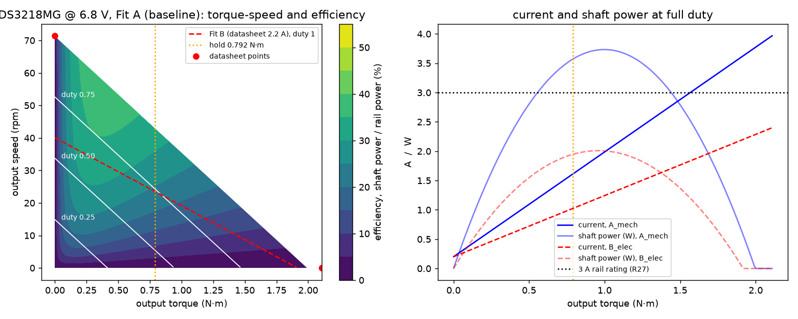
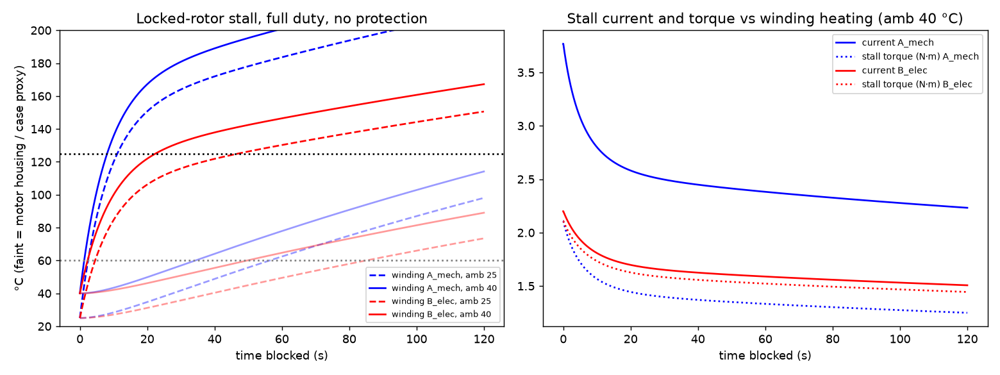
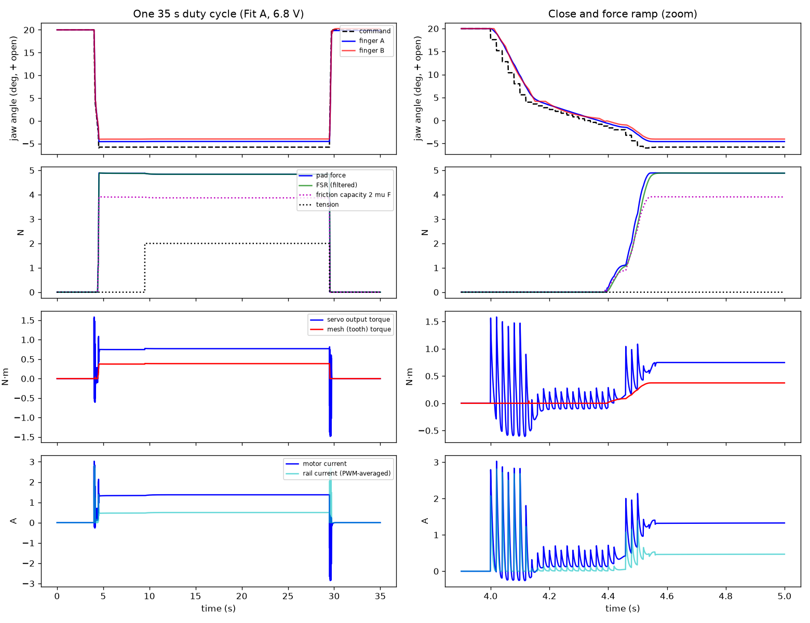
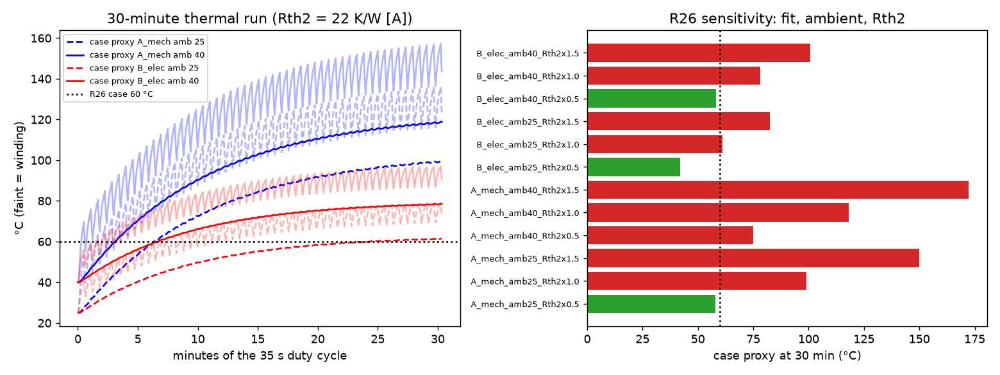
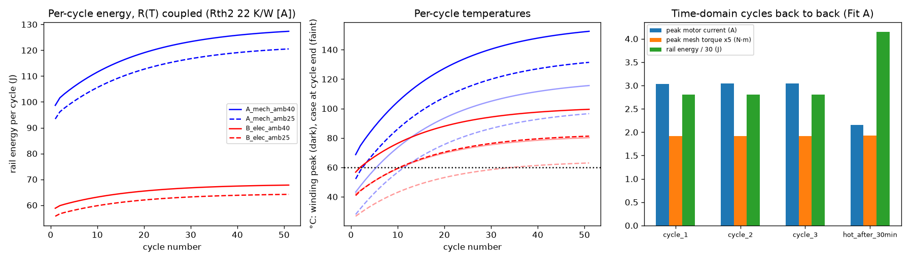
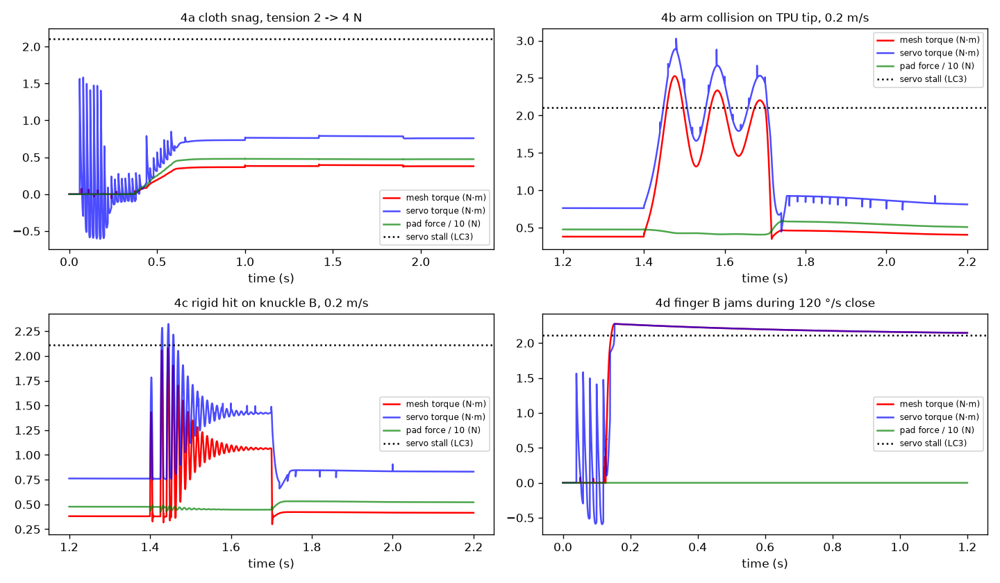
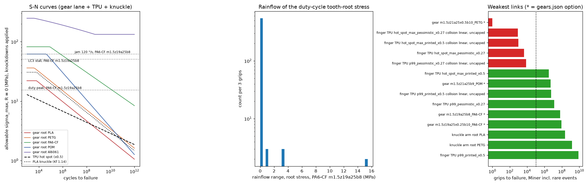

# Virtual actuator dyno and fatigue-to-failure

Lane: drivetrain dynamics and life for the cloth-feed gripper. Dated 2026-09-22 (review fix pass). `DESIGN-BASIS.md` wins where this note disagrees.

- **Script:** `analysis/gripper/dyno.py` (about 70 s). Re-run from the repository root: `uv run --with numpy --with scipy --with matplotlib --with shapely --with pylife python analysis/gripper/dyno.py`
- **Staleness check:** the same command with `--check` compares the input hashes recorded in `dyno.json` with the files on disk and exits 1 on any mismatch. A normal run also refuses to write `dyno.json` if an input changes while it runs; that guard fired once during this pass, when the FEA lane rewrote `fea_summary.json`.
- **Inputs read at run time** (sha256 in `dyno.json` → `inputs.input_file_sha256_16`): `cad/gripper/params.json`; `analysis/gripper/results/fea_summary.json` (recommended L45 finger); `finger_beam.json` (knuckle stress); `firmware/gripper/config.h` (parsed `#define`s); `analysis/gripper/gears.py` and `results/gears.json`, imported read-only. From these it takes gear geometry, VDI 2736 / ISO 6336 root and flank stress with F_βy derived per face width, S-N curves with knockdowns, and **the gear options themselves** (`gears.json` → `recommendation`, sweep and named geometries; nothing hardcoded).
- **Outputs:** `analysis/gripper/results/dyno.json` (every input with its tag, all results, downsampled time series for a viewer, 0.51 MB); figures `docs/gripper/figures/dyno_torque_speed.png`, `dyno_stall.png`, `dyno_duty_cycle.png`, `dyno_thermal_30min.png`, `dyno_per_cycle.png`, `dyno_shock.png`, `dyno_fatigue.png`.
- **Tags:** [S] sourced, [D] derived by the script, [A] assumed. Every [A] is reversible; the ones that decide a verdict have a measurement in section 8.
- **This revision:**
  - Inputs are current: the gear lane's new picks and the FEA lane's new finger (6 ribs at 30°, 4 mm tip, 1.10 N/mm, folds at 10.6 N).
  - θ_c0 sign fixed and CALIBRATE emulated.
  - Fast-jam peak swept over jam angle and servo damping.
  - Capped and uncapped tip-collision cases added for the TPU finger.
  - PWM discontinuous-conduction bound added.
  - 6.5 V stall current corrected and a 6.35 V point added.

## 0. Answer

| Question | Result |
|---|---|
| Does the DS3218MG datasheet describe a real DC motor? | **No.** Stall torque × no-load speed is 15.8 W; rail power at the listed stall current is 15.0 W. A DC motor would need a gearbox efficiency of 1.16 [D]. Fit A keeps torque and speed → **3.77 A stall current**. Fit B keeps 2.2 A → no-load speed **0.25 s/60°**, not 0.14 |
| Hold (5 N setpoint, 2 N tension) | Pad force 4.76 N: the 0.3 N integrator deadband leaves it just under setpoint. Servo 0.758 N·m (**36 % of stall**, rule ≤ 40 %), mesh 0.379 N·m. At the 0.792 N·m requirement the hold is 37.6 % of stall at 6.8 V and **39.2 % at the 6.35 V rail low end** (passes, both fits). Motor current 1.35 A (Fit A) / 0.80 A (Fit B). No slip at 2 N |
| Close time (ruled R19 ≤ 0.75 s) | CALIBRATE stores θ_c0 = −2.0° as a command angle, which includes servo lag. Contact at **0.36 s**, 5 N at **0.64 s**. Passes the ruled 0.75 s R19 to contact and to 5 N; the 0.5 s comparison is superseded 2026-10-12. The 20 °/s search now costs 0.22 s. The contact-to-5 N time is 0.28 s, set by the 25 N/s ramp and by PI gains sized for 1.63 N/mm against a 1.10 N/mm finger. The old sign error (θ_c0 = +0.44°) added 0.12 s of search |
| Thermal (R26 case ≤ 60 °C after 30 min) | **Fails in 9 of 12 modelled cases; the verdict waits on M7.** The "case" is the motor-housing node of a two-node model with borrowed constants, so it is an **upper bound** on the outer case R26 measures. Fit A at 25 °C ambient, Rth2 22 K/W [A]: 96 °C. Fit B: 63 °C. Passing: Fit A 25 °C with Rth2 halved, and Fit B at 25 °C or 40 °C with Rth2 halved. The average-value PWM model assumes continuous conduction [A]. Under the discontinuous-conduction bound, copper loss is 1.8–2.4× higher and all 12 fail. After 30 min at 40 °C (Fit A) the winding sits at 145 °C, stall torque falls to 1.42 N·m, and the hold becomes **54 % of the hot stall** |
| Stall (LC3) | 2.108 N·m through the mesh. Fit A draws 3.77 A, **above the 3 A rail (R27)**. The winding reaches 125 °C in 8 s (Fit A, 40 °C). The `config.h` 1.8 A / 100 ms trip limits the rise to about 3 K |
| Shock | The worst event is the **finger-B jam in the 120 °/s pre-close: 2.69 N·m** at base rotor inertia and **3.60 N·m at 2.6×**. These are maxima over jam angle 10–13.6° and servo damping ζ 0.5–1.0; the range is 2.11–2.69 N·m, so a single angle sample understates it. Arm collision on the TPU tip: 2.53 N·m. Gear lane's shock: 2.155. At 20 °/s the jam is quasi-static (2.108). A 2× tension snag gives 0.40 N·m, but the grip **slips**: friction capacity 3.81 N vs 4 N |
| Rail 6.5 / 6.35 V | Baseline stays 6.8 V (gear-lane LC3 basis, highest stall current). At 6.5 V: stall 2.05 N·m, so LC3 is −2.7 % and the 6.8 V gear verdicts are conservative. Hold is 38.6 % of stall at 6.5 V and 39.2 % at 6.35 V, against the 0.792 N·m requirement. Close is unchanged (0.36 / 0.66 s). Stall current is scaled from the 6.8 V datasheet values, because no source gives a 5 V current (section 5) |
| TPU finger vs R25 (1e5 grips) | **Fails at the pessimistic knockdown.** Hot spot × 0.27: **4.3e3 grips**, set by the 1e3 LC2 cap events (10 N) and the tip collisions. At × 0.5: 3.1e6 (passes). p99 stress: 1.3e7 / 2.0e9 (passes). The hot spot is the max von Mises at a sharp rib corner (singular), so the × 0.27 max row is the worst case, not the expected one. **Assumption:** the new finger's linear FEA holds to its fold (10.6 N at E 67, 8.9 N at E 56). The 5 N hold is inside that range. The 10 N cap (at E 56) and every tip collision (28.5 N) are not. Collisions are therefore capped at the fold stress, 10.7 MPa [A], which assumes structure not modelled here carries the load above the fold. Uncapped (linear at 28.5 N): 1.0e3 grips at × 0.5, so the finger fails |
| Weakest link, gear-lane options | 1. PETG best (m1.5 z21 x0.5 b10): **static root failure** at the jam (SF 0.90). 2. TPU hot spot × 0.27: 4.3e3. 3. POM CNC m1.5 z21 b9: 5.1e6. 4. PA6-CF printed m1.5 z19 b8: **6.3e7**. 5. PA6-CF robust m1.5 z19 x0.25 b10: 8.7e7. 6. PLA knuckle: 2.3e8 (SF 1.90 at the jam). Target: 1e5 grips = 972 h |
| Gear SF at the worst event / jam at 2.6× inertia / DS3235 stall (root) | PA6-CF printed **1.33 / 1.04 / 1.12**; PA6-CF robust **1.47 / 1.18 / 1.26**; POM CNC 1.29 / **1.01** / 1.09; PETG best **0.90 / 0.71 / 0.76**. The withdrawn m1.25 z19 b10 PA6-CF: 1.04 / **0.83 / 0.89**. Every option passes the base events except PETG. None keeps the gear lane's 1.5× margin under the swept jam |
| Static failures on the rare events | Every PLA and PETG geometry, including the PETG best. POM and PA6-CF at every b 6 named geometry except PA6-CF m1.5 z20 b6 (SF 1.16). The current CAD m1 z24 in every material. Al 6061 on the flank in a printed housing |
| Recommendation | Gears: **PA6-CF**, as gears.md says. The printed pick passes every event but drops to 1.04 at 2.6× rotor inertia. **Take the robust PA6-CF m1.5 z19 x0.25 b10 (min SF 1.18 over all cases) if the 0.7 mm extra centre distance fits**; otherwise keep the printed pick and measure the rotor inertia first. If a_w 31.5 fits, PA6-CF on the CNC geometry (m1.5 z21 b9) gives 1.56 / 1.24 / 1.33. POM CNC has no margin at 2.6× (1.01). The life limiters are **servo heat in the hold** (M7) and the **TPU finger under the 10 N cap and tip collisions** (M10 and a TPU coupon or bench fatigue test), not the gears |

## 1. Model

| Block | Model | Values (tag) |
|---|---|---|
| Rail | Stiff 6.8 V baseline; 6.5 and 6.35 V sensitivity in section 5 | [A], `torque_and_actuator.md` |
| Motor | Output-referred DC motor, quasi-static electrics: V_m = duty·V = R i + K ω; T = K(i − I_nl tanh(ω/0.05)). **Average-value PWM with continuous, ripple-free conduction (L/R ≫ PWM period) [A]; L ignored.** Bound: fully discontinuous conduction, mean i² = \|d\|((±V − Kω)/R)² (section 4) | Fit A: R 1.80 Ω, K 0.861 N·m/A. Fit B: R 3.09 Ω, K 1.474 N·m/A [D] |
| Datasheet | DS3218MG @ 6.8 V: 21.5 kg·cm, 0.14 s/60°, 2.2 A stall (Miuzei; Annimos says 1.8 A), 5 mA idle | [S] `actuators.csv` A17 |
| Gearbox | η_g 0.65 driving, 1/η_g back-driven (blended below 0.05 rad/s); ratio 300; rotor 0.6 g·cm² × 1.2 → reflected 6.5e-3 kg·m². **Reflected rotor inertia sits downstream of η_g, so rotor kinetic energy reaches the teeth with no gearbox loss: jam and collision peaks are conservative [A]** | [A]. Only public ratio in the family: DS3235 373 [S] |
| Servo position loop | PD, ±0.135° deadband (3 µs [S] × 0.09 °/µs), full duty at 3° error [A], ζ 0.8 [A] (0.5–1.0 swept in the jam), 1 µs pulse quantisation | Kp 19.1 /rad [D] |
| Mesh | 1:1 **PA6-CF m1.5 z19 α25 b8** (`gears.json` printed pick, a 28.5). VDI 2736 deformation relation → k = c_γ b r² = **480 N·m/rad** [D]. Backlash j_t 0.25 mm = 1.01° [S gears.json]. x_f 13.75 mm | gears.md 0 |
| Fingers | Tip-pad stiffness 1.101 N/mm per finger: fea_summary recommended L45, 6 ribs at 30°, E 67, linear [D]. Folds at 10.6 N (E 67) / 8.9 N (E 56) [D FEA]. J_B 9.7e-6 kg·m²; r_c 65 mm | [D] |
| Losses | η 0.85 per finger path: T_servo = 2 F r_c/η | [A] DESIGN-BASIS |
| Cloth | 0.3 mm ply, 30 N/mm through-thickness [A], in series with both fingers, 3 N·s/m [A]. Tension carried by μF per pad (μ 0.4 [A]); slips beyond | |
| Firmware | `config.h`: 50 Hz loop; 120 °/s pre-close to θ_c0 + 4°; 20 °/s search; touch 0.5 N; 25 N/s setpoint ramp; soft limit 7.5 N; trip 8 N; θ_min −11°; 60 °/s rate limit; 0.3 N integrator deadband; FSR EMA τ 9.5 ms. **CALIBRATE (R21) emulated:** close with no cloth from θ_c0 = 0 and store the command angle at FSR ≥ 0.5 N. Result −2.0° (Fit A and B), inside the ±4° window. The geometric pad touch is −0.44° (θ + open). `force_ctrl.h` is not in the tree, so the SIMC gains come from the `config.h` formula: Kp 0.240 °/N, Ti 0.040 s, feed-forward F_sp/K_stiff [D] | [S] config.h |
| Thermal | Two-node winding/housing RC. Structure (Rth1, Rth2, winding and motor time constants) and α_Cu 0.0039/K per maxon "Key information". Values [A]: Rth1 8 K/W, Rth2 22 K/W, τ_w 12 s, τ_h 450 s; winding limit 125 °C. **Motor housing node = case proxy, an upper bound on the outer servo case** | maxon structure; values [A] |

Semi-implicit Euler, dt 40 µs (duty cycle), 10 µs (shock). Fit A is the baseline for rail, heat and shock (more current, more rotor energy); Fit B is the optimistic electrical bound. Both give the same stall torque, so gear loads do not depend on the fit.

## 2. Test 1: torque-speed and efficiency

| | Fit A | Fit B |
|---|---|---|
| Peak efficiency (shaft / rail power) | 38 % at 0.36 N·m | 32 % at 0.43 N·m |
| Maximum shaft power | 3.7 W at 1.0 N·m | 2.0 W at 0.96 N·m |
| Current and copper loss at the 0.792 N·m hold | 1.42 A, 3.6 W | 0.83 A, 2.1 W |

The hold is at zero speed: efficiency is zero and all hold power becomes heat.

## 3. Test 2: stall and thermal rise

| Locked rotor, full duty | Fit A, 25 / 40 °C ambient | Fit B, 25 / 40 °C |
|---|---|---|
| Initial current / power | 3.77 A / 25.6 W | 2.2 A / 15.0 W |
| Winding rise at 0.2 s (R20) | 3.4 K | 2.0 K |
| Time to 125 °C winding | 11.1 s / 8.1 s | 47 s / 22 s |
| Motor housing (case proxy, upper bound) at 60 s | 62 / 78 °C | 49 / 65 °C |

Copper resistance rises with heat, so stall current falls (Fit A: 2.38 A after 60 s at 40 °C). The 1.8 A / 100 ms trip fires on either fit. With Fit A, a 3 A supply sags at stall: size the buck for 4 A until M6 [A].

## 4. Test 3: grip duty cycle (35 s, DESIGN-BASIS 7)

| Metric | Fit A | Fit B |
|---|---|---|
| Calibrated θ_c0 (command at touch, no cloth) | −2.0° | −2.0° |
| Pre-close / search / contact / 5 N after close start | 0.14 / 0.22 / 0.36 / **0.64 s** | 0.14 / 0.22 / 0.36 / 0.66 s |
| Hold pad force (mean) | 4.76 N | 4.84 N |
| Finger A / command at hold | −4.46° / −5.66° | −4.54° / −5.73° |
| Servo torque at feed hold | 0.758 N·m (36 % of stall) | 0.772 N·m (37 %) |
| Mesh torque: hold / peak / most negative | 0.379 / 0.382 / −0.060 N·m | 0.386 / 0.389 / −0.037 |
| Motor current: hold / peak / cycle RMS | 1.35 / 3.03 / 1.14 A | 0.80 / 1.75 / 0.68 A |
| Energy per cycle: rail / copper / shaft | 84.3 / 82.7 / 0.21 J | 51.8 / 50.1 / 0.21 J |
| Slip during the 2 N feed | none (capacity 3.81 N) | none |

- **θ_c0 sensitivity** (Fit A, `test3_duty_cycle.close_time_theta_c0_sensitivity_A_mech`):

  | θ_c0 used | Search | Contact | 5 N |
  |---|---|---|---|
  | Calibrated command, −2.0° | 0.22 s | 0.36 s | 0.64 s |
  | Geometric touch, −0.44° | 0.28 s | 0.40 s | 0.74 s |
  | Old sign error, +0.44° | 0.34 s | 0.46 s | 0.76 s |

  The geometric value leaves the jaw 1.6° further from contact when the slow zone starts, because it ignores servo lag. Shortening `JAW_SLOW_ZONE_DEG` or raising the ramp is the R19 lever.
- **Back-to-back cycles** (time domain, each from the previous end state): cycles 1, 2 and 3 agree within 0.02 % (84.3 J; peak current 3.03–3.04 A). The model has no cycle-to-cycle drift except heat.
- **Hot cycle** (winding resistance at the 30-min, 40 °C value: 145 °C, R 2.68 Ω): stall torque 1.42 N·m, hold = **54 % of hot stall**, 5 N at 0.74 s, 125 J/cycle.
- **Stepped command:** at 120 °/s the 50 Hz command jumps 2.4° per frame. Each step saturates the drive (1.6 N·m, 3 A pulses) while finger B is still in free travel, so the pulses do not reach the mesh.
- **Two currents:** in the average-value model the INA219 sees PWM-averaged rail current (0.46 A in the hold), while the motor carries 1.28–1.35 A. The 1.8 A stall trip compares rail current, which is correct. Both numbers depend on the continuous-conduction assumption.

**30-minute thermal run and per-cycle history** (51 cycles, R(T) coupled):

| Motor housing (case proxy, upper bound) at 30 min, °C | Rth2 × 0.5 | × 1 (22 K/W) | × 1.5 |
|---|---|---|---|
| Fit A, 25 °C ambient | **56.9** | 96.2 | 144.7 |
| Fit A, 40 °C | 73.7 | 115.2 | 166.6 |
| Fit B, 25 °C | **42.8** | 62.8 | 85.2 |
| Fit B, 40 °C | **58.8** | 80.0 | 103.7 |
| PWM bound, Fit A 25 °C / Fit B 25 °C | 96.9 / 67.7 | 168.4 / 110.2 | 239.4 / 152.4 |

- **PWM bound** (`test3_duty_cycle.thermal_30min_pwm_bound`). If L/R is much shorter than the servo's PWM period, current flows only during the on-time at (V − Kω)/R. Mean current is then still set by torque, but copper loss becomes \|i\|·V, independent of R(T). That is 6.7 W (Fit A) and 4.0 W (Fit B), 1.8–2.4× the average-value loss, and all 12 cases fail. The real value lies between the two. It is set by the motor's L/R against the PWM frequency; M6/M7 scope the motor current to settle it.
- Per cycle (Fit A, 40 °C): rail energy 98.7 → 127.3 J and winding peak 69 → 153 °C, from cycle 1 to 51 (`dyno.json` → `test3_duty_cycle.per_cycle_30min`). These rows repeat cycle 1's current profile. Per-cycle peak current and torque are not recomputed (see `per_cycle_30min_note`).
- DESIGN-BASIS 7 put mean I²R at 11.7 % of stall loss. The average-value model gives 2.9–3.7 W / 25.6 W = 11–14 % (Fit A). The fraction is right; 3–4 W continuous inside a plastic case is the problem.
- **Firmware option to bench-test [A]:** once 5 N is reached, back the command off until the servo holds on gearbox friction (a static gearbox can hold anywhere between η·T and T/η). The motor then needs about η² ≈ 0.42 of the current, which cuts average-value copper loss about 80 % (less under the PWM bound, where loss scales with \|i\|, about 58 %). It needs the FSR loop to confirm the force stays.

## 5. Test 4: shock cases

| Case | Peak mesh torque | Notes |
|---|---|---|
| 4a Cloth snag, tension 2 → 4 N in 5 ms, held 0.5 s | 0.40 N·m | Friction capacity 3.81 N < 4 N: the cloth **slips** for 97 % of the snag. Pad force stays ≥ 4.71 N |
| 4b Arm collision on finger B's TPU tip (0.2 m/s [A], 0.3 kg [A], 20 N arm push over 50 ms [A]) | **2.53 N·m** | Obstacle force 28.5 N; grip force 4.08–5.88 N; 3.73 A |
| 4c Rigid hit on knuckle B (r 30 mm, 100 N/mm), rotor inertia × 0.35 / 1 / 2.6 | 2.06 / 2.08 / 2.10 N·m | Arm-force limited, 48 N |
| 4d Finger B jams in the 120 °/s close. Max over jam angle 10–13.6° (0.3° steps) × ζ 0.5 / 0.8 / 1.0; inertia × 0.35 / 1 / 2.6 | 2.26 / **2.69** / **3.60** N·m | Rotor kinetic energy lands on the teeth. Range at × 1: 2.11–2.69 (2.25–2.59 at ζ 0.8); at 12° alone 2.27. The back-driven gearbox can hold up to T_stall/η_g² = 4.99 N·m before it slips, so it does not cap these peaks |
| 4d by gear (inertia × 1, ζ 0.8, angle swept): PA6-CF printed / PA6-CF robust / POM CNC | 2.59 / 2.61 / 2.58 N·m | Mesh stiffness 480 / 600 / 417 N·m/rad and backlash 1.01 / 1.01 / 0.29° barely move the peak |
| 4d same jam in the 20 °/s search | 2.108 (= LC3) | Quasi-static |

The peaks arrive within about 10 ms, so no current or firmware limit caps 4b or 4d. A slower pre-close near possible jams, or a slip clutch at ≤ 1.9 N·m, would.

**Rail sensitivity** (`dyno.json` → `rail_sensitivity`). `torque_and_actuator.md` sets the rail to 6.5 ± 0.15 V and checks the hold at 6.35 V. Torque and speed are interpolated between the 5 V and 6.8 V datasheet points, taking the lower (Miuzei) 5 V torque of 18 kg·cm [D from S]. **Stall current:** `actuators.csv` A17 gives Miuzei 2.2 A and Annimos 1.8 A, **both at 6.8 V**. No source there gives a 5 V current, so the previous 1.8 → 2.2 A interpolation was wrong. Current is now scaled with the winding resistance fixed, I = I_6.8 × V/6.8 [D]. The Annimos 1.8 A is run as a third fit.

| | 6.5 V: Fit A / Fit B / Fit B (1.8 A) | 6.35 V: Fit A / Fit B / Fit B (1.8 A) |
|---|---|---|
| Stall torque, s/60° | 2.05 N·m, 0.143 s | 2.02 N·m, 0.145 s |
| Stall current | 3.75 / 2.10 / 1.72 A | 3.74 / 2.05 / 1.68 A |
| Close: contact / 5 N | 0.36 / 0.66 s (all) | 0.36 / 0.66 s (all) |
| Hold: simulated servo torque, fraction of stall | 37.1 / 37.4 / 37.5 % | 37.8 / 37.8 / 38.0 % |
| Hold fraction at the 0.792 N·m requirement | 38.6 % (≤ 40 %, passes) | **39.2 %** (passes, 0.8 points of margin) |
| Hold current / rail energy per cycle | 1.35 / 0.79 / 0.64 A; 80.7 / 49.4 / 40.3 J | 1.41 / 0.78 / 0.63 A; 85.0 / 48.3 / 39.1 J |
| Case proxy at 30 min, 25 / 40 °C (Rth2 22 K/W) | 92 / 111; 61 / 78; 53 / 69 °C | 97 / 116; 60 / 77; 52 / 68 °C |

## 6. Fatigue to failure

**Method.**
- **Histories:** mesh torque and pad force from the Fit A duty cycle, three grips back to back.
- **Counting:** pylife 2.3.1 `FourPointDetector` rainflow.
- **Mean stress:** Smith-Watson-Topper to the R = 0 basis of every curve: σ_eq = √(2 σ_max σ_a).
- **Damage:** Palmgren-Miner, no endurance limit. Rare events are added as 0 → peak cycles over a 1e5-grip life [A counts]:

  | Event | Load | Count |
  |---|---|---|
  | LC2 cap | 0.976 N·m, 10 N at the pad | 1e3 |
  | Snag | 0.40 N·m | 1e3 |
  | LC3 stall | 2.108 N·m | 100 |
  | Fast jam, swept maximum | **2.69 N·m** | 100 |
  | Tip collision | 2.53 N·m, 28.5 N | 100 |

  Counts follow `gears.json` (n_LC2, n_LC3, n_shock) plus the collision and snag.
- **Gear stress:** `gears.stresses()` per option and material: VDI 2736 tip-load root stress (polymers, POM), ISO 6336-3 method B (metals), Hertz flank stress. K_Hβ comes from F_βy derived per face width (0.067 mm at b 8), so stress is not linear in torque. Root and flank lives use the gear lane's `life()` and `sH_allow()` (knockdowns included). Static check against the gear lane's LC3 allowables (root S_static × kd, flank 1.67 σ_y × kd).
- **TPU hot spot:** fea_summary recommended tip, 0.888 MPa/N (max vM at a sharp rib corner, singular) and 0.386 MPa/N (p99). Pad events at their linear stress. Tip collisions two ways:
  - **Capped** (headline): the nonlinear-FEA hot-spot stress at the fold, 10.7 MPa max / 5.3 MPa p99 [A: structure not modelled here carries the load above the fold].
  - **Linear, uncapped:** 25.3 MPa and 38 % strain at 28.5 N, outside the model's validity.
- **Knuckle arm root:** 0.460 MPa/N incl. Kt 1.5 (`finger_beam.json` design_L45). All events, with stall and jam forces taken at the tip pad (T η / r_c) [A]. **K_f 1.14 is applied on top of Kt 1.5, so the notch is counted twice (conservative).**

| S-N curve (σ_max, R ≈ 0) | Basis |
|---|---|
| Gear PLA / PETG / PA6-CF / POM / Al 6061 | Gear lane (`gears.md` 3), knockdowns included |
| Knuckle PLA: 143.5 N^−0.161, K_f 1.14, cap 35 | [S] Basquin σ_a = 68.159 N^−0.161, R 0.05 (Polymers 2026 via `research/gears.md` 2.1) |
| Knuckle PETG: PLA slope, 30.6 MPa at 1e5, cap 51 | [A] DESIGN-BASIS 4 |
| TPU: 49.3 N^−0.093 × 0.5 printed [A] (× 0.27 pessimistic), cap 23.7 | [S] TPU 80A HCF data, R 0.1 (PMC9958809), [D] fit |

**Gears, grips to failure with rare events.** `*` marks a `gears.json` option. S = static failure on an event, with the root SF in brackets. Otherwise the root SF under the worst event is given.

| Geometry | PLA | PETG | PA6-CF | POM | Al 6061 |
|---|---|---|---|---|---|
| m1.5 z19 α25 b8, a 28.5 (printed pick) | S (0.44) | S (0.72) | **6.3e7*** flank, SF 1.33 | 3.3e6, 1.08 | S flank (0.66) |
| m1.5 z19 α25 x0.25 b10, a 29.2 (robust) | S | S (0.82) | **8.7e7*** flank, SF 1.47 | 4.0e6, 1.23 | S flank |
| m1.5 z21 α25 b9, a 31.5 (CNC pick) | S | S (0.86) | 1.1e8, 1.56 | **5.1e6*** flank, SF 1.29 | S flank |
| m1.5 z21 α25 x0.5 b10, a 32.9 (best PETG) | S | **S (0.90)*** | 1.7e8, 1.59 | 6.3e6, 1.35 | S flank |
| m1.25 z19 α25 b10, a 23.75 (withdrawn pick) | S | S | 2.4e7, 1.04 | S (0.87) | S flank |
| m1.5 z20 α20 b6 (DB / torque-note PETG proposal) | S | S (0.60) | 5.2e7, 1.16 | S (0.91) | S flank |
| m1.25 z24 α20 b6 (DB) | S | S | S (1.00) | S (0.79) | S flank |
| m1 z24 α20 b6 (current CAD) | S | S | S (0.65) | S (0.51) | S flank |

**Event sensitivity for the `gears.json` options.** Root SF at the worst simulated event (2.69 N·m jam) / the jam at 2.6× rotor inertia (3.60 N·m) / the DS3235 backup stall (3.31 N·m):

| Option | Worst event | Jam at 2.6× inertia | DS3235 stall |
|---|---|---|---|
| PA6-CF printed | 1.33 | **1.04** | 1.12 |
| PA6-CF robust | 1.47 | 1.18 | 1.26 |
| POM CNC | 1.29 | **1.01** | 1.09 |
| PETG best | **0.90** | **0.71** | **0.76** |

Flank SF is higher than root in every PA6-CF and POM case (PA6-CF printed: 1.46 / 1.31 / 1.35). Changes since the last dyno run:
- The drivetrain moved from m1.25 z19 b10 to the gear lane's m1.5 z19 b8.
- K_Hβ now uses F_βy per face width (0.067 mm at b 8, previously 0.03).
- The jam peak rose from a single 12° sample (2.31 N·m) to the swept maximum (2.69 N·m).

**Other parts:**
- **TPU finger hot spot** (collisions capped): 3.1e6 grips at × 0.5; **4.3e3 at × 0.27 (fails R25)**. The p99 stress gives 2.0e9 / 1.3e7. Damage at × 0.27 comes from the 1e3 LC2 cap events (8.9 MPa at 10 N, 1.3e-4 per grip) and the capped collisions (1.0e-4 per grip); the duty cycle adds 3e-6. Duty peak is 4.3 MPa and 6.3 % strain at 4.79 N, inside the linear range. **Validity:** the new finger folds at 10.6 N (E 67) / 8.9 N (E 56). The 10 N cap is above the E 56 fold and the 28.5 N collision is far above both. Uncapped collisions give 1.0e3 grips (× 0.5) and 8.8e2 (× 0.27): with nothing stopping the fold, one collision does most of a lifetime's damage. `fea_summary` itself rates the finger CONDITIONAL: it fails the R15 fold check at the 10 N cap and relies on the 8 N FSR trip.
- **Knuckle arm root:** PLA 2.3e8 grips (2.2e6 h), PETG 1.5e9. Duty peak 2.25 MPa. Worst event (fast jam, 35 N at the tip) 16.18 MPa: SF 1.90 (PLA), 2.77 (PETG).

**Ranking, weakest first (`gears.json` options, finger, knuckle):**

| Rank | Component | Grips to failure | vs 1e5 |
|---|---|---|---|
| 1 | PETG best gear | static | fails |
| 2 | TPU hot spot × 0.27, uncapped collisions | 8.8e2 | fails |
| 3 | TPU hot spot × 0.5, uncapped collisions | 1.0e3 | fails |
| 4 | TPU hot spot × 0.27, capped | **4.3e3** | fails |
| 5 | TPU p99 × 0.27, uncapped | 7.6e3 | fails |
| 6 | TPU hot spot × 0.5, capped | 3.1e6 | passes |
| 7 | POM CNC | 5.1e6 | passes |
| 8 | TPU p99 × 0.5, uncapped | 5.7e6 | passes |
| 9 | TPU p99 × 0.27, capped | 1.3e7 | passes |
| 10 | PA6-CF printed | 6.3e7 | passes |
| 11 | PA6-CF robust | 8.7e7 | passes |
| 12 | PLA knuckle | 2.3e8 | passes |
| 13 | PETG knuckle | 1.5e9 | passes |

**Against the 1e5 target (R25):** every PA6-CF and POM option and both knuckles pass. PETG fails. The TPU finger fails at the pessimistic knockdown and whenever tip collisions are not capped at the fold. The full ranking is in `dyno.json` → `fatigue.ranking_weakest_first`.

## 7. Limits

- **Uncharacterised servo.** Ratio, rotor inertia, gearbox efficiency, no-load current, deadband behaviour and loop damping are [A]. The jam peak scales with √(J·k) and moves ±12 % with the command phase and ζ. Collision and rigid-hit peaks are set by the assumed arm force.
- **Average-value PWM.** Continuous conduction is assumed; the discontinuous bound raises hold copper loss 1.8–2.4×. The INA219 / motor current split and the back-off saving depend on which regime is real.
- **Thermal constants are borrowed** from the maxon structure, not from a DS3218 test. The motor-housing node is an upper bound on the outer case, and it swings ±50 K with Rth2. The hold uses the motoring-side gearbox efficiency (conservative current).
- **Finger.** Linear FEA up to the 10.6 N fold (8.9 N at E 56). Collisions are capped at the fold stress by assumption. The firmware PI gains are sized for 1.63 N/mm, so on the 1.10 N/mm finger the loop is slower than designed.
- **Gear stress** is the gear lane's model: no dynamic factor beyond the simulated torque, no creep. Long holds on PETG/PLA near a 60–120 °C servo case will creep and grow backlash; PLA's HDT is 57 °C.
- **S-N data** are coupon-based (PLA, PETG, TPU), continuous-rotation gear tests (PA6-CF, POM) or handbook (Al). None is at this slow, dwell-heavy loading. The TPU curve is for moulded 80A.
- **Event counts** are [A]. The verdicts on POM, the printed PA6-CF margin and the TPU finger depend on them and on the rotor inertia.
- **Conservative biases:** the reflected rotor inertia bypasses the gearbox loss, and the knuckle notch is counted twice (K_f on top of Kt).

## 8. Team must measure

| # | What | Why it decides |
|---|---|---|
| M6+ | DS3218MG stall current, stall torque, no-load speed and current at 6.8 V and 6.5 V. **Scope the motor current waveform in the hold** (shunt in series with the motor lead): PWM frequency, ripple, whether conduction is continuous | Fit A or B: rail sizing (3.77 vs 2.2 A), heat (×1.7), close speed. The waveform decides between the average-value and bound copper loss (×1.8–2.4) |
| M7 | Outer case temperature (IR, the R26 method) over 30 min of the duty cycle, the motor-current waveform in the hold, and the cool-down time constant (gives Rth2, τ_h) | The model fails R26 in 9 of 12 cases with a motor-housing upper bound, and in 12 of 12 under the PWM bound |
| New | Rotor inertia × ratio² (coast-down or step response, horn only); count the gear teeth on a spare. Step response also gives the loop damping ζ | Sets the jam peak (2.26–3.60 N·m) and whether the printed PA6-CF keeps SF > 1.04 and POM > 1.01 |
| New | Arm collision speed and force near fixtures (STS3215 load register) | Sets the 2.53 N·m collision peak and the 28.5 N tip load on the TPU finger |
| M17 | Printed sector step-load test (`gears.md` 7) including 20 drop-jams at 120 °/s | Validates the event verdicts |
| R19 | Time the close to contact and to 5 N, and log the calibrated θ_c0 | 0.36 / 0.64 s predicted with θ_c0 −2.0°. Historical request to meet 0.5 s at 5 N (superseded 2026-10-12; the 0.64 s prediction passes ruled R19 0.75 s): shorten JAW_SLOW_ZONE_DEG, raise F_RAMP_NPS, retune the PI for 1.10 N/mm, or define R19 as contact |
| M10 | Tip stiffness and fold load of the printed finger; a TPU tip bend-fatigue run at 10 N and at the collision load | Linear 1.10 N/mm up to a 10.6 N fold; the TPU life spans 4.3e3–3.1e6 grips on the knockdown and the collision cap |
| M2 | Pad-cloth friction μ | The 2× snag slips at μ 0.4 with a 4.76 N hold (capacity 3.81 N vs 4 N) |

## Sources

- DS3218MG data: `docs/gripper/research/actuators.csv` row A17 (SpeedyFPV product page; Miuzei datasheet https://images-na.ssl-images-amazon.com/images/I/81Lbgu+nG6L.pdf; Annimos 1.8 A @ 6.8 V https://cdck-file-uploads-europe1.s3.dualstack.eu-west-1.amazonaws.com/arduino/original/4X/7/4/f/74f50fff235673f3d7b2a23ae8b8d6e7f30a47f7.pdf); DS3235 ratio 373: https://hajim.rochester.edu/me/sites/kelley/me240/DS3235-270_datasheet.pdf
- maxon "DC motor and EC motor Key information" (Rth1/Rth2, winding and motor thermal time constants): https://people.ece.ubc.ca/leos/pdf/datasheets/Maxon/MaxonSpecs.pdf
- TPU high-cycle fatigue (R 0.1, 5 Hz, 80A): https://pmc.ncbi.nlm.nih.gov/articles/PMC9958809/
- Gear stresses, S-N curves, knockdowns and their sources (Hriberšek 2024 Onyx gears, Pogacnik & Tavcar POM/PA6, PLA Basquin, VDI 2736, ISO 6336 structure): `docs/gripper/analysis/gears.md` and `docs/gripper/research/gears.md`.
- Mean-stress correction: Smith, Watson and Topper, "A stress-strain function for the fatigue of metals", J. Materials 5 (1970) 767–778.
- pylife 2.3.1 rainflow (FourPointDetector, FullRecorder): https://github.com/boschresearch/pylife
- Firmware constants: `firmware/gripper/config.h`. Finger data: `analysis/gripper/results/fea_summary.json`, `finger_beam.json`.
