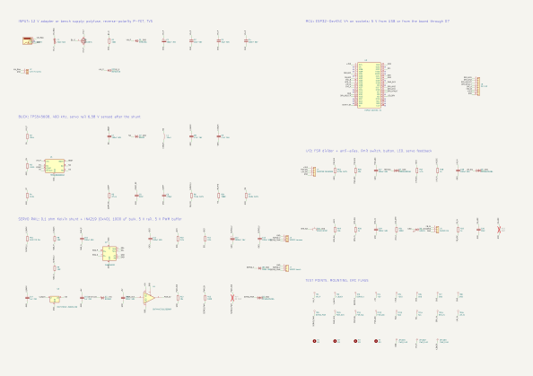
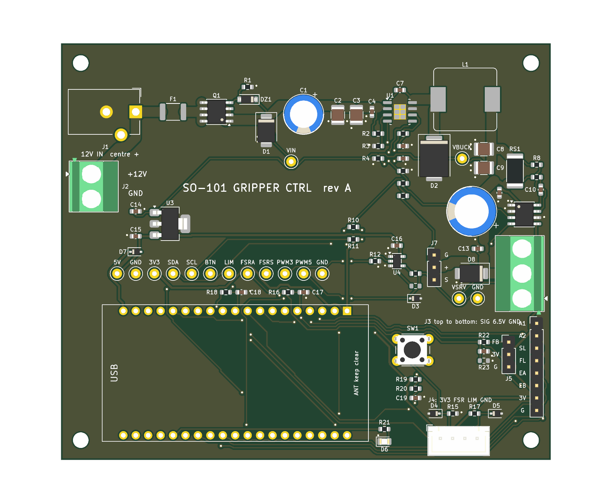

# Gripper electrical design: power, board, harness

Lane: gripper-electrical. Date: 2026-10-11. Board: SO-101 GRIPPER CTRL rev A.

- **Design files:** `ecad/gripper/design.py` (every part and net), `ecad/gripper/sourcing.py` (what to buy), `ecad/gripper/kicad/` (KiCad 10 project, generated), `ecad/gripper/kicad/fab/` (Gerbers, drill, position, BOM, STEP), `ecad/gripper/HARNESS.md` (cable build guide).
- **Calculations:** `ecad/gripper/calc/*.py`, outputs in `ecad/gripper/calc/out/` (one `.txt` and one `.json` per script).
- **Re-run calculations:** `python ecad/gripper/calc/run_all.py` from the repository root; add `--check` to compare without writing, or `--figures` to refresh figures on request. PNG bytes are stable only when regenerated on one machine. The full build is `python ecad/gripper/build.py` (about 15 minutes; needs KiCad 10). Tests: `python -m pytest ecad/gripper -q`.
- **Tags:** [S] sourced, [D] derived by a committed script (the output file is named), [A] assumed. A number with no tag in a table is from the file named in that table's heading.
- **Words used.** *Buck*: a step-down switching regulator. *Shunt*: a small resistor whose voltage drop measures current. *Stall*: the servo powered but blocked; it draws its largest current. *Fit A / Fit B*: the two servo-current models in `analysis/dyno.md`; Fit A stalls at 3.77 A, Fit B at the datasheet 2.2 A. Which is true is not known until measurement M6. *Plug*: the point where the harness meets the servo's own lead. *ERC / DRC*: KiCad's electrical and design rule checks. *DNP*: do not populate. *Brown-out*: the supply level at which the ESP32 resets itself.

## 0. Answer

<!-- ORDER-STATUS:BEGIN -->
## Order status — DO NOT ORDER

Input provenance uses per-module read granularity; each row lists modules read in margins.json.

- `input-fuse-hold`: missing: F1 MF-MSMF260/16X — hold-current tolerance at 25 C; find in datasheet electrical characteristics table; finished servo harness — awg20_ohm_m uncertainty or qualification; find in selected wire datasheet or finished-harness measurement; finished servo harness — awg26_ohm_m uncertainty or qualification; find in selected wire datasheet or finished-harness measurement; U1 TPS54560B buck stage — buck_nominal_input_v uncertainty or qualification; find in U1 datasheet or assembled loop measurement; U1 TPS54560B buck stage — buck_servo_lead_resistance_ohm uncertainty or qualification; find in U1 datasheet or assembled loop measurement; assembled gripper controller — c12_esr uncertainty or qualification; find in DESIGN-BASIS section 10 corresponding bench step; assembled gripper controller — c_wrist_esr uncertainty or qualification; find in DESIGN-BASIS section 10 corresponding bench step; finished servo harness — cable_l_per_m uncertainty or qualification; find in selected wire datasheet or finished-harness measurement; assembled gripper controller — cer_derate_6v6 uncertainty or qualification; find in DESIGN-BASIS section 10 corresponding bench step; 47 uF ceramics — effective capacitance at DC bias; find in manufacturer DC-bias curves; assembled gripper controller — d2_vf uncertainty or qualification; find in DESIGN-BASIS section 10 corresponding bench step; assembled gripper controller — d7_vf_100ma uncertainty or qualification; find in DESIGN-BASIS section 10 corresponding bench step; assembled gripper controller — d7_vf_slope uncertainty or qualification; find in DESIGN-BASIS section 10 corresponding bench step; assembled gripper controller — devkit_diode_drop uncertainty or qualification; find in DESIGN-BASIS section 10 corresponding bench step; assembled gripper controller — devkit_overhead_a uncertainty or qualification; find in DESIGN-BASIS section 10 corresponding bench step; assembled gripper controller — droop_5v_load_a uncertainty or qualification; find in DESIGN-BASIS section 10 corresponding bench step; assembled gripper controller — droop_comp_zero_v uncertainty or qualification; find in DESIGN-BASIS section 10 corresponding bench step; assembled gripper controller — droop_default_rise_s uncertainty or qualification; find in DESIGN-BASIS section 10 corresponding bench step; assembled gripper controller — droop_default_vin_v uncertainty or qualification; find in DESIGN-BASIS section 10 corresponding bench step; assembled gripper controller — droop_diode_v uncertainty or qualification; find in DESIGN-BASIS section 10 corresponding bench step; assembled gripper controller — droop_end_time_s uncertainty or qualification; find in DESIGN-BASIS section 10 corresponding bench step; assembled gripper controller — droop_fsw_hz uncertainty or qualification; find in DESIGN-BASIS section 10 corresponding bench step; assembled gripper controller — droop_recovery_band_v uncertainty or qualification; find in DESIGN-BASIS section 10 corresponding bench step; assembled gripper controller — droop_servo_idle_a uncertainty or qualification; find in DESIGN-BASIS section 10 corresponding bench step; assembled gripper controller — droop_step_time_s uncertainty or qualification; find in DESIGN-BASIS section 10 corresponding bench step; assembled gripper controller — droop_voltage_floor_v uncertainty or qualification; find in DESIGN-BASIS section 10 corresponding bench step; ESP32 DevKitC V4 assembly — esp_bod_default uncertainty or qualification; find in module and board documentation or rail measurement; selected servo and dyno specimen — fit_a_hold_a uncertainty or qualification; find in manufacturer datasheet or DESIGN-BASIS section 10 force/current bench step; selected servo and dyno specimen — fit_a_resistance_ohm uncertainty or qualification; find in manufacturer datasheet or DESIGN-BASIS section 10 force/current bench step; selected servo and dyno specimen — fit_a_torque_nm_per_a uncertainty or qualification; find in manufacturer datasheet or DESIGN-BASIS section 10 force/current bench step; selected servo and dyno specimen — fit_b_hold_a uncertainty or qualification; find in manufacturer datasheet or DESIGN-BASIS section 10 force/current bench step; selected servo and dyno specimen — fit_b_resistance_ohm uncertainty or qualification; find in manufacturer datasheet or DESIGN-BASIS section 10 force/current bench step; selected servo and dyno specimen — fit_b_stall_a uncertainty or qualification; find in manufacturer datasheet or DESIGN-BASIS section 10 force/current bench step; selected servo and dyno specimen — fit_b_torque_nm_per_a uncertainty or qualification; find in manufacturer datasheet or DESIGN-BASIS section 10 force/current bench step; FSR sensor — fit exponent confidence interval; find in DESIGN-BASIS.md section 10 force sweep; finished servo harness — harness_plug_band_v uncertainty or qualification; find in selected wire datasheet or finished-harness measurement; assembled gripper controller — ibus_5v_idle uncertainty or qualification; find in DESIGN-BASIS section 10 corresponding bench step; L1 SRP1245A-100M — inductance tolerance and bias derating; find in manufacturer datasheet curves; assembled gripper controller — l1_dcr uncertainty or qualification; find in DESIGN-BASIS section 10 corresponding bench step; ESP32 DevKitC V4 assembly — power_3v3_rail_v uncertainty or qualification; find in module and board documentation or rail measurement; assembled gripper controller — power_board_plane_resistance_ohm uncertainty or qualification; find in DESIGN-BASIS section 10 corresponding bench step; assembled gripper controller — power_diode_reference_current_a uncertainty or qualification; find in DESIGN-BASIS section 10 corresponding bench step; assembled gripper controller — power_external_3v3_load_a uncertainty or qualification; find in DESIGN-BASIS section 10 corresponding bench step; assembled gripper controller — power_fit_a_stall_current_a uncertainty or qualification; find in DESIGN-BASIS section 10 corresponding bench step; assembled gripper controller — power_five_volt_rail_v uncertainty or qualification; find in DESIGN-BASIS section 10 corresponding bench step; assembled gripper controller — power_fsr_return_current_a uncertainty or qualification; find in DESIGN-BASIS section 10 corresponding bench step; assembled gripper controller — power_ldo_dropout_scale_cap uncertainty or qualification; find in DESIGN-BASIS section 10 corresponding bench step; assembled gripper controller — power_ldo_full_load_dropout_ratio uncertainty or qualification; find in DESIGN-BASIS section 10 corresponding bench step; assembled gripper controller — power_ldo_light_load_a uncertainty or qualification; find in DESIGN-BASIS section 10 corresponding bench step; assembled gripper controller — power_ldo_load_span_a uncertainty or qualification; find in DESIGN-BASIS section 10 corresponding bench step; assembled gripper controller — power_log_current_floor_a uncertainty or qualification; find in DESIGN-BASIS section 10 corresponding bench step; assembled gripper controller — power_rating_margin_factor uncertainty or qualification; find in DESIGN-BASIS section 10 corresponding bench step; assembled gripper controller — power_regen_basis_mj uncertainty or qualification; find in DESIGN-BASIS section 10 corresponding bench step; assembled gripper controller — power_regen_rotor_mj uncertainty or qualification; find in DESIGN-BASIS section 10 corresponding bench step; assembled gripper controller — power_starting_efficiency uncertainty or qualification; find in DESIGN-BASIS section 10 corresponding bench step; assembled gripper controller — power_switch_transition_time_s uncertainty or qualification; find in DESIGN-BASIS section 10 corresponding bench step; selected servo and dyno specimen — servo_idle_a uncertainty or qualification; find in manufacturer datasheet or DESIGN-BASIS section 10 force/current bench step; servo Fit A dyno specimen — stall-current fit confidence interval; find in DESIGN-BASIS.md section 10 force/current sweep; selected servo and dyno specimen — servo_vmax uncertainty or qualification; find in manufacturer datasheet or DESIGN-BASIS section 10 force/current bench step; selected servo and dyno specimen — servo_vmin uncertainty or qualification; find in manufacturer datasheet or DESIGN-BASIS section 10 force/current bench step; RS1 WSLP1206R1000FEA — resistance over temperature; find in manufacturer datasheet and calibration step; assembled gripper controller — wire_gauges_awg uncertainty or qualification; find in DESIGN-BASIS section 10 corresponding bench step; wrist capacitor — capacitance after bias temperature and ageing; find in manufacturer datasheet
- `input-fuse-trip`: missing: F1 MF-MSMF260/16X — trip-current tolerance at 25 C; find in datasheet electrical characteristics table; finished servo harness — awg20_ohm_m uncertainty or qualification; find in selected wire datasheet or finished-harness measurement; finished servo harness — awg26_ohm_m uncertainty or qualification; find in selected wire datasheet or finished-harness measurement; U1 TPS54560B buck stage — buck_nominal_input_v uncertainty or qualification; find in U1 datasheet or assembled loop measurement; U1 TPS54560B buck stage — buck_servo_lead_resistance_ohm uncertainty or qualification; find in U1 datasheet or assembled loop measurement; assembled gripper controller — c12_esr uncertainty or qualification; find in DESIGN-BASIS section 10 corresponding bench step; assembled gripper controller — c_wrist_esr uncertainty or qualification; find in DESIGN-BASIS section 10 corresponding bench step; finished servo harness — cable_l_per_m uncertainty or qualification; find in selected wire datasheet or finished-harness measurement; assembled gripper controller — cer_derate_6v6 uncertainty or qualification; find in DESIGN-BASIS section 10 corresponding bench step; 47 uF ceramics — effective capacitance at DC bias; find in manufacturer DC-bias curves; assembled gripper controller — d2_vf uncertainty or qualification; find in DESIGN-BASIS section 10 corresponding bench step; assembled gripper controller — d7_vf_100ma uncertainty or qualification; find in DESIGN-BASIS section 10 corresponding bench step; assembled gripper controller — d7_vf_slope uncertainty or qualification; find in DESIGN-BASIS section 10 corresponding bench step; assembled gripper controller — devkit_diode_drop uncertainty or qualification; find in DESIGN-BASIS section 10 corresponding bench step; assembled gripper controller — devkit_overhead_a uncertainty or qualification; find in DESIGN-BASIS section 10 corresponding bench step; assembled gripper controller — droop_5v_load_a uncertainty or qualification; find in DESIGN-BASIS section 10 corresponding bench step; assembled gripper controller — droop_comp_zero_v uncertainty or qualification; find in DESIGN-BASIS section 10 corresponding bench step; assembled gripper controller — droop_default_rise_s uncertainty or qualification; find in DESIGN-BASIS section 10 corresponding bench step; assembled gripper controller — droop_default_vin_v uncertainty or qualification; find in DESIGN-BASIS section 10 corresponding bench step; assembled gripper controller — droop_diode_v uncertainty or qualification; find in DESIGN-BASIS section 10 corresponding bench step; assembled gripper controller — droop_end_time_s uncertainty or qualification; find in DESIGN-BASIS section 10 corresponding bench step; assembled gripper controller — droop_fsw_hz uncertainty or qualification; find in DESIGN-BASIS section 10 corresponding bench step; assembled gripper controller — droop_recovery_band_v uncertainty or qualification; find in DESIGN-BASIS section 10 corresponding bench step; assembled gripper controller — droop_servo_idle_a uncertainty or qualification; find in DESIGN-BASIS section 10 corresponding bench step; assembled gripper controller — droop_step_time_s uncertainty or qualification; find in DESIGN-BASIS section 10 corresponding bench step; assembled gripper controller — droop_voltage_floor_v uncertainty or qualification; find in DESIGN-BASIS section 10 corresponding bench step; ESP32 DevKitC V4 assembly — esp_bod_default uncertainty or qualification; find in module and board documentation or rail measurement; selected servo and dyno specimen — fit_a_hold_a uncertainty or qualification; find in manufacturer datasheet or DESIGN-BASIS section 10 force/current bench step; selected servo and dyno specimen — fit_a_resistance_ohm uncertainty or qualification; find in manufacturer datasheet or DESIGN-BASIS section 10 force/current bench step; selected servo and dyno specimen — fit_a_torque_nm_per_a uncertainty or qualification; find in manufacturer datasheet or DESIGN-BASIS section 10 force/current bench step; selected servo and dyno specimen — fit_b_hold_a uncertainty or qualification; find in manufacturer datasheet or DESIGN-BASIS section 10 force/current bench step; selected servo and dyno specimen — fit_b_resistance_ohm uncertainty or qualification; find in manufacturer datasheet or DESIGN-BASIS section 10 force/current bench step; selected servo and dyno specimen — fit_b_stall_a uncertainty or qualification; find in manufacturer datasheet or DESIGN-BASIS section 10 force/current bench step; selected servo and dyno specimen — fit_b_torque_nm_per_a uncertainty or qualification; find in manufacturer datasheet or DESIGN-BASIS section 10 force/current bench step; FSR sensor — fit exponent confidence interval; find in DESIGN-BASIS.md section 10 force sweep; finished servo harness — harness_plug_band_v uncertainty or qualification; find in selected wire datasheet or finished-harness measurement; assembled gripper controller — ibus_5v_idle uncertainty or qualification; find in DESIGN-BASIS section 10 corresponding bench step; L1 SRP1245A-100M — inductance tolerance and bias derating; find in manufacturer datasheet curves; assembled gripper controller — l1_dcr uncertainty or qualification; find in DESIGN-BASIS section 10 corresponding bench step; ESP32 DevKitC V4 assembly — power_3v3_rail_v uncertainty or qualification; find in module and board documentation or rail measurement; assembled gripper controller — power_board_plane_resistance_ohm uncertainty or qualification; find in DESIGN-BASIS section 10 corresponding bench step; assembled gripper controller — power_diode_reference_current_a uncertainty or qualification; find in DESIGN-BASIS section 10 corresponding bench step; assembled gripper controller — power_external_3v3_load_a uncertainty or qualification; find in DESIGN-BASIS section 10 corresponding bench step; assembled gripper controller — power_fit_a_stall_current_a uncertainty or qualification; find in DESIGN-BASIS section 10 corresponding bench step; assembled gripper controller — power_five_volt_rail_v uncertainty or qualification; find in DESIGN-BASIS section 10 corresponding bench step; assembled gripper controller — power_fsr_return_current_a uncertainty or qualification; find in DESIGN-BASIS section 10 corresponding bench step; assembled gripper controller — power_ldo_dropout_scale_cap uncertainty or qualification; find in DESIGN-BASIS section 10 corresponding bench step; assembled gripper controller — power_ldo_full_load_dropout_ratio uncertainty or qualification; find in DESIGN-BASIS section 10 corresponding bench step; assembled gripper controller — power_ldo_light_load_a uncertainty or qualification; find in DESIGN-BASIS section 10 corresponding bench step; assembled gripper controller — power_ldo_load_span_a uncertainty or qualification; find in DESIGN-BASIS section 10 corresponding bench step; assembled gripper controller — power_log_current_floor_a uncertainty or qualification; find in DESIGN-BASIS section 10 corresponding bench step; assembled gripper controller — power_rating_margin_factor uncertainty or qualification; find in DESIGN-BASIS section 10 corresponding bench step; assembled gripper controller — power_regen_basis_mj uncertainty or qualification; find in DESIGN-BASIS section 10 corresponding bench step; assembled gripper controller — power_regen_rotor_mj uncertainty or qualification; find in DESIGN-BASIS section 10 corresponding bench step; assembled gripper controller — power_starting_efficiency uncertainty or qualification; find in DESIGN-BASIS section 10 corresponding bench step; assembled gripper controller — power_switch_transition_time_s uncertainty or qualification; find in DESIGN-BASIS section 10 corresponding bench step; selected servo and dyno specimen — servo_idle_a uncertainty or qualification; find in manufacturer datasheet or DESIGN-BASIS section 10 force/current bench step; servo Fit A dyno specimen — stall-current fit confidence interval; find in DESIGN-BASIS.md section 10 force/current sweep; selected servo and dyno specimen — servo_vmax uncertainty or qualification; find in manufacturer datasheet or DESIGN-BASIS section 10 force/current bench step; selected servo and dyno specimen — servo_vmin uncertainty or qualification; find in manufacturer datasheet or DESIGN-BASIS section 10 force/current bench step; RS1 WSLP1206R1000FEA — resistance over temperature; find in manufacturer datasheet and calibration step; assembled gripper controller — wire_gauges_awg uncertainty or qualification; find in DESIGN-BASIS section 10 corresponding bench step; wrist capacitor — capacitance after bias temperature and ageing; find in manufacturer datasheet
- `buck-current-limit`: missing: U1 TPS54560BDDAR — current-limit test-condition variation; find in datasheet electrical characteristics table; finished servo harness — awg20_ohm_m uncertainty or qualification; find in selected wire datasheet or finished-harness measurement; assembled gripper controller — c12_esr uncertainty or qualification; find in DESIGN-BASIS section 10 corresponding bench step; assembled gripper controller — c_wrist_esr uncertainty or qualification; find in DESIGN-BASIS section 10 corresponding bench step; finished servo harness — cable_l_per_m uncertainty or qualification; find in selected wire datasheet or finished-harness measurement; assembled gripper controller — cer_derate_6v6 uncertainty or qualification; find in DESIGN-BASIS section 10 corresponding bench step; 47 uF ceramics — effective capacitance at DC bias; find in manufacturer DC-bias curves; assembled gripper controller — devkit_overhead_a uncertainty or qualification; find in DESIGN-BASIS section 10 corresponding bench step; assembled gripper controller — droop_5v_load_a uncertainty or qualification; find in DESIGN-BASIS section 10 corresponding bench step; assembled gripper controller — droop_comp_zero_v uncertainty or qualification; find in DESIGN-BASIS section 10 corresponding bench step; assembled gripper controller — droop_default_rise_s uncertainty or qualification; find in DESIGN-BASIS section 10 corresponding bench step; assembled gripper controller — droop_default_vin_v uncertainty or qualification; find in DESIGN-BASIS section 10 corresponding bench step; assembled gripper controller — droop_diode_v uncertainty or qualification; find in DESIGN-BASIS section 10 corresponding bench step; assembled gripper controller — droop_end_time_s uncertainty or qualification; find in DESIGN-BASIS section 10 corresponding bench step; assembled gripper controller — droop_fsw_hz uncertainty or qualification; find in DESIGN-BASIS section 10 corresponding bench step; assembled gripper controller — droop_recovery_band_v uncertainty or qualification; find in DESIGN-BASIS section 10 corresponding bench step; assembled gripper controller — droop_servo_idle_a uncertainty or qualification; find in DESIGN-BASIS section 10 corresponding bench step; assembled gripper controller — droop_step_time_s uncertainty or qualification; find in DESIGN-BASIS section 10 corresponding bench step; assembled gripper controller — droop_voltage_floor_v uncertainty or qualification; find in DESIGN-BASIS section 10 corresponding bench step; selected servo and dyno specimen — fit_a_hold_a uncertainty or qualification; find in manufacturer datasheet or DESIGN-BASIS section 10 force/current bench step; selected servo and dyno specimen — fit_a_resistance_ohm uncertainty or qualification; find in manufacturer datasheet or DESIGN-BASIS section 10 force/current bench step; selected servo and dyno specimen — fit_a_torque_nm_per_a uncertainty or qualification; find in manufacturer datasheet or DESIGN-BASIS section 10 force/current bench step; selected servo and dyno specimen — fit_b_hold_a uncertainty or qualification; find in manufacturer datasheet or DESIGN-BASIS section 10 force/current bench step; selected servo and dyno specimen — fit_b_resistance_ohm uncertainty or qualification; find in manufacturer datasheet or DESIGN-BASIS section 10 force/current bench step; selected servo and dyno specimen — fit_b_stall_a uncertainty or qualification; find in manufacturer datasheet or DESIGN-BASIS section 10 force/current bench step; selected servo and dyno specimen — fit_b_torque_nm_per_a uncertainty or qualification; find in manufacturer datasheet or DESIGN-BASIS section 10 force/current bench step; assembled gripper controller — ibus_5v_idle uncertainty or qualification; find in DESIGN-BASIS section 10 corresponding bench step; L1 SRP1245A-100M — inductance tolerance and bias derating; find in manufacturer datasheet curves; assembled gripper controller — power_external_3v3_load_a uncertainty or qualification; find in DESIGN-BASIS section 10 corresponding bench step; assembled gripper controller — power_five_volt_rail_v uncertainty or qualification; find in DESIGN-BASIS section 10 corresponding bench step; assembled gripper controller — power_ldo_dropout_scale_cap uncertainty or qualification; find in DESIGN-BASIS section 10 corresponding bench step; servo Fit A dyno specimen — stall-current fit confidence interval; find in DESIGN-BASIS.md section 10 force/current sweep; selected servo and dyno specimen — servo_vmin uncertainty or qualification; find in manufacturer datasheet or DESIGN-BASIS section 10 force/current bench step; RS1 WSLP1206R1000FEA — resistance over temperature; find in manufacturer datasheet and calibration step; wrist capacitor — capacitance after bias temperature and ageing; find in manufacturer datasheet
- `buck-thermal`: missing: U1 TPS54560BDDAR — junction-to-ambient thermal resistance for the assembled PCB; find in DESIGN-BASIS.md section 10 thermal-rise bench step; finished servo harness — awg20_ohm_m uncertainty or qualification; find in selected wire datasheet or finished-harness measurement; finished servo harness — awg26_ohm_m uncertainty or qualification; find in selected wire datasheet or finished-harness measurement; U1 TPS54560B buck stage — buck_junction_rise_limit_c uncertainty or qualification; find in U1 datasheet or assembled loop measurement; U1 TPS54560B buck stage — buck_nominal_input_v uncertainty or qualification; find in U1 datasheet or assembled loop measurement; U1 TPS54560B buck stage — buck_servo_lead_resistance_ohm uncertainty or qualification; find in U1 datasheet or assembled loop measurement; assembled gripper controller — c12_esr uncertainty or qualification; find in DESIGN-BASIS section 10 corresponding bench step; assembled gripper controller — c_wrist_esr uncertainty or qualification; find in DESIGN-BASIS section 10 corresponding bench step; finished servo harness — cable_l_per_m uncertainty or qualification; find in selected wire datasheet or finished-harness measurement; assembled gripper controller — cer_derate_6v6 uncertainty or qualification; find in DESIGN-BASIS section 10 corresponding bench step; 47 uF ceramics — effective capacitance at DC bias; find in manufacturer DC-bias curves; assembled gripper controller — d2_vf uncertainty or qualification; find in DESIGN-BASIS section 10 corresponding bench step; assembled gripper controller — d7_vf_100ma uncertainty or qualification; find in DESIGN-BASIS section 10 corresponding bench step; assembled gripper controller — d7_vf_slope uncertainty or qualification; find in DESIGN-BASIS section 10 corresponding bench step; assembled gripper controller — devkit_diode_drop uncertainty or qualification; find in DESIGN-BASIS section 10 corresponding bench step; assembled gripper controller — devkit_overhead_a uncertainty or qualification; find in DESIGN-BASIS section 10 corresponding bench step; assembled gripper controller — droop_5v_load_a uncertainty or qualification; find in DESIGN-BASIS section 10 corresponding bench step; assembled gripper controller — droop_comp_zero_v uncertainty or qualification; find in DESIGN-BASIS section 10 corresponding bench step; assembled gripper controller — droop_default_rise_s uncertainty or qualification; find in DESIGN-BASIS section 10 corresponding bench step; assembled gripper controller — droop_default_vin_v uncertainty or qualification; find in DESIGN-BASIS section 10 corresponding bench step; assembled gripper controller — droop_diode_v uncertainty or qualification; find in DESIGN-BASIS section 10 corresponding bench step; assembled gripper controller — droop_end_time_s uncertainty or qualification; find in DESIGN-BASIS section 10 corresponding bench step; assembled gripper controller — droop_fsw_hz uncertainty or qualification; find in DESIGN-BASIS section 10 corresponding bench step; assembled gripper controller — droop_recovery_band_v uncertainty or qualification; find in DESIGN-BASIS section 10 corresponding bench step; assembled gripper controller — droop_servo_idle_a uncertainty or qualification; find in DESIGN-BASIS section 10 corresponding bench step; assembled gripper controller — droop_step_time_s uncertainty or qualification; find in DESIGN-BASIS section 10 corresponding bench step; assembled gripper controller — droop_voltage_floor_v uncertainty or qualification; find in DESIGN-BASIS section 10 corresponding bench step; ESP32 DevKitC V4 assembly — esp_bod_default uncertainty or qualification; find in module and board documentation or rail measurement; selected servo and dyno specimen — fit_a_hold_a uncertainty or qualification; find in manufacturer datasheet or DESIGN-BASIS section 10 force/current bench step; selected servo and dyno specimen — fit_a_resistance_ohm uncertainty or qualification; find in manufacturer datasheet or DESIGN-BASIS section 10 force/current bench step; selected servo and dyno specimen — fit_a_torque_nm_per_a uncertainty or qualification; find in manufacturer datasheet or DESIGN-BASIS section 10 force/current bench step; selected servo and dyno specimen — fit_b_hold_a uncertainty or qualification; find in manufacturer datasheet or DESIGN-BASIS section 10 force/current bench step; selected servo and dyno specimen — fit_b_resistance_ohm uncertainty or qualification; find in manufacturer datasheet or DESIGN-BASIS section 10 force/current bench step; selected servo and dyno specimen — fit_b_stall_a uncertainty or qualification; find in manufacturer datasheet or DESIGN-BASIS section 10 force/current bench step; selected servo and dyno specimen — fit_b_torque_nm_per_a uncertainty or qualification; find in manufacturer datasheet or DESIGN-BASIS section 10 force/current bench step; FSR sensor — fit exponent confidence interval; find in DESIGN-BASIS.md section 10 force sweep; finished servo harness — harness_plug_band_v uncertainty or qualification; find in selected wire datasheet or finished-harness measurement; assembled gripper controller — ibus_5v_idle uncertainty or qualification; find in DESIGN-BASIS section 10 corresponding bench step; L1 SRP1245A-100M — inductance tolerance and bias derating; find in manufacturer datasheet curves; assembled gripper controller — l1_dcr uncertainty or qualification; find in DESIGN-BASIS section 10 corresponding bench step; ESP32 DevKitC V4 assembly — power_3v3_rail_v uncertainty or qualification; find in module and board documentation or rail measurement; assembled gripper controller — power_board_plane_resistance_ohm uncertainty or qualification; find in DESIGN-BASIS section 10 corresponding bench step; assembled gripper controller — power_diode_reference_current_a uncertainty or qualification; find in DESIGN-BASIS section 10 corresponding bench step; assembled gripper controller — power_external_3v3_load_a uncertainty or qualification; find in DESIGN-BASIS section 10 corresponding bench step; assembled gripper controller — power_fit_a_stall_current_a uncertainty or qualification; find in DESIGN-BASIS section 10 corresponding bench step; assembled gripper controller — power_five_volt_rail_v uncertainty or qualification; find in DESIGN-BASIS section 10 corresponding bench step; assembled gripper controller — power_fsr_return_current_a uncertainty or qualification; find in DESIGN-BASIS section 10 corresponding bench step; assembled gripper controller — power_ldo_dropout_scale_cap uncertainty or qualification; find in DESIGN-BASIS section 10 corresponding bench step; assembled gripper controller — power_ldo_full_load_dropout_ratio uncertainty or qualification; find in DESIGN-BASIS section 10 corresponding bench step; assembled gripper controller — power_ldo_light_load_a uncertainty or qualification; find in DESIGN-BASIS section 10 corresponding bench step; assembled gripper controller — power_ldo_load_span_a uncertainty or qualification; find in DESIGN-BASIS section 10 corresponding bench step; assembled gripper controller — power_log_current_floor_a uncertainty or qualification; find in DESIGN-BASIS section 10 corresponding bench step; assembled gripper controller — power_rating_margin_factor uncertainty or qualification; find in DESIGN-BASIS section 10 corresponding bench step; assembled gripper controller — power_regen_basis_mj uncertainty or qualification; find in DESIGN-BASIS section 10 corresponding bench step; assembled gripper controller — power_regen_rotor_mj uncertainty or qualification; find in DESIGN-BASIS section 10 corresponding bench step; assembled gripper controller — power_starting_efficiency uncertainty or qualification; find in DESIGN-BASIS section 10 corresponding bench step; assembled gripper controller — power_switch_transition_time_s uncertainty or qualification; find in DESIGN-BASIS section 10 corresponding bench step; selected servo and dyno specimen — servo_idle_a uncertainty or qualification; find in manufacturer datasheet or DESIGN-BASIS section 10 force/current bench step; servo Fit A dyno specimen — stall-current fit confidence interval; find in DESIGN-BASIS.md section 10 force/current sweep; selected servo and dyno specimen — servo_vmax uncertainty or qualification; find in manufacturer datasheet or DESIGN-BASIS section 10 force/current bench step; selected servo and dyno specimen — servo_vmin uncertainty or qualification; find in manufacturer datasheet or DESIGN-BASIS section 10 force/current bench step; RS1 WSLP1206R1000FEA — resistance over temperature; find in manufacturer datasheet and calibration step; assembled gripper controller — wire_gauges_awg uncertainty or qualification; find in DESIGN-BASIS section 10 corresponding bench step; wrist capacitor — capacitance after bias temperature and ageing; find in manufacturer datasheet
- `trace-current`: missing: PCB copper — finished copper thickness tolerance; find in PCB fabricator stack-up certificate; fabricated PCB copper — cu_rho uncertainty or qualification; find in fabricator stack-up or finished-trace measurement; fabricated PCB copper — cu_tc uncertainty or qualification; find in fabricator stack-up or finished-trace measurement; fabricated PCB copper — ipc_b uncertainty or qualification; find in fabricator stack-up or finished-trace measurement; fabricated PCB copper — ipc_c uncertainty or qualification; find in fabricator stack-up or finished-trace measurement; fabricated PCB copper — ipc_k_ext uncertainty or qualification; find in fabricator stack-up or finished-trace measurement; fabricated PCB copper — ipc_mil_per_oz uncertainty or qualification; find in fabricator stack-up or finished-trace measurement; fabricated PCB copper — trace_ambient_temperature_c uncertainty or qualification; find in fabricator stack-up or finished-trace measurement; fabricated PCB copper — trace_auxiliary_current_a uncertainty or qualification; find in fabricator stack-up or finished-trace measurement; servo Fit A dyno specimen — stall-current fit confidence interval; find in DESIGN-BASIS.md section 10 force/current sweep; fabricated PCB copper — trace_hold_current_a uncertainty or qualification; find in fabricator stack-up or finished-trace measurement; fabricated PCB copper — trace_reference_length_mm uncertainty or qualification; find in fabricator stack-up or finished-trace measurement; fabricated PCB copper — trace_reference_temperature_c uncertainty or qualification; find in fabricator stack-up or finished-trace measurement; fabricated PCB copper — trace_supply_current_a uncertainty or qualification; find in fabricator stack-up or finished-trace measurement; fabricated PCB copper — trace_temperature_rises_c uncertainty or qualification; find in fabricator stack-up or finished-trace measurement; fabricated PCB copper — trace_via_drill_mm uncertainty or qualification; find in fabricator stack-up or finished-trace measurement; fabricated PCB copper — trace_via_plating_um uncertainty or qualification; find in fabricator stack-up or finished-trace measurement
- `trace-neck-current`: verify transient heating or widen neck; missing: PCB copper — finished copper thickness tolerance; find in PCB fabricator stack-up certificate; fabricated PCB copper — cu_rho uncertainty or qualification; find in fabricator stack-up or finished-trace measurement; fabricated PCB copper — cu_tc uncertainty or qualification; find in fabricator stack-up or finished-trace measurement; fabricated PCB copper — ipc_b uncertainty or qualification; find in fabricator stack-up or finished-trace measurement; fabricated PCB copper — ipc_c uncertainty or qualification; find in fabricator stack-up or finished-trace measurement; fabricated PCB copper — ipc_k_ext uncertainty or qualification; find in fabricator stack-up or finished-trace measurement; fabricated PCB copper — ipc_mil_per_oz uncertainty or qualification; find in fabricator stack-up or finished-trace measurement; fabricated PCB copper — trace_ambient_temperature_c uncertainty or qualification; find in fabricator stack-up or finished-trace measurement; fabricated PCB copper — trace_auxiliary_current_a uncertainty or qualification; find in fabricator stack-up or finished-trace measurement; servo Fit A dyno specimen — stall-current fit confidence interval; find in DESIGN-BASIS.md section 10 force/current sweep; fabricated PCB copper — trace_hold_current_a uncertainty or qualification; find in fabricator stack-up or finished-trace measurement; fabricated PCB copper — trace_reference_length_mm uncertainty or qualification; find in fabricator stack-up or finished-trace measurement; fabricated PCB copper — trace_reference_temperature_c uncertainty or qualification; find in fabricator stack-up or finished-trace measurement; fabricated PCB copper — trace_supply_current_a uncertainty or qualification; find in fabricator stack-up or finished-trace measurement; fabricated PCB copper — trace_temperature_rises_c uncertainty or qualification; find in fabricator stack-up or finished-trace measurement; fabricated PCB copper — trace_via_drill_mm uncertainty or qualification; find in fabricator stack-up or finished-trace measurement; fabricated PCB copper — trace_via_plating_um uncertainty or qualification; find in fabricator stack-up or finished-trace measurement
- `trace-temperature`: missing: PCB copper — finished copper thickness tolerance; find in PCB fabricator stack-up certificate; fabricated PCB copper — cu_rho uncertainty or qualification; find in fabricator stack-up or finished-trace measurement; fabricated PCB copper — cu_tc uncertainty or qualification; find in fabricator stack-up or finished-trace measurement; fabricated PCB copper — ipc_b uncertainty or qualification; find in fabricator stack-up or finished-trace measurement; fabricated PCB copper — ipc_c uncertainty or qualification; find in fabricator stack-up or finished-trace measurement; fabricated PCB copper — ipc_k_ext uncertainty or qualification; find in fabricator stack-up or finished-trace measurement; fabricated PCB copper — ipc_mil_per_oz uncertainty or qualification; find in fabricator stack-up or finished-trace measurement; fabricated PCB copper — trace_ambient_temperature_c uncertainty or qualification; find in fabricator stack-up or finished-trace measurement; fabricated PCB copper — trace_auxiliary_current_a uncertainty or qualification; find in fabricator stack-up or finished-trace measurement; servo Fit A dyno specimen — stall-current fit confidence interval; find in DESIGN-BASIS.md section 10 force/current sweep; fabricated PCB copper — trace_hold_current_a uncertainty or qualification; find in fabricator stack-up or finished-trace measurement; fabricated PCB copper — trace_reference_length_mm uncertainty or qualification; find in fabricator stack-up or finished-trace measurement; fabricated PCB copper — trace_reference_temperature_c uncertainty or qualification; find in fabricator stack-up or finished-trace measurement; fabricated PCB copper — trace_supply_current_a uncertainty or qualification; find in fabricator stack-up or finished-trace measurement; fabricated PCB copper — trace_temp_rise_limit_c uncertainty or qualification; find in fabricator stack-up or finished-trace measurement; fabricated PCB copper — trace_temperature_rises_c uncertainty or qualification; find in fabricator stack-up or finished-trace measurement; fabricated PCB copper — trace_via_drill_mm uncertainty or qualification; find in fabricator stack-up or finished-trace measurement; fabricated PCB copper — trace_via_plating_um uncertainty or qualification; find in fabricator stack-up or finished-trace measurement
- `trace-drop`: missing: PCB copper — finished copper thickness tolerance; find in PCB fabricator stack-up certificate; fabricated PCB copper — cu_rho uncertainty or qualification; find in fabricator stack-up or finished-trace measurement; fabricated PCB copper — cu_tc uncertainty or qualification; find in fabricator stack-up or finished-trace measurement; fabricated PCB copper — ipc_b uncertainty or qualification; find in fabricator stack-up or finished-trace measurement; fabricated PCB copper — ipc_c uncertainty or qualification; find in fabricator stack-up or finished-trace measurement; fabricated PCB copper — ipc_k_ext uncertainty or qualification; find in fabricator stack-up or finished-trace measurement; fabricated PCB copper — ipc_mil_per_oz uncertainty or qualification; find in fabricator stack-up or finished-trace measurement; fabricated PCB copper — trace_ambient_temperature_c uncertainty or qualification; find in fabricator stack-up or finished-trace measurement; fabricated PCB copper — trace_auxiliary_current_a uncertainty or qualification; find in fabricator stack-up or finished-trace measurement; servo Fit A dyno specimen — stall-current fit confidence interval; find in DESIGN-BASIS.md section 10 force/current sweep; fabricated PCB copper — trace_hold_current_a uncertainty or qualification; find in fabricator stack-up or finished-trace measurement; fabricated PCB copper — trace_reference_length_mm uncertainty or qualification; find in fabricator stack-up or finished-trace measurement; fabricated PCB copper — trace_reference_temperature_c uncertainty or qualification; find in fabricator stack-up or finished-trace measurement; fabricated PCB copper — trace_servo_drop_limit_mv uncertainty or qualification; find in fabricator stack-up or finished-trace measurement; fabricated PCB copper — trace_supply_current_a uncertainty or qualification; find in fabricator stack-up or finished-trace measurement; fabricated PCB copper — trace_temperature_rises_c uncertainty or qualification; find in fabricator stack-up or finished-trace measurement; fabricated PCB copper — trace_via_drill_mm uncertainty or qualification; find in fabricator stack-up or finished-trace measurement; fabricated PCB copper — trace_via_plating_um uncertainty or qualification; find in fabricator stack-up or finished-trace measurement
- `shunt-power`: finished servo harness — awg20_ohm_m uncertainty or qualification; find in selected wire datasheet or finished-harness measurement; finished servo harness — awg26_ohm_m uncertainty or qualification; find in selected wire datasheet or finished-harness measurement; U1 TPS54560B buck stage — buck_nominal_input_v uncertainty or qualification; find in U1 datasheet or assembled loop measurement; U1 TPS54560B buck stage — buck_servo_lead_resistance_ohm uncertainty or qualification; find in U1 datasheet or assembled loop measurement; assembled gripper controller — c12_esr uncertainty or qualification; find in DESIGN-BASIS section 10 corresponding bench step; assembled gripper controller — c_wrist_esr uncertainty or qualification; find in DESIGN-BASIS section 10 corresponding bench step; finished servo harness — cable_l_per_m uncertainty or qualification; find in selected wire datasheet or finished-harness measurement; assembled gripper controller — cer_derate_6v6 uncertainty or qualification; find in DESIGN-BASIS section 10 corresponding bench step; 47 uF ceramics — effective capacitance at DC bias; find in manufacturer DC-bias curves; assembled gripper controller — d2_vf uncertainty or qualification; find in DESIGN-BASIS section 10 corresponding bench step; assembled gripper controller — d7_vf_100ma uncertainty or qualification; find in DESIGN-BASIS section 10 corresponding bench step; assembled gripper controller — d7_vf_slope uncertainty or qualification; find in DESIGN-BASIS section 10 corresponding bench step; assembled gripper controller — devkit_diode_drop uncertainty or qualification; find in DESIGN-BASIS section 10 corresponding bench step; assembled gripper controller — devkit_overhead_a uncertainty or qualification; find in DESIGN-BASIS section 10 corresponding bench step; assembled gripper controller — droop_5v_load_a uncertainty or qualification; find in DESIGN-BASIS section 10 corresponding bench step; assembled gripper controller — droop_comp_zero_v uncertainty or qualification; find in DESIGN-BASIS section 10 corresponding bench step; assembled gripper controller — droop_default_rise_s uncertainty or qualification; find in DESIGN-BASIS section 10 corresponding bench step; assembled gripper controller — droop_default_vin_v uncertainty or qualification; find in DESIGN-BASIS section 10 corresponding bench step; assembled gripper controller — droop_diode_v uncertainty or qualification; find in DESIGN-BASIS section 10 corresponding bench step; assembled gripper controller — droop_end_time_s uncertainty or qualification; find in DESIGN-BASIS section 10 corresponding bench step; assembled gripper controller — droop_fsw_hz uncertainty or qualification; find in DESIGN-BASIS section 10 corresponding bench step; assembled gripper controller — droop_recovery_band_v uncertainty or qualification; find in DESIGN-BASIS section 10 corresponding bench step; assembled gripper controller — droop_servo_idle_a uncertainty or qualification; find in DESIGN-BASIS section 10 corresponding bench step; assembled gripper controller — droop_step_time_s uncertainty or qualification; find in DESIGN-BASIS section 10 corresponding bench step; assembled gripper controller — droop_voltage_floor_v uncertainty or qualification; find in DESIGN-BASIS section 10 corresponding bench step; ESP32 DevKitC V4 assembly — esp_bod_default uncertainty or qualification; find in module and board documentation or rail measurement; selected servo and dyno specimen — fit_a_hold_a uncertainty or qualification; find in manufacturer datasheet or DESIGN-BASIS section 10 force/current bench step; selected servo and dyno specimen — fit_a_resistance_ohm uncertainty or qualification; find in manufacturer datasheet or DESIGN-BASIS section 10 force/current bench step; selected servo and dyno specimen — fit_a_torque_nm_per_a uncertainty or qualification; find in manufacturer datasheet or DESIGN-BASIS section 10 force/current bench step; selected servo and dyno specimen — fit_b_hold_a uncertainty or qualification; find in manufacturer datasheet or DESIGN-BASIS section 10 force/current bench step; selected servo and dyno specimen — fit_b_resistance_ohm uncertainty or qualification; find in manufacturer datasheet or DESIGN-BASIS section 10 force/current bench step; selected servo and dyno specimen — fit_b_stall_a uncertainty or qualification; find in manufacturer datasheet or DESIGN-BASIS section 10 force/current bench step; selected servo and dyno specimen — fit_b_torque_nm_per_a uncertainty or qualification; find in manufacturer datasheet or DESIGN-BASIS section 10 force/current bench step; FSR sensor — fit exponent confidence interval; find in DESIGN-BASIS.md section 10 force sweep; finished servo harness — harness_plug_band_v uncertainty or qualification; find in selected wire datasheet or finished-harness measurement; assembled gripper controller — ibus_5v_idle uncertainty or qualification; find in DESIGN-BASIS section 10 corresponding bench step; L1 SRP1245A-100M — inductance tolerance and bias derating; find in manufacturer datasheet curves; assembled gripper controller — l1_dcr uncertainty or qualification; find in DESIGN-BASIS section 10 corresponding bench step; ESP32 DevKitC V4 assembly — power_3v3_rail_v uncertainty or qualification; find in module and board documentation or rail measurement; assembled gripper controller — power_board_plane_resistance_ohm uncertainty or qualification; find in DESIGN-BASIS section 10 corresponding bench step; assembled gripper controller — power_diode_reference_current_a uncertainty or qualification; find in DESIGN-BASIS section 10 corresponding bench step; assembled gripper controller — power_external_3v3_load_a uncertainty or qualification; find in DESIGN-BASIS section 10 corresponding bench step; assembled gripper controller — power_fit_a_stall_current_a uncertainty or qualification; find in DESIGN-BASIS section 10 corresponding bench step; assembled gripper controller — power_five_volt_rail_v uncertainty or qualification; find in DESIGN-BASIS section 10 corresponding bench step; assembled gripper controller — power_fsr_return_current_a uncertainty or qualification; find in DESIGN-BASIS section 10 corresponding bench step; assembled gripper controller — power_ldo_dropout_scale_cap uncertainty or qualification; find in DESIGN-BASIS section 10 corresponding bench step; assembled gripper controller — power_ldo_full_load_dropout_ratio uncertainty or qualification; find in DESIGN-BASIS section 10 corresponding bench step; assembled gripper controller — power_ldo_light_load_a uncertainty or qualification; find in DESIGN-BASIS section 10 corresponding bench step; assembled gripper controller — power_ldo_load_span_a uncertainty or qualification; find in DESIGN-BASIS section 10 corresponding bench step; assembled gripper controller — power_log_current_floor_a uncertainty or qualification; find in DESIGN-BASIS section 10 corresponding bench step; assembled gripper controller — power_rating_margin_factor uncertainty or qualification; find in DESIGN-BASIS section 10 corresponding bench step; assembled gripper controller — power_regen_basis_mj uncertainty or qualification; find in DESIGN-BASIS section 10 corresponding bench step; assembled gripper controller — power_regen_rotor_mj uncertainty or qualification; find in DESIGN-BASIS section 10 corresponding bench step; assembled gripper controller — power_starting_efficiency uncertainty or qualification; find in DESIGN-BASIS section 10 corresponding bench step; assembled gripper controller — power_switch_transition_time_s uncertainty or qualification; find in DESIGN-BASIS section 10 corresponding bench step; assembled gripper controller — rs1_tol uncertainty or qualification; find in DESIGN-BASIS section 10 corresponding bench step; selected servo and dyno specimen — servo_idle_a uncertainty or qualification; find in manufacturer datasheet or DESIGN-BASIS section 10 force/current bench step; servo Fit A dyno specimen — stall-current fit confidence interval; find in DESIGN-BASIS.md section 10 force/current sweep; selected servo and dyno specimen — servo_vmax uncertainty or qualification; find in manufacturer datasheet or DESIGN-BASIS section 10 force/current bench step; selected servo and dyno specimen — servo_vmin uncertainty or qualification; find in manufacturer datasheet or DESIGN-BASIS section 10 force/current bench step; RS1 WSLP1206R1000FEA — resistance over temperature; find in manufacturer datasheet and calibration step; assembled gripper controller — wire_gauges_awg uncertainty or qualification; find in DESIGN-BASIS section 10 corresponding bench step; wrist capacitor — capacitance after bias temperature and ageing; find in manufacturer datasheet
- `sense-range`: missing: U2 INA219AIDR — input-filter source-impedance mismatch; find in DESIGN-BASIS.md section 10 current-calibration bench step; selected servo and dyno specimen — fit_a_hold_a uncertainty or qualification; find in manufacturer datasheet or DESIGN-BASIS section 10 force/current bench step; selected servo and dyno specimen — fit_a_resistance_ohm uncertainty or qualification; find in manufacturer datasheet or DESIGN-BASIS section 10 force/current bench step; selected servo and dyno specimen — fit_a_torque_nm_per_a uncertainty or qualification; find in manufacturer datasheet or DESIGN-BASIS section 10 force/current bench step; selected servo and dyno specimen — fit_b_hold_a uncertainty or qualification; find in manufacturer datasheet or DESIGN-BASIS section 10 force/current bench step; selected servo and dyno specimen — fit_b_resistance_ohm uncertainty or qualification; find in manufacturer datasheet or DESIGN-BASIS section 10 force/current bench step; selected servo and dyno specimen — fit_b_stall_a uncertainty or qualification; find in manufacturer datasheet or DESIGN-BASIS section 10 force/current bench step; selected servo and dyno specimen — fit_b_torque_nm_per_a uncertainty or qualification; find in manufacturer datasheet or DESIGN-BASIS section 10 force/current bench step; U2 INA219AIDR current-sense stage — ina_average_fit_limit_s uncertainty or qualification; find in U2 datasheet or current-calibration measurement; U2 INA219AIDR current-sense stage — ina_chop_duty uncertainty or qualification; find in U2 datasheet or current-calibration measurement; U2 INA219AIDR current-sense stage — ina_chop_frequencies_hz uncertainty or qualification; find in U2 datasheet or current-calibration measurement; U2 INA219AIDR current-sense stage — ina_force_caps_n uncertainty or qualification; find in U2 datasheet or current-calibration measurement; U2 INA219AIDR current-sense stage — ina_gain_temperature_span_c uncertainty or qualification; find in U2 datasheet or current-calibration measurement; U2 INA219AIDR current-sense stage — ina_saturation_error_fraction uncertainty or qualification; find in U2 datasheet or current-calibration measurement; U2 INA219AIDR current-sense stage — ina_shunt_temperature_rise_c uncertainty or qualification; find in U2 datasheet or current-calibration measurement; assembled gripper controller — rs1_tcr uncertainty or qualification; find in DESIGN-BASIS section 10 corresponding bench step; assembled gripper controller — rs1_tol uncertainty or qualification; find in DESIGN-BASIS section 10 corresponding bench step; selected servo and dyno specimen — servo_hold_torque_nm uncertainty or qualification; find in manufacturer datasheet or DESIGN-BASIS section 10 force/current bench step; servo Fit A dyno specimen — stall-current fit confidence interval; find in DESIGN-BASIS.md section 10 force/current sweep; RS1 WSLP1206R1000FEA — resistance over temperature; find in manufacturer datasheet and calibration step
- `current-error`: missing: U2 INA219AIDR — input-filter source-impedance mismatch; find in DESIGN-BASIS.md section 10 current-calibration bench step; selected servo and dyno specimen — fit_a_hold_a uncertainty or qualification; find in manufacturer datasheet or DESIGN-BASIS section 10 force/current bench step; selected servo and dyno specimen — fit_a_resistance_ohm uncertainty or qualification; find in manufacturer datasheet or DESIGN-BASIS section 10 force/current bench step; selected servo and dyno specimen — fit_a_torque_nm_per_a uncertainty or qualification; find in manufacturer datasheet or DESIGN-BASIS section 10 force/current bench step; selected servo and dyno specimen — fit_b_hold_a uncertainty or qualification; find in manufacturer datasheet or DESIGN-BASIS section 10 force/current bench step; selected servo and dyno specimen — fit_b_resistance_ohm uncertainty or qualification; find in manufacturer datasheet or DESIGN-BASIS section 10 force/current bench step; selected servo and dyno specimen — fit_b_stall_a uncertainty or qualification; find in manufacturer datasheet or DESIGN-BASIS section 10 force/current bench step; selected servo and dyno specimen — fit_b_torque_nm_per_a uncertainty or qualification; find in manufacturer datasheet or DESIGN-BASIS section 10 force/current bench step; U2 INA219AIDR current-sense stage — ina_average_fit_limit_s uncertainty or qualification; find in U2 datasheet or current-calibration measurement; U2 INA219AIDR current-sense stage — ina_chop_duty uncertainty or qualification; find in U2 datasheet or current-calibration measurement; U2 INA219AIDR current-sense stage — ina_chop_frequencies_hz uncertainty or qualification; find in U2 datasheet or current-calibration measurement; U2 INA219AIDR current-sense stage — ina_current_error_limit_a uncertainty or qualification; find in U2 datasheet or current-calibration measurement; U2 INA219AIDR current-sense stage — ina_force_caps_n uncertainty or qualification; find in U2 datasheet or current-calibration measurement; U2 INA219AIDR current-sense stage — ina_gain_temperature_span_c uncertainty or qualification; find in U2 datasheet or current-calibration measurement; U2 INA219AIDR current-sense stage — ina_saturation_error_fraction uncertainty or qualification; find in U2 datasheet or current-calibration measurement; U2 INA219AIDR current-sense stage — ina_shunt_temperature_rise_c uncertainty or qualification; find in U2 datasheet or current-calibration measurement; assembled gripper controller — rs1_tcr uncertainty or qualification; find in DESIGN-BASIS section 10 corresponding bench step; assembled gripper controller — rs1_tol uncertainty or qualification; find in DESIGN-BASIS section 10 corresponding bench step; selected servo and dyno specimen — servo_hold_torque_nm uncertainty or qualification; find in manufacturer datasheet or DESIGN-BASIS section 10 force/current bench step; servo Fit A dyno specimen — stall-current fit confidence interval; find in DESIGN-BASIS.md section 10 force/current sweep; RS1 WSLP1206R1000FEA — resistance over temperature; find in manufacturer datasheet and calibration step
- `detection-time`: missing: U2 INA219AIDR — input-filter source-impedance mismatch; find in DESIGN-BASIS.md section 10 current-calibration bench step; selected servo and dyno specimen — fit_a_hold_a uncertainty or qualification; find in manufacturer datasheet or DESIGN-BASIS section 10 force/current bench step; selected servo and dyno specimen — fit_a_resistance_ohm uncertainty or qualification; find in manufacturer datasheet or DESIGN-BASIS section 10 force/current bench step; selected servo and dyno specimen — fit_a_torque_nm_per_a uncertainty or qualification; find in manufacturer datasheet or DESIGN-BASIS section 10 force/current bench step; selected servo and dyno specimen — fit_b_hold_a uncertainty or qualification; find in manufacturer datasheet or DESIGN-BASIS section 10 force/current bench step; selected servo and dyno specimen — fit_b_resistance_ohm uncertainty or qualification; find in manufacturer datasheet or DESIGN-BASIS section 10 force/current bench step; selected servo and dyno specimen — fit_b_stall_a uncertainty or qualification; find in manufacturer datasheet or DESIGN-BASIS section 10 force/current bench step; selected servo and dyno specimen — fit_b_torque_nm_per_a uncertainty or qualification; find in manufacturer datasheet or DESIGN-BASIS section 10 force/current bench step; U2 INA219AIDR current-sense stage — ina_average_fit_limit_s uncertainty or qualification; find in U2 datasheet or current-calibration measurement; U2 INA219AIDR current-sense stage — ina_chop_duty uncertainty or qualification; find in U2 datasheet or current-calibration measurement; U2 INA219AIDR current-sense stage — ina_chop_frequencies_hz uncertainty or qualification; find in U2 datasheet or current-calibration measurement; U2 INA219AIDR current-sense stage — ina_force_caps_n uncertainty or qualification; find in U2 datasheet or current-calibration measurement; U2 INA219AIDR current-sense stage — ina_gain_temperature_span_c uncertainty or qualification; find in U2 datasheet or current-calibration measurement; U2 INA219AIDR current-sense stage — ina_saturation_error_fraction uncertainty or qualification; find in U2 datasheet or current-calibration measurement; U2 INA219AIDR current-sense stage — ina_shunt_temperature_rise_c uncertainty or qualification; find in U2 datasheet or current-calibration measurement; assembled gripper controller — rs1_tcr uncertainty or qualification; find in DESIGN-BASIS section 10 corresponding bench step; assembled gripper controller — rs1_tol uncertainty or qualification; find in DESIGN-BASIS section 10 corresponding bench step; selected servo and dyno specimen — servo_hold_torque_nm uncertainty or qualification; find in manufacturer datasheet or DESIGN-BASIS section 10 force/current bench step; servo Fit A dyno specimen — stall-current fit confidence interval; find in DESIGN-BASIS.md section 10 force/current sweep; RS1 WSLP1206R1000FEA — resistance over temperature; find in manufacturer datasheet and calibration step
- `fsr-node-high`: missing: U3 ESP32-WROOM-32E — ADC linear-range endpoint variation; find in DESIGN-BASIS.md section 10 ADC sweep bench step; assembled gripper controller — ctrl_lag_budget_s uncertainty or qualification; find in DESIGN-BASIS section 10 corresponding bench step; assembled gripper controller — ema_alpha uncertainty or qualification; find in DESIGN-BASIS section 10 corresponding bench step; ESP32 DevKitC V4 assembly — esp_adc_cs_pf uncertainty or qualification; find in module and board documentation or rail measurement; ESP32 DevKitC V4 assembly — esp_adc_resolution_bits uncertainty or qualification; find in module and board documentation or rail measurement; ESP32 DevKitC V4 assembly — esp_adc_rsw_ohm uncertainty or qualification; find in module and board documentation or rail measurement; FSR sensor and analog front end — fsr_e96_search_hi_ohm uncertainty or qualification; find in manufacturer curve or DESIGN-BASIS section 10 force/ADC sweep; FSR sensor and analog front end — fsr_e96_search_lo_ohm uncertainty or qualification; find in manufacturer curve or DESIGN-BASIS section 10 force/ADC sweep; FSR sensor and analog front end — fsr_filter_gain_freqs_hz uncertainty or qualification; find in manufacturer curve or DESIGN-BASIS section 10 force/ADC sweep; FSR sensor — fit exponent confidence interval; find in DESIGN-BASIS.md section 10 force sweep; FSR sensor and analog front end — fsr_resolution_force_n uncertainty or qualification; find in manufacturer curve or DESIGN-BASIS section 10 force/ADC sweep; FSR sensor and analog front end — fsr_sample_rate_hz uncertainty or qualification; find in manufacturer curve or DESIGN-BASIS section 10 force/ADC sweep; FSR sensor and analog front end — fsr_table_forces_n uncertainty or qualification; find in manufacturer curve or DESIGN-BASIS section 10 force/ADC sweep; FSR sensor and analog front end — fsr_unloaded_force_n uncertainty or qualification; find in manufacturer curve or DESIGN-BASIS section 10 force/ADC sweep; U2 INA219AIDR current-sense stage — ina_force_caps_n uncertainty or qualification; find in U2 datasheet or current-calibration measurement
- `force-reading-error`: missing: J1/J2/J3 harness assembly — finished conductor resistance and contact-resistance range; find in DESIGN-BASIS.md section 10 harness milliohm bench step; finished servo harness — awg20_ohm_m uncertainty or qualification; find in selected wire datasheet or finished-harness measurement; finished servo harness — awg22_ohm_m uncertainty or qualification; find in selected wire datasheet or finished-harness measurement; finished servo harness — awg26_ohm_m uncertainty or qualification; find in selected wire datasheet or finished-harness measurement; U1 TPS54560B buck stage — buck_servo_lead_resistance_ohm uncertainty or qualification; find in U1 datasheet or assembled loop measurement; ESP32 DevKitC V4 assembly — esp_adc_resolution_bits uncertainty or qualification; find in module and board documentation or rail measurement; selected servo and dyno specimen — fit_a_hold_a uncertainty or qualification; find in manufacturer datasheet or DESIGN-BASIS section 10 force/current bench step; selected servo and dyno specimen — fit_a_resistance_ohm uncertainty or qualification; find in manufacturer datasheet or DESIGN-BASIS section 10 force/current bench step; selected servo and dyno specimen — fit_a_torque_nm_per_a uncertainty or qualification; find in manufacturer datasheet or DESIGN-BASIS section 10 force/current bench step; selected servo and dyno specimen — fit_b_hold_a uncertainty or qualification; find in manufacturer datasheet or DESIGN-BASIS section 10 force/current bench step; selected servo and dyno specimen — fit_b_resistance_ohm uncertainty or qualification; find in manufacturer datasheet or DESIGN-BASIS section 10 force/current bench step; selected servo and dyno specimen — fit_b_stall_a uncertainty or qualification; find in manufacturer datasheet or DESIGN-BASIS section 10 force/current bench step; selected servo and dyno specimen — fit_b_torque_nm_per_a uncertainty or qualification; find in manufacturer datasheet or DESIGN-BASIS section 10 force/current bench step; FSR sensor — fit exponent confidence interval; find in DESIGN-BASIS.md section 10 force sweep; finished servo harness — harness_adapter_cord_mm uncertainty or qualification; find in selected wire datasheet or finished-harness measurement; finished servo harness — harness_awg_pigtail uncertainty or qualification; find in selected wire datasheet or finished-harness measurement; finished servo harness — harness_awg_power uncertainty or qualification; find in selected wire datasheet or finished-harness measurement; finished servo harness — harness_awg_signal uncertainty or qualification; find in selected wire datasheet or finished-harness measurement; finished servo harness — harness_bend_factor uncertainty or qualification; find in selected wire datasheet or finished-harness measurement; finished servo harness — harness_bend_factor_abs uncertainty or qualification; find in selected wire datasheet or finished-harness measurement; finished servo harness — harness_cap_lead_mm uncertainty or qualification; find in selected wire datasheet or finished-harness measurement; finished servo harness — harness_cycle_s uncertainty or qualification; find in selected wire datasheet or finished-harness measurement; finished servo harness — harness_design_life_cycles uncertainty or qualification; find in selected wire datasheet or finished-harness measurement; finished servo harness — harness_force_error_limit_n uncertainty or qualification; find in selected wire datasheet or finished-harness measurement; finished servo harness — harness_fsr_error_forces_n uncertainty or qualification; find in selected wire datasheet or finished-harness measurement; finished servo harness — harness_fsr_force_cap_n uncertainty or qualification; find in selected wire datasheet or finished-harness measurement; finished servo harness — harness_fsr_run_mm uncertainty or qualification; find in selected wire datasheet or finished-harness measurement; finished servo harness — harness_jaw_max_deg uncertainty or qualification; find in selected wire datasheet or finished-harness measurement; finished servo harness — harness_limit_run_mm uncertainty or qualification; find in selected wire datasheet or finished-harness measurement; finished servo harness — harness_od_26awg_mm uncertainty or qualification; find in selected wire datasheet or finished-harness measurement; finished servo harness — harness_pigtail_mm uncertainty or qualification; find in selected wire datasheet or finished-harness measurement; finished servo harness — harness_plug_band_v uncertainty or qualification; find in selected wire datasheet or finished-harness measurement; finished servo harness — harness_plug_rating_v uncertainty or qualification; find in selected wire datasheet or finished-harness measurement; finished servo harness — harness_pwm_current_a uncertainty or qualification; find in selected wire datasheet or finished-harness measurement; finished servo harness — harness_semester_fraction uncertainty or qualification; find in selected wire datasheet or finished-harness measurement; finished servo harness — harness_servo_lead_ohm uncertainty or qualification; find in selected wire datasheet or finished-harness measurement; finished servo harness — harness_servo_v_min uncertainty or qualification; find in selected wire datasheet or finished-harness measurement; finished servo harness — harness_spare_fraction uncertainty or qualification; find in selected wire datasheet or finished-harness measurement; finished servo harness — harness_unwired_length_mm uncertainty or qualification; find in selected wire datasheet or finished-harness measurement; finished servo harness — harness_usb_cable_mm uncertainty or qualification; find in selected wire datasheet or finished-harness measurement; finished servo harness — harness_vil_fraction uncertainty or qualification; find in selected wire datasheet or finished-harness measurement; servo Fit A dyno specimen — stall-current fit confidence interval; find in DESIGN-BASIS.md section 10 force/current sweep
- `adc-charge`: missing: C17 100 nF — capacitance tolerance; find in C17 manufacturer datasheet capacitance-tolerance table; assembled gripper controller — ctrl_lag_budget_s uncertainty or qualification; find in DESIGN-BASIS section 10 corresponding bench step; assembled gripper controller — ema_alpha uncertainty or qualification; find in DESIGN-BASIS section 10 corresponding bench step; ESP32 DevKitC V4 assembly — esp_adc_cs_pf uncertainty or qualification; find in module and board documentation or rail measurement; ESP32 DevKitC V4 assembly — esp_adc_resolution_bits uncertainty or qualification; find in module and board documentation or rail measurement; ESP32 DevKitC V4 assembly — esp_adc_rsw_ohm uncertainty or qualification; find in module and board documentation or rail measurement; FSR sensor and analog front end — fsr_adc_droop_limit_mv uncertainty or qualification; find in manufacturer curve or DESIGN-BASIS section 10 force/ADC sweep; FSR sensor and analog front end — fsr_e96_search_hi_ohm uncertainty or qualification; find in manufacturer curve or DESIGN-BASIS section 10 force/ADC sweep; FSR sensor and analog front end — fsr_e96_search_lo_ohm uncertainty or qualification; find in manufacturer curve or DESIGN-BASIS section 10 force/ADC sweep; FSR sensor and analog front end — fsr_filter_gain_freqs_hz uncertainty or qualification; find in manufacturer curve or DESIGN-BASIS section 10 force/ADC sweep; FSR sensor — fit exponent confidence interval; find in DESIGN-BASIS.md section 10 force sweep; FSR sensor and analog front end — fsr_resolution_force_n uncertainty or qualification; find in manufacturer curve or DESIGN-BASIS section 10 force/ADC sweep; FSR sensor and analog front end — fsr_sample_rate_hz uncertainty or qualification; find in manufacturer curve or DESIGN-BASIS section 10 force/ADC sweep; FSR sensor and analog front end — fsr_table_forces_n uncertainty or qualification; find in manufacturer curve or DESIGN-BASIS section 10 force/ADC sweep; FSR sensor and analog front end — fsr_unloaded_force_n uncertainty or qualification; find in manufacturer curve or DESIGN-BASIS section 10 force/ADC sweep; U2 INA219AIDR current-sense stage — ina_force_caps_n uncertainty or qualification; find in U2 datasheet or current-calibration measurement
- `filter-delay`: missing: C17 100 nF — capacitance tolerance; find in C17 manufacturer datasheet capacitance-tolerance table; assembled gripper controller — ctrl_lag_budget_s uncertainty or qualification; find in DESIGN-BASIS section 10 corresponding bench step; assembled gripper controller — ema_alpha uncertainty or qualification; find in DESIGN-BASIS section 10 corresponding bench step; ESP32 DevKitC V4 assembly — esp_adc_cs_pf uncertainty or qualification; find in module and board documentation or rail measurement; ESP32 DevKitC V4 assembly — esp_adc_resolution_bits uncertainty or qualification; find in module and board documentation or rail measurement; ESP32 DevKitC V4 assembly — esp_adc_rsw_ohm uncertainty or qualification; find in module and board documentation or rail measurement; FSR sensor and analog front end — fsr_e96_search_hi_ohm uncertainty or qualification; find in manufacturer curve or DESIGN-BASIS section 10 force/ADC sweep; FSR sensor and analog front end — fsr_e96_search_lo_ohm uncertainty or qualification; find in manufacturer curve or DESIGN-BASIS section 10 force/ADC sweep; FSR sensor and analog front end — fsr_filter_gain_freqs_hz uncertainty or qualification; find in manufacturer curve or DESIGN-BASIS section 10 force/ADC sweep; FSR sensor — fit exponent confidence interval; find in DESIGN-BASIS.md section 10 force sweep; FSR sensor and analog front end — fsr_resolution_force_n uncertainty or qualification; find in manufacturer curve or DESIGN-BASIS section 10 force/ADC sweep; FSR sensor and analog front end — fsr_sample_rate_hz uncertainty or qualification; find in manufacturer curve or DESIGN-BASIS section 10 force/ADC sweep; FSR sensor and analog front end — fsr_table_forces_n uncertainty or qualification; find in manufacturer curve or DESIGN-BASIS section 10 force/ADC sweep; FSR sensor and analog front end — fsr_unloaded_force_n uncertainty or qualification; find in manufacturer curve or DESIGN-BASIS section 10 force/ADC sweep; U2 INA219AIDR current-sense stage — ina_force_caps_n uncertainty or qualification; find in U2 datasheet or current-calibration measurement
- `firmware-trip-10N`: missing: servo Fit A dyno specimen — torque-constant and hold-current fit confidence interval; find in DESIGN-BASIS.md section 10 force/current sweep; selected servo and dyno specimen — fit_a_hold_a uncertainty or qualification; find in manufacturer datasheet or DESIGN-BASIS section 10 force/current bench step; selected servo and dyno specimen — fit_a_resistance_ohm uncertainty or qualification; find in manufacturer datasheet or DESIGN-BASIS section 10 force/current bench step; selected servo and dyno specimen — fit_a_torque_nm_per_a uncertainty or qualification; find in manufacturer datasheet or DESIGN-BASIS section 10 force/current bench step; selected servo and dyno specimen — fit_b_hold_a uncertainty or qualification; find in manufacturer datasheet or DESIGN-BASIS section 10 force/current bench step; selected servo and dyno specimen — fit_b_resistance_ohm uncertainty or qualification; find in manufacturer datasheet or DESIGN-BASIS section 10 force/current bench step; selected servo and dyno specimen — fit_b_stall_a uncertainty or qualification; find in manufacturer datasheet or DESIGN-BASIS section 10 force/current bench step; selected servo and dyno specimen — fit_b_torque_nm_per_a uncertainty or qualification; find in manufacturer datasheet or DESIGN-BASIS section 10 force/current bench step; U2 INA219AIDR current-sense stage — ina_average_fit_limit_s uncertainty or qualification; find in U2 datasheet or current-calibration measurement; U2 INA219AIDR current-sense stage — ina_chop_duty uncertainty or qualification; find in U2 datasheet or current-calibration measurement; U2 INA219AIDR current-sense stage — ina_chop_frequencies_hz uncertainty or qualification; find in U2 datasheet or current-calibration measurement; U2 INA219AIDR current-sense stage — ina_force_caps_n uncertainty or qualification; find in U2 datasheet or current-calibration measurement; U2 INA219AIDR current-sense stage — ina_gain_temperature_span_c uncertainty or qualification; find in U2 datasheet or current-calibration measurement; U2 INA219AIDR current-sense stage — ina_saturation_error_fraction uncertainty or qualification; find in U2 datasheet or current-calibration measurement; U2 INA219AIDR current-sense stage — ina_shunt_temperature_rise_c uncertainty or qualification; find in U2 datasheet or current-calibration measurement; assembled gripper controller — rs1_tcr uncertainty or qualification; find in DESIGN-BASIS section 10 corresponding bench step; assembled gripper controller — rs1_tol uncertainty or qualification; find in DESIGN-BASIS section 10 corresponding bench step; selected servo and dyno specimen — servo_hold_torque_nm uncertainty or qualification; find in manufacturer datasheet or DESIGN-BASIS section 10 force/current bench step; servo Fit A dyno specimen — stall-current fit confidence interval; find in DESIGN-BASIS.md section 10 force/current sweep; RS1 WSLP1206R1000FEA — resistance over temperature; find in manufacturer datasheet and calibration step
- `firmware-trip-8N`: missing: servo Fit A dyno specimen — torque-constant and hold-current fit confidence interval; find in DESIGN-BASIS.md section 10 force/current sweep; selected servo and dyno specimen — fit_a_hold_a uncertainty or qualification; find in manufacturer datasheet or DESIGN-BASIS section 10 force/current bench step; selected servo and dyno specimen — fit_a_resistance_ohm uncertainty or qualification; find in manufacturer datasheet or DESIGN-BASIS section 10 force/current bench step; selected servo and dyno specimen — fit_a_torque_nm_per_a uncertainty or qualification; find in manufacturer datasheet or DESIGN-BASIS section 10 force/current bench step; selected servo and dyno specimen — fit_b_hold_a uncertainty or qualification; find in manufacturer datasheet or DESIGN-BASIS section 10 force/current bench step; selected servo and dyno specimen — fit_b_resistance_ohm uncertainty or qualification; find in manufacturer datasheet or DESIGN-BASIS section 10 force/current bench step; selected servo and dyno specimen — fit_b_stall_a uncertainty or qualification; find in manufacturer datasheet or DESIGN-BASIS section 10 force/current bench step; selected servo and dyno specimen — fit_b_torque_nm_per_a uncertainty or qualification; find in manufacturer datasheet or DESIGN-BASIS section 10 force/current bench step; U2 INA219AIDR current-sense stage — ina_average_fit_limit_s uncertainty or qualification; find in U2 datasheet or current-calibration measurement; U2 INA219AIDR current-sense stage — ina_chop_duty uncertainty or qualification; find in U2 datasheet or current-calibration measurement; U2 INA219AIDR current-sense stage — ina_chop_frequencies_hz uncertainty or qualification; find in U2 datasheet or current-calibration measurement; U2 INA219AIDR current-sense stage — ina_force_caps_n uncertainty or qualification; find in U2 datasheet or current-calibration measurement; U2 INA219AIDR current-sense stage — ina_gain_temperature_span_c uncertainty or qualification; find in U2 datasheet or current-calibration measurement; U2 INA219AIDR current-sense stage — ina_saturation_error_fraction uncertainty or qualification; find in U2 datasheet or current-calibration measurement; U2 INA219AIDR current-sense stage — ina_shunt_temperature_rise_c uncertainty or qualification; find in U2 datasheet or current-calibration measurement; assembled gripper controller — rs1_tcr uncertainty or qualification; find in DESIGN-BASIS section 10 corresponding bench step; assembled gripper controller — rs1_tol uncertainty or qualification; find in DESIGN-BASIS section 10 corresponding bench step; selected servo and dyno specimen — servo_hold_torque_nm uncertainty or qualification; find in manufacturer datasheet or DESIGN-BASIS section 10 force/current bench step; servo Fit A dyno specimen — stall-current fit confidence interval; find in DESIGN-BASIS.md section 10 force/current sweep; RS1 WSLP1206R1000FEA — resistance over temperature; find in manufacturer datasheet and calibration step
- `adapter-current`: missing: PS1 12 V 3 A adapter — rated-current capability over temperature; find in adapter datasheet output-current table; assembled gripper controller — adapter_current_a uncertainty or qualification; find in DESIGN-BASIS section 10 corresponding bench step; finished servo harness — awg20_ohm_m uncertainty or qualification; find in selected wire datasheet or finished-harness measurement; finished servo harness — awg26_ohm_m uncertainty or qualification; find in selected wire datasheet or finished-harness measurement; U1 TPS54560B buck stage — buck_nominal_input_v uncertainty or qualification; find in U1 datasheet or assembled loop measurement; U1 TPS54560B buck stage — buck_servo_lead_resistance_ohm uncertainty or qualification; find in U1 datasheet or assembled loop measurement; assembled gripper controller — c12_esr uncertainty or qualification; find in DESIGN-BASIS section 10 corresponding bench step; assembled gripper controller — c_wrist_esr uncertainty or qualification; find in DESIGN-BASIS section 10 corresponding bench step; finished servo harness — cable_l_per_m uncertainty or qualification; find in selected wire datasheet or finished-harness measurement; assembled gripper controller — cer_derate_6v6 uncertainty or qualification; find in DESIGN-BASIS section 10 corresponding bench step; 47 uF ceramics — effective capacitance at DC bias; find in manufacturer DC-bias curves; assembled gripper controller — d2_vf uncertainty or qualification; find in DESIGN-BASIS section 10 corresponding bench step; assembled gripper controller — d7_vf_100ma uncertainty or qualification; find in DESIGN-BASIS section 10 corresponding bench step; assembled gripper controller — d7_vf_slope uncertainty or qualification; find in DESIGN-BASIS section 10 corresponding bench step; assembled gripper controller — devkit_diode_drop uncertainty or qualification; find in DESIGN-BASIS section 10 corresponding bench step; assembled gripper controller — devkit_overhead_a uncertainty or qualification; find in DESIGN-BASIS section 10 corresponding bench step; assembled gripper controller — droop_5v_load_a uncertainty or qualification; find in DESIGN-BASIS section 10 corresponding bench step; assembled gripper controller — droop_comp_zero_v uncertainty or qualification; find in DESIGN-BASIS section 10 corresponding bench step; assembled gripper controller — droop_default_rise_s uncertainty or qualification; find in DESIGN-BASIS section 10 corresponding bench step; assembled gripper controller — droop_default_vin_v uncertainty or qualification; find in DESIGN-BASIS section 10 corresponding bench step; assembled gripper controller — droop_diode_v uncertainty or qualification; find in DESIGN-BASIS section 10 corresponding bench step; assembled gripper controller — droop_end_time_s uncertainty or qualification; find in DESIGN-BASIS section 10 corresponding bench step; assembled gripper controller — droop_fsw_hz uncertainty or qualification; find in DESIGN-BASIS section 10 corresponding bench step; assembled gripper controller — droop_recovery_band_v uncertainty or qualification; find in DESIGN-BASIS section 10 corresponding bench step; assembled gripper controller — droop_servo_idle_a uncertainty or qualification; find in DESIGN-BASIS section 10 corresponding bench step; assembled gripper controller — droop_step_time_s uncertainty or qualification; find in DESIGN-BASIS section 10 corresponding bench step; assembled gripper controller — droop_voltage_floor_v uncertainty or qualification; find in DESIGN-BASIS section 10 corresponding bench step; ESP32 DevKitC V4 assembly — esp_bod_default uncertainty or qualification; find in module and board documentation or rail measurement; selected servo and dyno specimen — fit_a_hold_a uncertainty or qualification; find in manufacturer datasheet or DESIGN-BASIS section 10 force/current bench step; selected servo and dyno specimen — fit_a_resistance_ohm uncertainty or qualification; find in manufacturer datasheet or DESIGN-BASIS section 10 force/current bench step; selected servo and dyno specimen — fit_a_torque_nm_per_a uncertainty or qualification; find in manufacturer datasheet or DESIGN-BASIS section 10 force/current bench step; selected servo and dyno specimen — fit_b_hold_a uncertainty or qualification; find in manufacturer datasheet or DESIGN-BASIS section 10 force/current bench step; selected servo and dyno specimen — fit_b_resistance_ohm uncertainty or qualification; find in manufacturer datasheet or DESIGN-BASIS section 10 force/current bench step; selected servo and dyno specimen — fit_b_stall_a uncertainty or qualification; find in manufacturer datasheet or DESIGN-BASIS section 10 force/current bench step; selected servo and dyno specimen — fit_b_torque_nm_per_a uncertainty or qualification; find in manufacturer datasheet or DESIGN-BASIS section 10 force/current bench step; FSR sensor — fit exponent confidence interval; find in DESIGN-BASIS.md section 10 force sweep; finished servo harness — harness_plug_band_v uncertainty or qualification; find in selected wire datasheet or finished-harness measurement; assembled gripper controller — ibus_5v_idle uncertainty or qualification; find in DESIGN-BASIS section 10 corresponding bench step; L1 SRP1245A-100M — inductance tolerance and bias derating; find in manufacturer datasheet curves; assembled gripper controller — l1_dcr uncertainty or qualification; find in DESIGN-BASIS section 10 corresponding bench step; ESP32 DevKitC V4 assembly — power_3v3_rail_v uncertainty or qualification; find in module and board documentation or rail measurement; assembled gripper controller — power_board_plane_resistance_ohm uncertainty or qualification; find in DESIGN-BASIS section 10 corresponding bench step; assembled gripper controller — power_diode_reference_current_a uncertainty or qualification; find in DESIGN-BASIS section 10 corresponding bench step; assembled gripper controller — power_external_3v3_load_a uncertainty or qualification; find in DESIGN-BASIS section 10 corresponding bench step; assembled gripper controller — power_fit_a_stall_current_a uncertainty or qualification; find in DESIGN-BASIS section 10 corresponding bench step; assembled gripper controller — power_five_volt_rail_v uncertainty or qualification; find in DESIGN-BASIS section 10 corresponding bench step; assembled gripper controller — power_fsr_return_current_a uncertainty or qualification; find in DESIGN-BASIS section 10 corresponding bench step; assembled gripper controller — power_ldo_dropout_scale_cap uncertainty or qualification; find in DESIGN-BASIS section 10 corresponding bench step; assembled gripper controller — power_ldo_full_load_dropout_ratio uncertainty or qualification; find in DESIGN-BASIS section 10 corresponding bench step; assembled gripper controller — power_ldo_light_load_a uncertainty or qualification; find in DESIGN-BASIS section 10 corresponding bench step; assembled gripper controller — power_ldo_load_span_a uncertainty or qualification; find in DESIGN-BASIS section 10 corresponding bench step; assembled gripper controller — power_log_current_floor_a uncertainty or qualification; find in DESIGN-BASIS section 10 corresponding bench step; assembled gripper controller — power_rating_margin_factor uncertainty or qualification; find in DESIGN-BASIS section 10 corresponding bench step; assembled gripper controller — power_regen_basis_mj uncertainty or qualification; find in DESIGN-BASIS section 10 corresponding bench step; assembled gripper controller — power_regen_rotor_mj uncertainty or qualification; find in DESIGN-BASIS section 10 corresponding bench step; assembled gripper controller — power_starting_efficiency uncertainty or qualification; find in DESIGN-BASIS section 10 corresponding bench step; assembled gripper controller — power_switch_transition_time_s uncertainty or qualification; find in DESIGN-BASIS section 10 corresponding bench step; selected servo and dyno specimen — servo_idle_a uncertainty or qualification; find in manufacturer datasheet or DESIGN-BASIS section 10 force/current bench step; servo Fit A dyno specimen — stall-current fit confidence interval; find in DESIGN-BASIS.md section 10 force/current sweep; selected servo and dyno specimen — servo_vmax uncertainty or qualification; find in manufacturer datasheet or DESIGN-BASIS section 10 force/current bench step; selected servo and dyno specimen — servo_vmin uncertainty or qualification; find in manufacturer datasheet or DESIGN-BASIS section 10 force/current bench step; RS1 WSLP1206R1000FEA — resistance over temperature; find in manufacturer datasheet and calibration step; assembled gripper controller — wire_gauges_awg uncertainty or qualification; find in DESIGN-BASIS section 10 corresponding bench step; wrist capacitor — capacitance after bias temperature and ageing; find in manufacturer datasheet
- `droop-servo-min`: missing: C12 1000 uF — capacitance and ESR after bias, temperature, and ageing; find in DESIGN-BASIS.md section 10 load-step bench step; finished servo harness — awg20_ohm_m uncertainty or qualification; find in selected wire datasheet or finished-harness measurement; assembled gripper controller — c12_esr uncertainty or qualification; find in DESIGN-BASIS section 10 corresponding bench step; assembled gripper controller — c_wrist_esr uncertainty or qualification; find in DESIGN-BASIS section 10 corresponding bench step; finished servo harness — cable_l_per_m uncertainty or qualification; find in selected wire datasheet or finished-harness measurement; assembled gripper controller — cer_derate_6v6 uncertainty or qualification; find in DESIGN-BASIS section 10 corresponding bench step; 47 uF ceramics — effective capacitance at DC bias; find in manufacturer DC-bias curves; assembled gripper controller — devkit_overhead_a uncertainty or qualification; find in DESIGN-BASIS section 10 corresponding bench step; assembled gripper controller — droop_5v_load_a uncertainty or qualification; find in DESIGN-BASIS section 10 corresponding bench step; assembled gripper controller — droop_comp_zero_v uncertainty or qualification; find in DESIGN-BASIS section 10 corresponding bench step; assembled gripper controller — droop_default_rise_s uncertainty or qualification; find in DESIGN-BASIS section 10 corresponding bench step; assembled gripper controller — droop_default_vin_v uncertainty or qualification; find in DESIGN-BASIS section 10 corresponding bench step; assembled gripper controller — droop_diode_v uncertainty or qualification; find in DESIGN-BASIS section 10 corresponding bench step; assembled gripper controller — droop_end_time_s uncertainty or qualification; find in DESIGN-BASIS section 10 corresponding bench step; assembled gripper controller — droop_fsw_hz uncertainty or qualification; find in DESIGN-BASIS section 10 corresponding bench step; assembled gripper controller — droop_recovery_band_v uncertainty or qualification; find in DESIGN-BASIS section 10 corresponding bench step; assembled gripper controller — droop_servo_idle_a uncertainty or qualification; find in DESIGN-BASIS section 10 corresponding bench step; assembled gripper controller — droop_step_time_s uncertainty or qualification; find in DESIGN-BASIS section 10 corresponding bench step; assembled gripper controller — droop_voltage_floor_v uncertainty or qualification; find in DESIGN-BASIS section 10 corresponding bench step; selected servo and dyno specimen — fit_a_hold_a uncertainty or qualification; find in manufacturer datasheet or DESIGN-BASIS section 10 force/current bench step; selected servo and dyno specimen — fit_a_resistance_ohm uncertainty or qualification; find in manufacturer datasheet or DESIGN-BASIS section 10 force/current bench step; selected servo and dyno specimen — fit_a_torque_nm_per_a uncertainty or qualification; find in manufacturer datasheet or DESIGN-BASIS section 10 force/current bench step; selected servo and dyno specimen — fit_b_hold_a uncertainty or qualification; find in manufacturer datasheet or DESIGN-BASIS section 10 force/current bench step; selected servo and dyno specimen — fit_b_resistance_ohm uncertainty or qualification; find in manufacturer datasheet or DESIGN-BASIS section 10 force/current bench step; selected servo and dyno specimen — fit_b_stall_a uncertainty or qualification; find in manufacturer datasheet or DESIGN-BASIS section 10 force/current bench step; selected servo and dyno specimen — fit_b_torque_nm_per_a uncertainty or qualification; find in manufacturer datasheet or DESIGN-BASIS section 10 force/current bench step; assembled gripper controller — ibus_5v_idle uncertainty or qualification; find in DESIGN-BASIS section 10 corresponding bench step; L1 SRP1245A-100M — inductance tolerance and bias derating; find in manufacturer datasheet curves; assembled gripper controller — power_external_3v3_load_a uncertainty or qualification; find in DESIGN-BASIS section 10 corresponding bench step; assembled gripper controller — power_five_volt_rail_v uncertainty or qualification; find in DESIGN-BASIS section 10 corresponding bench step; assembled gripper controller — power_ldo_dropout_scale_cap uncertainty or qualification; find in DESIGN-BASIS section 10 corresponding bench step; servo Fit A dyno specimen — stall-current fit confidence interval; find in DESIGN-BASIS.md section 10 force/current sweep; selected servo and dyno specimen — servo_vmin uncertainty or qualification; find in manufacturer datasheet or DESIGN-BASIS section 10 force/current bench step; RS1 WSLP1206R1000FEA — resistance over temperature; find in manufacturer datasheet and calibration step; wrist capacitor — capacitance after bias temperature and ageing; find in manufacturer datasheet
- `servo-voltage-max`: finished servo harness — awg20_ohm_m uncertainty or qualification; find in selected wire datasheet or finished-harness measurement; U1 TPS54560B buck stage — buck_bulk_scale_max uncertainty or qualification; find in U1 datasheet or assembled loop measurement; U1 TPS54560B buck stage — buck_bulk_scale_min uncertainty or qualification; find in U1 datasheet or assembled loop measurement; U1 TPS54560B buck stage — buck_nominal_input_v uncertainty or qualification; find in U1 datasheet or assembled loop measurement; U1 TPS54560B buck stage — buck_nominal_load_a uncertainty or qualification; find in U1 datasheet or assembled loop measurement; U1 TPS54560B buck stage — buck_servo_lead_resistance_ohm uncertainty or qualification; find in U1 datasheet or assembled loop measurement; assembled gripper controller — c12_esr uncertainty or qualification; find in DESIGN-BASIS section 10 corresponding bench step; assembled gripper controller — c_wrist_esr uncertainty or qualification; find in DESIGN-BASIS section 10 corresponding bench step; finished servo harness — cable_l_per_m uncertainty or qualification; find in selected wire datasheet or finished-harness measurement; assembled gripper controller — cer_derate_6v6 uncertainty or qualification; find in DESIGN-BASIS section 10 corresponding bench step; assembled gripper controller — cer_esr uncertainty or qualification; find in DESIGN-BASIS section 10 corresponding bench step; 47 uF ceramics — effective capacitance at DC bias; find in manufacturer DC-bias curves; L1 SRP1245A-100M — inductance tolerance and bias derating; find in manufacturer datasheet curves; assembled gripper controller — mc_ridley uncertainty or qualification; find in DESIGN-BASIS section 10 corresponding bench step; selected servo and dyno specimen — servo_vmax uncertainty or qualification; find in manufacturer datasheet or DESIGN-BASIS section 10 force/current bench step; RS1 WSLP1206R1000FEA — resistance over temperature; find in manufacturer datasheet and calibration step; wrist capacitor — capacitance after bias temperature and ageing; find in manufacturer datasheet
- `plug-band-low`: missing: J1/J2/J3 harness assembly — finished conductor resistance and contact-resistance range; find in DESIGN-BASIS.md section 10 harness milliohm bench step; finished servo harness — awg20_ohm_m uncertainty or qualification; find in selected wire datasheet or finished-harness measurement; finished servo harness — awg22_ohm_m uncertainty or qualification; find in selected wire datasheet or finished-harness measurement; finished servo harness — awg26_ohm_m uncertainty or qualification; find in selected wire datasheet or finished-harness measurement; U1 TPS54560B buck stage — buck_servo_lead_resistance_ohm uncertainty or qualification; find in U1 datasheet or assembled loop measurement; ESP32 DevKitC V4 assembly — esp_adc_resolution_bits uncertainty or qualification; find in module and board documentation or rail measurement; selected servo and dyno specimen — fit_a_hold_a uncertainty or qualification; find in manufacturer datasheet or DESIGN-BASIS section 10 force/current bench step; selected servo and dyno specimen — fit_a_resistance_ohm uncertainty or qualification; find in manufacturer datasheet or DESIGN-BASIS section 10 force/current bench step; selected servo and dyno specimen — fit_a_torque_nm_per_a uncertainty or qualification; find in manufacturer datasheet or DESIGN-BASIS section 10 force/current bench step; selected servo and dyno specimen — fit_b_hold_a uncertainty or qualification; find in manufacturer datasheet or DESIGN-BASIS section 10 force/current bench step; selected servo and dyno specimen — fit_b_resistance_ohm uncertainty or qualification; find in manufacturer datasheet or DESIGN-BASIS section 10 force/current bench step; selected servo and dyno specimen — fit_b_stall_a uncertainty or qualification; find in manufacturer datasheet or DESIGN-BASIS section 10 force/current bench step; selected servo and dyno specimen — fit_b_torque_nm_per_a uncertainty or qualification; find in manufacturer datasheet or DESIGN-BASIS section 10 force/current bench step; FSR sensor — fit exponent confidence interval; find in DESIGN-BASIS.md section 10 force sweep; finished servo harness — harness_adapter_cord_mm uncertainty or qualification; find in selected wire datasheet or finished-harness measurement; finished servo harness — harness_awg_pigtail uncertainty or qualification; find in selected wire datasheet or finished-harness measurement; finished servo harness — harness_awg_power uncertainty or qualification; find in selected wire datasheet or finished-harness measurement; finished servo harness — harness_awg_signal uncertainty or qualification; find in selected wire datasheet or finished-harness measurement; finished servo harness — harness_bend_factor uncertainty or qualification; find in selected wire datasheet or finished-harness measurement; finished servo harness — harness_bend_factor_abs uncertainty or qualification; find in selected wire datasheet or finished-harness measurement; finished servo harness — harness_cap_lead_mm uncertainty or qualification; find in selected wire datasheet or finished-harness measurement; finished servo harness — harness_cycle_s uncertainty or qualification; find in selected wire datasheet or finished-harness measurement; finished servo harness — harness_design_life_cycles uncertainty or qualification; find in selected wire datasheet or finished-harness measurement; finished servo harness — harness_fsr_error_forces_n uncertainty or qualification; find in selected wire datasheet or finished-harness measurement; finished servo harness — harness_fsr_force_cap_n uncertainty or qualification; find in selected wire datasheet or finished-harness measurement; finished servo harness — harness_fsr_run_mm uncertainty or qualification; find in selected wire datasheet or finished-harness measurement; finished servo harness — harness_jaw_max_deg uncertainty or qualification; find in selected wire datasheet or finished-harness measurement; finished servo harness — harness_limit_run_mm uncertainty or qualification; find in selected wire datasheet or finished-harness measurement; finished servo harness — harness_od_26awg_mm uncertainty or qualification; find in selected wire datasheet or finished-harness measurement; finished servo harness — harness_pigtail_mm uncertainty or qualification; find in selected wire datasheet or finished-harness measurement; finished servo harness — harness_plug_band_v uncertainty or qualification; find in selected wire datasheet or finished-harness measurement; finished servo harness — harness_plug_rating_v uncertainty or qualification; find in selected wire datasheet or finished-harness measurement; finished servo harness — harness_pwm_current_a uncertainty or qualification; find in selected wire datasheet or finished-harness measurement; finished servo harness — harness_semester_fraction uncertainty or qualification; find in selected wire datasheet or finished-harness measurement; finished servo harness — harness_servo_lead_ohm uncertainty or qualification; find in selected wire datasheet or finished-harness measurement; finished servo harness — harness_servo_v_min uncertainty or qualification; find in selected wire datasheet or finished-harness measurement; finished servo harness — harness_spare_fraction uncertainty or qualification; find in selected wire datasheet or finished-harness measurement; finished servo harness — harness_unwired_length_mm uncertainty or qualification; find in selected wire datasheet or finished-harness measurement; finished servo harness — harness_usb_cable_mm uncertainty or qualification; find in selected wire datasheet or finished-harness measurement; finished servo harness — harness_vil_fraction uncertainty or qualification; find in selected wire datasheet or finished-harness measurement; servo Fit A dyno specimen — stall-current fit confidence interval; find in DESIGN-BASIS.md section 10 force/current sweep
- `plug-band-high`: missing: J1/J2/J3 harness assembly — finished conductor resistance and contact-resistance range; find in DESIGN-BASIS.md section 10 harness milliohm bench step; finished servo harness — awg20_ohm_m uncertainty or qualification; find in selected wire datasheet or finished-harness measurement; finished servo harness — awg22_ohm_m uncertainty or qualification; find in selected wire datasheet or finished-harness measurement; finished servo harness — awg26_ohm_m uncertainty or qualification; find in selected wire datasheet or finished-harness measurement; U1 TPS54560B buck stage — buck_servo_lead_resistance_ohm uncertainty or qualification; find in U1 datasheet or assembled loop measurement; ESP32 DevKitC V4 assembly — esp_adc_resolution_bits uncertainty or qualification; find in module and board documentation or rail measurement; selected servo and dyno specimen — fit_a_hold_a uncertainty or qualification; find in manufacturer datasheet or DESIGN-BASIS section 10 force/current bench step; selected servo and dyno specimen — fit_a_resistance_ohm uncertainty or qualification; find in manufacturer datasheet or DESIGN-BASIS section 10 force/current bench step; selected servo and dyno specimen — fit_a_torque_nm_per_a uncertainty or qualification; find in manufacturer datasheet or DESIGN-BASIS section 10 force/current bench step; selected servo and dyno specimen — fit_b_hold_a uncertainty or qualification; find in manufacturer datasheet or DESIGN-BASIS section 10 force/current bench step; selected servo and dyno specimen — fit_b_resistance_ohm uncertainty or qualification; find in manufacturer datasheet or DESIGN-BASIS section 10 force/current bench step; selected servo and dyno specimen — fit_b_stall_a uncertainty or qualification; find in manufacturer datasheet or DESIGN-BASIS section 10 force/current bench step; selected servo and dyno specimen — fit_b_torque_nm_per_a uncertainty or qualification; find in manufacturer datasheet or DESIGN-BASIS section 10 force/current bench step; FSR sensor — fit exponent confidence interval; find in DESIGN-BASIS.md section 10 force sweep; finished servo harness — harness_adapter_cord_mm uncertainty or qualification; find in selected wire datasheet or finished-harness measurement; finished servo harness — harness_awg_pigtail uncertainty or qualification; find in selected wire datasheet or finished-harness measurement; finished servo harness — harness_awg_power uncertainty or qualification; find in selected wire datasheet or finished-harness measurement; finished servo harness — harness_awg_signal uncertainty or qualification; find in selected wire datasheet or finished-harness measurement; finished servo harness — harness_bend_factor uncertainty or qualification; find in selected wire datasheet or finished-harness measurement; finished servo harness — harness_bend_factor_abs uncertainty or qualification; find in selected wire datasheet or finished-harness measurement; finished servo harness — harness_cap_lead_mm uncertainty or qualification; find in selected wire datasheet or finished-harness measurement; finished servo harness — harness_cycle_s uncertainty or qualification; find in selected wire datasheet or finished-harness measurement; finished servo harness — harness_design_life_cycles uncertainty or qualification; find in selected wire datasheet or finished-harness measurement; finished servo harness — harness_fsr_error_forces_n uncertainty or qualification; find in selected wire datasheet or finished-harness measurement; finished servo harness — harness_fsr_force_cap_n uncertainty or qualification; find in selected wire datasheet or finished-harness measurement; finished servo harness — harness_fsr_run_mm uncertainty or qualification; find in selected wire datasheet or finished-harness measurement; finished servo harness — harness_jaw_max_deg uncertainty or qualification; find in selected wire datasheet or finished-harness measurement; finished servo harness — harness_limit_run_mm uncertainty or qualification; find in selected wire datasheet or finished-harness measurement; finished servo harness — harness_od_26awg_mm uncertainty or qualification; find in selected wire datasheet or finished-harness measurement; finished servo harness — harness_pigtail_mm uncertainty or qualification; find in selected wire datasheet or finished-harness measurement; finished servo harness — harness_plug_band_v uncertainty or qualification; find in selected wire datasheet or finished-harness measurement; finished servo harness — harness_plug_rating_v uncertainty or qualification; find in selected wire datasheet or finished-harness measurement; finished servo harness — harness_pwm_current_a uncertainty or qualification; find in selected wire datasheet or finished-harness measurement; finished servo harness — harness_semester_fraction uncertainty or qualification; find in selected wire datasheet or finished-harness measurement; finished servo harness — harness_servo_lead_ohm uncertainty or qualification; find in selected wire datasheet or finished-harness measurement; finished servo harness — harness_servo_v_min uncertainty or qualification; find in selected wire datasheet or finished-harness measurement; finished servo harness — harness_spare_fraction uncertainty or qualification; find in selected wire datasheet or finished-harness measurement; finished servo harness — harness_unwired_length_mm uncertainty or qualification; find in selected wire datasheet or finished-harness measurement; finished servo harness — harness_usb_cable_mm uncertainty or qualification; find in selected wire datasheet or finished-harness measurement; finished servo harness — harness_vil_fraction uncertainty or qualification; find in selected wire datasheet or finished-harness measurement; servo Fit A dyno specimen — stall-current fit confidence interval; find in DESIGN-BASIS.md section 10 force/current sweep
- `loop-phase`: missing: U1 TPS54560BDDAR compensation network — small-signal plant/model error band; find in DESIGN-BASIS.md section 10 loop-response bench step; finished servo harness — awg20_ohm_m uncertainty or qualification; find in selected wire datasheet or finished-harness measurement; U1 TPS54560B buck stage — buck_bulk_scale_max uncertainty or qualification; find in U1 datasheet or assembled loop measurement; U1 TPS54560B buck stage — buck_bulk_scale_min uncertainty or qualification; find in U1 datasheet or assembled loop measurement; U1 TPS54560B buck stage — buck_nominal_input_v uncertainty or qualification; find in U1 datasheet or assembled loop measurement; U1 TPS54560B buck stage — buck_nominal_load_a uncertainty or qualification; find in U1 datasheet or assembled loop measurement; U1 TPS54560B buck stage — buck_servo_lead_resistance_ohm uncertainty or qualification; find in U1 datasheet or assembled loop measurement; assembled gripper controller — c12_esr uncertainty or qualification; find in DESIGN-BASIS section 10 corresponding bench step; assembled gripper controller — c_wrist_esr uncertainty or qualification; find in DESIGN-BASIS section 10 corresponding bench step; finished servo harness — cable_l_per_m uncertainty or qualification; find in selected wire datasheet or finished-harness measurement; assembled gripper controller — cer_derate_6v6 uncertainty or qualification; find in DESIGN-BASIS section 10 corresponding bench step; assembled gripper controller — cer_esr uncertainty or qualification; find in DESIGN-BASIS section 10 corresponding bench step; 47 uF ceramics — effective capacitance at DC bias; find in manufacturer DC-bias curves; L1 SRP1245A-100M — inductance tolerance and bias derating; find in manufacturer datasheet curves; assembled gripper controller — mc_ridley uncertainty or qualification; find in DESIGN-BASIS section 10 corresponding bench step; RS1 WSLP1206R1000FEA — resistance over temperature; find in manufacturer datasheet and calibration step; wrist capacitor — capacitance after bias temperature and ageing; find in manufacturer datasheet
- `loop-gain`: missing: U1 TPS54560BDDAR compensation network — small-signal plant/model error band; find in DESIGN-BASIS.md section 10 loop-response bench step; finished servo harness — awg20_ohm_m uncertainty or qualification; find in selected wire datasheet or finished-harness measurement; U1 TPS54560B buck stage — buck_bulk_scale_max uncertainty or qualification; find in U1 datasheet or assembled loop measurement; U1 TPS54560B buck stage — buck_bulk_scale_min uncertainty or qualification; find in U1 datasheet or assembled loop measurement; U1 TPS54560B buck stage — buck_nominal_input_v uncertainty or qualification; find in U1 datasheet or assembled loop measurement; U1 TPS54560B buck stage — buck_nominal_load_a uncertainty or qualification; find in U1 datasheet or assembled loop measurement; U1 TPS54560B buck stage — buck_servo_lead_resistance_ohm uncertainty or qualification; find in U1 datasheet or assembled loop measurement; assembled gripper controller — c12_esr uncertainty or qualification; find in DESIGN-BASIS section 10 corresponding bench step; assembled gripper controller — c_wrist_esr uncertainty or qualification; find in DESIGN-BASIS section 10 corresponding bench step; finished servo harness — cable_l_per_m uncertainty or qualification; find in selected wire datasheet or finished-harness measurement; assembled gripper controller — cer_derate_6v6 uncertainty or qualification; find in DESIGN-BASIS section 10 corresponding bench step; assembled gripper controller — cer_esr uncertainty or qualification; find in DESIGN-BASIS section 10 corresponding bench step; 47 uF ceramics — effective capacitance at DC bias; find in manufacturer DC-bias curves; L1 SRP1245A-100M — inductance tolerance and bias derating; find in manufacturer datasheet curves; assembled gripper controller — mc_ridley uncertainty or qualification; find in DESIGN-BASIS section 10 corresponding bench step; RS1 WSLP1206R1000FEA — resistance over temperature; find in manufacturer datasheet and calibration step; wrist capacitor — capacitance after bias temperature and ageing; find in manufacturer datasheet
- `uvlo-range`: missing: U1 TPS54560BDDAR compensation network — small-signal plant/model error band; find in DESIGN-BASIS.md section 10 loop-response bench step; assembled gripper controller — adapter_min_v uncertainty or qualification; find in DESIGN-BASIS section 10 corresponding bench step; finished servo harness — awg20_ohm_m uncertainty or qualification; find in selected wire datasheet or finished-harness measurement; U1 TPS54560B buck stage — buck_bulk_scale_max uncertainty or qualification; find in U1 datasheet or assembled loop measurement; U1 TPS54560B buck stage — buck_bulk_scale_min uncertainty or qualification; find in U1 datasheet or assembled loop measurement; U1 TPS54560B buck stage — buck_nominal_input_v uncertainty or qualification; find in U1 datasheet or assembled loop measurement; U1 TPS54560B buck stage — buck_nominal_load_a uncertainty or qualification; find in U1 datasheet or assembled loop measurement; U1 TPS54560B buck stage — buck_servo_lead_resistance_ohm uncertainty or qualification; find in U1 datasheet or assembled loop measurement; assembled gripper controller — c12_esr uncertainty or qualification; find in DESIGN-BASIS section 10 corresponding bench step; assembled gripper controller — c_wrist_esr uncertainty or qualification; find in DESIGN-BASIS section 10 corresponding bench step; finished servo harness — cable_l_per_m uncertainty or qualification; find in selected wire datasheet or finished-harness measurement; assembled gripper controller — cer_derate_6v6 uncertainty or qualification; find in DESIGN-BASIS section 10 corresponding bench step; assembled gripper controller — cer_esr uncertainty or qualification; find in DESIGN-BASIS section 10 corresponding bench step; 47 uF ceramics — effective capacitance at DC bias; find in manufacturer DC-bias curves; L1 SRP1245A-100M — inductance tolerance and bias derating; find in manufacturer datasheet curves; assembled gripper controller — mc_ridley uncertainty or qualification; find in DESIGN-BASIS section 10 corresponding bench step; RS1 WSLP1206R1000FEA — resistance over temperature; find in manufacturer datasheet and calibration step; wrist capacitor — capacitance after bias temperature and ageing; find in manufacturer datasheet
- `regulator-headroom`: missing: PS1 12 V 3 A adapter — rated-current capability over temperature; find in adapter datasheet output-current table; finished servo harness — awg20_ohm_m uncertainty or qualification; find in selected wire datasheet or finished-harness measurement; finished servo harness — awg26_ohm_m uncertainty or qualification; find in selected wire datasheet or finished-harness measurement; U1 TPS54560B buck stage — buck_nominal_input_v uncertainty or qualification; find in U1 datasheet or assembled loop measurement; U1 TPS54560B buck stage — buck_servo_lead_resistance_ohm uncertainty or qualification; find in U1 datasheet or assembled loop measurement; assembled gripper controller — c12_esr uncertainty or qualification; find in DESIGN-BASIS section 10 corresponding bench step; assembled gripper controller — c_wrist_esr uncertainty or qualification; find in DESIGN-BASIS section 10 corresponding bench step; finished servo harness — cable_l_per_m uncertainty or qualification; find in selected wire datasheet or finished-harness measurement; assembled gripper controller — cer_derate_6v6 uncertainty or qualification; find in DESIGN-BASIS section 10 corresponding bench step; 47 uF ceramics — effective capacitance at DC bias; find in manufacturer DC-bias curves; assembled gripper controller — d2_vf uncertainty or qualification; find in DESIGN-BASIS section 10 corresponding bench step; assembled gripper controller — d7_vf_100ma uncertainty or qualification; find in DESIGN-BASIS section 10 corresponding bench step; assembled gripper controller — d7_vf_slope uncertainty or qualification; find in DESIGN-BASIS section 10 corresponding bench step; assembled gripper controller — devkit_diode_drop uncertainty or qualification; find in DESIGN-BASIS section 10 corresponding bench step; assembled gripper controller — devkit_overhead_a uncertainty or qualification; find in DESIGN-BASIS section 10 corresponding bench step; assembled gripper controller — droop_5v_load_a uncertainty or qualification; find in DESIGN-BASIS section 10 corresponding bench step; assembled gripper controller — droop_comp_zero_v uncertainty or qualification; find in DESIGN-BASIS section 10 corresponding bench step; assembled gripper controller — droop_default_rise_s uncertainty or qualification; find in DESIGN-BASIS section 10 corresponding bench step; assembled gripper controller — droop_default_vin_v uncertainty or qualification; find in DESIGN-BASIS section 10 corresponding bench step; assembled gripper controller — droop_diode_v uncertainty or qualification; find in DESIGN-BASIS section 10 corresponding bench step; assembled gripper controller — droop_end_time_s uncertainty or qualification; find in DESIGN-BASIS section 10 corresponding bench step; assembled gripper controller — droop_fsw_hz uncertainty or qualification; find in DESIGN-BASIS section 10 corresponding bench step; assembled gripper controller — droop_recovery_band_v uncertainty or qualification; find in DESIGN-BASIS section 10 corresponding bench step; assembled gripper controller — droop_servo_idle_a uncertainty or qualification; find in DESIGN-BASIS section 10 corresponding bench step; assembled gripper controller — droop_step_time_s uncertainty or qualification; find in DESIGN-BASIS section 10 corresponding bench step; assembled gripper controller — droop_voltage_floor_v uncertainty or qualification; find in DESIGN-BASIS section 10 corresponding bench step; ESP32 DevKitC V4 assembly — esp_bod_default uncertainty or qualification; find in module and board documentation or rail measurement; selected servo and dyno specimen — fit_a_hold_a uncertainty or qualification; find in manufacturer datasheet or DESIGN-BASIS section 10 force/current bench step; selected servo and dyno specimen — fit_a_resistance_ohm uncertainty or qualification; find in manufacturer datasheet or DESIGN-BASIS section 10 force/current bench step; selected servo and dyno specimen — fit_a_torque_nm_per_a uncertainty or qualification; find in manufacturer datasheet or DESIGN-BASIS section 10 force/current bench step; selected servo and dyno specimen — fit_b_hold_a uncertainty or qualification; find in manufacturer datasheet or DESIGN-BASIS section 10 force/current bench step; selected servo and dyno specimen — fit_b_resistance_ohm uncertainty or qualification; find in manufacturer datasheet or DESIGN-BASIS section 10 force/current bench step; selected servo and dyno specimen — fit_b_stall_a uncertainty or qualification; find in manufacturer datasheet or DESIGN-BASIS section 10 force/current bench step; selected servo and dyno specimen — fit_b_torque_nm_per_a uncertainty or qualification; find in manufacturer datasheet or DESIGN-BASIS section 10 force/current bench step; FSR sensor — fit exponent confidence interval; find in DESIGN-BASIS.md section 10 force sweep; finished servo harness — harness_plug_band_v uncertainty or qualification; find in selected wire datasheet or finished-harness measurement; assembled gripper controller — ibus_5v_idle uncertainty or qualification; find in DESIGN-BASIS section 10 corresponding bench step; L1 SRP1245A-100M — inductance tolerance and bias derating; find in manufacturer datasheet curves; assembled gripper controller — l1_dcr uncertainty or qualification; find in DESIGN-BASIS section 10 corresponding bench step; ESP32 DevKitC V4 assembly — power_3v3_rail_v uncertainty or qualification; find in module and board documentation or rail measurement; assembled gripper controller — power_board_plane_resistance_ohm uncertainty or qualification; find in DESIGN-BASIS section 10 corresponding bench step; assembled gripper controller — power_diode_reference_current_a uncertainty or qualification; find in DESIGN-BASIS section 10 corresponding bench step; assembled gripper controller — power_external_3v3_load_a uncertainty or qualification; find in DESIGN-BASIS section 10 corresponding bench step; assembled gripper controller — power_fit_a_stall_current_a uncertainty or qualification; find in DESIGN-BASIS section 10 corresponding bench step; assembled gripper controller — power_five_volt_rail_v uncertainty or qualification; find in DESIGN-BASIS section 10 corresponding bench step; assembled gripper controller — power_fsr_return_current_a uncertainty or qualification; find in DESIGN-BASIS section 10 corresponding bench step; assembled gripper controller — power_ldo_dropout_scale_cap uncertainty or qualification; find in DESIGN-BASIS section 10 corresponding bench step; assembled gripper controller — power_ldo_full_load_dropout_ratio uncertainty or qualification; find in DESIGN-BASIS section 10 corresponding bench step; assembled gripper controller — power_ldo_light_load_a uncertainty or qualification; find in DESIGN-BASIS section 10 corresponding bench step; assembled gripper controller — power_ldo_load_span_a uncertainty or qualification; find in DESIGN-BASIS section 10 corresponding bench step; assembled gripper controller — power_log_current_floor_a uncertainty or qualification; find in DESIGN-BASIS section 10 corresponding bench step; assembled gripper controller — power_rating_margin_factor uncertainty or qualification; find in DESIGN-BASIS section 10 corresponding bench step; assembled gripper controller — power_regen_basis_mj uncertainty or qualification; find in DESIGN-BASIS section 10 corresponding bench step; assembled gripper controller — power_regen_rotor_mj uncertainty or qualification; find in DESIGN-BASIS section 10 corresponding bench step; assembled gripper controller — power_starting_efficiency uncertainty or qualification; find in DESIGN-BASIS section 10 corresponding bench step; assembled gripper controller — power_switch_transition_time_s uncertainty or qualification; find in DESIGN-BASIS section 10 corresponding bench step; selected servo and dyno specimen — servo_idle_a uncertainty or qualification; find in manufacturer datasheet or DESIGN-BASIS section 10 force/current bench step; servo Fit A dyno specimen — stall-current fit confidence interval; find in DESIGN-BASIS.md section 10 force/current sweep; selected servo and dyno specimen — servo_vmax uncertainty or qualification; find in manufacturer datasheet or DESIGN-BASIS section 10 force/current bench step; selected servo and dyno specimen — servo_vmin uncertainty or qualification; find in manufacturer datasheet or DESIGN-BASIS section 10 force/current bench step; RS1 WSLP1206R1000FEA — resistance over temperature; find in manufacturer datasheet and calibration step; assembled gripper controller — wire_gauges_awg uncertainty or qualification; find in DESIGN-BASIS section 10 corresponding bench step; wrist capacitor — capacitance after bias temperature and ageing; find in manufacturer datasheet
- `limit-switch-low`: missing: J1/J2/J3 harness assembly — finished conductor resistance and contact-resistance range; find in DESIGN-BASIS.md section 10 harness milliohm bench step; finished servo harness — awg20_ohm_m uncertainty or qualification; find in selected wire datasheet or finished-harness measurement; finished servo harness — awg22_ohm_m uncertainty or qualification; find in selected wire datasheet or finished-harness measurement; finished servo harness — awg26_ohm_m uncertainty or qualification; find in selected wire datasheet or finished-harness measurement; U1 TPS54560B buck stage — buck_servo_lead_resistance_ohm uncertainty or qualification; find in U1 datasheet or assembled loop measurement; ESP32 DevKitC V4 assembly — esp_adc_resolution_bits uncertainty or qualification; find in module and board documentation or rail measurement; selected servo and dyno specimen — fit_a_hold_a uncertainty or qualification; find in manufacturer datasheet or DESIGN-BASIS section 10 force/current bench step; selected servo and dyno specimen — fit_a_resistance_ohm uncertainty or qualification; find in manufacturer datasheet or DESIGN-BASIS section 10 force/current bench step; selected servo and dyno specimen — fit_a_torque_nm_per_a uncertainty or qualification; find in manufacturer datasheet or DESIGN-BASIS section 10 force/current bench step; selected servo and dyno specimen — fit_b_hold_a uncertainty or qualification; find in manufacturer datasheet or DESIGN-BASIS section 10 force/current bench step; selected servo and dyno specimen — fit_b_resistance_ohm uncertainty or qualification; find in manufacturer datasheet or DESIGN-BASIS section 10 force/current bench step; selected servo and dyno specimen — fit_b_stall_a uncertainty or qualification; find in manufacturer datasheet or DESIGN-BASIS section 10 force/current bench step; selected servo and dyno specimen — fit_b_torque_nm_per_a uncertainty or qualification; find in manufacturer datasheet or DESIGN-BASIS section 10 force/current bench step; FSR sensor — fit exponent confidence interval; find in DESIGN-BASIS.md section 10 force sweep; finished servo harness — harness_adapter_cord_mm uncertainty or qualification; find in selected wire datasheet or finished-harness measurement; finished servo harness — harness_awg_pigtail uncertainty or qualification; find in selected wire datasheet or finished-harness measurement; finished servo harness — harness_awg_power uncertainty or qualification; find in selected wire datasheet or finished-harness measurement; finished servo harness — harness_awg_signal uncertainty or qualification; find in selected wire datasheet or finished-harness measurement; finished servo harness — harness_bend_factor uncertainty or qualification; find in selected wire datasheet or finished-harness measurement; finished servo harness — harness_bend_factor_abs uncertainty or qualification; find in selected wire datasheet or finished-harness measurement; finished servo harness — harness_cap_lead_mm uncertainty or qualification; find in selected wire datasheet or finished-harness measurement; finished servo harness — harness_cycle_s uncertainty or qualification; find in selected wire datasheet or finished-harness measurement; finished servo harness — harness_design_life_cycles uncertainty or qualification; find in selected wire datasheet or finished-harness measurement; finished servo harness — harness_fsr_error_forces_n uncertainty or qualification; find in selected wire datasheet or finished-harness measurement; finished servo harness — harness_fsr_force_cap_n uncertainty or qualification; find in selected wire datasheet or finished-harness measurement; finished servo harness — harness_fsr_run_mm uncertainty or qualification; find in selected wire datasheet or finished-harness measurement; finished servo harness — harness_jaw_max_deg uncertainty or qualification; find in selected wire datasheet or finished-harness measurement; finished servo harness — harness_limit_run_mm uncertainty or qualification; find in selected wire datasheet or finished-harness measurement; finished servo harness — harness_od_26awg_mm uncertainty or qualification; find in selected wire datasheet or finished-harness measurement; finished servo harness — harness_pigtail_mm uncertainty or qualification; find in selected wire datasheet or finished-harness measurement; finished servo harness — harness_plug_band_v uncertainty or qualification; find in selected wire datasheet or finished-harness measurement; finished servo harness — harness_plug_rating_v uncertainty or qualification; find in selected wire datasheet or finished-harness measurement; finished servo harness — harness_pwm_current_a uncertainty or qualification; find in selected wire datasheet or finished-harness measurement; finished servo harness — harness_semester_fraction uncertainty or qualification; find in selected wire datasheet or finished-harness measurement; finished servo harness — harness_servo_lead_ohm uncertainty or qualification; find in selected wire datasheet or finished-harness measurement; finished servo harness — harness_servo_v_min uncertainty or qualification; find in selected wire datasheet or finished-harness measurement; finished servo harness — harness_spare_fraction uncertainty or qualification; find in selected wire datasheet or finished-harness measurement; finished servo harness — harness_unwired_length_mm uncertainty or qualification; find in selected wire datasheet or finished-harness measurement; finished servo harness — harness_usb_cable_mm uncertainty or qualification; find in selected wire datasheet or finished-harness measurement; finished servo harness — harness_vil_fraction uncertainty or qualification; find in selected wire datasheet or finished-harness measurement; servo Fit A dyno specimen — stall-current fit confidence interval; find in DESIGN-BASIS.md section 10 force/current sweep
- `regen-energy-2mJ`: measure returned energy; missing: PS1 12 V 3 A adapter — rated-current capability over temperature; find in adapter datasheet output-current table; finished servo harness — awg20_ohm_m uncertainty or qualification; find in selected wire datasheet or finished-harness measurement; finished servo harness — awg26_ohm_m uncertainty or qualification; find in selected wire datasheet or finished-harness measurement; U1 TPS54560B buck stage — buck_nominal_input_v uncertainty or qualification; find in U1 datasheet or assembled loop measurement; U1 TPS54560B buck stage — buck_servo_lead_resistance_ohm uncertainty or qualification; find in U1 datasheet or assembled loop measurement; assembled gripper controller — c12_esr uncertainty or qualification; find in DESIGN-BASIS section 10 corresponding bench step; assembled gripper controller — c_wrist_esr uncertainty or qualification; find in DESIGN-BASIS section 10 corresponding bench step; finished servo harness — cable_l_per_m uncertainty or qualification; find in selected wire datasheet or finished-harness measurement; assembled gripper controller — cer_derate_6v6 uncertainty or qualification; find in DESIGN-BASIS section 10 corresponding bench step; 47 uF ceramics — effective capacitance at DC bias; find in manufacturer DC-bias curves; assembled gripper controller — d2_vf uncertainty or qualification; find in DESIGN-BASIS section 10 corresponding bench step; assembled gripper controller — d7_vf_100ma uncertainty or qualification; find in DESIGN-BASIS section 10 corresponding bench step; assembled gripper controller — d7_vf_slope uncertainty or qualification; find in DESIGN-BASIS section 10 corresponding bench step; assembled gripper controller — devkit_diode_drop uncertainty or qualification; find in DESIGN-BASIS section 10 corresponding bench step; assembled gripper controller — devkit_overhead_a uncertainty or qualification; find in DESIGN-BASIS section 10 corresponding bench step; assembled gripper controller — droop_5v_load_a uncertainty or qualification; find in DESIGN-BASIS section 10 corresponding bench step; assembled gripper controller — droop_comp_zero_v uncertainty or qualification; find in DESIGN-BASIS section 10 corresponding bench step; assembled gripper controller — droop_default_rise_s uncertainty or qualification; find in DESIGN-BASIS section 10 corresponding bench step; assembled gripper controller — droop_default_vin_v uncertainty or qualification; find in DESIGN-BASIS section 10 corresponding bench step; assembled gripper controller — droop_diode_v uncertainty or qualification; find in DESIGN-BASIS section 10 corresponding bench step; assembled gripper controller — droop_end_time_s uncertainty or qualification; find in DESIGN-BASIS section 10 corresponding bench step; assembled gripper controller — droop_fsw_hz uncertainty or qualification; find in DESIGN-BASIS section 10 corresponding bench step; assembled gripper controller — droop_recovery_band_v uncertainty or qualification; find in DESIGN-BASIS section 10 corresponding bench step; assembled gripper controller — droop_servo_idle_a uncertainty or qualification; find in DESIGN-BASIS section 10 corresponding bench step; assembled gripper controller — droop_step_time_s uncertainty or qualification; find in DESIGN-BASIS section 10 corresponding bench step; assembled gripper controller — droop_voltage_floor_v uncertainty or qualification; find in DESIGN-BASIS section 10 corresponding bench step; ESP32 DevKitC V4 assembly — esp_bod_default uncertainty or qualification; find in module and board documentation or rail measurement; selected servo and dyno specimen — fit_a_hold_a uncertainty or qualification; find in manufacturer datasheet or DESIGN-BASIS section 10 force/current bench step; selected servo and dyno specimen — fit_a_resistance_ohm uncertainty or qualification; find in manufacturer datasheet or DESIGN-BASIS section 10 force/current bench step; selected servo and dyno specimen — fit_a_torque_nm_per_a uncertainty or qualification; find in manufacturer datasheet or DESIGN-BASIS section 10 force/current bench step; selected servo and dyno specimen — fit_b_hold_a uncertainty or qualification; find in manufacturer datasheet or DESIGN-BASIS section 10 force/current bench step; selected servo and dyno specimen — fit_b_resistance_ohm uncertainty or qualification; find in manufacturer datasheet or DESIGN-BASIS section 10 force/current bench step; selected servo and dyno specimen — fit_b_stall_a uncertainty or qualification; find in manufacturer datasheet or DESIGN-BASIS section 10 force/current bench step; selected servo and dyno specimen — fit_b_torque_nm_per_a uncertainty or qualification; find in manufacturer datasheet or DESIGN-BASIS section 10 force/current bench step; FSR sensor — fit exponent confidence interval; find in DESIGN-BASIS.md section 10 force sweep; finished servo harness — harness_plug_band_v uncertainty or qualification; find in selected wire datasheet or finished-harness measurement; assembled gripper controller — ibus_5v_idle uncertainty or qualification; find in DESIGN-BASIS section 10 corresponding bench step; L1 SRP1245A-100M — inductance tolerance and bias derating; find in manufacturer datasheet curves; assembled gripper controller — l1_dcr uncertainty or qualification; find in DESIGN-BASIS section 10 corresponding bench step; ESP32 DevKitC V4 assembly — power_3v3_rail_v uncertainty or qualification; find in module and board documentation or rail measurement; assembled gripper controller — power_board_plane_resistance_ohm uncertainty or qualification; find in DESIGN-BASIS section 10 corresponding bench step; assembled gripper controller — power_diode_reference_current_a uncertainty or qualification; find in DESIGN-BASIS section 10 corresponding bench step; assembled gripper controller — power_external_3v3_load_a uncertainty or qualification; find in DESIGN-BASIS section 10 corresponding bench step; assembled gripper controller — power_fit_a_stall_current_a uncertainty or qualification; find in DESIGN-BASIS section 10 corresponding bench step; assembled gripper controller — power_five_volt_rail_v uncertainty or qualification; find in DESIGN-BASIS section 10 corresponding bench step; assembled gripper controller — power_fsr_return_current_a uncertainty or qualification; find in DESIGN-BASIS section 10 corresponding bench step; assembled gripper controller — power_ldo_dropout_scale_cap uncertainty or qualification; find in DESIGN-BASIS section 10 corresponding bench step; assembled gripper controller — power_ldo_full_load_dropout_ratio uncertainty or qualification; find in DESIGN-BASIS section 10 corresponding bench step; assembled gripper controller — power_ldo_light_load_a uncertainty or qualification; find in DESIGN-BASIS section 10 corresponding bench step; assembled gripper controller — power_ldo_load_span_a uncertainty or qualification; find in DESIGN-BASIS section 10 corresponding bench step; assembled gripper controller — power_log_current_floor_a uncertainty or qualification; find in DESIGN-BASIS section 10 corresponding bench step; assembled gripper controller — power_rating_margin_factor uncertainty or qualification; find in DESIGN-BASIS section 10 corresponding bench step; assembled gripper controller — power_regen_basis_mj uncertainty or qualification; find in DESIGN-BASIS section 10 corresponding bench step; assembled gripper controller — power_regen_rotor_mj uncertainty or qualification; find in DESIGN-BASIS section 10 corresponding bench step; assembled gripper controller — power_starting_efficiency uncertainty or qualification; find in DESIGN-BASIS section 10 corresponding bench step; assembled gripper controller — power_switch_transition_time_s uncertainty or qualification; find in DESIGN-BASIS section 10 corresponding bench step; selected servo and dyno specimen — servo_idle_a uncertainty or qualification; find in manufacturer datasheet or DESIGN-BASIS section 10 force/current bench step; servo Fit A dyno specimen — stall-current fit confidence interval; find in DESIGN-BASIS.md section 10 force/current sweep; selected servo and dyno specimen — servo_vmax uncertainty or qualification; find in manufacturer datasheet or DESIGN-BASIS section 10 force/current bench step; selected servo and dyno specimen — servo_vmin uncertainty or qualification; find in manufacturer datasheet or DESIGN-BASIS section 10 force/current bench step; RS1 WSLP1206R1000FEA — resistance over temperature; find in manufacturer datasheet and calibration step; assembled gripper controller — wire_gauges_awg uncertainty or qualification; find in DESIGN-BASIS section 10 corresponding bench step; wrist capacitor — capacitance after bias temperature and ageing; find in manufacturer datasheet
- `regen-energy-5mJ`: measure returned energy; missing: PS1 12 V 3 A adapter — rated-current capability over temperature; find in adapter datasheet output-current table; finished servo harness — awg20_ohm_m uncertainty or qualification; find in selected wire datasheet or finished-harness measurement; finished servo harness — awg26_ohm_m uncertainty or qualification; find in selected wire datasheet or finished-harness measurement; U1 TPS54560B buck stage — buck_nominal_input_v uncertainty or qualification; find in U1 datasheet or assembled loop measurement; U1 TPS54560B buck stage — buck_servo_lead_resistance_ohm uncertainty or qualification; find in U1 datasheet or assembled loop measurement; assembled gripper controller — c12_esr uncertainty or qualification; find in DESIGN-BASIS section 10 corresponding bench step; assembled gripper controller — c_wrist_esr uncertainty or qualification; find in DESIGN-BASIS section 10 corresponding bench step; finished servo harness — cable_l_per_m uncertainty or qualification; find in selected wire datasheet or finished-harness measurement; assembled gripper controller — cer_derate_6v6 uncertainty or qualification; find in DESIGN-BASIS section 10 corresponding bench step; 47 uF ceramics — effective capacitance at DC bias; find in manufacturer DC-bias curves; assembled gripper controller — d2_vf uncertainty or qualification; find in DESIGN-BASIS section 10 corresponding bench step; assembled gripper controller — d7_vf_100ma uncertainty or qualification; find in DESIGN-BASIS section 10 corresponding bench step; assembled gripper controller — d7_vf_slope uncertainty or qualification; find in DESIGN-BASIS section 10 corresponding bench step; assembled gripper controller — devkit_diode_drop uncertainty or qualification; find in DESIGN-BASIS section 10 corresponding bench step; assembled gripper controller — devkit_overhead_a uncertainty or qualification; find in DESIGN-BASIS section 10 corresponding bench step; assembled gripper controller — droop_5v_load_a uncertainty or qualification; find in DESIGN-BASIS section 10 corresponding bench step; assembled gripper controller — droop_comp_zero_v uncertainty or qualification; find in DESIGN-BASIS section 10 corresponding bench step; assembled gripper controller — droop_default_rise_s uncertainty or qualification; find in DESIGN-BASIS section 10 corresponding bench step; assembled gripper controller — droop_default_vin_v uncertainty or qualification; find in DESIGN-BASIS section 10 corresponding bench step; assembled gripper controller — droop_diode_v uncertainty or qualification; find in DESIGN-BASIS section 10 corresponding bench step; assembled gripper controller — droop_end_time_s uncertainty or qualification; find in DESIGN-BASIS section 10 corresponding bench step; assembled gripper controller — droop_fsw_hz uncertainty or qualification; find in DESIGN-BASIS section 10 corresponding bench step; assembled gripper controller — droop_recovery_band_v uncertainty or qualification; find in DESIGN-BASIS section 10 corresponding bench step; assembled gripper controller — droop_servo_idle_a uncertainty or qualification; find in DESIGN-BASIS section 10 corresponding bench step; assembled gripper controller — droop_step_time_s uncertainty or qualification; find in DESIGN-BASIS section 10 corresponding bench step; assembled gripper controller — droop_voltage_floor_v uncertainty or qualification; find in DESIGN-BASIS section 10 corresponding bench step; ESP32 DevKitC V4 assembly — esp_bod_default uncertainty or qualification; find in module and board documentation or rail measurement; selected servo and dyno specimen — fit_a_hold_a uncertainty or qualification; find in manufacturer datasheet or DESIGN-BASIS section 10 force/current bench step; selected servo and dyno specimen — fit_a_resistance_ohm uncertainty or qualification; find in manufacturer datasheet or DESIGN-BASIS section 10 force/current bench step; selected servo and dyno specimen — fit_a_torque_nm_per_a uncertainty or qualification; find in manufacturer datasheet or DESIGN-BASIS section 10 force/current bench step; selected servo and dyno specimen — fit_b_hold_a uncertainty or qualification; find in manufacturer datasheet or DESIGN-BASIS section 10 force/current bench step; selected servo and dyno specimen — fit_b_resistance_ohm uncertainty or qualification; find in manufacturer datasheet or DESIGN-BASIS section 10 force/current bench step; selected servo and dyno specimen — fit_b_stall_a uncertainty or qualification; find in manufacturer datasheet or DESIGN-BASIS section 10 force/current bench step; selected servo and dyno specimen — fit_b_torque_nm_per_a uncertainty or qualification; find in manufacturer datasheet or DESIGN-BASIS section 10 force/current bench step; FSR sensor — fit exponent confidence interval; find in DESIGN-BASIS.md section 10 force sweep; finished servo harness — harness_plug_band_v uncertainty or qualification; find in selected wire datasheet or finished-harness measurement; assembled gripper controller — ibus_5v_idle uncertainty or qualification; find in DESIGN-BASIS section 10 corresponding bench step; L1 SRP1245A-100M — inductance tolerance and bias derating; find in manufacturer datasheet curves; assembled gripper controller — l1_dcr uncertainty or qualification; find in DESIGN-BASIS section 10 corresponding bench step; ESP32 DevKitC V4 assembly — power_3v3_rail_v uncertainty or qualification; find in module and board documentation or rail measurement; assembled gripper controller — power_board_plane_resistance_ohm uncertainty or qualification; find in DESIGN-BASIS section 10 corresponding bench step; assembled gripper controller — power_diode_reference_current_a uncertainty or qualification; find in DESIGN-BASIS section 10 corresponding bench step; assembled gripper controller — power_external_3v3_load_a uncertainty or qualification; find in DESIGN-BASIS section 10 corresponding bench step; assembled gripper controller — power_fit_a_stall_current_a uncertainty or qualification; find in DESIGN-BASIS section 10 corresponding bench step; assembled gripper controller — power_five_volt_rail_v uncertainty or qualification; find in DESIGN-BASIS section 10 corresponding bench step; assembled gripper controller — power_fsr_return_current_a uncertainty or qualification; find in DESIGN-BASIS section 10 corresponding bench step; assembled gripper controller — power_ldo_dropout_scale_cap uncertainty or qualification; find in DESIGN-BASIS section 10 corresponding bench step; assembled gripper controller — power_ldo_full_load_dropout_ratio uncertainty or qualification; find in DESIGN-BASIS section 10 corresponding bench step; assembled gripper controller — power_ldo_light_load_a uncertainty or qualification; find in DESIGN-BASIS section 10 corresponding bench step; assembled gripper controller — power_ldo_load_span_a uncertainty or qualification; find in DESIGN-BASIS section 10 corresponding bench step; assembled gripper controller — power_log_current_floor_a uncertainty or qualification; find in DESIGN-BASIS section 10 corresponding bench step; assembled gripper controller — power_rating_margin_factor uncertainty or qualification; find in DESIGN-BASIS section 10 corresponding bench step; assembled gripper controller — power_regen_basis_mj uncertainty or qualification; find in DESIGN-BASIS section 10 corresponding bench step; assembled gripper controller — power_regen_rotor_mj uncertainty or qualification; find in DESIGN-BASIS section 10 corresponding bench step; assembled gripper controller — power_starting_efficiency uncertainty or qualification; find in DESIGN-BASIS section 10 corresponding bench step; assembled gripper controller — power_switch_transition_time_s uncertainty or qualification; find in DESIGN-BASIS section 10 corresponding bench step; selected servo and dyno specimen — servo_idle_a uncertainty or qualification; find in manufacturer datasheet or DESIGN-BASIS section 10 force/current bench step; servo Fit A dyno specimen — stall-current fit confidence interval; find in DESIGN-BASIS.md section 10 force/current sweep; selected servo and dyno specimen — servo_vmax uncertainty or qualification; find in manufacturer datasheet or DESIGN-BASIS section 10 force/current bench step; selected servo and dyno specimen — servo_vmin uncertainty or qualification; find in manufacturer datasheet or DESIGN-BASIS section 10 force/current bench step; RS1 WSLP1206R1000FEA — resistance over temperature; find in manufacturer datasheet and calibration step; assembled gripper controller — wire_gauges_awg uncertainty or qualification; find in DESIGN-BASIS section 10 corresponding bench step; wrist capacitor — capacitance after bias temperature and ageing; find in manufacturer datasheet
- `regen-energy-20mJ`: measure returned energy; missing: PS1 12 V 3 A adapter — rated-current capability over temperature; find in adapter datasheet output-current table; finished servo harness — awg20_ohm_m uncertainty or qualification; find in selected wire datasheet or finished-harness measurement; finished servo harness — awg26_ohm_m uncertainty or qualification; find in selected wire datasheet or finished-harness measurement; U1 TPS54560B buck stage — buck_nominal_input_v uncertainty or qualification; find in U1 datasheet or assembled loop measurement; U1 TPS54560B buck stage — buck_servo_lead_resistance_ohm uncertainty or qualification; find in U1 datasheet or assembled loop measurement; assembled gripper controller — c12_esr uncertainty or qualification; find in DESIGN-BASIS section 10 corresponding bench step; assembled gripper controller — c_wrist_esr uncertainty or qualification; find in DESIGN-BASIS section 10 corresponding bench step; finished servo harness — cable_l_per_m uncertainty or qualification; find in selected wire datasheet or finished-harness measurement; assembled gripper controller — cer_derate_6v6 uncertainty or qualification; find in DESIGN-BASIS section 10 corresponding bench step; 47 uF ceramics — effective capacitance at DC bias; find in manufacturer DC-bias curves; assembled gripper controller — d2_vf uncertainty or qualification; find in DESIGN-BASIS section 10 corresponding bench step; assembled gripper controller — d7_vf_100ma uncertainty or qualification; find in DESIGN-BASIS section 10 corresponding bench step; assembled gripper controller — d7_vf_slope uncertainty or qualification; find in DESIGN-BASIS section 10 corresponding bench step; assembled gripper controller — devkit_diode_drop uncertainty or qualification; find in DESIGN-BASIS section 10 corresponding bench step; assembled gripper controller — devkit_overhead_a uncertainty or qualification; find in DESIGN-BASIS section 10 corresponding bench step; assembled gripper controller — droop_5v_load_a uncertainty or qualification; find in DESIGN-BASIS section 10 corresponding bench step; assembled gripper controller — droop_comp_zero_v uncertainty or qualification; find in DESIGN-BASIS section 10 corresponding bench step; assembled gripper controller — droop_default_rise_s uncertainty or qualification; find in DESIGN-BASIS section 10 corresponding bench step; assembled gripper controller — droop_default_vin_v uncertainty or qualification; find in DESIGN-BASIS section 10 corresponding bench step; assembled gripper controller — droop_diode_v uncertainty or qualification; find in DESIGN-BASIS section 10 corresponding bench step; assembled gripper controller — droop_end_time_s uncertainty or qualification; find in DESIGN-BASIS section 10 corresponding bench step; assembled gripper controller — droop_fsw_hz uncertainty or qualification; find in DESIGN-BASIS section 10 corresponding bench step; assembled gripper controller — droop_recovery_band_v uncertainty or qualification; find in DESIGN-BASIS section 10 corresponding bench step; assembled gripper controller — droop_servo_idle_a uncertainty or qualification; find in DESIGN-BASIS section 10 corresponding bench step; assembled gripper controller — droop_step_time_s uncertainty or qualification; find in DESIGN-BASIS section 10 corresponding bench step; assembled gripper controller — droop_voltage_floor_v uncertainty or qualification; find in DESIGN-BASIS section 10 corresponding bench step; ESP32 DevKitC V4 assembly — esp_bod_default uncertainty or qualification; find in module and board documentation or rail measurement; selected servo and dyno specimen — fit_a_hold_a uncertainty or qualification; find in manufacturer datasheet or DESIGN-BASIS section 10 force/current bench step; selected servo and dyno specimen — fit_a_resistance_ohm uncertainty or qualification; find in manufacturer datasheet or DESIGN-BASIS section 10 force/current bench step; selected servo and dyno specimen — fit_a_torque_nm_per_a uncertainty or qualification; find in manufacturer datasheet or DESIGN-BASIS section 10 force/current bench step; selected servo and dyno specimen — fit_b_hold_a uncertainty or qualification; find in manufacturer datasheet or DESIGN-BASIS section 10 force/current bench step; selected servo and dyno specimen — fit_b_resistance_ohm uncertainty or qualification; find in manufacturer datasheet or DESIGN-BASIS section 10 force/current bench step; selected servo and dyno specimen — fit_b_stall_a uncertainty or qualification; find in manufacturer datasheet or DESIGN-BASIS section 10 force/current bench step; selected servo and dyno specimen — fit_b_torque_nm_per_a uncertainty or qualification; find in manufacturer datasheet or DESIGN-BASIS section 10 force/current bench step; FSR sensor — fit exponent confidence interval; find in DESIGN-BASIS.md section 10 force sweep; finished servo harness — harness_plug_band_v uncertainty or qualification; find in selected wire datasheet or finished-harness measurement; assembled gripper controller — ibus_5v_idle uncertainty or qualification; find in DESIGN-BASIS section 10 corresponding bench step; L1 SRP1245A-100M — inductance tolerance and bias derating; find in manufacturer datasheet curves; assembled gripper controller — l1_dcr uncertainty or qualification; find in DESIGN-BASIS section 10 corresponding bench step; ESP32 DevKitC V4 assembly — power_3v3_rail_v uncertainty or qualification; find in module and board documentation or rail measurement; assembled gripper controller — power_board_plane_resistance_ohm uncertainty or qualification; find in DESIGN-BASIS section 10 corresponding bench step; assembled gripper controller — power_diode_reference_current_a uncertainty or qualification; find in DESIGN-BASIS section 10 corresponding bench step; assembled gripper controller — power_external_3v3_load_a uncertainty or qualification; find in DESIGN-BASIS section 10 corresponding bench step; assembled gripper controller — power_fit_a_stall_current_a uncertainty or qualification; find in DESIGN-BASIS section 10 corresponding bench step; assembled gripper controller — power_five_volt_rail_v uncertainty or qualification; find in DESIGN-BASIS section 10 corresponding bench step; assembled gripper controller — power_fsr_return_current_a uncertainty or qualification; find in DESIGN-BASIS section 10 corresponding bench step; assembled gripper controller — power_ldo_dropout_scale_cap uncertainty or qualification; find in DESIGN-BASIS section 10 corresponding bench step; assembled gripper controller — power_ldo_full_load_dropout_ratio uncertainty or qualification; find in DESIGN-BASIS section 10 corresponding bench step; assembled gripper controller — power_ldo_light_load_a uncertainty or qualification; find in DESIGN-BASIS section 10 corresponding bench step; assembled gripper controller — power_ldo_load_span_a uncertainty or qualification; find in DESIGN-BASIS section 10 corresponding bench step; assembled gripper controller — power_log_current_floor_a uncertainty or qualification; find in DESIGN-BASIS section 10 corresponding bench step; assembled gripper controller — power_rating_margin_factor uncertainty or qualification; find in DESIGN-BASIS section 10 corresponding bench step; assembled gripper controller — power_regen_basis_mj uncertainty or qualification; find in DESIGN-BASIS section 10 corresponding bench step; assembled gripper controller — power_regen_rotor_mj uncertainty or qualification; find in DESIGN-BASIS section 10 corresponding bench step; assembled gripper controller — power_starting_efficiency uncertainty or qualification; find in DESIGN-BASIS section 10 corresponding bench step; assembled gripper controller — power_switch_transition_time_s uncertainty or qualification; find in DESIGN-BASIS section 10 corresponding bench step; selected servo and dyno specimen — servo_idle_a uncertainty or qualification; find in manufacturer datasheet or DESIGN-BASIS section 10 force/current bench step; servo Fit A dyno specimen — stall-current fit confidence interval; find in DESIGN-BASIS.md section 10 force/current sweep; selected servo and dyno specimen — servo_vmax uncertainty or qualification; find in manufacturer datasheet or DESIGN-BASIS section 10 force/current bench step; selected servo and dyno specimen — servo_vmin uncertainty or qualification; find in manufacturer datasheet or DESIGN-BASIS section 10 force/current bench step; RS1 WSLP1206R1000FEA — resistance over temperature; find in manufacturer datasheet and calibration step; assembled gripper controller — wire_gauges_awg uncertainty or qualification; find in DESIGN-BASIS section 10 corresponding bench step; wrist capacitor — capacitance after bias temperature and ageing; find in manufacturer datasheet
- `regen-energy-50mJ`: measure returned energy; missing: PS1 12 V 3 A adapter — rated-current capability over temperature; find in adapter datasheet output-current table; finished servo harness — awg20_ohm_m uncertainty or qualification; find in selected wire datasheet or finished-harness measurement; finished servo harness — awg26_ohm_m uncertainty or qualification; find in selected wire datasheet or finished-harness measurement; U1 TPS54560B buck stage — buck_nominal_input_v uncertainty or qualification; find in U1 datasheet or assembled loop measurement; U1 TPS54560B buck stage — buck_servo_lead_resistance_ohm uncertainty or qualification; find in U1 datasheet or assembled loop measurement; assembled gripper controller — c12_esr uncertainty or qualification; find in DESIGN-BASIS section 10 corresponding bench step; assembled gripper controller — c_wrist_esr uncertainty or qualification; find in DESIGN-BASIS section 10 corresponding bench step; finished servo harness — cable_l_per_m uncertainty or qualification; find in selected wire datasheet or finished-harness measurement; assembled gripper controller — cer_derate_6v6 uncertainty or qualification; find in DESIGN-BASIS section 10 corresponding bench step; 47 uF ceramics — effective capacitance at DC bias; find in manufacturer DC-bias curves; assembled gripper controller — d2_vf uncertainty or qualification; find in DESIGN-BASIS section 10 corresponding bench step; assembled gripper controller — d7_vf_100ma uncertainty or qualification; find in DESIGN-BASIS section 10 corresponding bench step; assembled gripper controller — d7_vf_slope uncertainty or qualification; find in DESIGN-BASIS section 10 corresponding bench step; assembled gripper controller — devkit_diode_drop uncertainty or qualification; find in DESIGN-BASIS section 10 corresponding bench step; assembled gripper controller — devkit_overhead_a uncertainty or qualification; find in DESIGN-BASIS section 10 corresponding bench step; assembled gripper controller — droop_5v_load_a uncertainty or qualification; find in DESIGN-BASIS section 10 corresponding bench step; assembled gripper controller — droop_comp_zero_v uncertainty or qualification; find in DESIGN-BASIS section 10 corresponding bench step; assembled gripper controller — droop_default_rise_s uncertainty or qualification; find in DESIGN-BASIS section 10 corresponding bench step; assembled gripper controller — droop_default_vin_v uncertainty or qualification; find in DESIGN-BASIS section 10 corresponding bench step; assembled gripper controller — droop_diode_v uncertainty or qualification; find in DESIGN-BASIS section 10 corresponding bench step; assembled gripper controller — droop_end_time_s uncertainty or qualification; find in DESIGN-BASIS section 10 corresponding bench step; assembled gripper controller — droop_fsw_hz uncertainty or qualification; find in DESIGN-BASIS section 10 corresponding bench step; assembled gripper controller — droop_recovery_band_v uncertainty or qualification; find in DESIGN-BASIS section 10 corresponding bench step; assembled gripper controller — droop_servo_idle_a uncertainty or qualification; find in DESIGN-BASIS section 10 corresponding bench step; assembled gripper controller — droop_step_time_s uncertainty or qualification; find in DESIGN-BASIS section 10 corresponding bench step; assembled gripper controller — droop_voltage_floor_v uncertainty or qualification; find in DESIGN-BASIS section 10 corresponding bench step; ESP32 DevKitC V4 assembly — esp_bod_default uncertainty or qualification; find in module and board documentation or rail measurement; selected servo and dyno specimen — fit_a_hold_a uncertainty or qualification; find in manufacturer datasheet or DESIGN-BASIS section 10 force/current bench step; selected servo and dyno specimen — fit_a_resistance_ohm uncertainty or qualification; find in manufacturer datasheet or DESIGN-BASIS section 10 force/current bench step; selected servo and dyno specimen — fit_a_torque_nm_per_a uncertainty or qualification; find in manufacturer datasheet or DESIGN-BASIS section 10 force/current bench step; selected servo and dyno specimen — fit_b_hold_a uncertainty or qualification; find in manufacturer datasheet or DESIGN-BASIS section 10 force/current bench step; selected servo and dyno specimen — fit_b_resistance_ohm uncertainty or qualification; find in manufacturer datasheet or DESIGN-BASIS section 10 force/current bench step; selected servo and dyno specimen — fit_b_stall_a uncertainty or qualification; find in manufacturer datasheet or DESIGN-BASIS section 10 force/current bench step; selected servo and dyno specimen — fit_b_torque_nm_per_a uncertainty or qualification; find in manufacturer datasheet or DESIGN-BASIS section 10 force/current bench step; FSR sensor — fit exponent confidence interval; find in DESIGN-BASIS.md section 10 force sweep; finished servo harness — harness_plug_band_v uncertainty or qualification; find in selected wire datasheet or finished-harness measurement; assembled gripper controller — ibus_5v_idle uncertainty or qualification; find in DESIGN-BASIS section 10 corresponding bench step; L1 SRP1245A-100M — inductance tolerance and bias derating; find in manufacturer datasheet curves; assembled gripper controller — l1_dcr uncertainty or qualification; find in DESIGN-BASIS section 10 corresponding bench step; ESP32 DevKitC V4 assembly — power_3v3_rail_v uncertainty or qualification; find in module and board documentation or rail measurement; assembled gripper controller — power_board_plane_resistance_ohm uncertainty or qualification; find in DESIGN-BASIS section 10 corresponding bench step; assembled gripper controller — power_diode_reference_current_a uncertainty or qualification; find in DESIGN-BASIS section 10 corresponding bench step; assembled gripper controller — power_external_3v3_load_a uncertainty or qualification; find in DESIGN-BASIS section 10 corresponding bench step; assembled gripper controller — power_fit_a_stall_current_a uncertainty or qualification; find in DESIGN-BASIS section 10 corresponding bench step; assembled gripper controller — power_five_volt_rail_v uncertainty or qualification; find in DESIGN-BASIS section 10 corresponding bench step; assembled gripper controller — power_fsr_return_current_a uncertainty or qualification; find in DESIGN-BASIS section 10 corresponding bench step; assembled gripper controller — power_ldo_dropout_scale_cap uncertainty or qualification; find in DESIGN-BASIS section 10 corresponding bench step; assembled gripper controller — power_ldo_full_load_dropout_ratio uncertainty or qualification; find in DESIGN-BASIS section 10 corresponding bench step; assembled gripper controller — power_ldo_light_load_a uncertainty or qualification; find in DESIGN-BASIS section 10 corresponding bench step; assembled gripper controller — power_ldo_load_span_a uncertainty or qualification; find in DESIGN-BASIS section 10 corresponding bench step; assembled gripper controller — power_log_current_floor_a uncertainty or qualification; find in DESIGN-BASIS section 10 corresponding bench step; assembled gripper controller — power_rating_margin_factor uncertainty or qualification; find in DESIGN-BASIS section 10 corresponding bench step; assembled gripper controller — power_regen_basis_mj uncertainty or qualification; find in DESIGN-BASIS section 10 corresponding bench step; assembled gripper controller — power_regen_rotor_mj uncertainty or qualification; find in DESIGN-BASIS section 10 corresponding bench step; assembled gripper controller — power_starting_efficiency uncertainty or qualification; find in DESIGN-BASIS section 10 corresponding bench step; assembled gripper controller — power_switch_transition_time_s uncertainty or qualification; find in DESIGN-BASIS section 10 corresponding bench step; selected servo and dyno specimen — servo_idle_a uncertainty or qualification; find in manufacturer datasheet or DESIGN-BASIS section 10 force/current bench step; servo Fit A dyno specimen — stall-current fit confidence interval; find in DESIGN-BASIS.md section 10 force/current sweep; selected servo and dyno specimen — servo_vmax uncertainty or qualification; find in manufacturer datasheet or DESIGN-BASIS section 10 force/current bench step; selected servo and dyno specimen — servo_vmin uncertainty or qualification; find in manufacturer datasheet or DESIGN-BASIS section 10 force/current bench step; RS1 WSLP1206R1000FEA — resistance over temperature; find in manufacturer datasheet and calibration step; assembled gripper controller — wire_gauges_awg uncertainty or qualification; find in DESIGN-BASIS section 10 corresponding bench step; wrist capacitor — capacitance after bias temperature and ageing; find in manufacturer datasheet
- `regen-energy-174mJ`: measure returned energy; missing: PS1 12 V 3 A adapter — rated-current capability over temperature; find in adapter datasheet output-current table; finished servo harness — awg20_ohm_m uncertainty or qualification; find in selected wire datasheet or finished-harness measurement; finished servo harness — awg26_ohm_m uncertainty or qualification; find in selected wire datasheet or finished-harness measurement; U1 TPS54560B buck stage — buck_nominal_input_v uncertainty or qualification; find in U1 datasheet or assembled loop measurement; U1 TPS54560B buck stage — buck_servo_lead_resistance_ohm uncertainty or qualification; find in U1 datasheet or assembled loop measurement; assembled gripper controller — c12_esr uncertainty or qualification; find in DESIGN-BASIS section 10 corresponding bench step; assembled gripper controller — c_wrist_esr uncertainty or qualification; find in DESIGN-BASIS section 10 corresponding bench step; finished servo harness — cable_l_per_m uncertainty or qualification; find in selected wire datasheet or finished-harness measurement; assembled gripper controller — cer_derate_6v6 uncertainty or qualification; find in DESIGN-BASIS section 10 corresponding bench step; 47 uF ceramics — effective capacitance at DC bias; find in manufacturer DC-bias curves; assembled gripper controller — d2_vf uncertainty or qualification; find in DESIGN-BASIS section 10 corresponding bench step; assembled gripper controller — d7_vf_100ma uncertainty or qualification; find in DESIGN-BASIS section 10 corresponding bench step; assembled gripper controller — d7_vf_slope uncertainty or qualification; find in DESIGN-BASIS section 10 corresponding bench step; assembled gripper controller — devkit_diode_drop uncertainty or qualification; find in DESIGN-BASIS section 10 corresponding bench step; assembled gripper controller — devkit_overhead_a uncertainty or qualification; find in DESIGN-BASIS section 10 corresponding bench step; assembled gripper controller — droop_5v_load_a uncertainty or qualification; find in DESIGN-BASIS section 10 corresponding bench step; assembled gripper controller — droop_comp_zero_v uncertainty or qualification; find in DESIGN-BASIS section 10 corresponding bench step; assembled gripper controller — droop_default_rise_s uncertainty or qualification; find in DESIGN-BASIS section 10 corresponding bench step; assembled gripper controller — droop_default_vin_v uncertainty or qualification; find in DESIGN-BASIS section 10 corresponding bench step; assembled gripper controller — droop_diode_v uncertainty or qualification; find in DESIGN-BASIS section 10 corresponding bench step; assembled gripper controller — droop_end_time_s uncertainty or qualification; find in DESIGN-BASIS section 10 corresponding bench step; assembled gripper controller — droop_fsw_hz uncertainty or qualification; find in DESIGN-BASIS section 10 corresponding bench step; assembled gripper controller — droop_recovery_band_v uncertainty or qualification; find in DESIGN-BASIS section 10 corresponding bench step; assembled gripper controller — droop_servo_idle_a uncertainty or qualification; find in DESIGN-BASIS section 10 corresponding bench step; assembled gripper controller — droop_step_time_s uncertainty or qualification; find in DESIGN-BASIS section 10 corresponding bench step; assembled gripper controller — droop_voltage_floor_v uncertainty or qualification; find in DESIGN-BASIS section 10 corresponding bench step; ESP32 DevKitC V4 assembly — esp_bod_default uncertainty or qualification; find in module and board documentation or rail measurement; selected servo and dyno specimen — fit_a_hold_a uncertainty or qualification; find in manufacturer datasheet or DESIGN-BASIS section 10 force/current bench step; selected servo and dyno specimen — fit_a_resistance_ohm uncertainty or qualification; find in manufacturer datasheet or DESIGN-BASIS section 10 force/current bench step; selected servo and dyno specimen — fit_a_torque_nm_per_a uncertainty or qualification; find in manufacturer datasheet or DESIGN-BASIS section 10 force/current bench step; selected servo and dyno specimen — fit_b_hold_a uncertainty or qualification; find in manufacturer datasheet or DESIGN-BASIS section 10 force/current bench step; selected servo and dyno specimen — fit_b_resistance_ohm uncertainty or qualification; find in manufacturer datasheet or DESIGN-BASIS section 10 force/current bench step; selected servo and dyno specimen — fit_b_stall_a uncertainty or qualification; find in manufacturer datasheet or DESIGN-BASIS section 10 force/current bench step; selected servo and dyno specimen — fit_b_torque_nm_per_a uncertainty or qualification; find in manufacturer datasheet or DESIGN-BASIS section 10 force/current bench step; FSR sensor — fit exponent confidence interval; find in DESIGN-BASIS.md section 10 force sweep; finished servo harness — harness_plug_band_v uncertainty or qualification; find in selected wire datasheet or finished-harness measurement; assembled gripper controller — ibus_5v_idle uncertainty or qualification; find in DESIGN-BASIS section 10 corresponding bench step; L1 SRP1245A-100M — inductance tolerance and bias derating; find in manufacturer datasheet curves; assembled gripper controller — l1_dcr uncertainty or qualification; find in DESIGN-BASIS section 10 corresponding bench step; ESP32 DevKitC V4 assembly — power_3v3_rail_v uncertainty or qualification; find in module and board documentation or rail measurement; assembled gripper controller — power_board_plane_resistance_ohm uncertainty or qualification; find in DESIGN-BASIS section 10 corresponding bench step; assembled gripper controller — power_diode_reference_current_a uncertainty or qualification; find in DESIGN-BASIS section 10 corresponding bench step; assembled gripper controller — power_external_3v3_load_a uncertainty or qualification; find in DESIGN-BASIS section 10 corresponding bench step; assembled gripper controller — power_fit_a_stall_current_a uncertainty or qualification; find in DESIGN-BASIS section 10 corresponding bench step; assembled gripper controller — power_five_volt_rail_v uncertainty or qualification; find in DESIGN-BASIS section 10 corresponding bench step; assembled gripper controller — power_fsr_return_current_a uncertainty or qualification; find in DESIGN-BASIS section 10 corresponding bench step; assembled gripper controller — power_ldo_dropout_scale_cap uncertainty or qualification; find in DESIGN-BASIS section 10 corresponding bench step; assembled gripper controller — power_ldo_full_load_dropout_ratio uncertainty or qualification; find in DESIGN-BASIS section 10 corresponding bench step; assembled gripper controller — power_ldo_light_load_a uncertainty or qualification; find in DESIGN-BASIS section 10 corresponding bench step; assembled gripper controller — power_ldo_load_span_a uncertainty or qualification; find in DESIGN-BASIS section 10 corresponding bench step; assembled gripper controller — power_log_current_floor_a uncertainty or qualification; find in DESIGN-BASIS section 10 corresponding bench step; assembled gripper controller — power_rating_margin_factor uncertainty or qualification; find in DESIGN-BASIS section 10 corresponding bench step; assembled gripper controller — power_regen_basis_mj uncertainty or qualification; find in DESIGN-BASIS section 10 corresponding bench step; assembled gripper controller — power_regen_rotor_mj uncertainty or qualification; find in DESIGN-BASIS section 10 corresponding bench step; assembled gripper controller — power_starting_efficiency uncertainty or qualification; find in DESIGN-BASIS section 10 corresponding bench step; assembled gripper controller — power_switch_transition_time_s uncertainty or qualification; find in DESIGN-BASIS section 10 corresponding bench step; selected servo and dyno specimen — servo_idle_a uncertainty or qualification; find in manufacturer datasheet or DESIGN-BASIS section 10 force/current bench step; servo Fit A dyno specimen — stall-current fit confidence interval; find in DESIGN-BASIS.md section 10 force/current sweep; selected servo and dyno specimen — servo_vmax uncertainty or qualification; find in manufacturer datasheet or DESIGN-BASIS section 10 force/current bench step; selected servo and dyno specimen — servo_vmin uncertainty or qualification; find in manufacturer datasheet or DESIGN-BASIS section 10 force/current bench step; RS1 WSLP1206R1000FEA — resistance over temperature; find in manufacturer datasheet and calibration step; assembled gripper controller — wire_gauges_awg uncertainty or qualification; find in DESIGN-BASIS section 10 corresponding bench step; wrist capacitor — capacitance after bias temperature and ageing; find in manufacturer datasheet
- `fault-limit-servo`: protect J4 pin 3; resolve: D5, R17, R18, controller pin, +3V3 rail; missing: repository has no continuous-current or clamp-power quote; repository has no continuous-power quote; repository has no continuous-power quote; repository has no controller injection-current quote; repository has no 3.3 V rail sink-current quote

### Missing figures by part

- **47 uF ceramics:** effective capacitance at DC bias — manufacturer DC-bias curves; datasheet lookup; blocks adapter-current, buck-current-limit, buck-thermal, droop-servo-min, input-fuse-hold, input-fuse-trip, loop-gain, loop-phase, regen-energy-174mJ, regen-energy-20mJ, regen-energy-2mJ, regen-energy-50mJ, regen-energy-5mJ, regulator-headroom, servo-voltage-max, shunt-power, uvlo-range
- **C12 1000 uF:** capacitance and ESR after bias, temperature, and ageing — DESIGN-BASIS.md section 10 load-step bench step; datasheet lookup; blocks droop-servo-min
- **C17 100 nF:** capacitance tolerance — C17 manufacturer datasheet capacitance-tolerance table; datasheet lookup; blocks adc-charge, filter-delay
- **ESP32 DevKitC V4 assembly:** esp_adc_cs_pf uncertainty or qualification — module and board documentation or rail measurement; datasheet lookup or bench measurement; blocks adc-charge, filter-delay, fsr-node-high
- **ESP32 DevKitC V4 assembly:** esp_adc_resolution_bits uncertainty or qualification — module and board documentation or rail measurement; datasheet lookup or bench measurement; blocks adc-charge, filter-delay, force-reading-error, fsr-node-high, limit-switch-low, plug-band-high, plug-band-low
- **ESP32 DevKitC V4 assembly:** esp_adc_rsw_ohm uncertainty or qualification — module and board documentation or rail measurement; datasheet lookup or bench measurement; blocks adc-charge, filter-delay, fsr-node-high
- **ESP32 DevKitC V4 assembly:** esp_bod_default uncertainty or qualification — module and board documentation or rail measurement; datasheet lookup or bench measurement; blocks adapter-current, buck-thermal, input-fuse-hold, input-fuse-trip, regen-energy-174mJ, regen-energy-20mJ, regen-energy-2mJ, regen-energy-50mJ, regen-energy-5mJ, regulator-headroom, shunt-power
- **ESP32 DevKitC V4 assembly:** power_3v3_rail_v uncertainty or qualification — module and board documentation or rail measurement; datasheet lookup or bench measurement; blocks adapter-current, buck-thermal, input-fuse-hold, input-fuse-trip, regen-energy-174mJ, regen-energy-20mJ, regen-energy-2mJ, regen-energy-50mJ, regen-energy-5mJ, regulator-headroom, shunt-power
- **F1 MF-MSMF260/16X:** hold-current tolerance at 25 C — datasheet electrical characteristics table; datasheet lookup; blocks input-fuse-hold
- **F1 MF-MSMF260/16X:** trip-current tolerance at 25 C — datasheet electrical characteristics table; datasheet lookup; blocks input-fuse-trip
- **FSR sensor:** fit exponent confidence interval — DESIGN-BASIS.md section 10 force sweep; bench measurement; blocks adapter-current, adc-charge, buck-thermal, filter-delay, force-reading-error, fsr-node-high, input-fuse-hold, input-fuse-trip, limit-switch-low, plug-band-high, plug-band-low, regen-energy-174mJ, regen-energy-20mJ, regen-energy-2mJ, regen-energy-50mJ, regen-energy-5mJ, regulator-headroom, shunt-power
- **FSR sensor and analog front end:** fsr_adc_droop_limit_mv uncertainty or qualification — manufacturer curve or DESIGN-BASIS section 10 force/ADC sweep; datasheet lookup or bench measurement; blocks adc-charge
- **FSR sensor and analog front end:** fsr_e96_search_hi_ohm uncertainty or qualification — manufacturer curve or DESIGN-BASIS section 10 force/ADC sweep; datasheet lookup or bench measurement; blocks adc-charge, filter-delay, fsr-node-high
- **FSR sensor and analog front end:** fsr_e96_search_lo_ohm uncertainty or qualification — manufacturer curve or DESIGN-BASIS section 10 force/ADC sweep; datasheet lookup or bench measurement; blocks adc-charge, filter-delay, fsr-node-high
- **FSR sensor and analog front end:** fsr_filter_gain_freqs_hz uncertainty or qualification — manufacturer curve or DESIGN-BASIS section 10 force/ADC sweep; datasheet lookup or bench measurement; blocks adc-charge, filter-delay, fsr-node-high
- **FSR sensor and analog front end:** fsr_resolution_force_n uncertainty or qualification — manufacturer curve or DESIGN-BASIS section 10 force/ADC sweep; datasheet lookup or bench measurement; blocks adc-charge, filter-delay, fsr-node-high
- **FSR sensor and analog front end:** fsr_sample_rate_hz uncertainty or qualification — manufacturer curve or DESIGN-BASIS section 10 force/ADC sweep; datasheet lookup or bench measurement; blocks adc-charge, filter-delay, fsr-node-high
- **FSR sensor and analog front end:** fsr_table_forces_n uncertainty or qualification — manufacturer curve or DESIGN-BASIS section 10 force/ADC sweep; datasheet lookup or bench measurement; blocks adc-charge, filter-delay, fsr-node-high
- **FSR sensor and analog front end:** fsr_unloaded_force_n uncertainty or qualification — manufacturer curve or DESIGN-BASIS section 10 force/ADC sweep; datasheet lookup or bench measurement; blocks adc-charge, filter-delay, fsr-node-high
- **J1/J2/J3 harness assembly:** finished conductor resistance and contact-resistance range — DESIGN-BASIS.md section 10 harness milliohm bench step; datasheet lookup; blocks force-reading-error, limit-switch-low, plug-band-high, plug-band-low
- **L1 SRP1245A-100M:** inductance tolerance and bias derating — manufacturer datasheet curves; datasheet lookup; blocks adapter-current, buck-current-limit, buck-thermal, droop-servo-min, input-fuse-hold, input-fuse-trip, loop-gain, loop-phase, regen-energy-174mJ, regen-energy-20mJ, regen-energy-2mJ, regen-energy-50mJ, regen-energy-5mJ, regulator-headroom, servo-voltage-max, shunt-power, uvlo-range
- **PCB copper:** finished copper thickness tolerance — PCB fabricator stack-up certificate; datasheet lookup; blocks trace-current, trace-drop, trace-neck-current, trace-temperature
- **PS1 12 V 3 A adapter:** rated-current capability over temperature — adapter datasheet output-current table; datasheet lookup; blocks adapter-current, regen-energy-174mJ, regen-energy-20mJ, regen-energy-2mJ, regen-energy-50mJ, regen-energy-5mJ, regulator-headroom
- **RS1 WSLP1206R1000FEA:** resistance over temperature — manufacturer datasheet and calibration step; datasheet lookup; blocks adapter-current, buck-current-limit, buck-thermal, current-error, detection-time, droop-servo-min, firmware-trip-10N, firmware-trip-8N, input-fuse-hold, input-fuse-trip, loop-gain, loop-phase, regen-energy-174mJ, regen-energy-20mJ, regen-energy-2mJ, regen-energy-50mJ, regen-energy-5mJ, regulator-headroom, sense-range, servo-voltage-max, shunt-power, uvlo-range
- **U1 TPS54560B buck stage:** buck_bulk_scale_max uncertainty or qualification — U1 datasheet or assembled loop measurement; datasheet lookup or bench measurement; blocks loop-gain, loop-phase, servo-voltage-max, uvlo-range
- **U1 TPS54560B buck stage:** buck_bulk_scale_min uncertainty or qualification — U1 datasheet or assembled loop measurement; datasheet lookup or bench measurement; blocks loop-gain, loop-phase, servo-voltage-max, uvlo-range
- **U1 TPS54560B buck stage:** buck_junction_rise_limit_c uncertainty or qualification — U1 datasheet or assembled loop measurement; datasheet lookup or bench measurement; blocks buck-thermal
- **U1 TPS54560B buck stage:** buck_nominal_input_v uncertainty or qualification — U1 datasheet or assembled loop measurement; datasheet lookup or bench measurement; blocks adapter-current, buck-thermal, input-fuse-hold, input-fuse-trip, loop-gain, loop-phase, regen-energy-174mJ, regen-energy-20mJ, regen-energy-2mJ, regen-energy-50mJ, regen-energy-5mJ, regulator-headroom, servo-voltage-max, shunt-power, uvlo-range
- **U1 TPS54560B buck stage:** buck_nominal_load_a uncertainty or qualification — U1 datasheet or assembled loop measurement; datasheet lookup or bench measurement; blocks loop-gain, loop-phase, servo-voltage-max, uvlo-range
- **U1 TPS54560B buck stage:** buck_servo_lead_resistance_ohm uncertainty or qualification — U1 datasheet or assembled loop measurement; datasheet lookup or bench measurement; blocks adapter-current, buck-thermal, force-reading-error, input-fuse-hold, input-fuse-trip, limit-switch-low, loop-gain, loop-phase, plug-band-high, plug-band-low, regen-energy-174mJ, regen-energy-20mJ, regen-energy-2mJ, regen-energy-50mJ, regen-energy-5mJ, regulator-headroom, servo-voltage-max, shunt-power, uvlo-range
- **U1 TPS54560BDDAR:** current-limit test-condition variation — datasheet electrical characteristics table; datasheet lookup; blocks buck-current-limit
- **U1 TPS54560BDDAR:** junction-to-ambient thermal resistance for the assembled PCB — DESIGN-BASIS.md section 10 thermal-rise bench step; datasheet lookup; blocks buck-thermal
- **U1 TPS54560BDDAR compensation network:** small-signal plant/model error band — DESIGN-BASIS.md section 10 loop-response bench step; datasheet lookup; blocks loop-gain, loop-phase, uvlo-range
- **U2 INA219AIDR:** input-filter source-impedance mismatch — DESIGN-BASIS.md section 10 current-calibration bench step; datasheet lookup; blocks current-error, detection-time, sense-range
- **U2 INA219AIDR current-sense stage:** ina_average_fit_limit_s uncertainty or qualification — U2 datasheet or current-calibration measurement; datasheet lookup or bench measurement; blocks current-error, detection-time, firmware-trip-10N, firmware-trip-8N, sense-range
- **U2 INA219AIDR current-sense stage:** ina_chop_duty uncertainty or qualification — U2 datasheet or current-calibration measurement; datasheet lookup or bench measurement; blocks current-error, detection-time, firmware-trip-10N, firmware-trip-8N, sense-range
- **U2 INA219AIDR current-sense stage:** ina_chop_frequencies_hz uncertainty or qualification — U2 datasheet or current-calibration measurement; datasheet lookup or bench measurement; blocks current-error, detection-time, firmware-trip-10N, firmware-trip-8N, sense-range
- **U2 INA219AIDR current-sense stage:** ina_current_error_limit_a uncertainty or qualification — U2 datasheet or current-calibration measurement; datasheet lookup or bench measurement; blocks current-error
- **U2 INA219AIDR current-sense stage:** ina_force_caps_n uncertainty or qualification — U2 datasheet or current-calibration measurement; datasheet lookup or bench measurement; blocks adc-charge, current-error, detection-time, filter-delay, firmware-trip-10N, firmware-trip-8N, fsr-node-high, sense-range
- **U2 INA219AIDR current-sense stage:** ina_gain_temperature_span_c uncertainty or qualification — U2 datasheet or current-calibration measurement; datasheet lookup or bench measurement; blocks current-error, detection-time, firmware-trip-10N, firmware-trip-8N, sense-range
- **U2 INA219AIDR current-sense stage:** ina_saturation_error_fraction uncertainty or qualification — U2 datasheet or current-calibration measurement; datasheet lookup or bench measurement; blocks current-error, detection-time, firmware-trip-10N, firmware-trip-8N, sense-range
- **U2 INA219AIDR current-sense stage:** ina_shunt_temperature_rise_c uncertainty or qualification — U2 datasheet or current-calibration measurement; datasheet lookup or bench measurement; blocks current-error, detection-time, firmware-trip-10N, firmware-trip-8N, sense-range
- **U3 ESP32-WROOM-32E:** ADC linear-range endpoint variation — DESIGN-BASIS.md section 10 ADC sweep bench step; datasheet lookup; blocks fsr-node-high
- **assembled gripper controller:** adapter_current_a uncertainty or qualification — DESIGN-BASIS section 10 corresponding bench step; datasheet lookup or bench measurement; blocks adapter-current
- **assembled gripper controller:** adapter_min_v uncertainty or qualification — DESIGN-BASIS section 10 corresponding bench step; datasheet lookup or bench measurement; blocks uvlo-range
- **assembled gripper controller:** c12_esr uncertainty or qualification — DESIGN-BASIS section 10 corresponding bench step; datasheet lookup or bench measurement; blocks adapter-current, buck-current-limit, buck-thermal, droop-servo-min, input-fuse-hold, input-fuse-trip, loop-gain, loop-phase, regen-energy-174mJ, regen-energy-20mJ, regen-energy-2mJ, regen-energy-50mJ, regen-energy-5mJ, regulator-headroom, servo-voltage-max, shunt-power, uvlo-range
- **assembled gripper controller:** c_wrist_esr uncertainty or qualification — DESIGN-BASIS section 10 corresponding bench step; datasheet lookup or bench measurement; blocks adapter-current, buck-current-limit, buck-thermal, droop-servo-min, input-fuse-hold, input-fuse-trip, loop-gain, loop-phase, regen-energy-174mJ, regen-energy-20mJ, regen-energy-2mJ, regen-energy-50mJ, regen-energy-5mJ, regulator-headroom, servo-voltage-max, shunt-power, uvlo-range
- **assembled gripper controller:** cer_derate_6v6 uncertainty or qualification — DESIGN-BASIS section 10 corresponding bench step; datasheet lookup or bench measurement; blocks adapter-current, buck-current-limit, buck-thermal, droop-servo-min, input-fuse-hold, input-fuse-trip, loop-gain, loop-phase, regen-energy-174mJ, regen-energy-20mJ, regen-energy-2mJ, regen-energy-50mJ, regen-energy-5mJ, regulator-headroom, servo-voltage-max, shunt-power, uvlo-range
- **assembled gripper controller:** cer_esr uncertainty or qualification — DESIGN-BASIS section 10 corresponding bench step; datasheet lookup or bench measurement; blocks loop-gain, loop-phase, servo-voltage-max, uvlo-range
- **assembled gripper controller:** ctrl_lag_budget_s uncertainty or qualification — DESIGN-BASIS section 10 corresponding bench step; datasheet lookup or bench measurement; blocks adc-charge, filter-delay, fsr-node-high
- **assembled gripper controller:** d2_vf uncertainty or qualification — DESIGN-BASIS section 10 corresponding bench step; datasheet lookup or bench measurement; blocks adapter-current, buck-thermal, input-fuse-hold, input-fuse-trip, regen-energy-174mJ, regen-energy-20mJ, regen-energy-2mJ, regen-energy-50mJ, regen-energy-5mJ, regulator-headroom, shunt-power
- **assembled gripper controller:** d7_vf_100ma uncertainty or qualification — DESIGN-BASIS section 10 corresponding bench step; datasheet lookup or bench measurement; blocks adapter-current, buck-thermal, input-fuse-hold, input-fuse-trip, regen-energy-174mJ, regen-energy-20mJ, regen-energy-2mJ, regen-energy-50mJ, regen-energy-5mJ, regulator-headroom, shunt-power
- **assembled gripper controller:** d7_vf_slope uncertainty or qualification — DESIGN-BASIS section 10 corresponding bench step; datasheet lookup or bench measurement; blocks adapter-current, buck-thermal, input-fuse-hold, input-fuse-trip, regen-energy-174mJ, regen-energy-20mJ, regen-energy-2mJ, regen-energy-50mJ, regen-energy-5mJ, regulator-headroom, shunt-power
- **assembled gripper controller:** devkit_diode_drop uncertainty or qualification — DESIGN-BASIS section 10 corresponding bench step; datasheet lookup or bench measurement; blocks adapter-current, buck-thermal, input-fuse-hold, input-fuse-trip, regen-energy-174mJ, regen-energy-20mJ, regen-energy-2mJ, regen-energy-50mJ, regen-energy-5mJ, regulator-headroom, shunt-power
- **assembled gripper controller:** devkit_overhead_a uncertainty or qualification — DESIGN-BASIS section 10 corresponding bench step; datasheet lookup or bench measurement; blocks adapter-current, buck-current-limit, buck-thermal, droop-servo-min, input-fuse-hold, input-fuse-trip, regen-energy-174mJ, regen-energy-20mJ, regen-energy-2mJ, regen-energy-50mJ, regen-energy-5mJ, regulator-headroom, shunt-power
- **assembled gripper controller:** droop_5v_load_a uncertainty or qualification — DESIGN-BASIS section 10 corresponding bench step; datasheet lookup or bench measurement; blocks adapter-current, buck-current-limit, buck-thermal, droop-servo-min, input-fuse-hold, input-fuse-trip, regen-energy-174mJ, regen-energy-20mJ, regen-energy-2mJ, regen-energy-50mJ, regen-energy-5mJ, regulator-headroom, shunt-power
- **assembled gripper controller:** droop_comp_zero_v uncertainty or qualification — DESIGN-BASIS section 10 corresponding bench step; datasheet lookup or bench measurement; blocks adapter-current, buck-current-limit, buck-thermal, droop-servo-min, input-fuse-hold, input-fuse-trip, regen-energy-174mJ, regen-energy-20mJ, regen-energy-2mJ, regen-energy-50mJ, regen-energy-5mJ, regulator-headroom, shunt-power
- **assembled gripper controller:** droop_default_rise_s uncertainty or qualification — DESIGN-BASIS section 10 corresponding bench step; datasheet lookup or bench measurement; blocks adapter-current, buck-current-limit, buck-thermal, droop-servo-min, input-fuse-hold, input-fuse-trip, regen-energy-174mJ, regen-energy-20mJ, regen-energy-2mJ, regen-energy-50mJ, regen-energy-5mJ, regulator-headroom, shunt-power
- **assembled gripper controller:** droop_default_vin_v uncertainty or qualification — DESIGN-BASIS section 10 corresponding bench step; datasheet lookup or bench measurement; blocks adapter-current, buck-current-limit, buck-thermal, droop-servo-min, input-fuse-hold, input-fuse-trip, regen-energy-174mJ, regen-energy-20mJ, regen-energy-2mJ, regen-energy-50mJ, regen-energy-5mJ, regulator-headroom, shunt-power
- **assembled gripper controller:** droop_diode_v uncertainty or qualification — DESIGN-BASIS section 10 corresponding bench step; datasheet lookup or bench measurement; blocks adapter-current, buck-current-limit, buck-thermal, droop-servo-min, input-fuse-hold, input-fuse-trip, regen-energy-174mJ, regen-energy-20mJ, regen-energy-2mJ, regen-energy-50mJ, regen-energy-5mJ, regulator-headroom, shunt-power
- **assembled gripper controller:** droop_end_time_s uncertainty or qualification — DESIGN-BASIS section 10 corresponding bench step; datasheet lookup or bench measurement; blocks adapter-current, buck-current-limit, buck-thermal, droop-servo-min, input-fuse-hold, input-fuse-trip, regen-energy-174mJ, regen-energy-20mJ, regen-energy-2mJ, regen-energy-50mJ, regen-energy-5mJ, regulator-headroom, shunt-power
- **assembled gripper controller:** droop_fsw_hz uncertainty or qualification — DESIGN-BASIS section 10 corresponding bench step; datasheet lookup or bench measurement; blocks adapter-current, buck-current-limit, buck-thermal, droop-servo-min, input-fuse-hold, input-fuse-trip, regen-energy-174mJ, regen-energy-20mJ, regen-energy-2mJ, regen-energy-50mJ, regen-energy-5mJ, regulator-headroom, shunt-power
- **assembled gripper controller:** droop_recovery_band_v uncertainty or qualification — DESIGN-BASIS section 10 corresponding bench step; datasheet lookup or bench measurement; blocks adapter-current, buck-current-limit, buck-thermal, droop-servo-min, input-fuse-hold, input-fuse-trip, regen-energy-174mJ, regen-energy-20mJ, regen-energy-2mJ, regen-energy-50mJ, regen-energy-5mJ, regulator-headroom, shunt-power
- **assembled gripper controller:** droop_servo_idle_a uncertainty or qualification — DESIGN-BASIS section 10 corresponding bench step; datasheet lookup or bench measurement; blocks adapter-current, buck-current-limit, buck-thermal, droop-servo-min, input-fuse-hold, input-fuse-trip, regen-energy-174mJ, regen-energy-20mJ, regen-energy-2mJ, regen-energy-50mJ, regen-energy-5mJ, regulator-headroom, shunt-power
- **assembled gripper controller:** droop_step_time_s uncertainty or qualification — DESIGN-BASIS section 10 corresponding bench step; datasheet lookup or bench measurement; blocks adapter-current, buck-current-limit, buck-thermal, droop-servo-min, input-fuse-hold, input-fuse-trip, regen-energy-174mJ, regen-energy-20mJ, regen-energy-2mJ, regen-energy-50mJ, regen-energy-5mJ, regulator-headroom, shunt-power
- **assembled gripper controller:** droop_voltage_floor_v uncertainty or qualification — DESIGN-BASIS section 10 corresponding bench step; datasheet lookup or bench measurement; blocks adapter-current, buck-current-limit, buck-thermal, droop-servo-min, input-fuse-hold, input-fuse-trip, regen-energy-174mJ, regen-energy-20mJ, regen-energy-2mJ, regen-energy-50mJ, regen-energy-5mJ, regulator-headroom, shunt-power
- **assembled gripper controller:** ema_alpha uncertainty or qualification — DESIGN-BASIS section 10 corresponding bench step; datasheet lookup or bench measurement; blocks adc-charge, filter-delay, fsr-node-high
- **assembled gripper controller:** ibus_5v_idle uncertainty or qualification — DESIGN-BASIS section 10 corresponding bench step; datasheet lookup or bench measurement; blocks adapter-current, buck-current-limit, buck-thermal, droop-servo-min, input-fuse-hold, input-fuse-trip, regen-energy-174mJ, regen-energy-20mJ, regen-energy-2mJ, regen-energy-50mJ, regen-energy-5mJ, regulator-headroom, shunt-power
- **assembled gripper controller:** l1_dcr uncertainty or qualification — DESIGN-BASIS section 10 corresponding bench step; datasheet lookup or bench measurement; blocks adapter-current, buck-thermal, input-fuse-hold, input-fuse-trip, regen-energy-174mJ, regen-energy-20mJ, regen-energy-2mJ, regen-energy-50mJ, regen-energy-5mJ, regulator-headroom, shunt-power
- **assembled gripper controller:** mc_ridley uncertainty or qualification — DESIGN-BASIS section 10 corresponding bench step; datasheet lookup or bench measurement; blocks loop-gain, loop-phase, servo-voltage-max, uvlo-range
- **assembled gripper controller:** power_board_plane_resistance_ohm uncertainty or qualification — DESIGN-BASIS section 10 corresponding bench step; datasheet lookup or bench measurement; blocks adapter-current, buck-thermal, input-fuse-hold, input-fuse-trip, regen-energy-174mJ, regen-energy-20mJ, regen-energy-2mJ, regen-energy-50mJ, regen-energy-5mJ, regulator-headroom, shunt-power
- **assembled gripper controller:** power_diode_reference_current_a uncertainty or qualification — DESIGN-BASIS section 10 corresponding bench step; datasheet lookup or bench measurement; blocks adapter-current, buck-thermal, input-fuse-hold, input-fuse-trip, regen-energy-174mJ, regen-energy-20mJ, regen-energy-2mJ, regen-energy-50mJ, regen-energy-5mJ, regulator-headroom, shunt-power
- **assembled gripper controller:** power_external_3v3_load_a uncertainty or qualification — DESIGN-BASIS section 10 corresponding bench step; datasheet lookup or bench measurement; blocks adapter-current, buck-current-limit, buck-thermal, droop-servo-min, input-fuse-hold, input-fuse-trip, regen-energy-174mJ, regen-energy-20mJ, regen-energy-2mJ, regen-energy-50mJ, regen-energy-5mJ, regulator-headroom, shunt-power
- **assembled gripper controller:** power_fit_a_stall_current_a uncertainty or qualification — DESIGN-BASIS section 10 corresponding bench step; datasheet lookup or bench measurement; blocks adapter-current, buck-thermal, input-fuse-hold, input-fuse-trip, regen-energy-174mJ, regen-energy-20mJ, regen-energy-2mJ, regen-energy-50mJ, regen-energy-5mJ, regulator-headroom, shunt-power
- **assembled gripper controller:** power_five_volt_rail_v uncertainty or qualification — DESIGN-BASIS section 10 corresponding bench step; datasheet lookup or bench measurement; blocks adapter-current, buck-current-limit, buck-thermal, droop-servo-min, input-fuse-hold, input-fuse-trip, regen-energy-174mJ, regen-energy-20mJ, regen-energy-2mJ, regen-energy-50mJ, regen-energy-5mJ, regulator-headroom, shunt-power
- **assembled gripper controller:** power_fsr_return_current_a uncertainty or qualification — DESIGN-BASIS section 10 corresponding bench step; datasheet lookup or bench measurement; blocks adapter-current, buck-thermal, input-fuse-hold, input-fuse-trip, regen-energy-174mJ, regen-energy-20mJ, regen-energy-2mJ, regen-energy-50mJ, regen-energy-5mJ, regulator-headroom, shunt-power
- **assembled gripper controller:** power_ldo_dropout_scale_cap uncertainty or qualification — DESIGN-BASIS section 10 corresponding bench step; datasheet lookup or bench measurement; blocks adapter-current, buck-current-limit, buck-thermal, droop-servo-min, input-fuse-hold, input-fuse-trip, regen-energy-174mJ, regen-energy-20mJ, regen-energy-2mJ, regen-energy-50mJ, regen-energy-5mJ, regulator-headroom, shunt-power
- **assembled gripper controller:** power_ldo_full_load_dropout_ratio uncertainty or qualification — DESIGN-BASIS section 10 corresponding bench step; datasheet lookup or bench measurement; blocks adapter-current, buck-thermal, input-fuse-hold, input-fuse-trip, regen-energy-174mJ, regen-energy-20mJ, regen-energy-2mJ, regen-energy-50mJ, regen-energy-5mJ, regulator-headroom, shunt-power
- **assembled gripper controller:** power_ldo_light_load_a uncertainty or qualification — DESIGN-BASIS section 10 corresponding bench step; datasheet lookup or bench measurement; blocks adapter-current, buck-thermal, input-fuse-hold, input-fuse-trip, regen-energy-174mJ, regen-energy-20mJ, regen-energy-2mJ, regen-energy-50mJ, regen-energy-5mJ, regulator-headroom, shunt-power
- **assembled gripper controller:** power_ldo_load_span_a uncertainty or qualification — DESIGN-BASIS section 10 corresponding bench step; datasheet lookup or bench measurement; blocks adapter-current, buck-thermal, input-fuse-hold, input-fuse-trip, regen-energy-174mJ, regen-energy-20mJ, regen-energy-2mJ, regen-energy-50mJ, regen-energy-5mJ, regulator-headroom, shunt-power
- **assembled gripper controller:** power_log_current_floor_a uncertainty or qualification — DESIGN-BASIS section 10 corresponding bench step; datasheet lookup or bench measurement; blocks adapter-current, buck-thermal, input-fuse-hold, input-fuse-trip, regen-energy-174mJ, regen-energy-20mJ, regen-energy-2mJ, regen-energy-50mJ, regen-energy-5mJ, regulator-headroom, shunt-power
- **assembled gripper controller:** power_rating_margin_factor uncertainty or qualification — DESIGN-BASIS section 10 corresponding bench step; datasheet lookup or bench measurement; blocks adapter-current, buck-thermal, input-fuse-hold, input-fuse-trip, regen-energy-174mJ, regen-energy-20mJ, regen-energy-2mJ, regen-energy-50mJ, regen-energy-5mJ, regulator-headroom, shunt-power
- **assembled gripper controller:** power_regen_basis_mj uncertainty or qualification — DESIGN-BASIS section 10 corresponding bench step; datasheet lookup or bench measurement; blocks adapter-current, buck-thermal, input-fuse-hold, input-fuse-trip, regen-energy-174mJ, regen-energy-20mJ, regen-energy-2mJ, regen-energy-50mJ, regen-energy-5mJ, regulator-headroom, shunt-power
- **assembled gripper controller:** power_regen_rotor_mj uncertainty or qualification — DESIGN-BASIS section 10 corresponding bench step; datasheet lookup or bench measurement; blocks adapter-current, buck-thermal, input-fuse-hold, input-fuse-trip, regen-energy-174mJ, regen-energy-20mJ, regen-energy-2mJ, regen-energy-50mJ, regen-energy-5mJ, regulator-headroom, shunt-power
- **assembled gripper controller:** power_starting_efficiency uncertainty or qualification — DESIGN-BASIS section 10 corresponding bench step; datasheet lookup or bench measurement; blocks adapter-current, buck-thermal, input-fuse-hold, input-fuse-trip, regen-energy-174mJ, regen-energy-20mJ, regen-energy-2mJ, regen-energy-50mJ, regen-energy-5mJ, regulator-headroom, shunt-power
- **assembled gripper controller:** power_switch_transition_time_s uncertainty or qualification — DESIGN-BASIS section 10 corresponding bench step; datasheet lookup or bench measurement; blocks adapter-current, buck-thermal, input-fuse-hold, input-fuse-trip, regen-energy-174mJ, regen-energy-20mJ, regen-energy-2mJ, regen-energy-50mJ, regen-energy-5mJ, regulator-headroom, shunt-power
- **assembled gripper controller:** rs1_tcr uncertainty or qualification — DESIGN-BASIS section 10 corresponding bench step; datasheet lookup or bench measurement; blocks current-error, detection-time, firmware-trip-10N, firmware-trip-8N, sense-range
- **assembled gripper controller:** rs1_tol uncertainty or qualification — DESIGN-BASIS section 10 corresponding bench step; datasheet lookup or bench measurement; blocks current-error, detection-time, firmware-trip-10N, firmware-trip-8N, sense-range, shunt-power
- **assembled gripper controller:** wire_gauges_awg uncertainty or qualification — DESIGN-BASIS section 10 corresponding bench step; datasheet lookup or bench measurement; blocks adapter-current, buck-thermal, input-fuse-hold, input-fuse-trip, regen-energy-174mJ, regen-energy-20mJ, regen-energy-2mJ, regen-energy-50mJ, regen-energy-5mJ, regulator-headroom, shunt-power
- **fabricated PCB copper:** cu_rho uncertainty or qualification — fabricator stack-up or finished-trace measurement; datasheet lookup or bench measurement; blocks trace-current, trace-drop, trace-neck-current, trace-temperature
- **fabricated PCB copper:** cu_tc uncertainty or qualification — fabricator stack-up or finished-trace measurement; datasheet lookup or bench measurement; blocks trace-current, trace-drop, trace-neck-current, trace-temperature
- **fabricated PCB copper:** ipc_b uncertainty or qualification — fabricator stack-up or finished-trace measurement; datasheet lookup or bench measurement; blocks trace-current, trace-drop, trace-neck-current, trace-temperature
- **fabricated PCB copper:** ipc_c uncertainty or qualification — fabricator stack-up or finished-trace measurement; datasheet lookup or bench measurement; blocks trace-current, trace-drop, trace-neck-current, trace-temperature
- **fabricated PCB copper:** ipc_k_ext uncertainty or qualification — fabricator stack-up or finished-trace measurement; datasheet lookup or bench measurement; blocks trace-current, trace-drop, trace-neck-current, trace-temperature
- **fabricated PCB copper:** ipc_mil_per_oz uncertainty or qualification — fabricator stack-up or finished-trace measurement; datasheet lookup or bench measurement; blocks trace-current, trace-drop, trace-neck-current, trace-temperature
- **fabricated PCB copper:** trace_ambient_temperature_c uncertainty or qualification — fabricator stack-up or finished-trace measurement; datasheet lookup or bench measurement; blocks trace-current, trace-drop, trace-neck-current, trace-temperature
- **fabricated PCB copper:** trace_auxiliary_current_a uncertainty or qualification — fabricator stack-up or finished-trace measurement; datasheet lookup or bench measurement; blocks trace-current, trace-drop, trace-neck-current, trace-temperature
- **fabricated PCB copper:** trace_hold_current_a uncertainty or qualification — fabricator stack-up or finished-trace measurement; datasheet lookup or bench measurement; blocks trace-current, trace-drop, trace-neck-current, trace-temperature
- **fabricated PCB copper:** trace_reference_length_mm uncertainty or qualification — fabricator stack-up or finished-trace measurement; datasheet lookup or bench measurement; blocks trace-current, trace-drop, trace-neck-current, trace-temperature
- **fabricated PCB copper:** trace_reference_temperature_c uncertainty or qualification — fabricator stack-up or finished-trace measurement; datasheet lookup or bench measurement; blocks trace-current, trace-drop, trace-neck-current, trace-temperature
- **fabricated PCB copper:** trace_servo_drop_limit_mv uncertainty or qualification — fabricator stack-up or finished-trace measurement; datasheet lookup or bench measurement; blocks trace-drop
- **fabricated PCB copper:** trace_supply_current_a uncertainty or qualification — fabricator stack-up or finished-trace measurement; datasheet lookup or bench measurement; blocks trace-current, trace-drop, trace-neck-current, trace-temperature
- **fabricated PCB copper:** trace_temp_rise_limit_c uncertainty or qualification — fabricator stack-up or finished-trace measurement; datasheet lookup or bench measurement; blocks trace-temperature
- **fabricated PCB copper:** trace_temperature_rises_c uncertainty or qualification — fabricator stack-up or finished-trace measurement; datasheet lookup or bench measurement; blocks trace-current, trace-drop, trace-neck-current, trace-temperature
- **fabricated PCB copper:** trace_via_drill_mm uncertainty or qualification — fabricator stack-up or finished-trace measurement; datasheet lookup or bench measurement; blocks trace-current, trace-drop, trace-neck-current, trace-temperature
- **fabricated PCB copper:** trace_via_plating_um uncertainty or qualification — fabricator stack-up or finished-trace measurement; datasheet lookup or bench measurement; blocks trace-current, trace-drop, trace-neck-current, trace-temperature
- **finished servo harness:** awg20_ohm_m uncertainty or qualification — selected wire datasheet or finished-harness measurement; datasheet lookup or bench measurement; blocks adapter-current, buck-current-limit, buck-thermal, droop-servo-min, force-reading-error, input-fuse-hold, input-fuse-trip, limit-switch-low, loop-gain, loop-phase, plug-band-high, plug-band-low, regen-energy-174mJ, regen-energy-20mJ, regen-energy-2mJ, regen-energy-50mJ, regen-energy-5mJ, regulator-headroom, servo-voltage-max, shunt-power, uvlo-range
- **finished servo harness:** awg22_ohm_m uncertainty or qualification — selected wire datasheet or finished-harness measurement; datasheet lookup or bench measurement; blocks force-reading-error, limit-switch-low, plug-band-high, plug-band-low
- **finished servo harness:** awg26_ohm_m uncertainty or qualification — selected wire datasheet or finished-harness measurement; datasheet lookup or bench measurement; blocks adapter-current, buck-thermal, force-reading-error, input-fuse-hold, input-fuse-trip, limit-switch-low, plug-band-high, plug-band-low, regen-energy-174mJ, regen-energy-20mJ, regen-energy-2mJ, regen-energy-50mJ, regen-energy-5mJ, regulator-headroom, shunt-power
- **finished servo harness:** cable_l_per_m uncertainty or qualification — selected wire datasheet or finished-harness measurement; datasheet lookup or bench measurement; blocks adapter-current, buck-current-limit, buck-thermal, droop-servo-min, input-fuse-hold, input-fuse-trip, loop-gain, loop-phase, regen-energy-174mJ, regen-energy-20mJ, regen-energy-2mJ, regen-energy-50mJ, regen-energy-5mJ, regulator-headroom, servo-voltage-max, shunt-power, uvlo-range
- **finished servo harness:** harness_adapter_cord_mm uncertainty or qualification — selected wire datasheet or finished-harness measurement; datasheet lookup or bench measurement; blocks force-reading-error, limit-switch-low, plug-band-high, plug-band-low
- **finished servo harness:** harness_awg_pigtail uncertainty or qualification — selected wire datasheet or finished-harness measurement; datasheet lookup or bench measurement; blocks force-reading-error, limit-switch-low, plug-band-high, plug-band-low
- **finished servo harness:** harness_awg_power uncertainty or qualification — selected wire datasheet or finished-harness measurement; datasheet lookup or bench measurement; blocks force-reading-error, limit-switch-low, plug-band-high, plug-band-low
- **finished servo harness:** harness_awg_signal uncertainty or qualification — selected wire datasheet or finished-harness measurement; datasheet lookup or bench measurement; blocks force-reading-error, limit-switch-low, plug-band-high, plug-band-low
- **finished servo harness:** harness_bend_factor uncertainty or qualification — selected wire datasheet or finished-harness measurement; datasheet lookup or bench measurement; blocks force-reading-error, limit-switch-low, plug-band-high, plug-band-low
- **finished servo harness:** harness_bend_factor_abs uncertainty or qualification — selected wire datasheet or finished-harness measurement; datasheet lookup or bench measurement; blocks force-reading-error, limit-switch-low, plug-band-high, plug-band-low
- **finished servo harness:** harness_cap_lead_mm uncertainty or qualification — selected wire datasheet or finished-harness measurement; datasheet lookup or bench measurement; blocks force-reading-error, limit-switch-low, plug-band-high, plug-band-low
- **finished servo harness:** harness_cycle_s uncertainty or qualification — selected wire datasheet or finished-harness measurement; datasheet lookup or bench measurement; blocks force-reading-error, limit-switch-low, plug-band-high, plug-band-low
- **finished servo harness:** harness_design_life_cycles uncertainty or qualification — selected wire datasheet or finished-harness measurement; datasheet lookup or bench measurement; blocks force-reading-error, limit-switch-low, plug-band-high, plug-band-low
- **finished servo harness:** harness_force_error_limit_n uncertainty or qualification — selected wire datasheet or finished-harness measurement; datasheet lookup or bench measurement; blocks force-reading-error
- **finished servo harness:** harness_fsr_error_forces_n uncertainty or qualification — selected wire datasheet or finished-harness measurement; datasheet lookup or bench measurement; blocks force-reading-error, limit-switch-low, plug-band-high, plug-band-low
- **finished servo harness:** harness_fsr_force_cap_n uncertainty or qualification — selected wire datasheet or finished-harness measurement; datasheet lookup or bench measurement; blocks force-reading-error, limit-switch-low, plug-band-high, plug-band-low
- **finished servo harness:** harness_fsr_run_mm uncertainty or qualification — selected wire datasheet or finished-harness measurement; datasheet lookup or bench measurement; blocks force-reading-error, limit-switch-low, plug-band-high, plug-band-low
- **finished servo harness:** harness_jaw_max_deg uncertainty or qualification — selected wire datasheet or finished-harness measurement; datasheet lookup or bench measurement; blocks force-reading-error, limit-switch-low, plug-band-high, plug-band-low
- **finished servo harness:** harness_limit_run_mm uncertainty or qualification — selected wire datasheet or finished-harness measurement; datasheet lookup or bench measurement; blocks force-reading-error, limit-switch-low, plug-band-high, plug-band-low
- **finished servo harness:** harness_od_26awg_mm uncertainty or qualification — selected wire datasheet or finished-harness measurement; datasheet lookup or bench measurement; blocks force-reading-error, limit-switch-low, plug-band-high, plug-band-low
- **finished servo harness:** harness_pigtail_mm uncertainty or qualification — selected wire datasheet or finished-harness measurement; datasheet lookup or bench measurement; blocks force-reading-error, limit-switch-low, plug-band-high, plug-band-low
- **finished servo harness:** harness_plug_band_v uncertainty or qualification — selected wire datasheet or finished-harness measurement; datasheet lookup or bench measurement; blocks adapter-current, buck-thermal, force-reading-error, input-fuse-hold, input-fuse-trip, limit-switch-low, plug-band-high, plug-band-low, regen-energy-174mJ, regen-energy-20mJ, regen-energy-2mJ, regen-energy-50mJ, regen-energy-5mJ, regulator-headroom, shunt-power
- **finished servo harness:** harness_plug_rating_v uncertainty or qualification — selected wire datasheet or finished-harness measurement; datasheet lookup or bench measurement; blocks force-reading-error, limit-switch-low, plug-band-high, plug-band-low
- **finished servo harness:** harness_pwm_current_a uncertainty or qualification — selected wire datasheet or finished-harness measurement; datasheet lookup or bench measurement; blocks force-reading-error, limit-switch-low, plug-band-high, plug-band-low
- **finished servo harness:** harness_semester_fraction uncertainty or qualification — selected wire datasheet or finished-harness measurement; datasheet lookup or bench measurement; blocks force-reading-error, limit-switch-low, plug-band-high, plug-band-low
- **finished servo harness:** harness_servo_lead_ohm uncertainty or qualification — selected wire datasheet or finished-harness measurement; datasheet lookup or bench measurement; blocks force-reading-error, limit-switch-low, plug-band-high, plug-band-low
- **finished servo harness:** harness_servo_v_min uncertainty or qualification — selected wire datasheet or finished-harness measurement; datasheet lookup or bench measurement; blocks force-reading-error, limit-switch-low, plug-band-high, plug-band-low
- **finished servo harness:** harness_spare_fraction uncertainty or qualification — selected wire datasheet or finished-harness measurement; datasheet lookup or bench measurement; blocks force-reading-error, limit-switch-low, plug-band-high, plug-band-low
- **finished servo harness:** harness_unwired_length_mm uncertainty or qualification — selected wire datasheet or finished-harness measurement; datasheet lookup or bench measurement; blocks force-reading-error, limit-switch-low, plug-band-high, plug-band-low
- **finished servo harness:** harness_usb_cable_mm uncertainty or qualification — selected wire datasheet or finished-harness measurement; datasheet lookup or bench measurement; blocks force-reading-error, limit-switch-low, plug-band-high, plug-band-low
- **finished servo harness:** harness_vil_fraction uncertainty or qualification — selected wire datasheet or finished-harness measurement; datasheet lookup or bench measurement; blocks force-reading-error, limit-switch-low, plug-band-high, plug-band-low
- **selected servo and dyno specimen:** fit_a_hold_a uncertainty or qualification — manufacturer datasheet or DESIGN-BASIS section 10 force/current bench step; datasheet lookup or bench measurement; blocks adapter-current, buck-current-limit, buck-thermal, current-error, detection-time, droop-servo-min, firmware-trip-10N, firmware-trip-8N, force-reading-error, input-fuse-hold, input-fuse-trip, limit-switch-low, plug-band-high, plug-band-low, regen-energy-174mJ, regen-energy-20mJ, regen-energy-2mJ, regen-energy-50mJ, regen-energy-5mJ, regulator-headroom, sense-range, shunt-power
- **selected servo and dyno specimen:** fit_a_resistance_ohm uncertainty or qualification — manufacturer datasheet or DESIGN-BASIS section 10 force/current bench step; datasheet lookup or bench measurement; blocks adapter-current, buck-current-limit, buck-thermal, current-error, detection-time, droop-servo-min, firmware-trip-10N, firmware-trip-8N, force-reading-error, input-fuse-hold, input-fuse-trip, limit-switch-low, plug-band-high, plug-band-low, regen-energy-174mJ, regen-energy-20mJ, regen-energy-2mJ, regen-energy-50mJ, regen-energy-5mJ, regulator-headroom, sense-range, shunt-power
- **selected servo and dyno specimen:** fit_a_torque_nm_per_a uncertainty or qualification — manufacturer datasheet or DESIGN-BASIS section 10 force/current bench step; datasheet lookup or bench measurement; blocks adapter-current, buck-current-limit, buck-thermal, current-error, detection-time, droop-servo-min, firmware-trip-10N, firmware-trip-8N, force-reading-error, input-fuse-hold, input-fuse-trip, limit-switch-low, plug-band-high, plug-band-low, regen-energy-174mJ, regen-energy-20mJ, regen-energy-2mJ, regen-energy-50mJ, regen-energy-5mJ, regulator-headroom, sense-range, shunt-power
- **selected servo and dyno specimen:** fit_b_hold_a uncertainty or qualification — manufacturer datasheet or DESIGN-BASIS section 10 force/current bench step; datasheet lookup or bench measurement; blocks adapter-current, buck-current-limit, buck-thermal, current-error, detection-time, droop-servo-min, firmware-trip-10N, firmware-trip-8N, force-reading-error, input-fuse-hold, input-fuse-trip, limit-switch-low, plug-band-high, plug-band-low, regen-energy-174mJ, regen-energy-20mJ, regen-energy-2mJ, regen-energy-50mJ, regen-energy-5mJ, regulator-headroom, sense-range, shunt-power
- **selected servo and dyno specimen:** fit_b_resistance_ohm uncertainty or qualification — manufacturer datasheet or DESIGN-BASIS section 10 force/current bench step; datasheet lookup or bench measurement; blocks adapter-current, buck-current-limit, buck-thermal, current-error, detection-time, droop-servo-min, firmware-trip-10N, firmware-trip-8N, force-reading-error, input-fuse-hold, input-fuse-trip, limit-switch-low, plug-band-high, plug-band-low, regen-energy-174mJ, regen-energy-20mJ, regen-energy-2mJ, regen-energy-50mJ, regen-energy-5mJ, regulator-headroom, sense-range, shunt-power
- **selected servo and dyno specimen:** fit_b_stall_a uncertainty or qualification — manufacturer datasheet or DESIGN-BASIS section 10 force/current bench step; datasheet lookup or bench measurement; blocks adapter-current, buck-current-limit, buck-thermal, current-error, detection-time, droop-servo-min, firmware-trip-10N, firmware-trip-8N, force-reading-error, input-fuse-hold, input-fuse-trip, limit-switch-low, plug-band-high, plug-band-low, regen-energy-174mJ, regen-energy-20mJ, regen-energy-2mJ, regen-energy-50mJ, regen-energy-5mJ, regulator-headroom, sense-range, shunt-power
- **selected servo and dyno specimen:** fit_b_torque_nm_per_a uncertainty or qualification — manufacturer datasheet or DESIGN-BASIS section 10 force/current bench step; datasheet lookup or bench measurement; blocks adapter-current, buck-current-limit, buck-thermal, current-error, detection-time, droop-servo-min, firmware-trip-10N, firmware-trip-8N, force-reading-error, input-fuse-hold, input-fuse-trip, limit-switch-low, plug-band-high, plug-band-low, regen-energy-174mJ, regen-energy-20mJ, regen-energy-2mJ, regen-energy-50mJ, regen-energy-5mJ, regulator-headroom, sense-range, shunt-power
- **selected servo and dyno specimen:** servo_hold_torque_nm uncertainty or qualification — manufacturer datasheet or DESIGN-BASIS section 10 force/current bench step; datasheet lookup or bench measurement; blocks current-error, detection-time, firmware-trip-10N, firmware-trip-8N, sense-range
- **selected servo and dyno specimen:** servo_idle_a uncertainty or qualification — manufacturer datasheet or DESIGN-BASIS section 10 force/current bench step; datasheet lookup or bench measurement; blocks adapter-current, buck-thermal, input-fuse-hold, input-fuse-trip, regen-energy-174mJ, regen-energy-20mJ, regen-energy-2mJ, regen-energy-50mJ, regen-energy-5mJ, regulator-headroom, shunt-power
- **selected servo and dyno specimen:** servo_vmax uncertainty or qualification — manufacturer datasheet or DESIGN-BASIS section 10 force/current bench step; datasheet lookup or bench measurement; blocks adapter-current, buck-thermal, input-fuse-hold, input-fuse-trip, regen-energy-174mJ, regen-energy-20mJ, regen-energy-2mJ, regen-energy-50mJ, regen-energy-5mJ, regulator-headroom, servo-voltage-max, shunt-power
- **selected servo and dyno specimen:** servo_vmin uncertainty or qualification — manufacturer datasheet or DESIGN-BASIS section 10 force/current bench step; datasheet lookup or bench measurement; blocks adapter-current, buck-current-limit, buck-thermal, droop-servo-min, input-fuse-hold, input-fuse-trip, regen-energy-174mJ, regen-energy-20mJ, regen-energy-2mJ, regen-energy-50mJ, regen-energy-5mJ, regulator-headroom, shunt-power
- **servo Fit A dyno specimen:** stall-current fit confidence interval — DESIGN-BASIS.md section 10 force/current sweep; bench measurement; blocks adapter-current, buck-current-limit, buck-thermal, current-error, detection-time, droop-servo-min, firmware-trip-10N, firmware-trip-8N, force-reading-error, input-fuse-hold, input-fuse-trip, limit-switch-low, plug-band-high, plug-band-low, regen-energy-174mJ, regen-energy-20mJ, regen-energy-2mJ, regen-energy-50mJ, regen-energy-5mJ, regulator-headroom, sense-range, shunt-power, trace-current, trace-drop, trace-neck-current, trace-temperature
- **servo Fit A dyno specimen:** torque-constant and hold-current fit confidence interval — DESIGN-BASIS.md section 10 force/current sweep; datasheet lookup; blocks firmware-trip-10N, firmware-trip-8N
- **wrist capacitor:** capacitance after bias temperature and ageing — manufacturer datasheet; datasheet lookup; blocks adapter-current, buck-current-limit, buck-thermal, droop-servo-min, input-fuse-hold, input-fuse-trip, loop-gain, loop-phase, regen-energy-174mJ, regen-energy-20mJ, regen-energy-2mJ, regen-energy-50mJ, regen-energy-5mJ, regulator-headroom, servo-voltage-max, shunt-power, uvlo-range

Uncertainties combine by worst-case sum of absolute endpoint sensitivities.

| id | margin | uncertainty | components | status |
|---|---:|---:|---|---|
| input-fuse-hold | 0.1124745 A | known subtotal 0; 63 band(s) missing | F1 MF-MSMF260/16X hold-current tolerance at 25 C: missing band (missing: F1 MF-MSMF260/16X — hold-current tolerance at 25 C; find in datasheet electrical characteristics table) | margin positive, uncertainty not evidenced |
| input-fuse-trip | 2.512475 A | known subtotal 0; 63 band(s) missing | F1 MF-MSMF260/16X trip-current tolerance at 25 C: missing band (missing: F1 MF-MSMF260/16X — trip-current tolerance at 25 C; find in datasheet electrical characteristics table) | margin positive, uncertainty not evidenced |
| buck-current-limit | 2.223063 A | known subtotal 0; 35 band(s) missing | U1 TPS54560BDDAR current-limit test-condition variation: missing band (missing: U1 TPS54560BDDAR — current-limit test-condition variation; find in datasheet electrical characteristics table) | margin positive, uncertainty not evidenced |
| buck-thermal | 52.08829 C | known subtotal 0; 64 band(s) missing | U1 TPS54560BDDAR junction-to-ambient thermal resistance for the assembled PCB: missing band (missing: U1 TPS54560BDDAR — junction-to-ambient thermal resistance for the assembled PCB; find in DESIGN-BASIS.md section 10 thermal-rise bench step) | margin positive, uncertainty not evidenced |
| trace-current | 0.1831129 A | known subtotal 0; 17 band(s) missing | PCB copper finished copper thickness tolerance: missing band (missing: PCB copper — finished copper thickness tolerance; find in PCB fabricator stack-up certificate) | margin positive, uncertainty not evidenced |
| trace-neck-current | -2.118601 A | known subtotal 0; 17 band(s) missing | PCB copper finished copper thickness tolerance: missing band (missing: PCB copper — finished copper thickness tolerance; find in PCB fabricator stack-up certificate) | not met pending measurement |
| trace-temperature | 1.021854 C | known subtotal 0; 18 band(s) missing | PCB copper finished copper thickness tolerance: missing band (missing: PCB copper — finished copper thickness tolerance; find in PCB fabricator stack-up certificate) | margin positive, uncertainty not evidenced |
| trace-drop | 28.80989 mV | known subtotal 0; 18 band(s) missing | PCB copper finished copper thickness tolerance: missing band (missing: PCB copper — finished copper thickness tolerance; find in PCB fabricator stack-up certificate) | margin positive, uncertainty not evidenced |
| shunt-power | 0.7844592 W | known subtotal 0.01215541; 63 band(s) missing | RS1 resistance tolerance: [-0.01, 0.01] (constants.py:138, RS1 0.1 ohm 1 percent design value) | margin positive, uncertainty not evidenced |
| sense-range | -0.57 A | known subtotal 0; 20 band(s) missing | U2 INA219AIDR input-filter source-impedance mismatch: missing band (missing: U2 INA219AIDR — input-filter source-impedance mismatch; find in DESIGN-BASIS.md section 10 current-calibration bench step) | not met pending measurement |
| current-error | -0.01384375 A | known subtotal 0; 21 band(s) missing | U2 INA219AIDR input-filter source-impedance mismatch: missing band (missing: U2 INA219AIDR — input-filter source-impedance mismatch; find in DESIGN-BASIS.md section 10 current-calibration bench step) | not met pending measurement |
| detection-time | 0.079414 s | known subtotal 0; 20 band(s) missing | U2 INA219AIDR input-filter source-impedance mismatch: missing band (missing: U2 INA219AIDR — input-filter source-impedance mismatch; find in DESIGN-BASIS.md section 10 current-calibration bench step) | margin positive, uncertainty not evidenced |
| fsr-node-high | -7.456691 mV | known subtotal 0; 15 band(s) missing | U3 ESP32-WROOM-32E ADC linear-range endpoint variation: missing band (missing: U3 ESP32-WROOM-32E — ADC linear-range endpoint variation; find in DESIGN-BASIS.md section 10 ADC sweep bench step) | not met pending measurement |
| force-reading-error | 0.09717833 N | known subtotal 0; 42 band(s) missing | J1/J2/J3 harness assembly finished conductor resistance and contact-resistance range: missing band (missing: J1/J2/J3 harness assembly — finished conductor resistance and contact-resistance range; find in DESIGN-BASIS.md section 10 harness milliohm bench step) | margin positive, uncertainty not evidenced |
| adc-charge | 0.391684 mV | known subtotal 0; 16 band(s) missing | C17 100 nF capacitance tolerance: missing band (missing: C17 100 nF — capacitance tolerance; find in C17 manufacturer datasheet capacitance-tolerance table) | margin positive, uncertainty not evidenced |
| filter-delay | 0.07475854 s | known subtotal 0; 15 band(s) missing | C17 100 nF capacitance tolerance: missing band (missing: C17 100 nF — capacitance tolerance; find in C17 manufacturer datasheet capacitance-tolerance table) | margin positive, uncertainty not evidenced |
| firmware-trip-10N | 0.7540514 A | known subtotal 0; 20 band(s) missing | servo Fit A dyno specimen torque-constant and hold-current fit confidence interval: missing band (missing: servo Fit A dyno specimen — torque-constant and hold-current fit confidence interval; find in DESIGN-BASIS.md section 10 force/current sweep) | margin positive, uncertainty not evidenced |
| firmware-trip-8N | 1.109315 A | known subtotal 0; 20 band(s) missing | servo Fit A dyno specimen torque-constant and hold-current fit confidence interval: missing band (missing: servo Fit A dyno specimen — torque-constant and hold-current fit confidence interval; find in DESIGN-BASIS.md section 10 force/current sweep) | margin positive, uncertainty not evidenced |
| adapter-current | -0.1094069 A | known subtotal 0; 64 band(s) missing | PS1 12 V 3 A adapter rated-current capability over temperature: missing band (missing: PS1 12 V 3 A adapter — rated-current capability over temperature; find in adapter datasheet output-current table) | not met pending measurement |
| droop-servo-min | 1.293385 V | known subtotal 0; 35 band(s) missing | C12 1000 uF capacitance and ESR after bias, temperature, and ageing: missing band (missing: C12 1000 uF — capacitance and ESR after bias, temperature, and ageing; find in DESIGN-BASIS.md section 10 load-step bench step) | margin positive, uncertainty not evidenced |
| servo-voltage-max | 0.1410554 V | known subtotal 0; 17 band(s) missing | none; demand already evaluated at listed extremes | margin positive, uncertainty not evidenced |
| plug-band-low | 0.03196618 V | known subtotal 0; 41 band(s) missing | J1/J2/J3 harness assembly finished conductor resistance and contact-resistance range: missing band (missing: J1/J2/J3 harness assembly — finished conductor resistance and contact-resistance range; find in DESIGN-BASIS.md section 10 harness milliohm bench step) | margin positive, uncertainty not evidenced |
| plug-band-high | 0.113279 V | known subtotal 0; 41 band(s) missing | J1/J2/J3 harness assembly finished conductor resistance and contact-resistance range: missing band (missing: J1/J2/J3 harness assembly — finished conductor resistance and contact-resistance range; find in DESIGN-BASIS.md section 10 harness milliohm bench step) | margin positive, uncertainty not evidenced |
| loop-phase | 46.06384 deg | known subtotal 0; 17 band(s) missing | U1 TPS54560BDDAR compensation network small-signal plant/model error band: missing band (missing: U1 TPS54560BDDAR compensation network — small-signal plant/model error band; find in DESIGN-BASIS.md section 10 loop-response bench step) | margin positive, uncertainty not evidenced |
| loop-gain | 9.50081 dB | known subtotal 0; 17 band(s) missing | U1 TPS54560BDDAR compensation network small-signal plant/model error band: missing band (missing: U1 TPS54560BDDAR compensation network — small-signal plant/model error band; find in DESIGN-BASIS.md section 10 loop-response bench step) | margin positive, uncertainty not evidenced |
| uvlo-range | 2.023298 V | known subtotal 0; 18 band(s) missing | U1 TPS54560BDDAR compensation network small-signal plant/model error band: missing band (missing: U1 TPS54560BDDAR compensation network — small-signal plant/model error band; find in DESIGN-BASIS.md section 10 loop-response bench step) | margin positive, uncertainty not evidenced |
| regulator-headroom | 0.8860886 V | known subtotal 0; 63 band(s) missing | PS1 12 V 3 A adapter rated-current capability over temperature: missing band (missing: PS1 12 V 3 A adapter — rated-current capability over temperature; find in adapter datasheet output-current table) | margin positive, uncertainty not evidenced |
| limit-switch-low | 824.7744 mV | known subtotal 0; 41 band(s) missing | J1/J2/J3 harness assembly finished conductor resistance and contact-resistance range: missing band (missing: J1/J2/J3 harness assembly — finished conductor resistance and contact-resistance range; find in DESIGN-BASIS.md section 10 harness milliohm bench step) | margin positive, uncertainty not evidenced |
| regen-energy-2mJ | 0.02239736 V | known subtotal 0; 63 band(s) missing | PS1 12 V 3 A adapter rated-current capability over temperature: missing band (missing: PS1 12 V 3 A adapter — rated-current capability over temperature; find in adapter datasheet output-current table) | margin positive, uncertainty not evidenced |
| regen-energy-5mJ | -0.2616369 V | known subtotal 0; 63 band(s) missing | PS1 12 V 3 A adapter rated-current capability over temperature: missing band (missing: PS1 12 V 3 A adapter — rated-current capability over temperature; find in adapter datasheet output-current table) | not met pending measurement |
| regen-energy-20mJ | -1.537914 V | known subtotal 0; 63 band(s) missing | PS1 12 V 3 A adapter rated-current capability over temperature: missing band (missing: PS1 12 V 3 A adapter — rated-current capability over temperature; find in adapter datasheet output-current table) | not met pending measurement |
| regen-energy-50mJ | -3.632113 V | known subtotal 0; 63 band(s) missing | PS1 12 V 3 A adapter rated-current capability over temperature: missing band (missing: PS1 12 V 3 A adapter — rated-current capability over temperature; find in adapter datasheet output-current table) | not met pending measurement |
| regen-energy-174mJ | -9.671271 V | known subtotal 0; 63 band(s) missing | PS1 12 V 3 A adapter rated-current capability over temperature: missing band (missing: PS1 12 V 3 A adapter — rated-current capability over temperature; find in adapter datasheet output-current table) | not met pending measurement |

### Computed faults

| id | entry | applied | part | current | power | rating | verdict |
|---|---|---:|---|---:|---:|---|---|
| fault-limit-servo | LIM_SIG | 6.65895 V | D5 | 6.3 A | not evidenced W | not quoted (repository has no continuous-current or clamp-power quote) | not evidenced |
| fault-limit-servo | LIM_SIG | 6.65895 V | R17 | 0.000714669 A | 0.002400534 W | not quoted (repository has no continuous-power quote) | not evidenced |
| fault-limit-servo | LIM_SIG | 6.65895 V | R18 | 0.00665895 A | 0.04434155 W | not quoted (repository has no continuous-power quote) | not evidenced |
| fault-limit-servo | LIM_SIG | 6.65895 V | controller pin | 0.00665895 A | 0.0 W | not quoted (repository has no controller injection-current quote) | not evidenced |
| fault-limit-servo | LIM_SIG | 6.65895 V | +3V3 rail | 0.000714669 A | 0.0 W | not quoted (repository has no 3.3 V rail sink-current quote) | not evidenced |

#### Proposed in-memory protection

| entry | part | current | power | rating | verdict |
|---|---|---:|---:|---|---|
| LIM_RAW | R25 | 0.00665895 A | 0.04434155 W | not quoted (repository has no continuous-power quote) | not evidenced |
| LIM_RAW | R17 | 0.000702128 A | 0.002317021 W | not quoted (repository has no continuous-power quote) | not evidenced |
| LIM_RAW | R18 | 0 A | 0.0 W | not quoted (repository has no continuous-power quote) | not evidenced |
| LIM_RAW | D5 | 0.00736107 A | not evidenced W | not quoted (repository has no continuous-current or clamp-power quote) | not evidenced |
| LIM_RAW | controller pin | 0 A | 0.0 W | not quoted (repository has no controller injection-current quote) | not evidenced |
| LIM_RAW | +3V3 rail | 0.000702128 A | 0.0 W | not quoted (repository has no 3.3 V rail sink-current quote) | not evidenced |

Closed low 0.578947 V against 0.825 V VIL; close tau 0.000182456 s; release tau 0.00057 s.
<!-- ORDER-STATUS:END -->

| Question | Answer | Where |
|---|---|---|
| Does the supply hold in a stall? | Yes. Worst case (Fit A, 10 us current step, 10.8 V in): servo rail dips to 6.46 V, the plug to 6.09 V (servo minimum 4.8 V [S]), buck inductor peak 4.08 A against a 6.3 A limit | `calc/out/droop_sim.txt` |
| ESP32 supply during a stall, and margin to brown-out | DevKitC 5 V pin 4.55 V, 3V3 rail 3.267 V, **+0.84 V** above the 2.43 V brown-out level [A]. The on-board 3.3 V regulator keeps +0.10 V of headroom (+0.05 V at a Wi-Fi transmit peak) | `calc/out/power_budget.txt` (e) |
| Adapter | 12 V. Worst input 2.49 A (26.9 W) at 10.8 V in a Fit A stall; 3.11 A with 25 % margin. The harness list carries a 3 A adapter: enough for hold and for stalls the firmware ends in 100 ms; 3.5 A if sustained Fit A stalls are expected | `power_budget.txt` (b) |
| Is 1000 uF right for the bulk capacitor? | Adequate, not critical. 220 to 2200 uF changes the plug minimum from 6.09 to 6.10 V. The 470 uF at the forearm end of the cable matters more: without it the plug falls to 5.83 V | `droop_sim.txt` |
| Current-sense error at the 1.8 A firmware trip | Reading 1.8 A means a true 1.761 to 1.841 A (worst case), 1.778 to 1.822 A (root-sum-square). Detection takes 100 to 120.6 ms, leaving 79.4 ms of the 200 ms allowed by R20 | `calc/out/ina219_budget.txt` |
| Force reading error from the electronics | -0.159 N at 5 N if 3V3 is 1 % low; +0.139 N at 5 N from ground offset in a Fit A stall with the separate sensor return (it would be +1.247 N on a shared return) | `power_budget.txt` (f) |
| Board | 100.0 x 85.0 mm, 2 copper layers, 90 footprints, 95 vias. Lives on the table at the arm base, not on the arm | `kicad/out/board_stats.json` |
| ERC / DRC | ERC 0 errors, 0 warnings. DRC 0 violations, 0 unconnected pads, 0 schematic parity issues. Each report lists the checks set to ignore at its top; the courtyard check is one of them (the generated footprints carry no courtyards), so part overlap is not covered by the zero and needs the visual review in 0.1 item 2 | `kicad/out/erc.rpt`, `drc.rpt` |
| Pin map against `firmware/gripper/config.h` | All 14 pins match, checked in the exported netlist | section 5 |
| Electronics cost, one gripper | **$108.28**: board parts $36.00, harness and adapter $70.28, five bare boards $2.00. Shipping, tax, servo and FSR not included | `kicad/out/bom.json` |

### 0.1 Changes before ordering or powering

1. **Measure a real ESP32-DevKitC against the footprint.** The socket footprint assumes two rows of 19 pins at 2.54 mm pitch, 25.4 mm apart [A]; Espressif's guide gives the pin order but no dimensions that could be read (`sourcing.EVIDENCE['devkitc_dimensions']`). Print `kicad/out/board/gripper-F_Fab.pdf` at 100 % and lay the board on it. Many clone boards are a different width.
2. **Open the board in KiCad and look at it.** Placement comes from a table (`kicad/gen/placement.py`) and the tracks from an automatic router written for this job (`kicad/gen/router.py`). It passes DRC, but no person has reviewed it in the editor. Look hardest at the buck: the input capacitors C2 and C3 sit 12.7 and 8.9 mm from U1 [D: placement.py], which works at this current but is not tight.
3. **Firmware constants** (section 7.1) before the first stall test: `STALL_CURRENT_A` is below the Fit A current at the force cap, and the INA219 needs one configuration write.
4. **Substitute out-of-stock parts.** On the retrieval date these were out of stock at the listed supplier: C2/C3, Q1, D1, RS1, R4 (LCSC), C12 and the DevKitC (DigiKey); R6 showed 4 in stock and D7 a 39 week lead time. Also out of stock: the braided sleeve (26 week lead) and the Adafruit 392 header strip for J5 to J7 (any 2.54 mm break-away strip fits). The BOM files carry no stock column, so check these lines first; each note in `sourcing.py` names an equivalent. The JST SM crimp contacts for the wrist connector are not confirmed or priced (`HARNESS.md`, Parts). Confirm the six 0.2 mm thermal-via drills under U1 with the fabricator at order, or change them to 0.3 mm [A] in `kicad/gen` and rebuild.
5. **Silkscreen text is 0.8 mm high**; the fabricator states 1.0 mm minimum text height [S: `sourcing.FAB`]. It will print, possibly soft. Reference designators are also in the F.Fab PDF.
6. **Adapter rating**: see the adapter row above.
7. **Protect the limit input before ordering.** Route J4 pin 3 to a new net `LIM_RAW`; fit R25 1 kilohm,
   at least 0.1 W, between `LIM_RAW` and `LIM_SIG`; keep R17, R18, C18 and D5 unchanged. The computed
   fault tables above remain `not evidenced` until every listed continuous rating is quoted.

### 0.2 The two open requirements

Neither is settled here. Every result below is given for both values (`calc/out/open_requirements.txt`).

| Quantity | R15 cap 10 N | R15 cap 8 N (proposed) |
|---|---|---|
| Servo current at the cap, Fit A / Fit B | 2.246 / 1.323 A | 1.891 / 1.116 A |
| Margin to the 1.8 A firmware trip, Fit A / Fit B | -0.446 / +0.477 A | -0.091 / +0.684 A |
| FSR node voltage at the cap with R15 = 2.70 kohm | 2457.5 mV, 7.5 mV over the 2450 mV linear limit | 2337.7 mV, 112.3 mV inside |
| Best standard value for R15 | 2.61 kohm (node 2436.0 mV) | 3.16 kohm (node 2441.3 mV) |
| Shunt dissipation at the cap, Fit A / Fit B | 0.50 / 0.18 W | 0.36 / 0.12 W |

| Quantity | Historical R19 close in 0.5 s (superseded 2026-10-12) | R19 close in 0.75 s (ruled 2026-10-12) |
|---|---|---|
| Grip cycle time | 35.00 s | 35.25 s |
| Mean adapter current over the cycle, Fit A / Fit B | 660 / 419 mA | 662 / 419 mA |
| Board values that change | none | none |

<!-- R15-CHOICE:BEGIN -->
**R15 force-cap choice:**
- 10 N: fitted 2.70 kohm gives 2457.5 mV (-7.5 mV to the 2450 mV linear limit); best E96 is 2.61 kohm at 2436.0 mV.
- 8 N: fitted 2.70 kohm gives 2337.7 mV (+112.3 mV to the 2450 mV linear limit); best E96 is 3.16 kohm at 2441.3 mV.
Fit R15 for the selected force cap (2.61 kohm for 10 N; 3.16 kohm for 8 N), and set firmware `R_FSR_FIXED_OHM` to the same resistance.
<!-- R15-CHOICE:END -->

### 0.3 If the servo changes

This board is sized for the DS3218MG. `analysis/actuation_trade.md`, merged the same day, recommends waiting for a DS3230 on the same 6.5 V rail and asks for supply and wiring for 5 A or more (its sizing current is 3.99 A [D: that note]); its fallback is a DS3235 on a 7.1 V rail at 6.98 A. Nothing here was recalculated for either, so treat this as a list of what to recheck, not a result:

- **DS3230, 6.5 V.** The rail voltage, the buck (5.93 A DC capability at 12 V in, `buck_design.txt`) and the 2.0 mm tracks (3.95 A at a 10 C rise) are in range. Three parts are not: fuse F1 (2.6 A hold, +0.11 A margin already at 3.49 A), the adapter, and the INA219 range (3.20 A full scale). Rerun `python ecad/gripper/build.py calc` with the new servo's currents in `calc/constants.py` before ordering; expect a larger fuse and adapter.
- **DS3235, 7.1 V, 6.98 A.** Outside this board: above the buck's 6.3 A minimum current limit and D8 (7.0 V stand-off, conducts from 7.78 V [S]). That servo needs a new power stage.

## 1. Power budget

From `calc/out/power_budget.txt` (a) and (b). Servo currents are from `analysis/dyno.md`; stall is quoted there at 6.8 V and is 3.49 A (Fit A) and 2.08 A (Fit B) at this board's rail.

| Load | Voltage range | Typical | Peak | Stall |
|---|---|---|---|---|
| DS3218MG servo, Fit A | 4.8 to 6.8 V | 0.005 A idle, 1.35 A hold | 3.77 A | 3.77 A |
| DS3218MG servo, Fit B | 4.8 to 6.8 V | 0.005 A idle, 0.80 A hold | 2.20 A | 2.20 A |
| ESP32 DevKitC on +5V | 4.5 to 5.5 V | 0.094 A, no Wi-Fi | 0.266 A, Wi-Fi transmit | - |
| PWM buffer U4 and R12 on +5V | 4.5 to 5.5 V | 0.001 A | 0.001 A | - |
| INA219, LED, FSR divider, pull-ups on +3V3 | 3.0 to 3.6 V | 0.010 A | 0.010 A | - |
| Buck controller U1, quiescent | 4.5 to 60 V | 0.0001 A | 0.0001 A | - |

Input at the adapter:

| Input voltage | Case | Servo A | Input W | Input A | Efficiency | Fuse margin (2.6 A hold) |
|---|---|---|---|---|---|---|
| 10.8 V | Fit A hold | 1.350 | 10.21 | 0.95 | 96 % | +1.65 A |
| 10.8 V | Fit A stall | 3.486 | 26.87 | 2.49 | 94 % | +0.11 A |
| 12.0 V | Fit A hold | 1.350 | 10.24 | 0.85 | 95 % | +1.75 A |
| 12.0 V | Fit A stall | 3.486 | 26.84 | 2.24 | 94 % | +0.36 A |
| 12.0 V | Fit B hold | 0.800 | 6.25 | 0.52 | 96 % | +2.08 A |
| 12.0 V | Fit B stall | 2.081 | 15.72 | 1.31 | 95 % | +1.29 A |

Voltage at the servo plug with the 20 AWG pair (set point low / nominal / high = 6.504 / 6.581 / 6.659 V; target band 6.35 to 6.65 V; servo rating 6.8 V):

| Case | Servo A | Plug low | Plug nominal | Plug high | In band |
|---|---|---|---|---|---|
| Fit A idle | 0.01 | 6.504 | 6.581 | 6.658 | no: 8 mV over at the high set point |
| Fit A hold | 1.35 | 6.356 | 6.433 | 6.511 | yes |
| Fit A stall | 3.45 | 6.130 | 6.203 | 6.276 | no: a stall is not a holding state |
| Fit B hold | 0.80 | 6.416 | 6.493 | 6.571 | yes |
| Fit B stall | 2.06 | 6.281 | 6.355 | 6.430 | at the edge |

A 26 AWG power pair fails: 6.107 V nominal at Fit A hold. The harness script adds the 100 mm pigtail and counts the servo's own 300 mm lead; with those the Fit A hold corner is 6.339 V at the low set point, 11 mV under the band (`calc/out/harness.txt`). The nominal point is inside. Shortening the pigtail closes it.

Heat at a Fit A stall, 12 V in (`power_budget.txt` (d)): shunt RS1 1.22 W (61 % of its 2 W rating), U1 0.70 W conduction plus 0.08 W switching for a 33 K rise, diode D2 0.73 W. At Fit A hold: RS1 0.18 W, U1 rise 6 K. The 5 V regulator U3 runs 10 to 12 K above ambient.

## 2. Schematic

PDF: `ecad/gripper/kicad/out/gripper-schematic.pdf`. The sheet is generated from `design.py`: every pin has a short wire and a net label, so connections are read by label name, not by following lines. `kicad/gen/check_netlist.py` compares KiCad's exported netlist with the design table: 41 nets, 207 pins, no difference (`kicad/out/netlist_check.json`).

Signal path: 12 V in (J1 barrel jack or J2 screw terminal) -> F1 resettable fuse -> Q1 reverse-polarity switch -> U1 buck -> RS1 shunt -> SERVO_V -> J3 to the harness. U3 makes 5 V from the buck output for the ESP32 board and the PWM buffer. J4 carries 3V3, the FSR signal, the limit-switch signal and the sensor ground.

## 3. Design decisions, each with its number

| # | Decision | Number | Source |
|---|---|---|---|
| 1 | Servo rail set to 6.581 V, above the 6.5 V target, so the plug sits in band at hold after the cable drop | Range 6.504 to 6.659 V from the 1 % reference and 0.1 % resistors R6 + R24 over R7 | `buck_design.txt` |
| 2 | Feedback is taken after the shunt, at SERVO_V | Taken before the shunt, the rail would settle at 6.25 V in a Fit A stall instead of regulating | `droop_sim.txt` |
| 3 | TPS54560B buck at 399.8 kHz with a 10 uH inductor | Ripple 0.743 A peak to peak at 12 V; peak inductor current 4.08 A in the worst stall against a 6.3 A minimum limit; inductor saturation 16 A [S] | `buck_design.txt`, `droop_sim.txt` |
| 4 | Loop compensation R5, C5, C6 | 324 cases of load, capacitor tolerance and input voltage: worst phase margin 87.6 deg, worst gain margin 19.5 dB, none failing 45 deg / 10 dB. With the forearm capacitor missing, 55.0 deg | `buck_design.txt` |
| 5 | Under-voltage lockout by R2, R3 | Starts at 9.01 V, stops at 8.01 V nominal (start range 8.06 to 9.98 V) | `buck_design.txt` |
| 6 | F1 resettable fuse, 2.6 A hold | +0.11 A margin at the worst input current; it trips only after seconds above 2.6 A | `power_budget.txt` (b) |
| 7 | Q1 P-channel switch for reverse polarity, D1 16 V clamp on the input | Q1 dissipates 0.066 W at a Fit A stall | `power_budget.txt` (d) |
| 8 | Bulk capacitor C12 1000 uF plus 470 uF at the forearm end | Delivers 122 uC during the stall step; SERVO_V dips 0.12 V | `power_budget.txt` (g) |
| 9 | D8 transient suppressor on the servo rail (7.0 V stand-off [S]) | The buck cannot sink current. The capacitors absorb 2.2 mJ before the rail reaches 6.8 V; 20 mJ of returned energy [A] would lift it to 8.34 V. D8 conducts from 7.78 V [S] and clamps at up to 12 V at 50 A [S]: it protects the board and does not hold the servo to its 6.8 V rating. The returned energy is unmeasured | `power_budget.txt` (g), `sourcing.py` |
| 10 | Shunt RS1 0.1 ohm, 2 W, four-wire (Kelvin) taps into the INA219 through R8, R9, C10 | 180 mV at the 1.8 A trip; full scale 3.20 A, so a Fit A stall reads as 3.20 A (saturated, still above the trip) | `ina219_budget.txt` |
| 11 | 5 V from the buck output through U3, not from 12 V | U3 dissipates 0.19 W instead of several times that; needs V_BUCK above 5.65 V and gets 6.58 V at the stall minimum | `droop_sim.txt` |
| 12 | U4 5 V buffer on the servo PWM line | No public threshold exists for this servo's signal pin (`sourcing.EVIDENCE['servo_signal_level']`); 5 V removes the doubt | `sourcing.py` |
| 13 | FSR divider R15 2.70 kohm 0.1 %, FSR on the 3V3 side | 0.2 N reads 348.8 mV, 5 N reads 2056.0 mV; 127.03 mV per newton at 5 N | `calc/out/fsr_frontend.txt` |
| 14 | Anti-alias filter R16 10 kohm, C17 100 nF at the ADC pin | Corner 128.2 to 159.2 Hz; delay at most 1.24 ms, 1.6 % of the firmware's 76 ms lag budget | `fsr_frontend.txt` |
| 15 | Sensor ground on its own wire (J4 pin 4), separate from the servo return | Force error in a Fit A stall +0.139 N at 5 N; +1.247 N if shared | `power_budget.txt` (f) |
| 16 | 20 AWG servo power pair | 79.9 mohm out and back over 1.2 m; 26 AWG would be 321.4 mohm | `power_budget.txt` |
| 17 | D7 diode from +5V to the DevKitC 5V pin | USB and 12 V may both be connected without back-feeding U3. Espressif says to use one supply at a time [S]; D7 is why this board tolerates both | `sourcing.EVIDENCE['devkitc_power']` |

## 4. Board

Layer PDFs: `ecad/gripper/kicad/out/board/`. 3D model: `ecad/gripper/kicad/fab/gripper.step`.

**Where it lives.** Off the arm, flat on the table at the arm base, on four M3 standoffs (holes 4.0 mm in from each corner, `placement.py`). The CAD leaves no room at the wrist: R9 limits the hub to a 24 to 30 mm diameter envelope and R10's mass-moment estimate is already 40,507 of 43,720 g mm, 93 % [D: `docs/gripper/DESIGN-BASIS.md`]. One sleeved cable, 1.2 m [A, measure at assembly], runs up the arm to the wrist. `ecad/gripper/HARNESS.md` has the route and the build steps.

**Fabricator and rules.** JLCPCB two-layer, 1 oz copper, 1.6 mm [S: `sourcing.FAB`, capabilities page read 2026-10-11]. The 100 x 85 mm outline is inside the 100 x 100 mm size a third-party guide gives for the lowest price class [A].

| Rule | Fabricator minimum [S] | This board |
|---|---|---|
| Track width | 0.10 mm | 0.25 mm signal, 0.4 mm logic power, 2.0 mm servo and 12 V |
| Spacing | 0.10 mm | 0.2 mm |
| Drill | 0.15 mm | 0.4 mm vias; 0.2 mm in six thermal vias under U1 |
| Via pad | hole + 0.1 mm | 0.8 mm on a 0.4 mm hole |
| Copper to board edge | 0.2 mm | 0.3 mm rule |

**Trace width from stall current** (`calc/out/trace_width.txt`). A 3.77 A stall needs 1.87 mm of 1 oz outer copper for a 10 C rise. The servo and 12 V paths are routed at 2.0 mm: 0.9 C rise at the 1.35 A hold current, 9.0 C at stall. Where a wide track meets a pad it narrows to 0.6 mm for at most 1.78 mm (`kicad/out/route_report.json`); as a long trace that width would rise 6.3 C at hold. No power net changes layer: 0 vias in any of them. Copper in the servo path adds at most 18.9 mohm, 71 mV at stall.

**Ground strategy.** The bottom layer is one ground plane covering 89.3 % of the board, and every ground pad drops into it through its own via (50 in all), so no signal shares a return track with the servo. The servo loop (RS1, C12, D8, J3) is in the right-hand column and the FSR divider, its filter and J4 are along the bottom edge beside the ESP32 ADC pin, so servo return current does not pass under the analog node [A: by placement, not simulated].

**Limits of this layout.** It is machine-placed and machine-routed (section 0.1 item 2). The STEP model lacks bodies for L1, F1, J1, U1 and the test points because KiCad ships no model for them (`kicad/out/build_log_fab.txt`). Track identifiers in `gripper.kicad_pcb` change on each regeneration; the geometry does not.

**Fabrication set** (`kicad/out/fab_check.json`): 9 Gerber layers (top and bottom copper, mask, paste, silkscreen; outline), plated drill file with 189 holes (94 pad holes + 95 vias), unplated drill file with 4 mounting holes, position file with 84 placements, board BOM with 64 lines, every line carrying a manufacturer part number, supplier number and price. The harness BOM has assumed lines and no confirmed SM crimp contacts (`HARNESS.md`, Parts).

## 5. Pin map against `firmware/gripper/config.h`

From `calc/out/pinmap_check.txt`, which reads `config.h`, the design table and KiCad's exported netlist. Overall: PASS.

| `config.h` macro | GPIO | Net on the board | DevKitC socket pin | Check |
|---|---|---|---|---|
| `PIN_SERVO_PWM` | 18 | PWM_3V3 (through U4 to SERVO_PWM) | 28 | ok |
| `PIN_FSR_ADC` | 34 | FSR_ADC | 5 | ok |
| `PIN_SERVO_FB_ADC` | 32 | FB_ADC | 7 | ok |
| `PIN_BUTTON` | 25 | BTN_IN | 9 | ok |
| `PIN_LIMIT_OPEN` | 26 | LIM_IN | 10 | ok |
| `PIN_I2C_SDA` | 21 | SDA | 25 | ok |
| `PIN_I2C_SCL` | 22 | SCL | 22 | ok |
| `PIN_STATUS_LED` | 2 | LED_DRV | 34 | ok |
| `PIN_DRV_AIN1` | 16 | DRV_AIN1 (J6) | 31 | ok |
| `PIN_DRV_AIN2` | 17 | DRV_AIN2 (J6) | 30 | ok |
| `PIN_DRV_NSLEEP` | 13 | DRV_NSLEEP (J6) | 15 | ok |
| `PIN_DRV_NFAULT` | 4 | DRV_NFAULT (J6) | 32 | ok |
| `PIN_ENC_A` | 27 | ENC_A (J6) | 11 | ok |
| `PIN_ENC_B` | 33 | ENC_B (J6) | 8 | ok |

Other constants that touch the board: `INA219_SHUNT_OHM` 0.1 equals RS1; `INA219_ADDR` 64 is the address with both address pins grounded; `R_FSR_FIXED_OHM` 2700 equals R15. GPIO 2 is a boot strapping pin: the LED and its 330 ohm resistor hold it low at reset, which is allowed. GPIO 34 has no internal pull-up; the divider biases it. The check rests on the header table in `design.py`, taken from Espressif's guide [S]; a clone board with a different pin order would defeat it (section 0.1 item 1).

## 6. Harness

Full table, parts, assembly order, strain relief and checks: `ecad/gripper/HARNESS.md`. Wiring table as data: `ecad/gripper/calc/out/harness_wiring.csv`.

- **Cable.** One sleeved run of 1200 mm [A]: a 20 AWG red/black pair for servo power and five 26 AWG wires (PWM, 3V3, FSR, limit, sensor ground). J3 pins 1, 2, 3 are GND, SERVO_V, SERVO_PWM; J4 pins 1 to 4 are 3V3, FSR, limit, GND.
- **Strain relief at the moving finger.** The sleeve is tied to the fixed wrist mount, and the wire beyond it runs free in one loop of at least 30 mm diameter, a 15.0 mm bend radius (10 x the 1.5 mm wire diameter [S: `sourcing.EVIDENCE['flex_wire']`]). The jaw's 27.4 deg travel takes up and returns 7.2 mm of slack per cycle (`calc/out/harness.txt`). The CAD has no anchor feature yet (section 7.2).
- **FSR lead flex life.** The FSR tail has printed silver traces that crack if flexed and it cannot be soldered. The tail goes into a Clincher connector bonded to the finger, so only stranded silicone wire bends. Design life 100000 cycles [A]; inspect every 10000.
- **Limit switch.** Common and normally-open contacts, so a broken wire reads "not at the limit".

## 7. Requested changes

Nothing outside `ecad/gripper/` and this file was edited. These are requests to the owners.

### 7.1 Firmware (`firmware/gripper/config.h`)

| Line | Change | Number |
|---|---|---|
| `STALL_CURRENT_A 1.8` | Raise, or detect a stall by current and position together. Fit A holds 2.246 A at a 10 N cap and 1.891 A at 8 N, both above 1.8 A | above 2.41 A for 10 N, above 2.03 A for 8 N (`open_requirements.txt`) |
| INA219 setup | Write configuration register 0x00 = 0x39EF at boot (default 0x399F): 32-sample averaging, one result per 17.02 ms. A single sample of a chopped motor current can be wrong by up to 100 % | `ina219_budget.txt` |
| `SERVO_STALL_A 2.2` | Note that the INA219 reads at most 3.20 A on this board, so a Fit A stall (3.77 A) shows as 3.20 A | `ina219_budget.txt` |
| `R_FSR_FIXED_OHM 2700` | Keep equal to R15. If R15 changes for the force cap (2.61 kohm for 10 N, 3.16 kohm for 8 N), change both | `fsr_frontend.txt` |
| `ADC_VREF_MV 3300` | The DevKitC regulator can sit at 3.267 V: -0.159 N at 5 N, -0.326 N at 8 N. The `CALF` span calibration absorbs it; run it on each board | `power_budget.txt` (f) |
| `PIN_SERVO_PWM` comment | The 5 V buffer is on the board; the comment's "add 74AHCT125" is done | - |
| Wi-Fi | If Wi-Fi is turned on, the 0.266 A transmit peak exceeds U3's 0.250 A rating | `power_budget.txt` (e) |

### 7.2 CAD rev B (`cad/gripper/`)

All sizes are proposals [A]; the full table is in `HARNESS.md`.

| Part | Change | Number |
|---|---|---|
| `wrist_mount` | Two tie slots and a seat for the cable sleeve | slots 3.0 x 1.6 mm, 12 mm apart; seat 6.5 mm wide, 8 mm long |
| Finger B web | Two tie slots near the root | 3.0 x 1.6 mm, 10 mm apart |
| `fsr_backing_b` | Pocket for the Clincher connector | placeholder 10 x 6 x 5 mm, check the Amphenol drawing |
| Front plate, jaw-open end | Pocket and two M2 holes for the D2F-01L limit switch | placeholder 13 x 6 x 7 mm, check the Omron drawing |
| Beside knuckle B | Keep a 30 mm diameter volume clear for the service loop | no clash over the jaw sweep and wrist flex |
| Arm base | A place for the board: four M3 standoffs on the pattern in `placement.py` | board 100 x 85 mm |

### 7.3 Requirements (`docs/gripper/DESIGN-BASIS.md`)

- R15 and R19: section 0.2 gives the electrical effect of each value. Electrically, 8 N is the easier cap: it puts the FSR node 112.3 mV inside the ADC's linear range with the fitted resistor and cuts the Fit A current at the cap from 2.246 to 1.891 A.
- M6 (servo stall current) decides between Fit A and Fit B. Until it is measured, the board is sized for Fit A.

## 8. Bench checks before first power-on

Do these in order. Stop at the first one that fails.

1. **Unpowered.** Meter between J3 pin 2 and pin 1, and between the J1 centre pin and sleeve: no short. Run the continuity list in `HARNESS.md`.
2. **Bare board, no DevKitC, nothing on J3 or J4.** Feed 12 V from a bench supply limited to 0.2 A. Input current should be far below the 0.06 A the board draws with the ESP32 running.
3. **Rails.** TP2 (VBUCK) and TP3 (VSRV): 6.504 to 6.659 V. TP4 (5V): 5.0 V nominal, not below 4.85 V.
4. **Reverse polarity.** Swap the supply leads at J2, still limited to 0.2 A: no current, no voltage on TP2 [A: Q1 blocks; not simulated]. Restore.
5. **Under-voltage lockout.** Ramp the input up from 6 V: the rail starts between 8.06 and 9.98 V (9.01 V nominal).
6. **Fit the DevKitC** in its sockets, USB connector at the left board edge, antenna over the marked keep-out. Power from 12 V only. TP5 (3V3): 3.3 V nominal, not below 3.267 V.
7. **I2C.** The INA219 answers at address 64.
8. **PWM.** With the firmware commanding the servo, TP10 shows 3.3 V pulses and TP9 the same pulses at 5 V, 50 Hz.
9. **FSR input.** Put a 1.6 kohm resistor across J4 pins 1 and 2: TP11 reads close to 2056.0 mV, the modelled value for 1634 ohm (5 N on the fit); 1.6 kohm reads slightly higher. Open: near 0 V.
10. **Limit input.** TP16 high with J4 pin 3 open, low with pin 3 shorted to pin 4.
11. **Load.** A power resistor or electronic load on J3 drawing 1.35 A: TP3 stays at the value from step 3; the INA219 reading agrees with a meter within 2.22 % (the worst-case budget at the 1.8 A trip level; the fixed offset is a larger share at 1.35 A, so allow slightly more [A]).
12. **Servo on the harness,** jaws free, then holding a test piece. Plug voltage at hold: 6.416 V modelled at the nominal set point and 6.339 V at the worst corner, both at the servo plug with the pigtail and servo lead included (`calc/out/harness.txt`). Below that, find the bad joint.
13. **Stall test last,** after the firmware changes in 7.1: block a finger, confirm the trip within 100 to 120.6 ms and that the rail returns. A Fit A stall puts 1.22 W in RS1; do not hold it.

## 9. What is not known

- **Fit A or Fit B.** Sets the stall trip, whether the INA219 saturates, and the fuse margin (+0.11 A for Fit A at 10.8 V). Measurement M6.
- **Energy the servo returns when back-driven.** 20 mJ is assumed; D8 is sized on it. Watch TP3 on a scope while forcing the jaws open by hand.
- **Servo PWM threshold and chop frequency.** Neither is published. The buffer and the INA219 averaging cover both.
- **DevKitC dimensions and brown-out level.** Both [A].
- **Layout quality.** DRC passes; no electromagnetic or thermal simulation was run, and no person has reviewed the routing.
- **D8 leakage.** 200 uA maximum from a mirror page that does not state the test voltage [A]; the maker's datasheet could not be opened. D7's reverse leakage is up to 2.6 mA at 8 V [S: `sourcing.py` `d_5v`], which flows only when USB powers the board with 12 V off.
