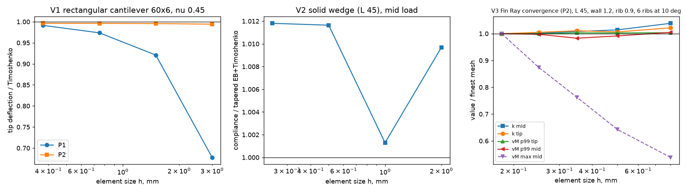
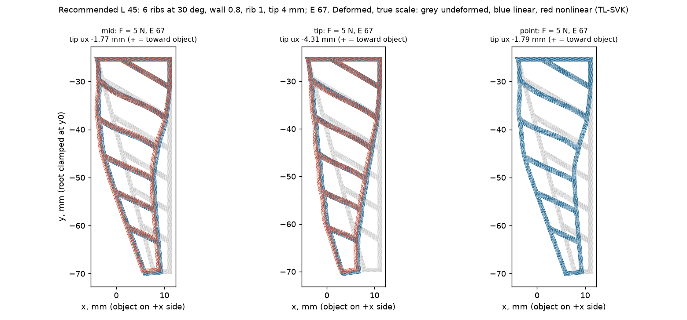
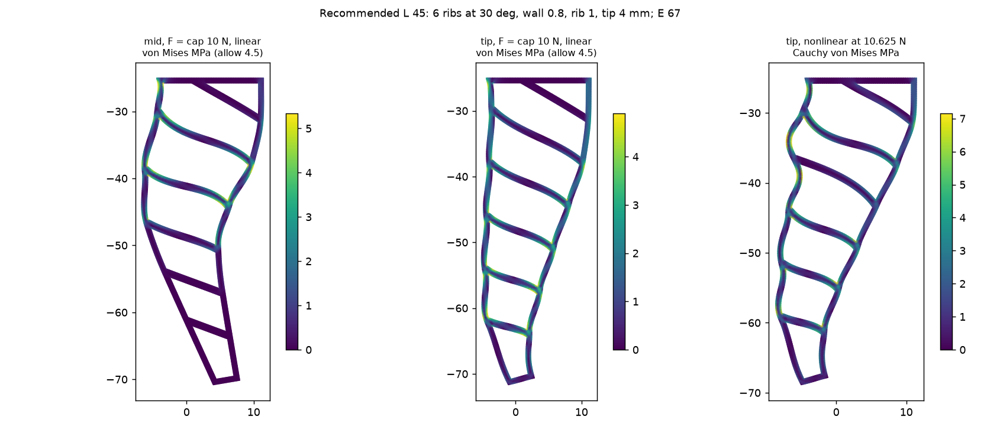
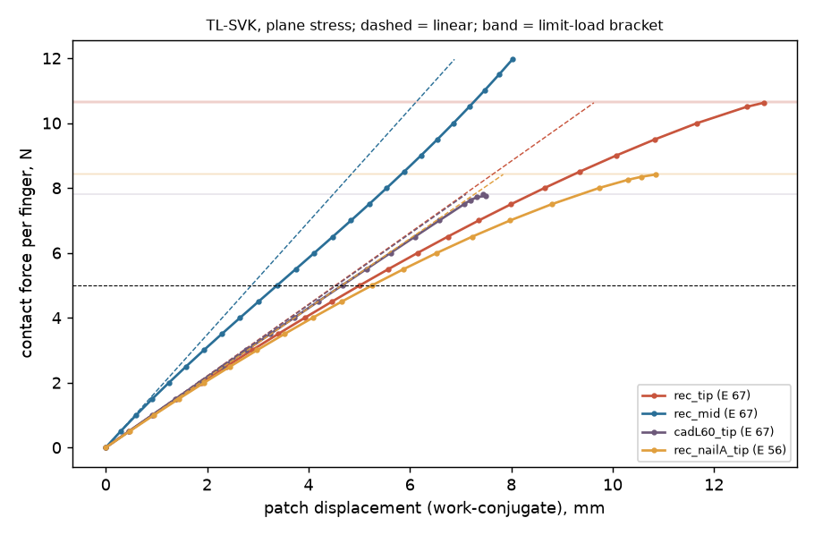
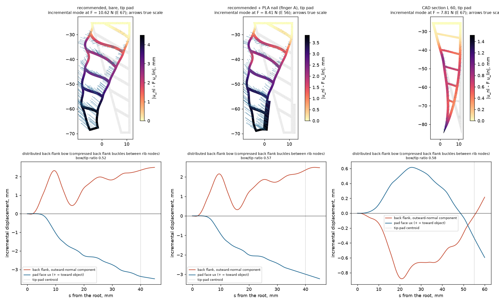
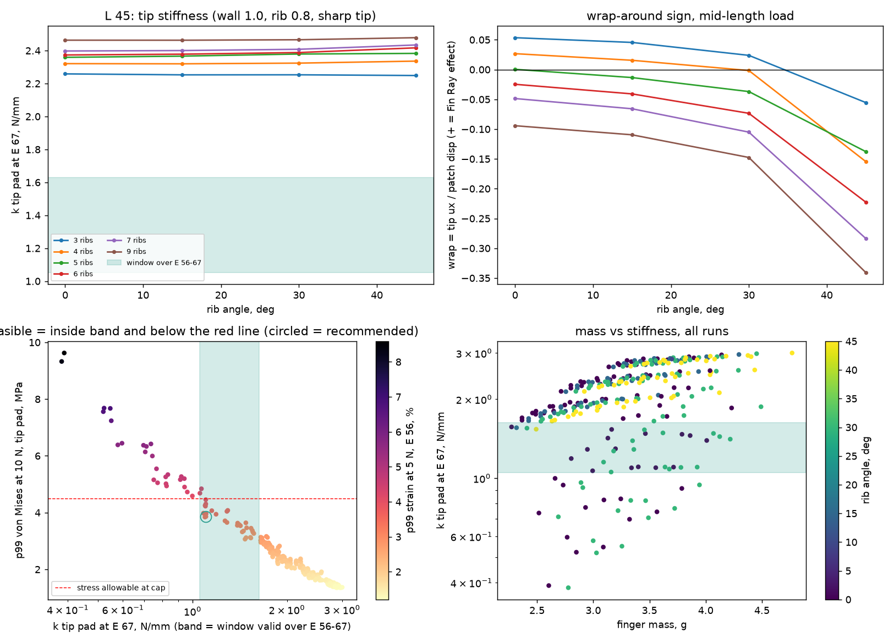
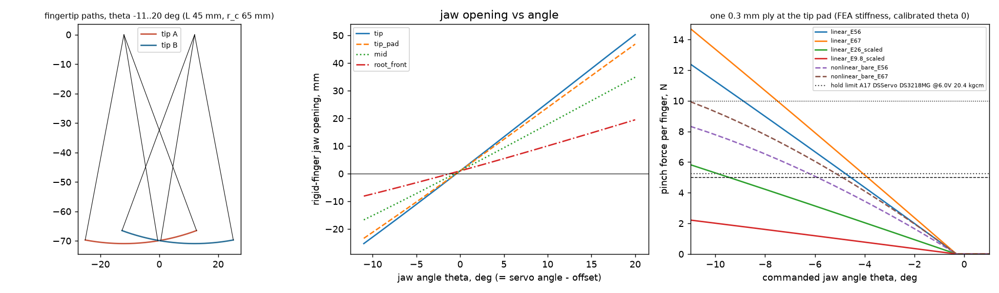

# Finger analysis: cantilever hand calcs, FEA, design sweep, jaw motion

Lane: finger stiffness, stress, fold limit, grip force and jaw motion for the cloth-feed gripper. Dated 2026-09-22. Governing inputs: `docs/gripper/DESIGN-BASIS.md` (D2, D3, D7, R12, R14-R18, section 4) through `cad/gripper/params.json`. Tags: **[S]** sourced, **[D]** derived by a script in this lane (run with inputs and outputs saved, section 8), **[A]** assumed.

## 1. Bottom line

1. **Recommended finger (L 45, r_c 65):** rib angle 30°, 6 ribs, wall 0.8 mm, rib 1.0 mm, blunt tip 4 mm wide. Mass 3.64 g bare [D]. k_tip 0.92 (E 56) to 1.10 (E 67) N/mm bare, and 1.07-1.29 N/mm with the D7 nail (A) or FSR backing (B). All of these sit inside the R12 window of 0.88-1.63 N/mm [D].
2. **Verdict: CONDITIONAL.** The linear window, stress and strain checks pass. PLA stress in the nail and backing is 8.1-8.4 MPa at the cap, against an LC2 allowable of 23.3 MPa [D]. The nonlinear check fails, though. **The finger folds at 8.88 N at E 56** (bisection bracket 8.88-8.92 N) [D]. That is above the 8 N FSR trip but **below the 10 N R15 cap**. In practice, only the 8 N FSR trip keeps the finger from folding.
3. **The mechanism is back-flank buckling, not a tip fold.** The compressed back flank bows outward by 2.3 mm between the root and the first rib, peaking at s = 9.6 mm (section 5.3) [D]. A hand Euler estimate for that same panel (s 4.3-11.9 mm) gives 3.0 N pinned and 12.0 N fixed, which brackets the FEA result [D]. **The PLA nail does not fix it.** With the nail, finger A folds *earlier*, at 8.41 N at E 56 [D].
4. **The CAD section is far too stiff at L 45.** Keeping 10°, 6 ribs, wall 1.2 and rib 0.9 at the governing L 45 gives k_tip 2.38-2.85 N/mm, which fails the window [D]. The earlier L 60 FEA reference was in the window (1.09 N/mm at E 67), but folded at 6.52 N at E 56; that historical geometry had r_c 80 mm. The current CAD params use L 45 and r_c 64.9 mm.
5. **θ_min = −11° does not cap the force for this finger. This conflicts with R15/R18 (section 6.3).** At θ_min the linear pinch is 12.4 N (E 56) and 14.7 N (E 67). The cap is reached at −8.7° (E 56) and −7.4° (E 67) [D]. **Recommended θ_min ≈ −7.4°**, which still leaves 2.9° of margin to reach the 5 N target at E 56 (−4.5°) [D].
6. **Servo force, using the governing DESIGN-BASIS convention T = 2·F·r_c/η:**
   - At r_c 65, the current params design-point DS3218MG at 6.5 V (21.08 kg·cm) held at 40 % of stall makes **5.41 N** at the tip pad [D]. It needs 7.80 kg·cm, i.e. 19.49 kg·cm stall.
   - The current CAD case in `finger_beam.json` also uses L 45 and r_c 65, giving the same tip force. At mid-length (r_c 47.5) it makes 7.40 N [D]. The output key `cad_L60` is retained for compatibility with the older FEA record.
7. **There is no Fin Ray wrap in the recommended finger.** Under a mid-length load the tip moves away from the object, with a wrap ratio of −0.61 [D]. 71 of the 289 sweep designs wrap; the best reaches +0.11, and all of them are 3-rib designs that fail the mid-length stress or the fold check [D]. For a one-ply tip pinch, wrap is not needed (section 6).

**Next step before printing:** add stiffness to the first back-flank panel only, either with a thicker back wall (1.0-1.2 mm on the back flank, keeping 0.8 on the pad face) or with an extra rib near the root. Then re-run the fold check. The closest screened design is 30°, 4 ribs, wall 1.0, rib 1.0, tip 4 at 3.68 g; it folds at 9.38 N [D]. The sweep varies both walls together, so the back-wall-only variant has not been run yet (section 7). The one screened design that holds 10 N is 45°, 3 ribs, 0.8/0.6, 2.49 g. It fails the mid-length stress check (5.9 against 4.5 MPa at the cap), and with the D7 parts it is too stiff (1.76-1.82 N/mm) [D].

## 2. Inputs

- **Owner of every input:** the `INPUTS` block at the top of `analysis/gripper/finger_beam.py`. `apply_overrides()` maps the `params.json` `grip` and `materials.allowables` values over it, and every output JSON records which values came from there. `finger_fea.py` imports this block.

| Input | Value | Tag |
|---|---|---|
| Finger length / tip pad | L 45 mm (D3/R17); tip-pad centroid 5 mm above the tip (s 40); r_c 65 mm | [D] DESIGN-BASIS |
| CAD section (current params) | W 16, depth 20, wall 1.2, rib 0.9, 6 ribs at 10°, L 45 (r_c 64.9 face measurement; 65 in the beam model) | [S] `params.json` finger |
| TPU 95A | **E 67 X-Y (nominal) / 56 Z (low)** MPa, ν 0.45, ρ 1.22 | [S] [Ultimaker TDS v5.00](https://um-support-files.ultimaker.com/materials/2.85mm/tds/TPU-95A/Ultimaker-TPU95A-TDS-v5.00.pdf); ν [A] |
| TPU sensitivity only | 26 MPa (NinjaTek Cheetah) and 9.8 MPa (Bambu TPU 95A HF) | [S] [Cheetah TDS](https://ninjatek.com/wp-content/uploads/Cheetah-TDS.pdf), [Bambu TDS](https://store.bblcdn.eu/s8/default/16df21baf482453999b3dbb61cc110e7/Bambu_TPU_95A_HF_Technical_Data_Sheet.pdf) |
| TPU limits | Strain ≤ 10 % at F_target (LC1); p99 von Mises ≤ 4.5 MPa at F_cap | [A] DESIGN-BASIS LC1; stress [A], near the flexural 4.1 MPa at 9.4 % [S] |
| PLA | E 2580 MPa; LC1 15.0 / LC2 23.3 MPa | [S]/[D] DESIGN-BASIS section 4 |
| Grip | F_target 5 N, F_cap 10 N, FSR trip 8 N, μ 0.4, one 0.3 mm ply, stiffness window 0.88-1.63 N/mm, θ ∈ [−11°, +20°] | [D]/[A] DESIGN-BASIS R12, R14, R15, R18, section 8 |
| Drive | η 0.85; T = 2·F·r_c/η (governing); hold 40 % of stall; current params design-point servo DS3218MG at 6.5 V, 21.08 kg·cm | [A]/[D] `params.json` grip.servo_design_point; DESIGN-BASIS D4 supersession |
| D7 parts | Nail on A: 1.0 × 12 mm PLA. FSR backing on B: 1.0 × 14 mm PLA | [A] |
| Contact patches | Tip pad 6 mm (the FSR puck); mid 10 mm at s = L/2 | [A] |
| θ = 0 | Rigid pads 1 mm apart after R21 CALIBRATE (backlash taken up, lag 0). Sensitivity: centred mesh, lag jt/2 = 0.68 mm at the pad | [A] |

## 3. Method

**Hand calcs (`finger_beam.py`):**
- **Solid wedge:** tapered Euler-Bernoulli plus Timoshenko.
- **Fin Ray as a two-flank truss:** sandwich chords, Vierendeel ribs, and the tapered-chord shear relief V_web = V − M·tanφ/c.
- **Other checks:** TPU root stresses; PLA arm and root plate; tapered PLA arm and VDI 2736 mesh compliance in series.
- **New: back-flank panel buckling.** The first compressed panel is treated as an Euler column between rib nodes, pinned (lower bound) or fixed (upper bound). The load on it is the chord force (a − s)/c/cosφ per N.
- **Drive:** force from torque, and overtravel 2·r_c·φ = F/k_pair + gap − ply + lag.

**FEA (`finger_fea.py`):**
- **Mesh and solve:** gmsh OCC mesh of the ported `gripper_concept.py` profile; scikit-fem **P2** triangles; plane stress with thickness = depth 20 mm; root line clamped.
- **Load cases:** patch pressure at the tip pad and at mid-length, plus a nodal point load.
- **D7 variants:** PLA strips bonded on the pad face as a two-material mesh.
- **Nonlinear:** total-Lagrangian St Venant-Kirchhoff, Newton, load control with step bisection down to 0.03-0.05 N, and rejection of branch jumps. Reported as a [last converged, smallest rejected] bracket.
- **Mechanism:** the incremental mode u_nl − F·u_lin at the limit load. Back-flank outward bow is compared with the tip's incremental motion; a ratio ≥ 0.5 is classed as back-flank buckling.
- **Sweep:** 289 linear runs at L 45 and E 67, scaled exactly to E 56 (stress does not depend on E for TPU alone):
  - rib angle 0/15/30/45°, 3-9 ribs, wall 0.8/1.0/1.2, rib 0.6/0.8/1.0, with a sharp tip;
  - blunt tips of 2 and 4 mm on a subset;
  - the CAD section.
- **Feasibility** = linear window, strain and stress, **then** a nonlinear tip-pad fold screen on the candidates. There are 9 candidates: the 5 lightest and the 5 stiffest linear-feasible designs, de-duplicated, at h 0.4-0.5.
  - **Pass:** limit at E 56 ≥ 10 N.
  - **Conditional:** limit ≥ 8 N (the FSR trip, 1.6 × F_target).
  - The chosen design must also pass the linear checks for both D7 variants at E 56 and E 67.

## 4. Validation



| Check | Result [D] |
|---|---|
| V1 rectangular cantilever 60 × 6 × 20, ν 0.45, E 67; Timoshenko 3.011 mm/N | **P2:** 0.9943, 0.9956, 0.9961, 0.9963 at h = 3, 1.5, 0.75, 0.375, i.e. converged 0.4 % stiff (clamped-face constraint). **P1:** 0.678, 0.921, 0.974, 0.991, i.e. 32 % too stiff at h 3 |
| V2 solid wedge, L 45, mid load, against tapered EB+Timoshenko | 1.010, 1.001, 1.012, 1.012 at h = 2, 1, 0.5, 0.25 (within 1.2 %) |
| V3 Fin Ray convergence, CAD section at L 45, h 0.8 → 0.18 (3.4 k → 49 k DOF) | k_mid 2.752 → 2.650; k_tip 2.877 → 2.816 (−0.5 % from h 0.25 to 0.18). p99 von Mises: mid 0.315, tip 0.141 MPa/N (converged). **Max** von Mises at mid 0.46 → 0.86 MPa/N: it diverges at the sharp corners, so decisions use p99 |
| P1 against P2 (CAD L 45, h 0.25) | k_mid 2.933 against 2.654 (P1 11 % stiff) |
| Plane-strain bound | k_mid 3.327 (+25 %). The true 20 mm-deep plate lies between [A] |
| Hand calc against FEA, CAD L 45, E 67 | Tip: truss 3.175 against FEA 2.829 N/mm (+12 %). Mid: truss 1.262 against 2.654 (the Vierendeel model is 52 % soft). Solid wedge tip 5.05 N/mm |
| Nonlinear screen mesh against fine mesh (recommended finger) | Limit at E 56: 8.93 N at h 0.5, 8.88 N at h 0.32 (−0.6 %) |
| Fold hand calc against FEA (recommended finger, E 56) | Euler bracket 3.0 (pinned) to 12.0 (fixed) N, critical panel s 4.3-11.9 mm; FEA 8.88 N with peak bow at s 9.6 mm |

Production mesh for the recommended finger: h 0.25 for linear (26.9 k DOF) and h 0.32 for nonlinear. The sweep uses h ≤ 0.35 (within 0.5 % of the finest-mesh k).

## 5. Results

### 5.1 Recommended finger, linear (per N; E 67)

| Load | k, N/mm | Tip ux per N (+ = toward object) | Wrap | p99 / max von Mises, MPa per N | p99 strain per N |
|---|---|---|---|---|---|
| Tip pad (s 40, 6 mm) | 1.101 (0.922 at E 56) | −0.861 | −0.95 | 0.386 / 0.888 | 0.57 % |
| Mid patch (s 22.5, 10 mm) | 1.738 | −0.354 | **−0.61** | 0.400 / 0.930 | 0.59 % |
| Point, s 22.5 | 1.50 at the node (log-singular) | −0.358 | | 0.440 / 1.00 | 0.65 % |

- **At the 10 N cap:** p99 von Mises is 3.86 MPa at the tip pad and 3.99 MPa at mid-length, against the 4.5 MPa allowable [D].
- **At 5 N, E 56:** p99 strain is 3.4 % (tip) and 3.6 % (mid), against the 10 % limit [D].
- **D7 variants at the cap:** TPU p99 is 3.55 MPa. PLA maximum is 8.07 MPa (nail) and 8.44 MPa (backing), against 23.3 MPa [D].
- **Hand calcs, L 45, CAD section, at the cap on the tip pad:** TPU chord 1.13 MPa. The PLA arm root is 5.55 MPa, or 8.32 MPa with Kt 1.5, against LC2 23.3 MPa. At LC1 it is 4.16 MPa with Kt, against 15.0 MPa. Arm and mesh add 2.8-3.4 % of the pair compliance [D].





### 5.2 Nonlinear (TL-SVK, tip pad unless stated)



Solved at E 67 and scaled exactly to other moduli: at fixed ν, the SVK force at a given displacement is linear in E. The nail case has PLA in it, so it is solved directly at E 56.

| Case | Limit at E 56 (bracket) [D] | At E 26 / 9.8 (sensitivity) | State at the last converged step |
|---|---|---|---|
| **Recommended, bare** | **8.88 N** (8.88-8.92) | 4.12 / 1.55 N | Patch displacement 13.0 mm at 10.6 N (E 67); p99 strain 8.3 %; J_min 0.88; no self-intersection |
| Recommended + PLA nail (finger A) | 8.41 N (8.41-8.44) | not scaled | Nail p99 6.6 MPa |
| Recommended, mid patch | ≥ 10 N (reached the cap, no fold) | ≥ 4.64 / 1.75 N | Secant k 1.48 N/mm, near linear (1.74) |
| CAD section, L 60 | 6.52 N (6.52-6.53) | 3.03 / 1.14 N | Matches the reviewer's bisected E 26 value (3.0 converged, 3.03 rejected) |

### 5.3 Fold mechanism



The incremental mode (nonlinear minus linear) at the limit load [D]:

- **Recommended, bare.** The back flank bows outward by +2.32 mm at s 9.6 mm, the root-to-first-rib panel. The tip's incremental motion is 4.50 mm. The ratio is 0.52, just above the 0.5 threshold, so this is classed as back-flank buckling. It is borderline: the tip also swings away from the object.
- **With the nail.** The bow peaks at s 37 mm (+2.17 mm; ratio 0.57). Stiffening the pad face moves the buckle down the back flank and lowers the limit load. **The nail does not fix the fold.**
- **CAD L 60.** The back flank bows inward, by −0.88 mm at s 21 mm; ratio 0.58.
- **Implication.** The limit is set by the compressed back flank. To raise it, shorten or thicken the back-flank panels: a thicker back wall, or one more rib near the root. A tip fillet or the nail will not raise it.
  - In the screen, rib 1.0 plus 4 ribs plus wall 1.0 gave 9.38 N.
  - Sharp-tip 3-rib designs at 0-30° fold at 1.5-3.6 N.

### 5.4 Design sweep (289 runs, L 45)



| Count [D] | |
|---|---|
| Runs / errors | 289 / 0 |
| Inside the stiffness window over E 56-67 | 32 |
| Linear-feasible (window + strain + p99 stress) | 30 (13 also pass the mid-length check) |
| Nonlinear screen: screened / ≥ 10 N / ≥ 8 N trip | 9 / 1 / 4 |

- **k_tip spans 0.38-3.00 N/mm at E 67.** Mass spans 2.27-4.77 g [D].
- **Most in-window designs have a blunt tip.** 28 of the 32 have a 2 or 4 mm blunt tip. At L 45 a sharp tip puts the pad on the solid wedge, which is too stiff unless the lattice is thin [D].
- **Screened candidates, limit at E 56** [D]:

| Design (angle / ribs / wall / rib / tip) | Mass, g | Limit at E 56 | Other result |
|---|---|---|---|
| 0 / 6 / 0.8 / 1.0 / 2 | 3.16 | 8.10 N | D7 too stiff |
| 30 / 6 / 0.8 / 1.0 / 2 | 3.46 | 6.79 N | |
| 30 / 4 / 1.2 / 0.6 / 2 | 3.62 | 7.52 N | |
| **30 / 6 / 0.8 / 1.0 / 4** | **3.64** | **8.93 N** | **chosen** |
| 30 / 4 / 1.0 / 1.0 / 4 | 3.68 | 9.38 N | |
| 0°, 15°, 30° / 3 / 0.8 / 0.6 / sharp | 2.27-2.41 | 3.60, 2.04, 1.53 N | |
| 45 / 3 / 0.8 / 0.6 / sharp | 2.49 | ≥ 10 N | Fails mid stress and the D7 window |

- **Why this set was chosen:** it is the lightest design that passes every linear check (bare and both D7 variants) and the 8 N trip. It is also the closest to the 1.0 N/mm default.

## 6. Gripper motion (`finger_motion.json`, recommended finger, r_c 65)



### 6.1 Opening

Rigid fingers, gap between the pad faces [D]:

| θ | Tip | Tip pad | Mid | Pad root |
|---|---|---|---|---|
| +20° (open maximum) | 50.3 mm | 46.9 mm | 34.9 mm | 19.5 mm |
| 0° | 1.0 | 1.0 | 1.0 | 1.0 |
| −7.4° (recommended θ_min) | −16.8 | −15.6 | −11.0 | −5.3 |
| −11° (R18 θ_min) | −25.3 | −23.4 | −16.7 | −8.1 |

A negative opening means rigid-body overlap, which the fingers take up as compression.

### 6.2 Pinch, one 0.3 mm ply at the tip pad

- **First touch:** −0.4° (calibrated) or −0.7° (centred lag) [D].
- **Pair stiffness:** finger A with the nail, finger B with the backing, plus arm and mesh compliance, gives k_pair 0.523 (E 56) and 0.621 (E 67) N/mm [D].

| | E 56 | E 67 | E 26 (sens.) | E 9.8 (sens.) |
|---|---|---|---|---|
| θ for 5 N, calibrated | −4.52° | −3.86° | −9.26° | −23.9° (outside the range) |
| θ for 10 N cap | −8.73° | −7.41° | −18.2° | — |
| Linear F at θ = −11° | 12.4 N | 14.7 N | 5.8 N | 2.2 N |
| Nonlinear bare-finger F at −11° | 8.33 N | 9.94 N | | |

- **With centred lag**, each angle moves about 0.3° more negative [D].
- **The nonlinear curve** stays converged over the whole range [−11°, 0] at both moduli [D]. In this sweep each finger's displacement is taken from the bare-finger tip curve. The D7-stiffened pair above uses the linear k.

### 6.3 Conflict with DESIGN-BASIS R15/R18 (filed here; DESIGN-BASIS not edited)

- **Conflict.** R15/D8 enforce the 10 N cap "by position (θ_min = −11°)". For this finger (L 45, k_tip 1.07-1.29 N/mm with the D7 parts) the linear pinch at −11° is 12.4-14.7 N [D].
- **Recommendation.** Set **θ_min = −7.4°**. That is the E 67 cap angle, the stiffer case, which reaches the cap first. It keeps 2.9° of margin to the E 56 target angle (−4.5°).
- **Otherwise.** Accept that only the 8 N FSR trip, backed by the 8.9 N fold, bounds the force. θ_min then no longer does that job.
- **Owner.** The owner of DESIGN-BASIS R15/R18 and `params.json` `grip.theta_min_deg` should decide.

### 6.4 Torque ceiling at the tip pad

Governing convention T = 2·F·r_c/η, 40 % of stall [D]:

| Servo | r_c 65 (design and current CAD beam model) | Lane convention T = F·r_c·(1+1/η), comparison only |
|---|---:|---:|
| DS3218MG at 6.5 V, 21.08 kg·cm (current design point) | **5.41 N** | 5.85 N |
| DS3218MG at 6.8 V, 21.5 kg·cm | 5.51 N | 5.96 N |
| A13 FS5115M-FB, 15.5 kg·cm | 3.98 N | 4.30 N |
| A12 FS5106B-FB, 6.0 kg·cm | 1.54 N | 1.66 N |

- **Torque for 5 N (governing convention):** 7.80 kg·cm at r_c 65, i.e. 19.49 kg·cm stall [D]. The lane convention gives 7.21 kg·cm, about 8 % less conservative.
- **The hold limit, not the finger, caps the steady grip.** The current design-point servo holds 5.41 N, above the 5 N target but below the 8 N trip. The fold limit (8.9 N) matters for transients and over-commands up to stall: the tip-pad force at stall is 13.52 N [D].
- **Pad tilt.** Tilt equals θ. The ejection limit is atan 0.4 = 21.8°, above the +20° open angle [D].
- **Servo angle** = θ + the horn offset (1:1; the horn is on A's shaft).

## 7. Limits

- **2D model.**
  - Plane stress is used; plane strain gives +25 %.
  - There is no self-contact, and loads are dead loads.
  - SVK is used up to about 8 % p99 strain at the fold.
  - The fold is a load-control limit point. Post-buckling and snap-through are not traced (no arc-length method).
- **Imperfections.** None are modelled. The buckling load of the printed part may be lower. Print a finger and measure it (DESIGN-BASIS M10, extended to 10 N).
- **Stress singularities.** Decisions use p99, because max von Mises is mesh-dependent at the sharp corners. Add 0.5 mm fillets at the rib-wall joints [A].
- **Material model.** Linear-elastic isotropic TPU. The E band 56-67 covers only the Z/X-Y anisotropy. Creep, hysteresis and perimeter porosity are ignored.
- **Screen coverage.** The fold screen covers 9 of the 30 linear-feasible designs. The sweep varies both walls together, so a back-wall-only thickening (the fix suggested by the mechanism) has not been run.
- **Nonlinear jaw curve.** It uses the bare-finger tip curve, not the D7 parts. Servo compliance, deadband and cloth compliance are not modelled.
- **Hand calcs.** The Vierendeel model is 52 % soft at mid-length. The buckling bracket (pinned/fixed) is a factor of 4 wide.

## 8. Reproduce

```
uv run --with numpy --with matplotlib python analysis/gripper/finger_beam.py > analysis/gripper/results/finger_beam_stdout.txt
uv run --with numpy --with matplotlib python analysis/gripper/finger_beam.py --check
uv run --with gmsh --with scikit-fem --with meshio --with numpy --with scipy --with matplotlib python analysis/gripper/finger_fea.py > analysis/gripper/results/fea_stdout.txt
uv run --with gmsh --with scikit-fem --with meshio --with numpy --with scipy --with matplotlib python analysis/gripper/finger_fea.py --motion-only > analysis/gripper/results/fea_motion_stdout.txt
```

- **Run.** This document comes from one full default run on 2026-09-22 (no `--quick`, no `--limit`). The FEA took 914 s: sweep 150 s, nonlinear screen 220 s, fine nonlinear 510 s. `--motion-only` re-runs step 6 from the saved `fea_summary.json`.
- **Timestamps.** JSON, PNG and stdout agree. The hand calcs are from 22:57. The FEA outputs are from 23:17, except `fea_validation.png`, written at 23:02 early in the same run.
- **Outputs** in `analysis/gripper/results/`:
  - `finger_beam.json`, `finger_beam_stdout.txt`
  - `fea_summary.json`, `fea_sweep.json` (all 289 rows, screened candidates, D7 variants, `nonlinear_check`)
  - `finger_motion.json` (`R15_theta_min_check`, `nonlinear_fold_check`)
  - `fea_stdout.txt`, `fea_motion_stdout.txt`
- **Viewer exports** (nodes, triangles, displacement and von Mises; the nonlinear files also carry Green-Lagrange strain), **0.98 MB total**:
  - `fea_mid.json`, `fea_tip.json`, `fea_point.json` (linear, per 1 N at E 67)
  - `fea_mid_nl_cap.json` and `fea_tip_nl_cap.json` (last converged nonlinear states: mid at 11.96 N and tip at 10.63 N, both at E 67)
- **Figures** in `docs/gripper/figures/`: `finger_beam.png`, `fea_validation.png`, `fea_deformed.png`, `fea_stress.png`, `fea_nonlinear.png`, `fea_nl_mode.png`, `fea_sweep.png`, `finger_motion.png`.
